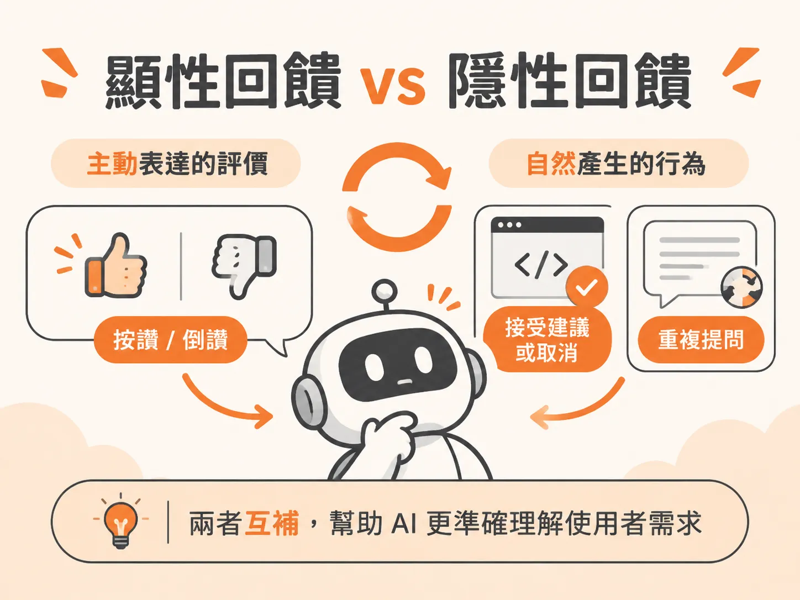

# Explicit vs Implicit Feedback

## A 是什麼

A 是「顯性回饋」（Explicit Feedback）。

顯性回饋是使用者刻意且主動留下的評價。最常見的形式，就是聊天介面上的按「讚」（thumbs up）與「倒讚」（thumbs down）。它的特點是訊號非常直觀，但需要使用者停下手邊的動作，特地花時間點擊按鈕。

## B 是什麼

B 是「隱性回饋」（Implicit Feedback）。

隱性回饋是使用者在正常操作系統時，自然流露出來的行為訊號。使用者不需要額外填寫問卷或評分，系統只要觀察他們「怎麼做」，就能推敲出結果好不好。

來源中有兩個典型的例子：
* **程式碼編輯工具（如 Cursor）**：模型產生程式碼建議後，開發者是選擇「按下接受」、「直接取消」，還是後續真的有把這段程式碼送出審查（Pull Request）。如果使用者沒有接受建議，就代表這次的產出不夠好。
* **客服聊天機器人**：如果使用者連續兩次問幾乎一模一樣的問題，甚至說出「我還是聽不懂，請解釋清楚一點」，這段對話行為本身就說明了前一次的回應不及格。

## 關鍵差異

* **收集方式不同**：顯性回饋需要使用者「主動告訴你」，如果使用者不點按鈕，你就拿不到資料；隱性回饋則是從使用者的「日常行為」中直接觀察。
* **資料規模不同**：大部分使用者不會主動按讚或倒讚，因此顯性回饋的數量通常較少；隱性回饋伴隨操作產生，就算只有一到兩成的互動留下操作軌跡，每天累積下來的資料量依然非常龐大。
* **訊號本質不同**：按讚或倒讚是直接的滿意度分數；接受、放棄或重複詢問則是真實工作流程中的動作，能更具體反映系統產出是否真的有用。

## 何時用哪個

在打造 AI 產品的初期，團隊就應該把這兩種回饋一併設計進系統裡，兩者互為補充：

* **使用顯性回饋的時機**：需要快速、直接取得使用者的滿意度標籤時。例如在聊天機器人的每條回答下方放按鈕，讓想表達意見的使用者能一鍵回饋。
* **使用隱性回饋的時機**：想在大規模使用下持續抓出失敗案例，而且不希望打擾使用者時。你可以分析使用者的操作流程，只要發現取消、修改或重複提問，就能自動抓出有問題的產出。

## 進階

隱性回饋不只能用來統計滿意度，還能直接變成自動化改善系統的原料。

在線上系統中，研發團隊可以透過追蹤紀錄（trace）自動監控使用者的互動歷程。一旦系統偵測到隱性失敗訊號（例如使用者重複問了兩次相同的問題），就可以把這筆對話軌跡自動標記出來，存入評測資料庫。這些來自真實使用者的失敗樣本，能直接提供給工程團隊進行提示詞（prompt）優化或模型微調，讓評測系統形成持續迭代的閉環。
