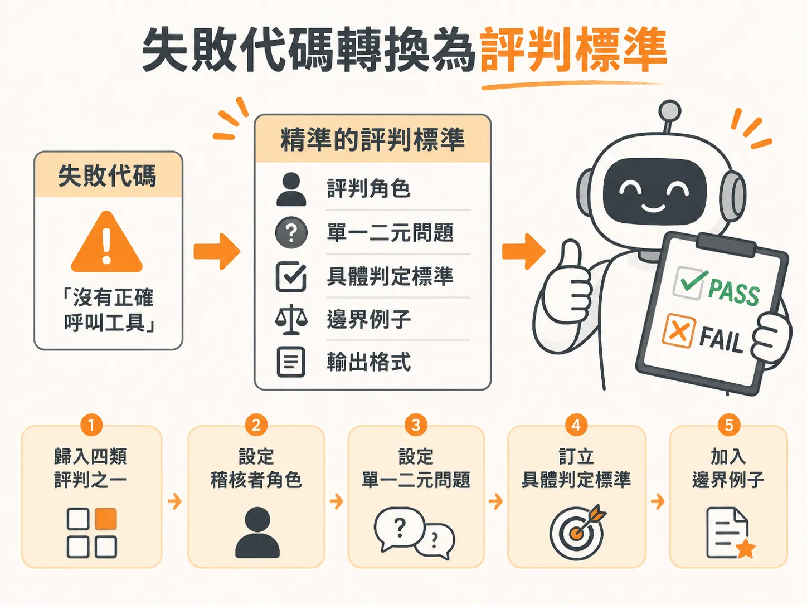

# Failure Code to Rubric

## 問題

當團隊評估 AI 客服或任務型助理時，最常見的錯誤是寫出籠統的評分要求。例如要求評判模型「用 1 到 5 分評估回應的幫助程度、準確度與語氣」。

這種做法會把多個標準混雜在一起。一旦系統拿到低分，開發團隊完全無法確認是哪裡出錯，也就不知道該修改檢索資料庫、調整提示詞，還是修正工具呼叫。

## 前置條件

在開始將失敗代碼（failure code）轉換為評判標準（rubric）之前，你需要準備好兩件事：

* 系統在測試或實際運作中記錄到的具體失敗代碼，例如「陳舊知識」或「錯誤操作」。
* 包含使用者輸入與助理回應的對話紀錄或執行軌跡（Trace）。這裡不需要事先準備標準答案，只要有實際對話紀錄即可開始。

## 步驟

把一條失敗代碼轉換成精準的評估提示詞，請依序執行以下步驟：

1. **歸入四類評判之一**：將失敗代碼對應到合適的檢查維度。常見維度包括「語氣與風格」（是否具同理心）、「事實正確性」（抓取幻覺）、「指令遵循」（是否遵守公司政策）或「任務完成度」（工具呼叫與步驟是否完整）。
2. **設定稽核者角色**：在提示詞開頭指派身分，明確要求評判模型負責審查挑錯，而不是繼續回答使用者的問題。
3. **設定單一二元問題**：只問一個二選一的是非題，只針對單一維度檢查，避免詢問複合問題或使用 1 到 5 分的量表。
4. **訂立具體判定標準**：分別寫清楚怎樣算通過（PASS）、怎樣算失敗（FAIL）。如果流程規定必須查詢內部知識庫，就算模型碰巧猜對答案但沒有調用資料庫，也必須判定為 FAIL。
5. **加入邊界例子**：把最容易產生爭議的情況寫進標準裡，直接指明這類灰色地帶該算 PASS 還是 FAIL。
6. **限制輸出格式**：要求評判模型先寫出一到兩句推導理由，最後再單獨輸出一行 PASS 或 FAIL，確保思考過程透明且容易被程式讀取。

## 例子

以處理訂單的任務型助理為例，若要檢查「沒有正確呼叫工具」這條失敗代碼，可以建立如下的五元素評判：

* **稽核者角色**：你正在稽核一段使用者與客服 Agent 之間的對話紀錄。
* **單一二元問題**：每一個需要呼叫工具的輪次，Agent 是否都有呼叫工具？
* **具體判定標準**：
  * PASS：所有需要工具的輪次都成功發出工具呼叫；單純用文字回答說明原因則可接受。
  * FAIL：只要有任何一輪需要工具，但 Agent 僅用文字回應，即判定為 FAIL。
* **邊界例子**：若使用者抗議後 Agent 才補呼叫工具，不能算作合格，依然判定為 FAIL。
* **輸出格式**：先寫一到兩句推導理由，最後單獨一行輸出 PASS 或 FAIL。

## 失敗模式

建立與執行評判時，常見的失敗模式有以下幾種：

* **標準混雜**：在同一個評判中同時檢查語氣和事實正確性，導致結果失敗時無法定位原因。
* **分數定義模糊**：使用量表評分（如 1 到 10 分），造成人類與模型無法釐清相近分數之間的具體界線。
* **因結果正確而放行錯誤流程**：助理碰巧回答正確，但檢索流程根本沒有調用內部資料庫。如果因此判定 PASS，會掩蓋檢索系統失靈的缺陷。
* **缺少邊界案例**：沒有事先寫明補救行為或模糊情況的判定規則，導致評判模型給出隨機或不一致的結論。

## 進階

當單一判準建立完成並準備大規模執行時，可以採取以下進階作法提升效率與信度：

* **分開生成與評判模型**：負責產生回應的模型不可拿來評估自己，否則容易產生偏見而給出過於寬鬆的判斷。
* **人機校準**：先由人類專家標註一組樣本，再與評判模型的結果比對，計算一致性指標（如 Cohen's Kappa），目標通常設定在 90% 以上。
* **混合大小模型降低成本**：複雜推理任務使用大型模型，而像身分驗證這類規則明確的日常任務，可改用微調過的 7B 小型模型搭配程式規則來評估。
* **避免濫用委員會機制**：多個模型組成的評判委員會成本極高，除了法律等極端敏感領域外，絕大多數場景使用單一評判模型即可。
