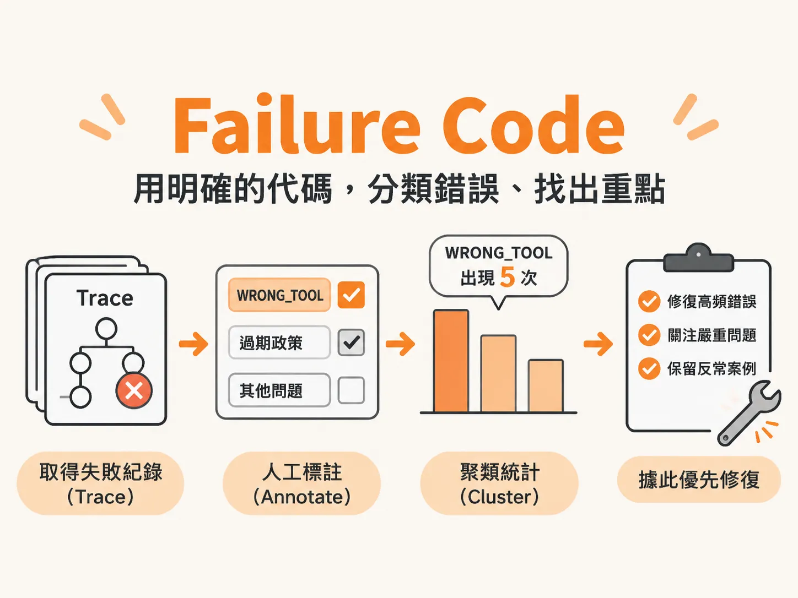

# Failure Code

## 定義

Failure Code（失敗代碼）就是幫「錯誤」取一個固定名字的標籤。

想像你是一間餐廳的經理，客人抱怨了一百次。如果你只記下「服務不好」「感覺很怪」這種模糊評語，永遠不知道該先修什麼。但如果你把抱怨分類成「上菜太慢：40 次」「算錯錢：25 次」，事情就清楚了。

Failure Code 做的就是這件事：把一條條失敗的紀錄，聚類（Bucket）成一個個有名字、可以數次數的代碼。例如：

- `WRONG_TOOL`：Agent 是否針對使用者的請求呼叫了錯誤的工具？
- `REFUND_POLICY_MISQUOTE`：退款決策是否違背了明文規定的退款政策？

這裡的 Agent 指的是會自己呼叫工具、做決策的 AI 系統。每一次 Agent 的完整執行過程會被記錄成一條 Trace（軌跡），Failure Code 就是描述這條軌跡「錯在哪裡」的標籤。

## 為什麼重要

因為模糊的評語沒辦法被統計，也就沒辦法排優先級。

如果每個人只用「模型回答不太好」這種話來描述錯誤，錯誤就會淪為一個個無法統計的意見。團隊看到一百筆失敗，卻說不出哪一種錯最多、哪一種最傷，修復順序只能靠猜。

反過來，一旦有了可數的代碼，你就能說出「`WRONG_TOOL` 在 8 次測試中出現了 5 次」這種量化數據。數據會直接轉化為決策：先修出現最頻繁、傷害最大的那個。

這在真實世界特別關鍵。剛推出產品時，錯誤數量往往非常龐大，連 Anthropic 這樣的頂尖團隊，GitHub 上都可能隨時有八、九萬個未解決的問題。不可能全修，必須挑。Failure Code 就是讓「挑」有依據的工具。

## 如何運作

建立 Failure Code 的標準流程分三步：取得 Trace（Source）、人工標註（Annotate）、聚類歸納（Cluster）。

**第一步：檢視與標註 Trace。** 收集測試環境或正式環境中的失敗 Trace（例如 30 筆輸入範例），可以用瀏覽器開啟單一 HTML 的輕量 Trace Viewer，上傳 OpenTelemetry（OTel）格式的 JSON 檔案，展開帶有執行時間長度條的 Span 樹狀結構，查看完整決策細節，再逐一標註通過或失敗。親自花 20 分鐘肉眼逐筆看過非常關鍵——略過手動這步，就很難建立對失敗原因的直覺。

**第二步：聚類成二元 Code 並統計。** 把所有失敗 Trace 的行為聚類成 5 個以上的二元 Code，每個 Code 寫成一句「是 / 否」判斷句加上一行簡短定義。然後計算每種 Code 出現的次數。因為一次失敗可能同時觸發多種問題，各 Code 的次數加總可以超過樣本總數（非互斥）。

**第三步：對齊品質維度。** 把每個 Code 對應到六大品質維度之一：模型品質、產品行為、安全性、可靠性、成本、延遲。最後挑出發生頻率最高的前三名作為修復重點，並保留一個目前無法解釋的反常失敗（Unexplained Anomaly），這種看不懂的案例往往藏著系統未知的盲點。

整個過程中，每個 Code 都要符合四項特徵：

1. **名稱固定（Named）**：團隊所有人稱呼同一個錯誤時，都用同一個代碼。
2. **二元判斷（Binary）**：只有符合或不符合，不要設計成 1 到 5 分的模糊級距。
3. **具體明確（Specific）**：兩位不同的人檢視同一個 Trace，要能給出完全一致的標註。
4. **可量化計數（Countable）**：每個 Code 都能統計出現次數與頻率。

## 例子

以 Coding Agent 的 8 個工作階段（Sessions）為例，標註統計後的結果長這樣：

| Failure Code | 出現頻率 |
| :--- | :--- |
| Unverified Status Reporting（未經驗證便回報狀態） | 5 / 8 |
| Weak Preview Test Coverage（預覽測試覆蓋不足） | 5 / 8 |
| Stale Domain Terminology（使用過時的領域術語） | 3 / 8 |
| Poor Identifier Naming（識別碼命名不佳） | 3 / 8 |
| Spec Quality Issue（規格品質問題） | 3 / 8 |
| Wrong Mechanism for Job（選用錯誤的實作機制） | 3 / 8 |
| Acted Before Diagnosing（未診斷就直接行動） | 3 / 8 |
| Unwarranted Default Override（無正當理由覆蓋預設值） | 2 / 8 |
| System Internals Misunderstood（誤解系統內部運作） | 2 / 8 |
| Missed Existing Asset（遺漏已存在的資源） | 1 / 8 |

看到這張表，修復順序立刻浮現：先處理「未經驗證便回報狀態」和「預覽測試覆蓋不足」這兩個 5/8 的高頻問題。

電商客服 Agent 的例子也一樣：8 個失敗對話中有 5 個引用了過期政策，直接導致向顧客超收費用。這種嚴重又高頻的錯誤（Bad Refund Scenario，誤判退款條件造成金錢損失）必須第一時間修復；相比之下，回答稍微冗長（Too Verbose）這種低影響問題可以往後排，甚至暫時不處理。

## 邊界與常見誤解

**誤解一：用量表打分就好，何必用二元代碼？**
量表（例如 1 到 5 分）的問題是標準模糊，兩個標註者對同一個 Trace 可能給出不同分數。二元代碼強迫定義變得具體，讓不同人標註結果一致。這是四項特徵裡「二元」和「具體」存在的理由。

**誤解二：以為一次失敗只能歸一類。**
一次失敗的 Trace 可能同時觸發多種問題，所以各 Code 的次數加總可以超過樣本總數。代碼之間不是互斥的。

**誤解三：跳過人工標註，直接寫自動化判斷。**
在寫出任何自動化評判器（Judge）之前，必須先有人工歸納出的分類法。因為機器判斷的標準，就來自你親手看過、標過的那些 Trace。

**誤解四：只看最終輸出就夠了。**
Agent 的錯誤多半是語意與流程層級的。例如「答非所問」的回答可能通過所有事實準確度檢查——內容完全正確，但回答了錯誤的問題（Wrong Intent）。只盯著最終答案，會漏掉這種失敗；必須看完整 Trace 裡的工具呼叫與決策過程。

**還有一個常見的盲點：指標漂亮不代表產品沒事。** 儀表板顯示準確率 92%、指標全綠，客服端卻可能傳來真人轉接率暴增的消息。Failure Code 幫你把注意力從單一分數，拉回到具體的失敗行為上。

## 進階

**頻率 × 嚴重度排優先級。** 有了代碼和次數，修復順序看兩件事：嚴重程度（爆炸半徑與商業成本）與發生頻率。頻率最高的前三名失敗模式是修復重點，但嚴重程度可以讓一個低頻錯誤跳到最前面——例如超收費用的錯誤，即使只出現幾次也必須馬上修。

**保留反常案例。** 除了前三名，務必保留一個當下無法合理解釋的反常失敗（Unexplained Anomaly），並記下它的 Trace ID。例如同一個退款請求執行三次，查詢訂單的工具呼叫次數分別是 3 次、7 次與 12 次——同樣輸入產生差異極大的路徑，系統卻沒報錯、沒警報。這種異常是後續迭代測試與優化評估的重要種子。

**分類法是團隊資產，也是說服工具。** 一份可交接的失敗分類法（Failure Taxonomy），定義要明確到其他團隊成員能一致套用。而且扎實的評估數據不只拿來修錯誤：業務和行銷團隊可以直接引用這些數據向客戶證明產品價值，讓工程開發與商業目標接軌。
