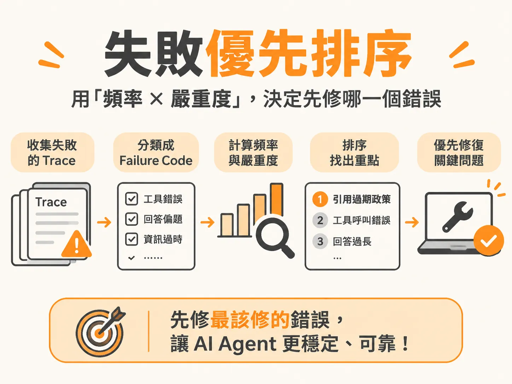

# Failure Prioritization

## 問題

想像你家的水塔破了一個洞，家裡到處在漏水：廚房在滴、浴室在噴、天花板也在滲水。你只有一雙手，不可能同時堵住所有地方。你會先堵噴得最兇、淹壞地板的那個，對吧？

做 AI Agent（會自己呼叫工具完成任務的 AI 系統）也一樣。上線之後錯誤會一口氣冒出來，多到修不完。就像 Anthropic 這樣的頂尖團隊，GitHub 上也隨時掛著八、九萬個未解決的問題。現實是：不可能全修，有些錯誤甚至不值得修。

所以真正的問題不是「找出所有錯誤」，而是「決定先修哪一個」。如果每個人只用「模型回答不太好」這種模糊的感覺來描述錯誤，錯誤就會變成無法統計的意見，團隊永遠吵不出要先修什麼。

Failure Prioritization 就是一套方法：把失敗整理成可以數的代碼，再用「頻率 × 嚴重度」排出修復順序。

## 前置條件

開始排序之前，你手上必須先有這些東西：

- **失敗的 Trace**。Trace 是 Agent 完整的活動軌跡，記錄了它呼叫了哪些工具、輸入輸出是什麼、每一步花了多久。只看對話記錄不夠，因為 Agent 的錯誤常常藏在工具呼叫的過程裡。
- **人工標註的結果**。親自花時間（例如 20 分鐘）逐筆看過 Trace，標出通過或失敗，並寫下筆記。略過這一步，你會對系統到底怎麼壞的沒有直覺。
- **聚類好的 Failure Code**。Failure Code 是幫失敗行為取的名字，像是 `WRONG_TOOL`（Agent 呼叫了錯的工具）。好的 Code 要符合四個條件：
  1. 名稱固定：大家都用同一個詞稱呼同一個錯誤。
  2. 二元判斷：只有「符合／不符合」，不要設計成 1 到 5 分的模糊級距。
  3. 具體明確：兩個不同的人看同一條 Trace，會得出同一個結論。
  4. 可量化計數：能統計出現次數。

沒有這些前置條件，排序就只是猜測。

## 步驟

1. **標註 Trace**：收集失敗的 Trace（例如 30 筆測試案例），用 Trace Viewer 之類的工具展開每條軌跡，逐筆標註通過或失敗，附上備註後匯出成 JSON 或 CSV。

2. **聚類成二元 Code 並統計頻率**：重新檢視所有失敗的 Trace，把相似的行為歸成一類，整理出至少 5 個具名的二元 Code。每個 Code 寫成一句「是／否」判斷句加上一行定義。然後數出每種 Code 出現幾次。注意：一次失敗可能同時踩到好幾種問題，所以各 Code 的次數加總可以超過樣本總數。

3. **對齊品質維度**：把每個 Code 歸到六大品質維度之一——模型品質、產品行為、安全性、可靠性、成本、延遲。這樣團隊才能全盤看出問題分布在哪。

4. **用「頻率 × 嚴重度」排序**：頻率是這個錯誤出現幾次；嚴重度看兩件事——爆炸半徑（影響多大）和商業成本（賠多少錢）。兩者都高的排最前面。頻率高代表它反覆發生，嚴重度高代表它對使用者傷害最大，這種錯誤最該優先建立評估並修復。

5. **撰寫摘要並保留異常**：列出前三大失敗模式，說明該先修哪一項。同時務必保留一個目前解釋不了的奇怪案例，記下它的 Trace ID，當作後續研究的種子。

## 例子

以電商客服 Agent 為例，儀表板顯示模型準確率 92%、指標全綠，客服端卻傳來真人轉接率暴增兩倍的消息。

深入檢視 8 個失敗的對話工作階段後，團隊歸納出各種 Failure Code 的出現頻率，例如：

| Failure Code | 出現頻率 |
| :--- | :--- |
| Unverified Status Reporting（未經驗證便回報狀態） | 5 / 8 |
| Weak Preview Test Coverage（預覽測試覆蓋不足） | 5 / 8 |
| Stale Domain Terminology（使用過時的領域術語） | 3 / 8 |
| Missed Existing Asset（遺漏已存在的資源） | 1 / 8 |

其中「引用過期政策」這一項，在 8 個失敗案例中出現了 5 次，還直接導致向顧客超收費用。頻率高（5/8）、嚴重度也高（超收錢、損失顧客信任），所以它是第一優先修復項，也是團隊應該建立的第一個評估器。

反過來，「回答稍微冗長（Too Verbose）」這類問題，影響小、不傷錢包，就往後排，甚至暫時不處理。

還有一個重要的發現：同一個退款請求執行三次，查詢訂單的工具呼叫次數分別是 3 次、7 次和 12 次。同樣的輸入，執行路徑卻差很多，系統又沒有報錯。這就是前面說的「保留異常」——它的 Trace ID 要先存好，留給之後深入研究。

## 失敗模式

做 Failure Prioritization 時，常見的失敗方式有這幾種：

- **只盯單一指標**：只看事實準確度（Accuracy）這種總體數字。模型可能講出百分之百正確的事實，卻完全答非所問，使用者照樣生氣、照樣要求轉接真人。指標漂亮不代表產品沒問題。
- **用模糊評語代替代碼**：如果只寫「感覺答非所問」，錯誤就無法統計，也就無法算頻率、無法排序。
- **用量表打分**：把錯誤分成 1 到 5 分，兩個標註者很容易給出不同分數。二元代碼（是／否）才能讓大家的判斷一致。
- **跳過人工閱讀**：沒有先親眼看過 Trace 就想自動化，寫出來的評判器（Judge）抓不到真正的失敗模式。原則是「先人工研讀，再自動化」。
- **只看最終輸出**：只瀏覽模型最後說了什麼，會漏掉藏在工具呼叫和佇列等待裡的延遲問題，也會漏掉多輪對話才會出現的失敗。
- **把異常丟掉**：看不懂的案例不是垃圾，是未來的教材。刪掉它就等於丟掉了發現系統盲點的機會。

## 進階

排序的成果不只拿來修 bug，還要能交到別人手上。一份可交接的失敗分類法要符合這些標準：

- 30 筆測試案例都經過完整人工標註，不是只瞄一眼最終產出。
- 至少 5 個具名的二元 Code，定義清楚到其他團隊成員也能一致套用。
- 每個 Code 都有頻率統計，並歸類到六大維度之一。
- 摘要點出 3 個關鍵發現與 1 個未解異常，附上具體的 Trace ID。

再往商業端延伸，這套評估數據還能變成團隊的說服工具。業務和行銷面對客戶詢問時，可以引用扎實的評估結果證明產品價值——這就是所謂的 Eval-driven PRD（以評估為導向的產品定義）與 Eval-driven GTM（以評估為導向的市場策略）。同一批軌跡分析，修完 bug 之後還能直接餵給市場團隊使用。
