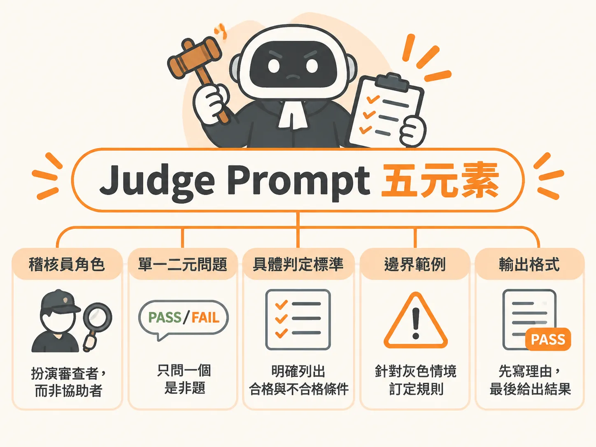

# Judge Prompt Five Elements



## 定義

Judge Prompt Five Elements 是設計大型語言模型裁判（LLM as a Judge）提示詞時，必須具備的五個核心積木：

1. **稽核員角色（Auditor role）**：指派模型擔任客觀審查者，而不是提供協助的聊天助理。
2. **單一二元問題（Single binary question）**：只問一個非黑即白的是非題（PASS 或 FAIL）。
3. **具體判定標準（Concrete standard）**：詳細條列合格與不合格的白紙黑字條件。
4. **邊界範例（Boundary example）**：針對最容易引發爭議的灰色情境定出硬性規則。
5. **輸出格式（Output format）**：限制模型先寫推導理由，最後再輸出 PASS 或 FAIL。

## 為什麼重要

當我們想用模型來評估另一個 AI 的表現時，傳統的字串比對工具（如 Exact Match 或 BLEU）只能看字詞是否重疊，完全抓不出事實捏造或語氣失當。

很多人直覺會寫一個提示詞，叫模型「從 1 到 5 分評估回答的正確性、完整性與語氣」。這種作法極不可靠，因為分數通常會全部擠在 3 到 5 分之間，而且多個維度混在一起，扣分時工程師根本不知道是語氣不好還是內容說謊。

五元素架構把籠統的主觀打分，拆解成結構分明、一次只抓一件事的二元檢查，讓評估結果清晰而且可以追查原因。

## 如何運作

五個元素各自防堵了一種常見的誤判漏洞：

- **稽核員角色（防止身分混淆）**：一般模型習慣順著對話幫忙解決問題。如果不嚴格規定它是「稽核員」，它常會忘記自己在打分數，反而跳下去替使用者回答，甚至同理被評估的對象而放水。
- **單一二元問題（防止標準污染）**：一次只問一個問題，例如「資訊是否正確？」。這能避免正確性、語氣與工具呼叫互相干擾，也不會出現模稜兩可的中間分數。
- **具體判定標準（防止自由心證）**：把 PASS 與 FAIL 的條件逐條寫死，防止模型用自己的偏好隨機裁量。
- **邊界範例（防止偽合格）**：特別針對容易鑽漏洞的情境建立規則。例如被使用者抗議之後才補救，依然算作失敗。
- **輸出格式（防止黑盒子衝動判斷）**：要求模型「先寫一兩句理由，最後再給判定單詞」。強迫模型先梳理事實，可以提升準確度；如果評審判錯，工程師也能看懂理由並著手修改提示詞。

## 例子

以下是一個用來檢查客服助理是否確實執行工具呼叫的提示詞範例：

<!-- derived -->
```markdown
ROLE:
你正在稽核一段使用者與客服助理之間的對話紀錄。你的任務是評估，不是協助回答。

QUESTION:
每一個需要呼叫工具的輪次，都有確實觸發工具呼叫嗎？

PASS:
所有需要呼叫工具的輪次都確實送出了工具呼叫。
若使用者詢問「為什麼」或「如何做」的問題，客服以純文字回答屬於正常情況，視為 PASS。

FAIL:
任何需要呼叫工具的輪次中，客服僅以純文字回覆而未呼叫工具。

BOUNDARY EXAMPLE:
使用者提出質疑或追問後，客服才在下一輪補呼叫工具，不能抵消前一輪的遺漏，依然判定為 FAIL。

OUTPUT:
請先用一到兩句話說明你的判斷理由，最後換行輸出單一個詞：PASS 或 FAIL。
```

## 邊界與常見誤解

- **一個 Judge 同時量多個項目**：很多人想在同一份提示詞裡同時檢查事實、語氣和格式。當分數下滑時，這會讓團隊無法歸因問題。正確作法是拆成多個獨立 Judge，一人只管一個維度。
- **沒有標準答案就不能評估**：評估對話行為（如是否遵守安全政策、有沒有呼叫工具）不需要預先寫好的標準答案，只要對話紀錄本身和清晰的標準就能執行。
- **答對了就應該算 PASS**：若系統規定回答必須查閱內部知識庫，即使模型碰巧猜對答案，但紀錄顯示它沒有查資料，依然必須判為 FAIL。因為檢索流程失靈代表系統存在風險，不能因為僥倖答對而忽視流程缺陷。

## 進階

- **規則明確時優先使用程式碼**：若檢查邏輯能用程式碼寫死（如欄位是否存在、字串精準比對），務必用腳本檢查。程式碼速度快、費用微乎其微且結果絕不浮動；LLM 裁判則存在 10% 到 30% 的漂移浮動與額外花費，只應在需要語意判斷時使用。
- **評審模型與生成模型不可相同**：產生回答的模型不該自己評估自己。模型往往對自己的輸出有盲點與寬容偏見，評審應改用另一家廠商的模型。
- **永遠進行人機校準（Alignment）**：未經人工標註驗證的 Judge 絕不能直接上線。標準流程是先準備數十筆由人類標記的正反樣本，計算模型與人類判定的一致性（如達到 85% 到 90% 以上）。若有一致性落差，就回頭補齊標準或新增邊界範例。
