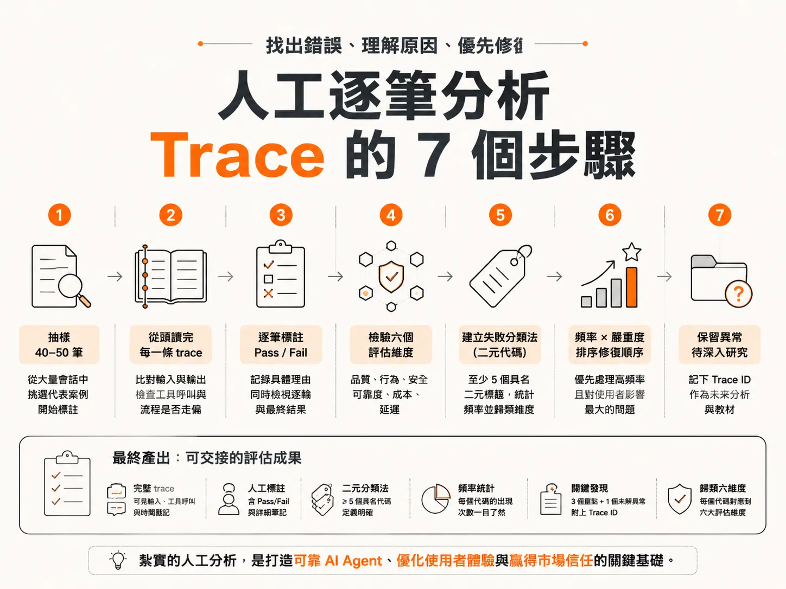

# Manual Trace Error Analysis

## 問題

你的 AI Agent 看起來很正常：儀表板顯示準確率 92%，指標全亮綠燈。但客服端卻回報真人轉接率暴增兩倍，社群平台上充斥使用者抱怨。

為什麼會這樣？因為大家只看終端機輸出的 log，或是只看模型最後給使用者的回覆。回覆看起來客氣通順，就以為系統運作正常。但實際上，底層可能調用了錯誤的工具、略過了必要的安全規則，甚至在背後默默失敗。

修復程式碼往往是最簡單的一步。最難的是「找出到底哪裡出錯」以及「為什麼出錯」。而找出錯誤的方法，就是人工逐筆讀完 trace。

「Trace」是什麼？就是 Agent 執行時的完整過程紀錄，包括它調用了哪些工具、輸入了什麼、輸出了什麼、每一步發生的時間。想像成 Agent 的行車記錄器。

## 前置條件

開始人工分析前，你需要：

1. **有 trace 可以看**。系統要先把執行過程存下來。可以用追蹤 SDK（例如 LangSmith）在程式碼中埋點，或直接用免設定的 Trace Viewer 介面。有些企業平台會把 trace 倒進資料雲（Data Cloud），讓團隊透過 API 或介面檢視。
2. **一個看得懂 trace 的介面**。常見的是三欄式：左側是根會話（Root Session，整體對話流程與時間戳記）、中間是跨度（Span，會話底下的各個具體步驟）、右側是詳細屬性（輸入、輸出、中繼資料）。
3. **明確的預期標準（ground truth）**。例如「超過 50 美元的退款必須送人工簽核」。有了預期，判定 pass 或 fail 才有依據。
4. **一個記錄的地方**。早期流程用 Excel 試算表就夠了。工具不是重點。

## 步驟

### 1. 抽樣 40 到 50 筆開始標註

面對動輒一萬筆的線上會話，不可能全部人工肉眼看。業界的最佳實踐是先挑 40 到 50 筆會話。另一個常見做法是執行 30 筆測試案例：10 筆訂單與退款（含邊界案例）、10 筆政策與保固諮詢、10 筆多輪對話（含 2 到 3 筆對抗性測試）。

### 2. 從頭讀完每一條 trace

不是掃過最終答案，而是從頭讀到尾。分析的 核心：比對「進去了什麼輸入」與「模型生成了什麼輸出」，確認中間每一步有沒有走偏。

如果 Agent 呼叫了某個工具，就要看它內部呼叫了哪一個動作、呼叫順序是否符合預期。

### 3. 逐筆給 pass 或 fail，並寫下具體理由

每筆標註兩件事：判定結果，以及一行具體原因。例如：「此筆退款不該直接核准；超過 50 美元時依規定需經人工核准。」

如果是多輪對話，兩種層級都要看：

- **逐輪判定（Turn level）**：Agent 當下的反應是否合乎邏輯與業務流程。
- **最終判定（Session level）**：使用者的終極目標是否確實被解決，或流程中途走偏。

### 4. 同一次研讀檢驗六個維度

同一批 trace，同時檢視：品質（Quality）、行為（Behavior）、安全（Safety）、可靠度（Reliability）、成本（Cost）、延遲（Latency）。

### 5. 歸納失敗分類法（Failure Taxonomy）

把標註結果整理成至少 5 個明確具名的二元標籤代碼（是／否，不是量表打分），統計每個代碼出現的頻率，並歸類到六個維度之一。二元代碼的好處：兩位不同標註者看到的標準會一致。

### 6. 用「頻率 × 嚴重度」排出修復順序

優先修那些反覆發生、且對使用者傷害最大的失敗模式。

### 7. 保留無法解釋的異常

遇到暫時解釋不了的奇怪 trace，記下它的 Trace ID，作為後續深入研究的起點。異常是未來的教材。

## 例子

電商客服 Agent 的實際案例：

- **超額退款（over-refund）**：系統直接核准了 85 美元的退款，中間完全沒有請求人工核准。但防護規範（Guardrail）明訂「超過 50 美元就不能直接退款，必須送交人工簽核」。所以這筆標為 Fail。
- **正確觸發的對照組**：使用者要求退款 $85.40，系統正確送交人工審核。超過 $50 門檻，正確觸發人工升級機制。標為 Pass。
- **走錯流程**：使用者回報壞掉的草莓，Agent 卻去查詢訂單狀態，而不是發起退款流程，也沒索取 24 小時內的照片。標為 Fail。
- **多輪對話的合理行為**：使用者抱怨「同一筆訂單被收了兩次費用，快點處理」，Agent 回覆「請問您的訂單編號是什麼？」。因為系統在採取退款等敏感動作前，本來就應該先確認對象、識別驗證使用者身分，所以這輪是 Pass。
- **儀表板看不到的事**：8 個失敗對話中有 5 個引用了過期政策，導致向顧客超收費用——這是應該建立的第一個評估器。對話卡頓的主因不是模型推理太慢，而是工具呼叫與佇列等待時間過長——只有看呼叫樹才會發現。同一個退款請求執行三次，查詢訂單的工具呼叫次數分別是 3 次、7 次、12 次——同樣輸入卻產生差異極大的執行路徑，系統沒報錯、沒警報，這類異常的 Trace ID 要先保存。

## 失敗模式

- **只看最終答案**。答非所問的回答可以通過所有事實準確度檢查——內容事實無誤，但回答了錯誤的問題。單看單一輪次也抓不到多輪對話中的轉接失敗。
- **第一天就想全靠 LLM 自動分群錯誤**。如果連人都不清楚每一步為什麼對、為什麼錯，直接把評估全丟給 AI，做出來的產品只會離真實使用者情境越來越遠。必須先有人工歸納出的分類法，再寫自動化評判器（Judge）。
- **在第一天就糾結評估標準是否完美**。這個階段的核心目的是鍛鍊手感與判讀能力，標準不必百分之百完美。
- **只盯著「事實準確度」（Accuracy）**，忽略行為（Behavior）與可靠度（Reliability），就會出現「指標很漂亮、使用者極度不滿」的窘境。
- **用量表打分**。分數標準因人而異；具名的二元代碼才能讓團隊一致。

## 進階

一份可交接的成果，要符合這些完成標準：

- 每一筆執行都產出可見的 trace，清楚顯示輸入、工具呼叫與時間戳記。
- 測試案例皆經完整人工標註，包含 pass／fail 判定與詳細筆記。
- 分類法包含至少 5 個具名二元代碼，定義明確到其他成員能一致套用。
- 每個代碼都有頻率統計，以利排序優先修復項目。
- 摘要點出 3 個關鍵發現與 1 個未解異常，附上具體 Trace ID。
- 每個代碼都歸類到六個維度之一。

工具選擇上，不必被複雜工具綁架。分析長篇郵件往返的業務開發 Agent，與分析語音 Agent 需要的版面完全不同。現成工具不合用時，可以用提示詞請 LLM 在十分鐘內寫一個簡單 HTML 頁面，能上傳 JSON trace、匯出結果即可；早期用 Excel 也行。

最後，這些評估成果不只是修錯用。當業務與行銷團隊要向客戶證明產品與競品的差異時，扎實的評估數據是團隊最強的說服工具——這就是以評估為導向的產品定義（Eval-driven PRD）與市場拓展策略（Eval-driven GTM）。
