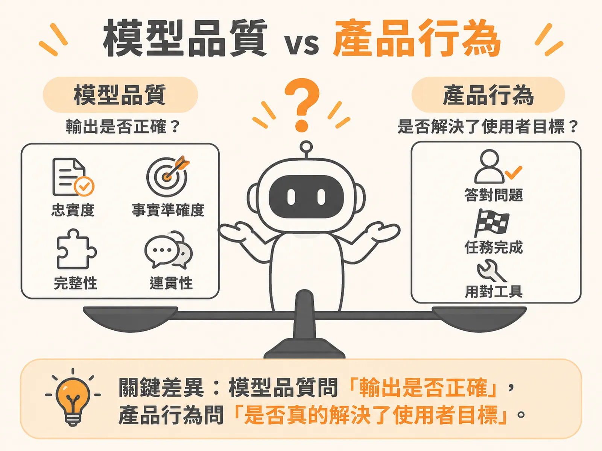

# Model Quality vs Behavior

## A 是什麼

**Model Quality（模型品質）**問的是一個很單純的問題：模型說出來的話，對不對？

就像考試改答案卷。你只看這一次的回答內容：事實有沒有講錯、有沒有憑據、句子通不通順。

模型品質涵蓋的維度包括：

* **忠實度（faithfulness）**：回答有沒有忠於手上的資料，沒有亂編。
* **事實準確度（factual accuracy）**：講的內容是不是真的。
* **完整性（completeness）**：該講的有没有講齊。
* **連貫性（coherence）**：讀起來是否前後一致。

測量的方式有三種：讓另一個大語言模型當評審（LLM judge）、人工審查，或跟標準答案比對（reference comparison）。

## B 是什麼

**Product Behavior（產品行為）**問的是另一個問題：使用者要的事，辦成了沒？

就像看球賽結果。不管球員個人動作多標準，只看一件事——球隊贏了沒。

產品行為涵蓋的維度包括：

* **有沒有回答對的問題（right question answered）**：使用者問 A，你答的是不是 A？
* **任務是否完成（task completed）**：使用者最終達成目的了嗎？
* **有沒有用對工具（right tool used）**：Agent 該查的查了嗎？

測量的方式是任務完成度評估（task-completion evals）和執行軌跡分析（trajectory analysis，也就是檢視整段對話和工具呼叫的完整紀錄）。

## 關鍵差異

兩者的核心差異，一句話就能講清楚：

> 模型品質問「輸出是否正確」，產品行為問「是否真的解決了使用者目標」。

最典型的失敗案例叫「意圖理解錯誤（Wrong Intent）」：模型給出的事實**完全正確**，卻回答了**錯誤的問題**。每一項事實準確度檢查都通過，但使用者沒有得到想要的結果。這就是「答對了，卻答錯問題」。

另一個真實案例更驚人：一個客服 Agent 的模型準確率達到 **92%**，儀表板全綠，但轉接真人客服的升級率（escalations）**翻了一倍**。

為什麼會這樣？因為單一回回答對 92%，不代表整段對話讓人滿意。Agent 可能在錯的時間點答非所問、推不動流程，或乾脆放棄對話，使用者只好去敲真人。模型品質對這些「行為層面」的問題完全盲目。

所以兩者不能互相取代：

* 模型品質好，行為可能還是很糟——因為理解錯了使用者的意圖。
* 只看行為不看品質，也可能漏掉答非所問背後的事實錯誤。

模型品質只是整體評估的一部分，產品行為才決定系統能不能端到端達成業務目標。

## 何時用哪個

兩個都要測，但先後和重點會變：

* **建立評估機制時**：先從完整的執行軌跡（trace）人工閱讀，建立錯誤分類法（taxonomy），再決定要為哪一類問題建評估器。優先順序由「發生頻率 × 業務損害嚴重性」決定。例如一次分析中，8 個失敗對話有 5 個引用過時政策導致溢收費（overcharge），就該先為「過期知識（Stale Knowledge）」建評估器。
* **查客訴暴增時**：問題多半出在行為層。要抓出所有被轉接真人的**完整對話（session-level）**來看，因為單一回合格看不出破綻。人工標註失敗原因（例如「Wrong Intent」是否顯著增加），再把新場景補進回歸測試（regression test cycles）。
* **日常監控時**：同一份 trace 一次看齊六個維度——品質、行為、安全、可靠性、成本、延遲。不要只盯著準確率一個數字。

判斷錯誤標籤時，用「兩個人都會標出相同結果」的是／否二元定義，而不是主觀的 1 到 5 分量表。

## 進階

進一步想的兩個方向：

1. **評估是分佈，不是斷言。** 不要把 AI 評估當成一個像程式斷言（assertion）那樣「過／不過」的單一檢查。品質是一種分佈，要在多個維度上同時檢視。門檻也要依風險調整：內部問答 Agent 可以用寬鬆門檻（例如 50%）快速迭代；法律或金融 Agent 要拉到 90% 以上，還要加上引用來源檢查（citations）和確定性規則檢查（deterministic checks）。
2. **Trace 勝過平面日誌。** AI Agent 的失敗是語意層面的失敗（semantic failure），單看對話文字（transcript）看不出決策邏輯，必須檢視包含呼叫關係與工具調用的完整結構樹（tree）。遇到暫時解釋不了的異常模式，先把 trace ID 存下來——它們往往是日後建立新評估機制的起點。
