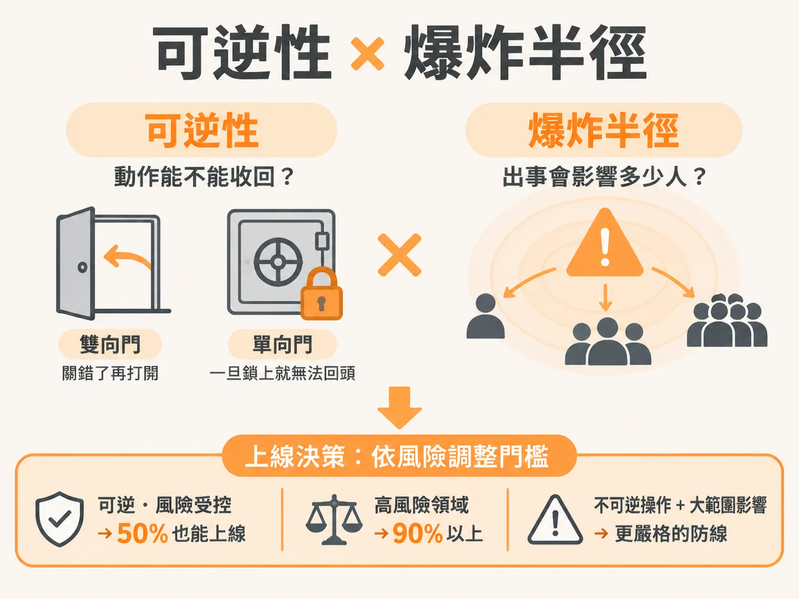

# Reversibility and Blast Radius

## 定義

要判斷一個 AI 系統能不能上線，要看兩件事：

- **可逆性（Reversibility）**：系統做的動作能不能收回？能收回的叫「雙向門（two-way door）」，收不回來的叫「單向門（one-way door）」。
- **爆炸半徑（Blast Radius）**：如果最糟的情況發生，會波及多少人？情況惡化的速度有多快？

用一個比喻：可逆性就像你關門的方式。雙向門是普通房間的門，關錯了再打開就好。單向門是保險庫的門，「咔」一聲鎖上之後就回不去了。

爆炸半徑則是問：如果這扇門後面出了事，是只吵到一個人，還是整棟大樓都疏散？

## 為什麼重要

傳統軟體測試有一套熟悉的流程：輸入固定、預期輸出固定，測試全過就能部署。但大型語言模型的系統不一樣——輸入千奇百怪，輸出每次都在變。面對這種不斷變動的系統，光看 benchmark 分數不夠。

因為錯誤的代價不同，所以門檻也不同：

- **內部員工專用的問答系統**：就算正確率只有 50%，也可以先上線。因為範圍只限公司內部，可以做受控發布（controlled launch），而且系統只回答問題，不碰外部資料或高風險操作。
- **法律或金融場景**：一旦出錯，代價極高。門檻必須拉到 90% 以上，還要在最上層加上引用來源驗證（citations）與決定性檢查（deterministic checks）等硬性防護。

所以「現在能不能 ship」的答案，不是追求每個指標滿分，而是在快速交付與合理風險之間，找到站得住腳的論據。

## 如何運作

評估一個 AI Agent 動作的可逆性，先問它做的是哪一種門：

- **雙向門（可逆）**：例如 Gmail Agent 的「草擬郵件」。草稿寫得不好不會造成實質損害，使用者寄出前還能閱讀與修改。
- **單向門（不可逆）**：例如讓 Agent「直接寄出郵件」，信件一旦發出就無法收回；或是讓它把資料上傳到公開的 S3 bucket。這些都收不回來。

接著評估爆炸半徑：最糟情況發生時，多少人受影響？惡化多快？這在對抗性場景（adversarial scenarios）、紅隊演練（red teaming）、提示詞注入（prompt injections）與資料外洩（data exfiltration）特別關鍵。

把兩個維度合起來，就得到上線決策的規則：

- 操作越不可逆、爆炸半徑越大 → eval gates（評估關卡）要設得越嚴苛。
- 屬於可逆的雙向門、風險受控 → 50% 也能先交付。
- 牽涉不可逆操作與高爆炸半徑 → 必須守住 90% 以上的防線，不能倉促上線。

## 例子

**草擬郵件 vs 直接寄出**：同一個 Gmail Agent，「草擬郵件」是雙向門——寫錯了頂多刪掉重寫。「直接寄出」是單向門——信送出去了就收不回來。所以前者可以早點上線，後者要更嚴格的評估。

**一個資安漏洞的擴散**：有測試人員發現系統漏洞並取得原始碼，把原始碼放上 GitHub，接著在 Twitter（現為 X）上迅速擴散，短時間內達到 200 萬次下載。這就是爆炸半徑的具體展現：出事之後惡化到什麼地步、速度多快。

**門檻怎麼定**：內部員工問答系統，50% 就能上線，因為用戶是自己人、系統只回答問題。同樣架構改用在法律或金融領域，錯一個字可能造成實質損失，門檻就要 90% 以上，還要加上引用來源與決定性檢查。

## 邊界與常見誤解

- **不要只盯 benchmark 的單一數字**。分數高不等於可以上線，還要檢視動作可不可逆、爆炸半徑多大。
- **門檻不是越高越好**。內部工具硬要求 90%，只會卡住團隊的開發節奏。門檻取決於應用場景與錯誤的代價。
- **不可逆動作越多，傷害越難挽回**。這不是指標問題，而是系統設計問題：給 Agent 多一個「寄出」或「上傳到公開 bucket」的權限，就多一道單向門。
- **攻擊是以機器速度進行的**。許多針對 AI 的攻擊擴散極快，所以防禦與偵測機制必須跟上同樣的反應速度，不能假設「發現了再處理就好」。

## 進階

當功能屬於高風險（不可逆操作、大爆炸半徑），只跑標準資料集的評分不夠，必須投入紅隊測試（red teaming）：由測試人員主動攻擊系統，找出隱藏的漏洞與注入弱點。許多大型企業甚至花費數百萬美元聘請外部駭客做滲透測試。

回答「現在能不能 ship」的完整檢查，可以用五個核心問題收斂：

1. 應該發生什麼事？
2. 絕對不能發生什麼事？
3. 系統真的解決了使用者提出的實際需求嗎？
4. 系統還殘留哪些風險？（例如幻覺率還有 20%）
5. 現在可以上線，還是該延後一個月？

把可逆性與爆炸半徑套進第 5 題：風險受控且是雙向門，50% 也能交付；有不可逆操作與高爆炸半徑，就守住 90% 以上的防線，不能倉促上線。
