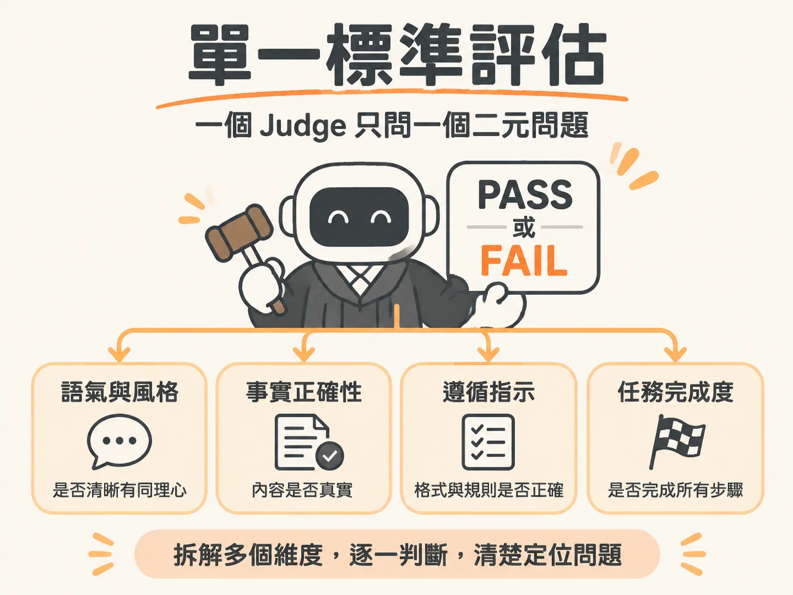

# Single-Criterion Judge

## 主張

一個 LLM Judge（讓大型語言模型擔任評審裁判）一次只能評估一個獨立標準，而且只回答一個二元是非題（PASS 或 FAIL）。千萬不要把多個維度混在同一個評分題目中，也不要使用 1 到 5 分的打分量表。

## 為什麼成立

因為把多個判斷維度塞在一起時，各個標準會互相污染。當裁判給出一個中間分數（例如 3 分）時，你完全無法分辨這個分數是因為事實正確但語氣冷淡，還是因為語氣非常親切但內容完全捏造。

傳統 1 到 5 分的評分量表（Likert scale）容易讓分數大量擠在 3 分或 4 到 5 分之間，失去鑑別度，而且缺乏明確的及格標準。

當拆成「一個 Judge 只問一個二元問題」時，每一次失敗都有清楚的歸因。如果系統評估結果顯示「事實正確性」FAIL 而「語氣」PASS，開發團隊就能立刻知道問題出在知識檢索不足或模型產生幻覺，而不是對話風格設定不良，可以立刻針對問題修復。

## 適用範圍

適用於無法用寫死規則檢查、需要理解語意與上下文的主觀評估場景。實務上，絕大多數的系統失敗代碼（failure code）都可以對應並拆解成以下四種專門的二元 Judge：

- **語氣與風格（Tone and style）**：檢查表達是否清晰冗長、對沮喪使用者是否有同理心。
- **事實正確性（Factual correctness）**：檢查內容是否真實、完整，且與參考資料一致，專門抓出捏造資訊的幻覺。
- **遵循指示（Instruction following）**：檢查輸出是否在任務範圍內、格式是否正確，並符合安全準則與公司政策。
- **任務完成度（Task completion）**：檢查流程步驟、工具呼叫（tool calls）與真人轉接是否確實執行。

## 反例

最常見的反模式（anti-pattern）是在提示詞中寫下這類綜合要求：「請根據這則回答的實用性、正確性與語氣，給出 1 到 5 分。」

這種評分看起來一次涵蓋了多種面向，但實際上產生了一個意義模糊的單一分數。當分數從 4.5 分跌到 3.8 分時，工程師完全看不出到底觸發了哪一項違規，也找不到修改的方向。同時，模型在沒有明確邊界標準的情況下，評分會像擲硬幣一樣漂移不定。

## 進階

- **提示詞五大要素**：要落實單一判準，提示詞內必須包含「稽核員角色」（防止模型跳下去幫忙回答）、「單一二元問題」、「明確的 PASS 與 FAIL 標準」、「邊界範例說明」（指明補救行為不能算合格的灰色地帶），以及「先推導理由再輸出 PASS/FAIL」的指定輸出格式。
- **程式碼評估優先**：如果可以用程式邏輯檢查（例如字串精準比對、欄位是否存在），應優先使用代碼評估器（Code Evaluator），以避免 LLM Judge 帶來的延遲、Token 成本與 10% 到 30% 的評分漂移。
- **評判與生成模型分離**：負責生成回答的模型不該拿來評估自己（例如 Claude 生成的回應由 GPT 擔任裁判），避免模型對自己的輸出帶有偏見。
- **人機一致性驗證**：在正式採用 Judge 之前，必須先交由人類標註一組測試集進行比對驗證，達到目標一致性（例如 85% 到 90% 以上）才算合格。
