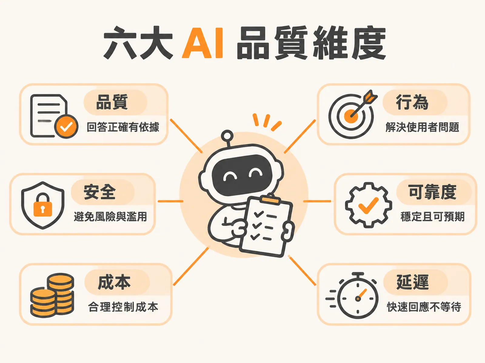

# Six AI Quality Dimensions

## 定義

評估一個 AI 產品好不好，不能只看一個分數。要同時看六個維度：

1. **品質（Quality）**：模型回答得對不對。
2. **行為（Behavior）**：系統有沒有解決使用者真正的問題。
3. **安全（Safety）**：系統會不會造成危害、偏見或個資外洩。
4. **可靠度（Reliability）**：系統是不是每次都成功，而不是碰巧成功一次。
5. **成本（Cost）**：完成一次任務實際花多少錢。
6. **延遲（Latency）**：使用者要等多久才感覺到回應。

就像買一輛車，不能只問「引擎好不好」。還要問安不安全、會不會常拋錨、油錢貴不貴、開起來順不順。AI 也一樣，六個維度都要看。

## 為什麼重要

因為只看準確率，會出現「儀表板全綠、用戶氣炸」的慘劇。

曾有一個客服 Agent，模型準確率高達 92%，監控儀表板一片綠字。結果上線一週後，轉接真人客服的案件量翻倍，使用者到處抱怨體驗糟糕。為什麼？因為準確率只衡量了品質，卻對行為與可靠度完全盲目。模型每次的回覆在事實上都可能正確，但整體對話答非所問、無法推進流程，使用者最終還是得求助真人。

準確度只能告訴你「回答是否切中題意」，卻無法反映系統在真實世界裡的風險。這就是為什麼六個維度必須一次檢視。

## 如何運作

六個維度各量不同的東西，各有各的測量方式：

**品質**關心輸出是否正確且有憑有據，涵蓋忠實度、事實準確度、完整性與連貫性，用 LLM 評審、人工審查或基準答案比對來量。

**行為**關心的是使用者任務是否達成：有沒有回答正確的問題、任務有沒有完成、有沒有用對工具。用任務完成度評估與執行軌跡分析來量。

**安全**防範間接提示詞注入、PII 外洩、毒性言論與偏見。用紅隊測試、對抗性測試集與防護欄評估來量。

**可靠度**看的是多次執行下的一致性。例如同一個任務連續跑 5 次只成功 3 次，成功率只有 60%。也要看系統遇到外部服務異常時會不會優雅降級、有沒有無聲錯誤、尖峰時刻 1,000 或 10,000 人湧入時扛不扛得住。用 N 次重複執行的成功率、變異數分析與回歸測試來量。

**成本**包含 Token 消耗、工具呼叫開銷、重試成本與檢索開銷。要落實單任務成本追蹤。特別要提防「重試風暴」——它常在無人察覺的情況下讓帳單暴增 4 倍。

**延遲**看使用者感受的速度，最重要的指標是首字時間（TTFF），也就是使用者看到第一個字要等多久。導入串流輸出可以讓使用者先看到內容，掩蓋後續生成的漫長等待。度量時要追蹤 P95、P99 這種長尾分位數，而不是只看平均值。

## 例子

只看準確率，六個維度各自可能漏掉什麼？以下都是實際會發生的失敗：

- **行為**：模型給出的事實完全正確，但回答了錯誤的問題（意圖理解錯誤）。使用者問 A，它精準地答了 B。
- **安全**：HR Agent「非常準確」地從後端資料庫抓出主管的真實薪資與身分證號並完整回答。準確度滿分，但造成嚴重個資外洩。
- **可靠度**：單次測試漂亮完成任務、準確度滿分，但連跑 5 次有 2 次因外部工具超時而無聲中斷，成功率只有 60%。
- **成本**：報告完全正確、準確度 100%，但因底層不穩定反覆重試 4 次，單次任務成本直接翻 4 倍，商業上完全不可行。
- **延遲**：除錯建議完全正確，但首字時間長達 25 秒，使用者只看到空白載入圖示，誤以為當機而直接關閉視窗。

## 邊界與常見誤解

**誤解一：準確率高就能上線。**
92% 的準確率攔不住翻倍的客訴，因為準確率對行為與可靠度是盲的。上線標準也不該一刀切：內部員工使用的問答 Agent 可以採用較寬鬆的門檻（例如 50%），快速上線迭代；法律或金融領域犯錯代價極高，門檻要拉到 90% 以上，還要搭配引用來源檢查與確定性規則檢查。

**誤解二：產品行為等於模型品質。**
兩者不能互相取代。模型品質問「輸出對不對」，產品行為問「使用者的問題解決了沒」。系統可能通過每一項事實準確度檢查，使用者卻依然沒得到想要的結果。

**誤解三：單回合測試夠了。**
轉接真人客服是對話層級（session-level）的結果，單一回合看不出破綻。必須抓出被升級的完整對話紀錄來檢視。

**誤解四：延遲看平均值就好。**
要追蹤 P95、P99 長尾分位數，因為使用者體驗到的是最慢的那幾次。

## 進階

在實務上，六個維度是在同一份執行軌跡（trace）中一次檢視的，而不是分開跑六套測試。將 trace 中觀察到的問題轉化為評估體系時，有幾個關鍵原則：

- **Trace 勝過平面日誌**：AI Agent 的失敗本質上是語意層面的失敗，必須檢視包含呼叫關係與工具調用的完整結構樹。
- **自動化前先人工閱讀**：交給自動化評審器之前，先由人工建立清楚的錯誤分類法。
- **二元標籤而非模糊量表**：採用兩個人標註都會得到相同結果的是／否失敗模式，而不是主觀的 1 到 5 分量表。

當某個維度出問題時，流程是：從失敗的完整對話著手、人工標註失敗原因、建立錯誤分類體系，再把這些場景補進回歸測試，避免問題重演。那些暫時無法解釋的異常模式，先保存 trace ID——它們往往會成為建立新評估機制的關鍵起點。
