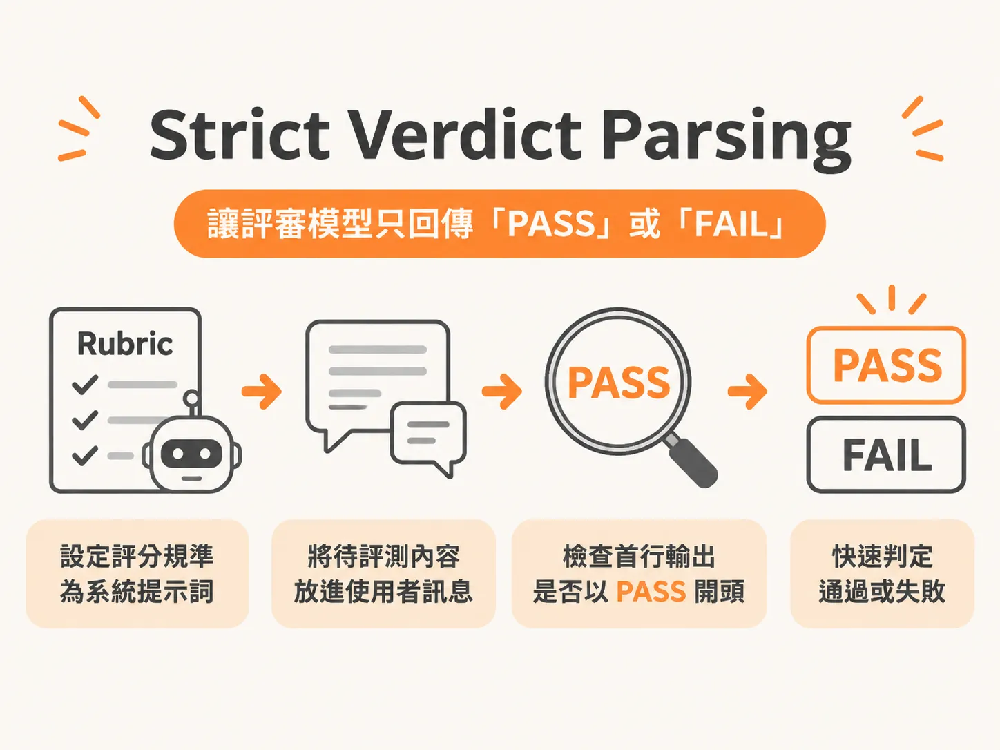

# Strict Verdict Parsing



## 問題

當我們請另一個大型語言模型（LLM Judge）來當評審時，如果只叫它自由打分數，它常常會寫出一整篇落落長的評論，或是給出 3 分這種模稜兩可的分數。因為程式沒辦法直接讀懂長篇大論，所以自動化評測管線就會卡住，無法準確判斷產出到底合不合格。

## 前置條件

- 已經準備好包含五大核心要素的評分規準（Rubric）：包含稽核員角色、單一二元問題、明確標準、邊界案例，以及嚴格的輸出格式。
- 設定好評審模型的客戶端與 API 金鑰（例如 Braintrust 或 OpenAI 的金鑰）。
- 準備好至少三個有人工標註標準答案（Ground Truth）的測試案例。

## 步驟

1. **把 Rubric 設定為系統提示詞**：把完整的評分規準整包放進 `system prompt`，命令模型扮演客觀的稽核員，只回答單一是非題。
2. **將待評測內容放進使用者訊息**：把受測 Agent 的對話紀錄或輸出內容，作為 `user message` 餵給評審模型。
3. **嚴格檢查首行輸出**：在接收模型的文字回傳時，程式碼只檢查字串是否以 `PASS` 開頭。符合條件就判定通過，否則判定失敗。
4. **用已知標準答案驗證**：拿三個已知結果的案例進行測試，確認評審模型的判決與人工標註完全一致。

## 例子

在評測腳本中，先建立評審客戶端：

<!-- source: sources/ai-eval/20261108/supplement/code/Week-2-Assignment-1-Step-by-Step-Walkthrough.txt#L99-L99 -->
```python
from openai import OpenAI
def _judge_client():
    return OpenAI(base_url="https://api.braintrust.dev/v1",
                  api_key=os.environ["BRAINTRUST_API_KEY"])
```

接著在終端機中測試已知案例。假設公司規定「退款超過 50 美元必須經過人工核准」，當 Agent 回覆未經核准就全額退款 85 美元時：

<!-- derived -->
```bash
python -c "
from starter import run_judge
print(run_judge('policy_adherence', 'Processed your \$85 refund in full, no approval needed.'))
"
```

此時程式必須準確回傳單一單詞 `FAIL`，而不是一段分析文章。

## 失敗模式

- **回傳長篇文字而非判決**：模型第一行沒有輸出 PASS 或 FAIL，而是印出一整段理由或 JSON。這代表提示詞的格式約束力不夠，必須在提示詞中強化指令為「Output EXACTLY: ...」。
- **API 驗證失敗**：執行時遇到 401 錯誤，代表環境變數中的金鑰設定有誤，需要重新檢查 API Key。
- **判決結果與人工標註不符**：模型判決與人類標準答案不一致，可能是因為缺少邊界案例說明，或者遇到模型漂移。切記不能直接信任未經人工標註驗證的評審。

## 進階

- **程式規則優先**：如果可以用程式碼檢查欄位是否存在或字串完全匹配，就不要呼叫 LLM Judge，以節省成本並避免 10% 到 30% 的模型漂移。
- **加入少樣本範例（Few-shot）**：如果是小型模型或特定領域任務，在 prompt 內附上正確與錯誤的範例，能顯著降低誤判率。
- **量表門檻化**：若專案規定必須使用 1 到 5 分量表，應設定明確的及格門檻（例如 4 分以上為 PASS，未滿 4 分為 FAIL），兼顧二元通過率與細粒度分數。
