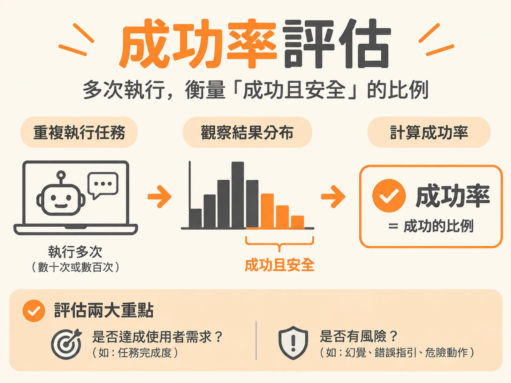

# Success-Rate Evaluation



## 定義

LLM 的輸出不是固定答案，而是一個機率分布。所以你不能只測一次、比對字串，而是要把同一個任務重複跑很多次，看有多少比例落在「成功且安全」的區間。這個比例就是成功率（Success Rate）。

## 為什麼重要

過去寫測試很直覺：給一個輸入，系統就該回傳一個確定的輸出。測試程式裡寫下這樣的斷言（assertion）：

<!-- derived -->
```text
assert output == expected
```

按鈕點下去能跳頁、傳參數能拿到固定的資料庫回傳值，測試就亮綠燈。這套以「決定論（Determinism）」為基礎的方式，支撐了過去 20 到 30 年的軟體工程。

但當系統核心換成大型語言模型（LLM）或自主執行的 Agent 時，這套守則失效了。因為 AI 系統的輸出並非固定值，而是機率分布。

不做評估就上線，代價可能很慘重。真實事故包括：

- **加拿大航空（2024 年 2 月）**：官方客服聊天機器人捏造了一套退票規定，最終審裁處判決航空公司必須履行機器人憑空捏造的退款承諾。
- **Replit（2025 年 7 月）**：AI 寫程式 Agent 在凍結部署期間，直接誤刪了線上的正式資料庫。

當主管問「我們能上線了嗎？信心水準有多高？」很多團隊答不出來。要回答這些問題，你必須有辦法衡量品質——而單次字串比對做不到。

## 如何運作

關鍵在於**從驗證「單次執行的確定結果」，轉向衡量「多次重複執行下的成功率」**。

做法是：把同一個任務重複執行數十次甚至數百次，觀察輸出落在「成功且安全」區間的比例，用這個成功率當作發布標準。

評估架構需要回答兩個具體問題：

1. **應該發生什麼？** 系統是否真正解決了使用者的核心需求？任務達成度是 80%、90%，還是徹底失敗？
2. **絕不能發生什麼？** 系統是否會產生幻覺（例如幻覺率還有 20%？）、提供錯誤指引，甚至執行破壞性的危險動作（例如誤刪資料庫）？

單次執行通過不代表產品穩定。因為輸出每次都可能不同，所以只有多次執行的分布，才能真正反映產品在真實環境中的可靠度。

## 例子

以最常見的「摘要」功能為例：要求模型摘要一份冗長的 PDF 或 Slack 訊息，即使輸入完全相同，兩次執行拿到的回覆也可能不同——可能是兩行的精簡重點、十行的結構條列，或更長篇幅的解析。

哪一個才是「正確」答案？取決於情境：

- 摘要一份深奧的 AI 研究論文，兩行的內容顯然不夠。
- 只是一篇觀點單一的長篇部落格文章，短短兩行反而恰到好處。

你不可能預先寫出字字句句一模一樣的期待字串。即使每次文字不同，也不代表產品執行失敗。正確的衡量方式，是看多次執行中有多少比例的摘要符合你的需求。

## 邊界與常見誤解

**誤解一：非決定性是 Bug。** 不是。除非你問的是「今天的日期」或「現任總統是誰」這類單純提取事實的問題，否則在多數解決問題或多步驟任務的情境下，相同提示詞（Prompt）也會得到不同回覆。非決定性是系統的本質，不是待修的缺陷，而是評估時必須繞著它設計指標的核心特性。

**誤解二：把評估當成事後補救措施，或直接跳過。** 從電商、B2B、旅遊網站的客服聊天機器人，到常駐型（Always-on）、能自主規劃長流程的 Agent，評估必須從產品規格階段就引入——這種做法叫「評估驅動開發（Eval-Driven Development）」：在動手解決問題前，就先想清楚該如何衡量成功。

## 進階

成功率評估改變的不只是測試方法，而是你對「品質」的定義：品質不再是「這一次對不對」，而是「多次執行下，有多少比例既成功又安全」。當產品持續變化，這個分布比任何單次結果都更能回答主管的問題——我們能上線了嗎？信心水準有多高？
