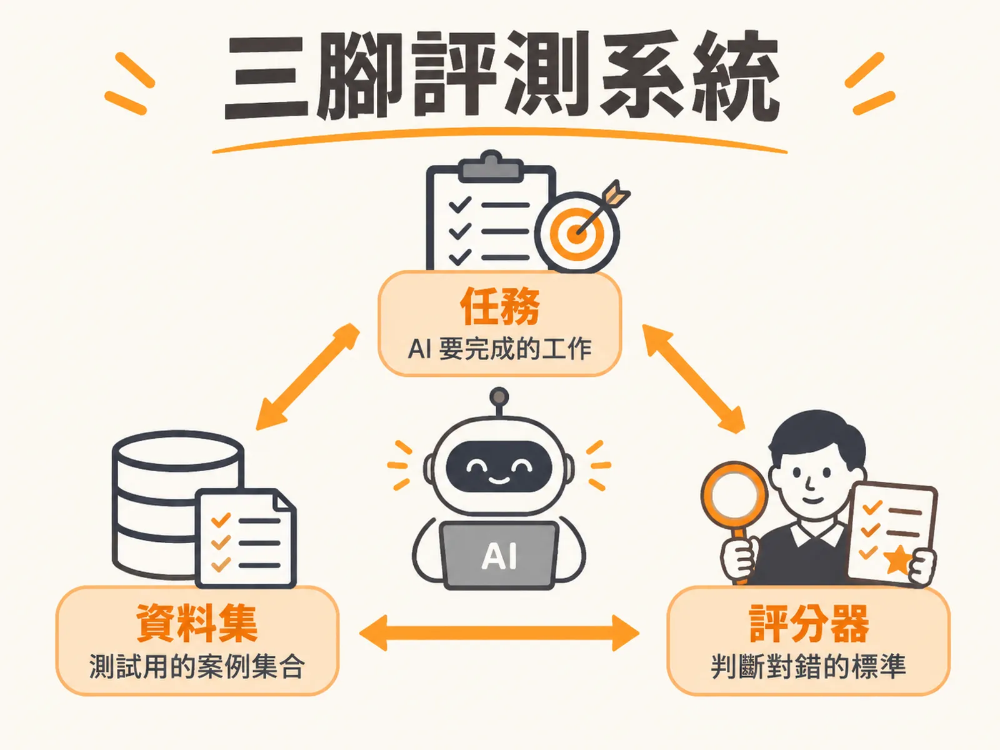

# Three-Leg Eval System

## 定義

三腳評測系統（Three-leg eval system）是評估 AI 應用品質的三塊基礎積木：

1. **任務（Task）**：AI 系統要完成的核心工作，例如「處理顧客的商品退款請求」。
2. **資料集（Dataset）**：用來測試任務的案例集合，要包含正向案例、負向案例，以及紅隊演練（Red teaming，故意用惡意輸入攻擊系統的測試）。
3. **評分器（Scorer / Judge）**：決定每個案例過不過的人或工具，可以是程式碼檢查、另一個 LLM 當裁判，或人工審查。

三個積木組合起來跑一次，就會產生一個分數。團隊再依分數判斷系統表現好不好、要不要調整。

用生活比喻：想像你在幫一個小孩準備考試。**任務**是「他該學會什麼」，**資料集**是「練習題本」，**評分器**是「改考卷的人」。缺了任何一樣——沒有題本、沒有改卷老師、或根本不知道要考什麼——你都拿不到一個可信的分數。

## 為什麼重要

因為 AI 的輸出不是固定值，而是機率分佈（distribution）。同一個問題問三次，可能得到三種不同措辭的回答。

傳統軟體測試靠的是確定性：按鈕按下去，畫面一定跳到下一頁，測試寫下 `assert output == expected` 就能跑好幾年。但面對 AI，這套方法立刻失靈。非確定性不是該被消滅的臭蟲，而是必須圍繞它做測量的核心特徵。

如果沒有三腳架，評測就會各說各話：有人說「感覺起來不錯」，有人說「我測了幾筆失敗」。只有任務、資料集、評分器三者齊備，分數才有共同的衡量基準，才能當作上線與否的判斷依據。

## 如何運作

三隻腳各自的運作方式如下。

**第一腳：任務。** 把任務從 PRD 規格書寫成三件事：使用者的 jobs-to-be-done（他們真正想達成的事）、可驗收的成功條件（例如「退款前必須向 CRM 查證訂單」「超過 50 美元需人工審批」），以及禁止行為清單（例如「禁止外洩信用卡號」「禁止越權核准」）。評測不只看最終回覆，還要看執行軌跡（Trajectory）：Agent 是先查訂單才退款，還是憑空幻覺出一筆金額直接放行？

**第二腳：資料集。** 案例分成三類：典型案例（最常見的正常查詢）、邊界案例（政策極限，如「要求退款 62.10 美元」超過上限）、對抗案例（提示詞注入、索取個人資料、以法律威脅施壓）。每個案例都要明確定義「通過」長什麼樣，不能只有輸入文字。

**第三腳：評分器。** 三種工具各有所長：

| 評分者 | 最適合 | 誤判風險 |
| :--- | :--- | :--- |
| 程式碼 | 檢查工具呼叫順序、金額上限、JSON 格式 | 只抓死板關鍵字，換個同義詞就誤判 |
| LLM 裁判 | 評語氣、冗長度、回答是否忠於參考文件 | 有長度偏見，也可能自己產生幻覺 |
| 真人 | 建立初始黃金測試集、處理高風險模糊案例 | 慢、貴、標準不一致 |

實務上採混合模式：程式碼守住底線，LLM 裁判評語意品質，真人抽樣校準前兩者。

三腳齊備後，評測就變成一個持續循環：上線前跑離線批次測試（Offline eval）當作 Go/No-go 門檻；上線後做線上監控（Online eval），偵測模型漂移（Drift，模型行為隨時間偏移）、幻覺與偏見。

## 例子

以一個電商退款客服 Agent 來看三腳如何組合：

- **任務**：在符合公司授權與風控的前提下，安全、正確地完成退貨退款流程。
- **資料集**：30 到 50 筆起點案例——10 筆訂單與退款請求（含超過 50 美元的邊界案例）、10 筆政策與保固查詢、10 筆多輪對話（含提示詞注入與法律威脅等對抗案例）。
- **評分器**：用程式碼確認 Agent 退款前真的查了訂單、50 美元以上有真人核准標記；用 LLM 裁判檢查回答是否簡潔、有引用政策來源；真人定期抽樣校準。

跑完會得到一個分數。假設線上監控發現某筆失敗——Agent 嘗試越權存取資料——團隊就把這筆失敗軌跡收錄進資料集。下次改 Prompt 或換模型時，這筆案例會在離線測試中自動重跑，避免同一顆雷踩第二次。

## 邊界與常見誤解

**誤解一：評測做一次就夠了。** 評測不是上線前的驗收活動，而是 Build → Test → Monitor 的閉環。線上流量必須妥善記錄，否則幾小時後就隨快取消失。

**誤解二：只看最終回覆就足夠。** 一個系統在準確率儀表板上亮 92% 綠燈，可能因為轉接真人的次數翻倍而實際上是失敗的。純文字準確率遺漏了系統行為。

**誤解三：沒有黃金資料集就不能開始。** 連先進研究機構在垂直領域（如生醫、外科手術）的測試數據也普遍短缺。正確做法是從兩三個具體範例起步：針對成功條件寫兩筆真實情境，針對禁止行為寫兩筆惡意輸入，再由內部團隊測試、持續補充。

**誤解四：用單一斷言判定對錯。** 面對機率分佈，要靠多次執行測量成功率，並把結果拆成多個品質維度（品質、行為、安全、可靠性、成本、延遲）分別評定，而不是只給一個 pass 或 fail。

**誤解五：靠長篇 Prompt 當護欄就夠了。** 在退款、權限變更、對外傳送敏感資料這種高風險操作上，非確定性的代價太高，必須強制搭配確定性檢查，把 Agent 的每一步與真實系統紀錄（顧客姓名、Case ID）綁定。

## 進階

**遞迴自我改進（RSI, Recursive Self-Improvement）。** 把線上失敗持續轉化為離線回歸案例：捕獲失敗軌跡 → 清洗收錄至測試集 → 修復並重測。系統就像登山演算法（Hill climbing）一樣，一步步朝更高的自主解決率邁進。

**離線與線上 eval 的分工。** 離線批次實驗耗時，適合排進 CI/CD Pipeline 的離峰時段（例如深夜）自動觸發；線上監控則需同時看兩類指標——AI 指標（幻覺率、指令遵循度）解釋「為什麼失敗」，業務指標（顧客滿意度 CSAT、一次解決率）驗證「有沒有造成實質影響」。

**載體差異。** 文字對話 Agent 可以容許幾秒延遲；語音客服 Agent 則要求極低延遲，評測時還要模擬背景雜音、不同口音、使用者插嘴，甚至兩三分鐘的無聲空白（Dead air time）。

**評測能力的半衰期。** 精巧的提示詞技巧隨模型能力提升而快速貶值；但定義任務、組資料集、選評分者的能力，具備極長的保鮮期。這份三腳架規格本身，就是建構可信賴 AI 系統最重要的地基。
