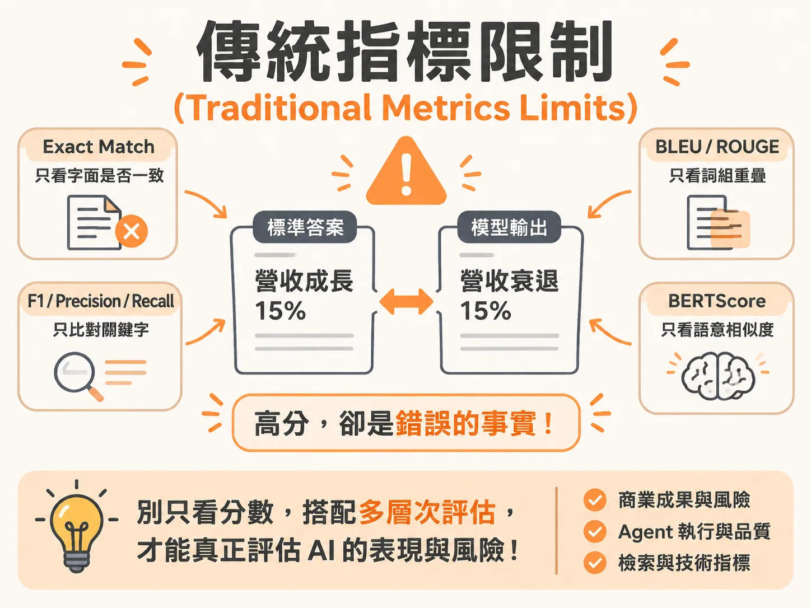

# Traditional Metrics Limits

## 定義

傳統指標限制（Traditional Metrics Limits），是指工程師過去用來給文字打分數的傳統統計與比對方法，在面對大型語言模型自由生成的文字時，會各自漏看語意、語序或事實真實性的一種限制現象。

常見的傳統指標包括完全匹配（Exact Match）、F1 分數、BLEU、ROUGE 與 BERTScore。

## 為什麼重要

如果只看傳統指標的分數，團隊會誤以為模型表現很好，實際上模型可能說出了完全相反的事實。

同時，如果拿著「F1 達到 0.92」或「BLEU 分數大幅提升」這些數字向主管報告，主管依然無法得知這項 AI 應用是否達成了商業目標，也無法評估產品上線後到底存在哪些業務或法規風險。

## 如何運作

自由文本的變化很多，四種常見的傳統指標各自有不同的比對盲點：

1. **Exact Match（完全匹配）**：
   檢查輸出和標準答案是否一字不差。因為自由文本只要換句話說（phrasing variation），就算意思完全正確，它也會直接判為零分。
2. **F1 / Precision / Recall（詞彙重疊程度）**：
   只比對字詞片段有沒有出現。因為它完全不檢查前後語序與整體語意，就算模型把因果關係或邏輯顛倒，只要關鍵字都出現了，依然能拿到高分。
3. **BLEU / ROUGE（連續詞組重疊比例）**：
   比對連續幾個字詞是否重複出現。高分不代表內容正確，模型只要把參考答案裡的詞組重新拼裝，就能拿到漂亮分數，產出的內容事實卻可能是錯的。
4. **BERTScore（詞向量語意相似度）**：
   比對字詞向量在空間中的接近程度。因為它無法捕捉精準的事實錯誤（misses factual errors），常常把語意結構很像但事實完全相反的句子判成極高分。

## 例子

在財務報告的問答任務中，標準答案是「營收成長 15%」，模型卻生成「營收衰退 15%」。

這兩句話的句型結構與詞性高度一致，在詞向量空間中非常接近。這時 BERTScore 會給出極高的相似度分數，完全漏掉這是一個事實嚴重相反的重大錯誤。

另一個例子是在摘要任務中，模型把標準答案裡的詞組抓出來胡亂拼湊。這時 BLEU 或 ROUGE 測量到的連續詞組重疊度很高，但整段摘要的真實結論卻可能完全顛倒。

## 邊界與常見誤解

這不代表傳統指標完全失去價值。

常見的誤解是以為「傳統指標在大型語言模型時代已經徹底無用」。事實上，它們只是不適合用來評估最後生成的自由文本。在系統管線（pipeline）的前半段——也就是從資料庫抓取資料的「檢索（retrieval）」環節，F1、Precision 與 Recall 依然是非常優秀的檢驗工具，能精準確認有沒有抓對文件片段。

## 進階

要避免傳統指標帶來的混亂，評估體系應該劃分為三個層級：

- **第一層：商業成果與風險（Outcome and Risk）**：
  最高層級，優先回答 AI 是否達成預期的商業成果，以及上線後是否有法規、資安或聲譽風險。
- **第二層：Agent 執行與功能品質（Agent Execution and Quality）**：
  中間層級，檢查 Agent 有沒有呼叫正確的工具、存取正確的資料來源，工作流程是否運作正常。
- **第三層：底層檢索與技術運作指標（Underlying and Retrieval Metrics）**：
  底層技術層，傳統指標應該留在這裡，負責監控檢索環節的文件抓取精準度。

在選擇評估工具時，必須回歸本質：你正在檢查的是不可違反的固定規則、需要上下文理解的綜合判斷，還是有標準答案的客觀事實。
