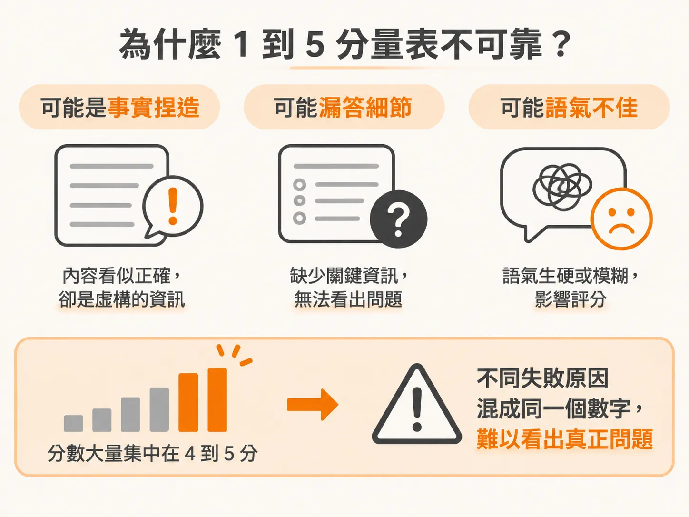
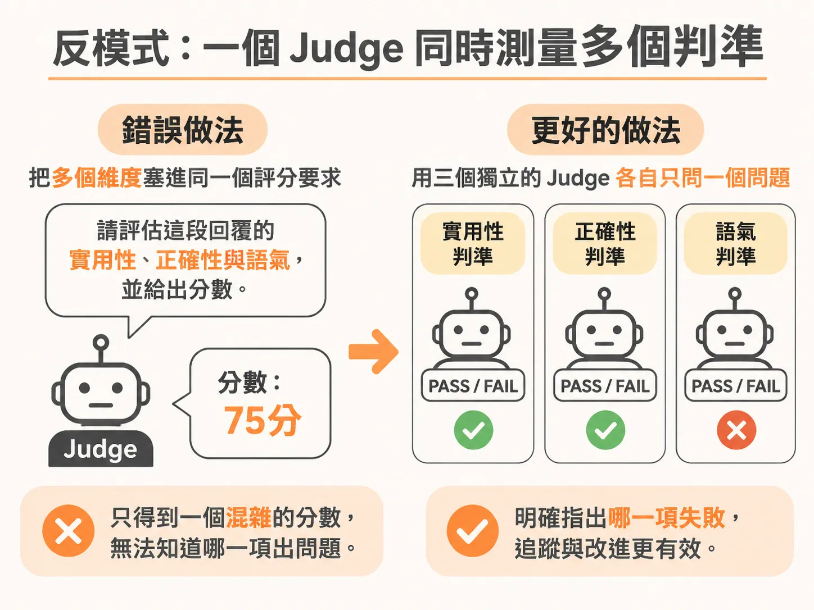
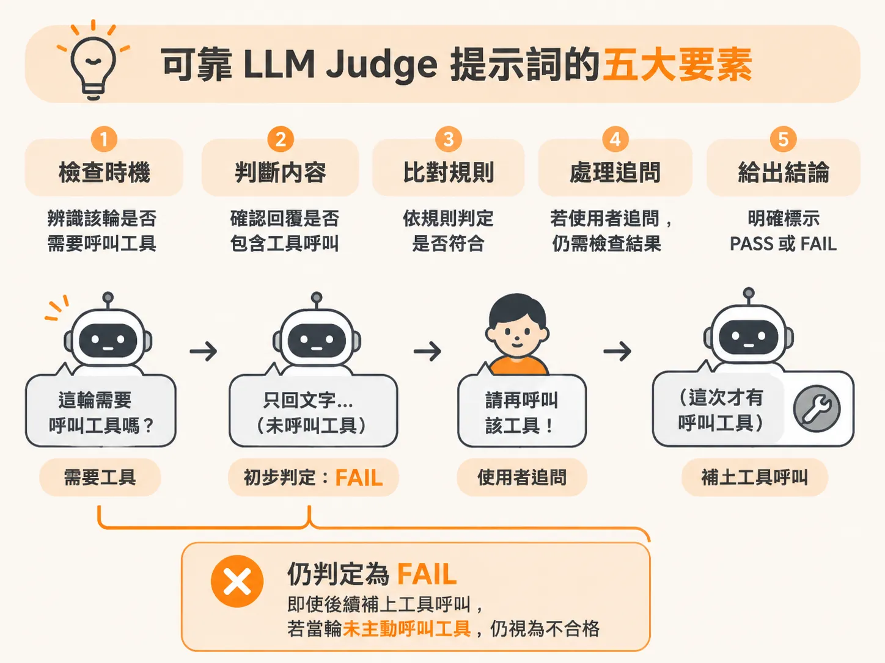
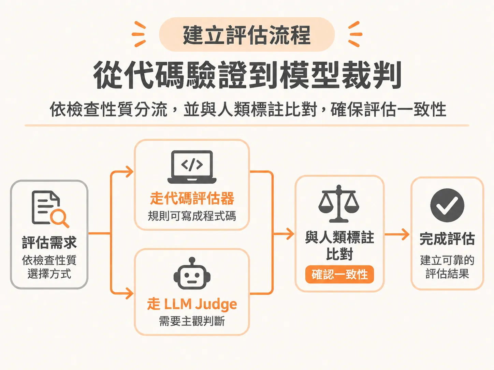

# 打造可靠的 LLM Judge：為什麼你該放棄 1 到 5 分量表，改用單一判準 PASS/FAIL

在評估大型語言模型（LLM）的回答品質時，最直覺的做法往往是寫一段提示詞（prompt）：「請根據回答的正確性、完整性與語氣，給出 1 到 5 分的評分。」

當儀表板上顯示平均分數高達 4.2 分時，團隊往往覺得表現優異、可以上線。然而，這種評分方式隱藏了嚴重的盲點：你不知道扣掉的那 0.8 分究竟是因為事實捏造、漏答關鍵細節，還是單純語氣不夠客氣。更糟的是，分數通常大量擠在 4 到 5 分之間，失去鑑別度；當分數下滑時，工程師也完全不知道該從哪裡著手修改系統。

要建立真正具備指導意義、可重複驗證的自動化評估機制，核心原則只有兩個：**改用二元判斷（PASS/FAIL）**，以及**一個 Judge 只評估一個獨立判準**。

---

## 為什麼 1 到 5 分量表不可靠？

傳統的李克特量表（Likert scale，如 1 到 5 分）看似提供了細緻的分數，但在實際評估 LLM 或由人類標註員評分時，常會引發數個問題：



1. **分數擠壓與模糊的中間值**：人類評估者拿到 1 到 5 分時，經常因為判斷標準不明確而猶豫不決，最後全部給 3 分或 4 分；LLM 的評分也常常集中在 4 到 5 分，讓平均分數看起來很漂亮，卻無法反映致命的錯誤。
2. **缺乏明確的及格標準（Pass/Fail Standard）**：在 1 到 5 分的設計下，沒有具體定義什麼樣的回答才算及格、什麼情況絕對算失敗。如果團隊需要向利害關係人報告，通常還是得事後設定門檻（例如「4 分以上算及格，4 分以下算失敗」）來計算及格率。
3. **沒有邊界範例（Boundary Examples）**：缺乏對模糊灰色地帶的具體說明，遇到邊界案例時，模型的評分就像擲硬幣一樣不穩定。

如果你需要掌握細部表現，正確的做法不是要求評分者在 1 到 5 之間琢磨，而是**把原本笼統的量表拆解成數個獨立的二元檢查項目**。

---

## 反模式：一個 Judge 同時測量多個判準

設計評估提示詞時，最常見的反模式（anti-pattern）就是把多個維度塞進同一個評分要求中：



> **反模式範例：**  
> 「請根據這則回答的實用性（helpfulness）、正確性（accuracy）與語氣（tone），給出 1 到 5 分。」

當你把三個標準混在同一個提示詞裡，會產生嚴重的問題：

- **標準互相污染（Bleed together）**：同一個分數同時混雜了三種完全不同的意義。一個獲得 3 分的回答，可能是事實完全正確但語氣冷淡，也可能是語氣非常親切但內容完全捏造。
- **失敗無法追查原因（Not actionable）**：一旦評分下降，團隊無法從單一分數看出到底觸發了哪一項違規。

正確的修正方式是**拆分成三個獨立的 Judge，每個 Judge 只回答一個二元問題**：

- **Judge A**：這則回答實用嗎？（PASS / FAIL）
- **Judge B**：這則回答正確嗎？（PASS / FAIL）
- **Judge C**：這則回答的語氣合適嗎？（PASS / FAIL）

每個 Judge 對應一個明確的失敗代碼（failure code）與專屬規則。當系統出錯時，如果「正確性」FAIL 而「語氣」PASS，開發人員就能立刻清楚問題出在檢索或幻覺，而不是提示詞的風格設定。此外，二元結構也大幅降低了比對人類標註標籤（human labels）時的複雜度。

常見的失敗代碼通常可以由四種專門的 Judge 類型來涵蓋：
- **語氣與風格（Tone and style）**：檢查表達是否清晰、是否過於冗長，或對情緒沮喪的使用者是否具備同理心。
- **事實正確性（Factual correctness）**：檢查回答是否真實、完整，且與參考資料一致（偵測幻覺）。
- **遵循指示（Instruction following）**：檢查輸出是否在範疇內、結構是否正確，並符合安全準則與優先政策。
- **任務完成度（Task completion）**：檢查所有流程步驟、工具呼叫（tool calls）與人員轉接是否皆已確實完成。

---

## 可靠 LLM Judge 提示詞的五大要素

一個設計嚴謹、判斷一致的二元 LLM Judge 提示詞，背後必須包含五個核心區塊：

1. **稽核員角色（Auditor role）**：明確設定模型的任務是進行客觀稽核與評估，而不是扮演輔助對話的助理。例如：「你正在稽核一段使用者與客服人員的對話紀錄。」
2. **單一二元問題（Single binary question）**：只問一個非黑即白的問題，例如：「每一個需要呼叫工具的輪次，都有確實呼叫工具嗎？」
3. **具體的 PASS / FAIL 標準（Concrete standard）**：詳細界定兩者的成立條件。PASS 與 FAIL 都要有清楚的文字說明，讓標準沒有模糊空間。
4. **邊界範例與極限情境（Boundary example）**：指明最容易被模型誤判的邊界情境。例如：「使用者抗議後客服才補呼叫工具，並不能抵消原本的遺漏。」
5. **指定輸出格式與推理依據（Output format）**：要求模型先用一至兩句話寫出評分理由（rationale），最後再輸出單一個單字 PASS 或 FAIL。要求先寫推理依據非常關鍵，這不僅能讓評估過程透明、不再是黑盒子，也讓工程師能在評分不合理時找出原因並微調提示詞。

### 範例：工具呼叫檢查 Judge

以下是一個驗證客服助理是否確實執行工具呼叫的 Judge 提示詞範例：



<!-- derived -->
```markdown
ROLE:
你正在稽核一段使用者與客服助理之間的對話紀錄。你的任務是評估，不是協助回答。

QUESTION:
每一個需要呼叫工具的輪次，都有確實觸發工具呼叫嗎？

PASS:
所有需要呼叫工具的輪次都確實送出了工具呼叫。
若使用者詢問「為什麼」或「如何做」的問題，客服以純文字回答屬於正常情況，視為 PASS。

FAIL:
任何需要呼叫工具的輪次中，客服僅以純文字回覆而未呼叫工具。

BOUNDARY EXAMPLE:
使用者提出質疑或追問後，客服才在下一輪補呼叫工具，不能抵消前一輪的遺漏，依然判定為 FAIL。

OUTPUT:
請先用一到兩句話說明你的判斷理由，最後換行輸出單一個詞：PASS 或 FAIL。
```

---

## 建立評估流程：從代碼驗證到模型裁判

在實際的工程平台（如 BrainTrust 或 Langfuse）中建立評估體系時，開發團隊需要因應不同的情境選擇評估方式：



- **規則明確時優先使用代碼評估器（Code Evaluator）**：如果檢查邏輯可以寫成程式碼（例如字串精準比對、欄位是否存在、是否包含特定關鍵字），務必使用程式碼或腳本進行布林值（True/False）檢查。代碼評估器執行百萬次的成本極低、速度飛快，且絕不會發生結果浮動（drift）；若使用 LLM 執行這類機械檢查，除了消耗大量輸入與輸出 Token 的成本，評分還可能存在 10% 到 30% 的漂移。
- **需要主觀判斷時才交給 LLM Judge**：面對語氣、事實一致性或摘要品質等無固定規則的場景，才使用 LLM Judge。在設計時，可透過平台提供的變數（如使用者語系、所在國家等上下文資訊）輔助評估，並提供 Few-shot 正反例，防止小型模型因未接觸過特定領域而誤判。
- **永遠以人類標註驗證 Judge**：不要盲目信任未經校準的 LLM Judge。標準做法是先由人類專家標註一組測試集（例如 40 筆樣本），將 Judge 的判斷結果與人類標籤計算一致性（Agreement rate）。若未達標準（例如 85%），就檢視錯誤混淆矩陣，找出規則漏洞並加入新的邊界範例，反覆調校直到評估器完全可靠。
