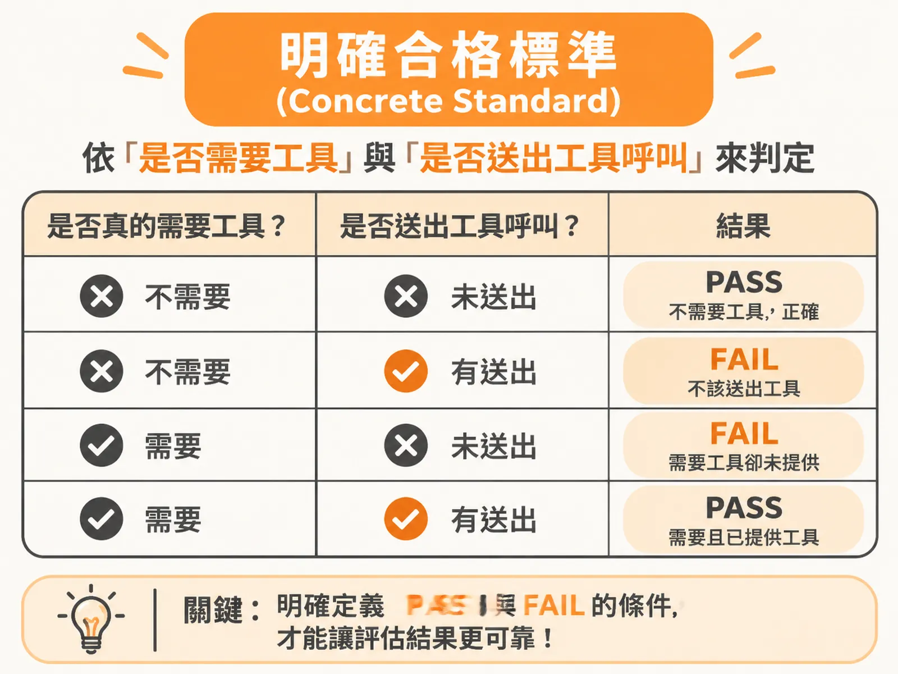
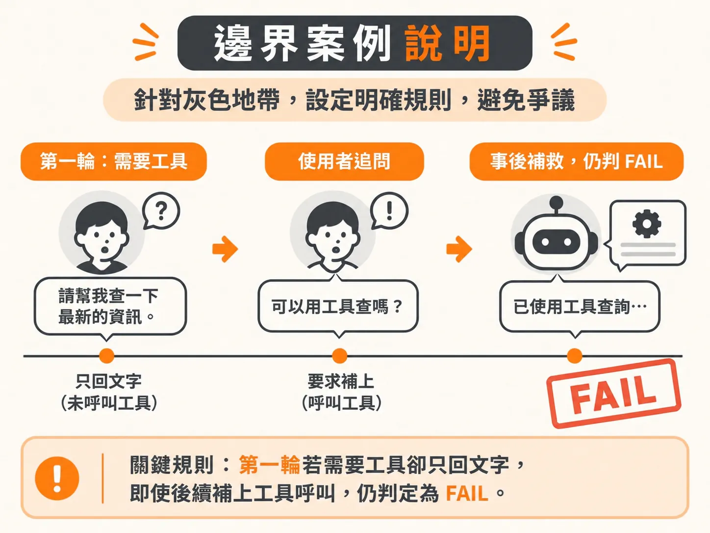
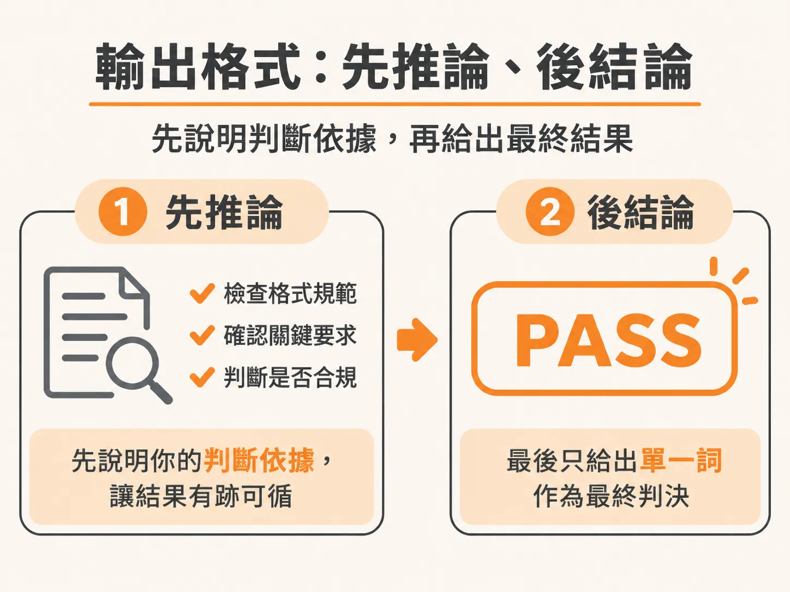

# 設計可靠 LLM Judge Prompt 的五個關鍵元素

上一節說明了為什麼要把評分拆成單一判準的二元判斷，接下來要處理的是：怎麼把這種 judge 寫出來。

在評估大型語言模型（LLM）或 AI Agent 的輸出時，最常遇到的挫折就是評審模型（LLM as a judge）忽好忽壞：有時判定太寬鬆，把沒叫工具的錯誤回答當作合格；有時模型被對話帶著走，忘了自己是評審，反而跳下去幫使用者解決問題；或者給出 3 分這種模稜兩可的分數，讓人摸不清它到底根據什麼標準。

傳統指標如 Exact Match、BLEU、ROUGE 只能比對字串或詞組重疊，遇到語意換句話說就破功；BERT Score 雖然能看語意相似度，卻往往抓不出事實錯誤。當評估需要人類層級的「主觀判斷」時，我們需要 LLM Judge，但前提是必須給它一份結構嚴謹的評判提示詞（Judge Prompt）。

一份可靠的 Judge Prompt 由五個核心元素組成，每個元素都各自針對特定類型的誤判建立防線。

---

## 1. 稽核員角色（Auditor Role）

在提示詞開頭，必須明確指派模型的身分與職責，例如：

> 「你正在稽核一段使用者與客服 Agent 之間的對話紀錄。」（You are auditing a transcript between a user and a support agent.）

**防止的誤判：身分混淆，模型從「評審」變成「幫手」**

一般的 Agent 提示詞通常是「請回答使用者問題」或「請採取行動」。如果沒有替 Judge 設定明確的稽核身分，模型在閱讀對話時容易忘記自己的任務是驗收，反而順著對話脈絡開始回答問題、給予建議，甚至對不合格的 Agent 產生同理心而給出放寬標準的偏頗評分。明確賦予「稽核員」角色，就是強迫模型守住「只評估、不提供協助」的客觀界線。

---

## 2. 單一二元問題（Single Binary Question）

評審提示詞的核心問題必須單純且只有兩種答案，例如：

> 「每個需要呼叫工具的輪次，都有成功呼叫工具嗎？」（Did every turn that needed a tool call get one?）

**防止的誤判：標準多工混雜，以及 1 到 5 分量表的模糊地帶**

在設計評估指標時，常見的做法是給一個 1 到 5 分的里克特量表（Likert scale）。但這種分數往往容易出現大量不確定的 3 分，讓人不知道該算過還是不過。如果一題裡面又問事實性、又問語氣、又問工具使用，模型就會顧此失彼，產生綜合評分的漂移。

最可靠的做法是將問題收斂成「單一標準」的二元合格判定（Pass / Fail）。若需要評估多個面向，應將一個模糊的 1 到 5 分評分拆解成數個獨立的二元檢查項目，一次只查一件事。

---

## 3. 明確合格標準（Concrete Standard）

只問二元問題還不夠，提示詞必須把 PASS 與 FAIL 的條件分別定義得一清二楚：

- **PASS**：每個需要工具的輪次都發出了工具呼叫；如果是解釋「為什麼」或「如何做」的說明性問題，直接用文字回答是可以接受的。
- **FAIL**：任何需要呼叫工具的輪次，Agent 卻只用文字回覆。

**防止的誤判：標準不明確導致的標準浮動與隨機裁量**

如果只叫模型判定「表現好不好」，模型會依賴自身的預訓練偏好進行自由心證。特別是面對特定業務情境時，小型模型容易混淆或分類錯誤。將合格與不合格的具體情境逐條列出，能建立一致的評判準則，避免標準忽高忽低。

---

## 4. 邊界案例說明（Boundary Example）

在真實對話中，最容易引發爭議的往往是灰色地帶。提示詞必須針對已知的邊緣情境（Edge case）給出硬性規則，例如：

> 「Agent 在使用者抗議並反駁後才補做修正，並不能抵消最初的失誤，仍判定為 FAIL。」（Fixing it after the user pushes back does NOT redeem the miss.）

**防止的誤判：被後續補救行為誤導的「偽合格」誤判**

在多輪對話中，常見 Agent 第一輪漏叫工具，使用者追問「你怎麼沒查？」之後 Agent 才乖乖呼叫工具。如果沒有特別標註這條邊界規則，LLM Judge 很容易認為「對話最後問題有解決」而給予合格。藉由提供 Few-shot 範例或直接在 Prompt 中白紙黑字寫明邊界規範，能直接杜絕這類模稜兩可的誤判。

---

## 5. 強制輸出格式（Output Format：先推論、後結論）

提示詞的結尾必須嚴格規範輸出格式，並要求模型先寫出推論，最後再給出判決單詞：

> 「用一到兩句話說明評判理由，接著輸出單一單詞：PASS 或 FAIL。」（Reasoning in one or two sentences, then one word: PASS or FAIL.）

**防止的誤判：黑盒子直覺衝動判決與無法調校的困境**

要求模型「先思考再給判決」（Reasoning first, then verdict）具備兩大優勢：
1. **提升準確度**：強迫模型先梳理事實依據，能大幅減少模型在未經思考前產生的直覺誤判。
2. **提供透明度與可除錯性**：如果只拿到一個標籤，評審機制就會變成黑盒子；有了短短幾句的具體理由，團隊就能看出模型究竟是看漏了資訊，還是誤解了標準，進而針對提示詞進行調優與對齊。

---

## 程式規則優先於 LLM Judge

雖然 LLM Judge 能處理複雜的語意判斷，但它的缺點是延遲較高、消耗 API Token 成本，且存在 10% 到 30% 不等的漂移風險。因此在評估架構中，如果某個條件能用確定性的規則檢查（例如欄位是否存在、字串是否完全比對、正規表達式），就應該交由程式碼評估器（Code Evaluator）處理；只有當規則無法覆蓋、真正需要理解語意與脈絡時，再動用這套具備五大元素的 LLM Judge。

最後，切記一條核心原則：**在尚未與人類標註的真實基準（Ground Truth）比對驗證之前，永遠不要完全信任任何一個 Judge 的評分。**
