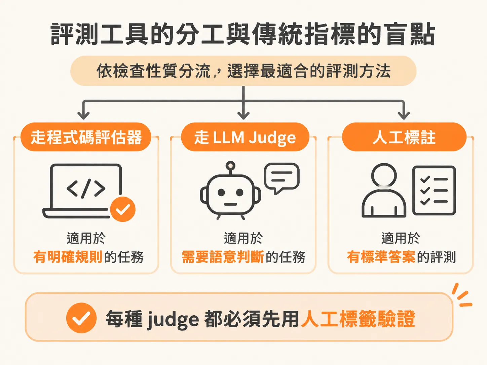
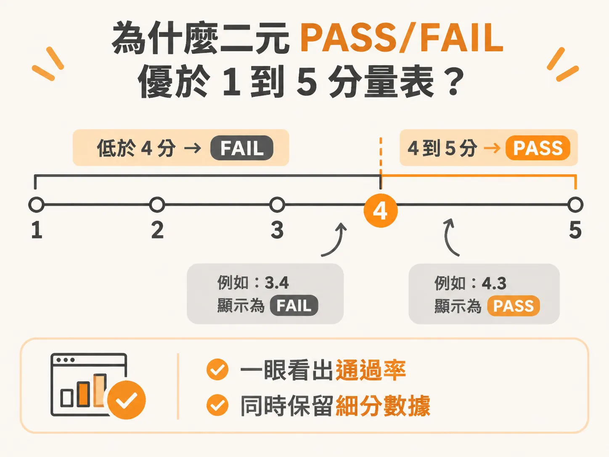

# 把 Rubric 化為 System Prompt：用嚴格的 PASS/FAIL 打造 LLM Judge

rubric 寫好之後，最後一步是把它真的接進評測流程。

當大型語言模型（LLM）的應用走向生產環境，光靠簡單的字串比對很難評估回覆品質。但若放任另一個 LLM 自由發揮打分數，往往會得到浮動不定、難以解析的冗長評論。要建立可靠的自動評測，關鍵在於將清楚的評分規準（rubric）作為 system prompt 餵給 judge，並以嚴格的首行 PASS 或 FAIL 驗證判決。

## 評測工具的分工與傳統指標的盲點

評測不是所有地方都要請出大模型。選擇評測方法時，應根據你要驗證的標的決定：



* **存在明確規則**：直接交給程式碼（code evaluator）。
* **需要語意判斷**：交給 LLM judge。
* **標準答案（Ground Truth）**：來自人工標註（human labels）。

切記一條核心原則：**絕對不能信任未經人工標註驗證過的 judge**。

許多團隊一開始會套用傳統的自然語言處理（NLP）指標，但在評估 LLM 生成內容時，這些指標幾乎都會遇到瓶頸：

* **Exact Match（完全匹配）**：驗證輸出是否與參考答案完全一致。適合 ID、標籤與固定分類；但只要措辭稍有變化就會被判失敗。
* **F1 / Precision / Recall**：比對 token 或字詞區間的重疊率。適合實體擷取與分類；缺點是會完全忽略語序與整體含意。
* **BLEU / ROUGE**：比對 n-gram 重疊度。常用於翻譯與摘要；但高分不等於內容正確。
* **BERT Score**：比對 embedding 相似度。適合判斷語意接近程度；但無法捕捉致命的事實錯誤。

因為傳統指標無法有效捕捉邏輯、事實與語氣，我們才需要引入具備理解能力的 LLM judge。

## 能用程式碼檢查，就不要用 Judge

雖然 LLM judge 具備語意理解力，但成本與穩定度是兩大硬傷。

在 Langfuse 等評測工具中，評測器主要分為兩類：code evaluator 與 LLM judge。Code evaluator 本質上是一段腳本或函式，負責檢查欄位是否存在、字詞是否包含（contains）或是否完全匹配（exact match）。它的呼叫成本極低，跑一百萬次花費幾乎可以忽略，而且毫無延遲壓力。

相對地，LLM judge 是依據輸入與輸出 token 計費，其中輸出 token 更加昂貴。更嚴重的是模型漂移（LLM drift）：同一個檢查跑兩到三次，如果沒有做好對齊，判決可能產生 10% 到 30% 的漂移浮動。因此，凡是能用程式碼寫死規則的檢查，就不要浪費 token 去呼叫 LLM judge。

## 為什麼二元 PASS/FAIL 優於 1 到 5 分量表

許多人習慣讓 judge 評 1 到 5 分（Likert scale），但這往往帶來評分不穩。在人工評估中，人類給 1 到 5 分時極容易偷懶選「3」，讓結果卡在沒有參考價值的灰色地帶。

雖然 LLM 擅長區分 3 分與 4 分的細微語感，但向團隊或利害關係人報告時，精確的二元指標遠比模糊的平均分數更有意義。最穩健的做法是：**如果需要更多細節，不要用一張 1 到 5 分的量表，而是拆成多個獨立的二元（binary）檢查**。

若實務上客戶或專案強烈要求 1 到 5 分，你可以設定一個明確的及格門檻（pass threshold）。例如在 Braintrust 中設定：低於 4 分標為 FAIL，4 到 5 分標為 PASS。這樣在儀表板上一眼就能看出通過率，同時後台仍保留 3.4 或 4.3 這類細粒度分數。



此外，無論是評分量表還是二元判斷，都可以要求模型在輸出中附帶簡短理由（rationale）。理由能讓 judge 不再是黑盒子，清楚呈現它為何給出這個分數，後續要調整提示詞時才有依據。

## 可靠 LLM Judge Prompt 的五大要素

一個能精準執行的 judge prompt，背後是一組明確的稽核指令。與一般負責對話或執行的 agent 不同，judge 的定位是稽核員。提示詞必須包含以下五個要素：

1. **稽核員角色（Auditor role）**：明確界定身分，例如「你正在審計使用者與客服人員的對話紀錄」。
2. **單一二元問題（Single binary question）**：只問一個是非問題，例如「每個需要呼叫工具的輪次是否都成功呼叫了？」
3. **具體標準（Concrete standard）**：詳細界定怎樣算 PASS、怎樣算 FAIL。
4. **邊界案例（Boundary example）**：釐清模糊地帶，例如「若使用者提出抗議後客服才修正，不能挽回最初的失誤」。
5. **輸出格式（Output format）**：限制回覆結構，例如「先寫一至兩句推導理由，接著輸出一個單詞：PASS 或 FAIL」。

如果使用的是小型模型，或者該任務屬於特定領域、未經大量領域資料訓練，模型很容易混淆誤判。這時只要在 prompt 中加入好範例與壞範例（Few-shot examples），judge 的準確度就會大幅提升。

在 Braintrust 或 Langfuse 等平台上，你可以配置完整的變數（例如使用者身分、語言、所在國家），並套用事實性（factuality）或忠實度（faithfulness）範本進行測試。在流程自動化上，系統也可以將抽樣軌跡（traces）自動指派給領域專家（例如指定給專家 Manjeet 並設定三天內審查），透過 Slack 或 Email 提醒專家填寫人工標籤，藉此持續校正 judge。

## 把 Rubric 寫進程式碼與驗證首行

在實際串接時，我們會把上述的評分規準整包放進 `system prompt`，而被評測的 agent 輸出則作為 `user message`。


以下是在評測腳本中設定 judge 客戶端並發起呼叫的實作：

<!-- source: sources/ai-eval/20261108/supplement/code/Week-2-Assignment-1-Step-by-Step-Walkthrough.txt#L99-L99 -->

```python
from openai import OpenAI
def _judge_client():
    return OpenAI(base_url="https://api.braintrust.dev/v1",
                  api_key=os.environ["BRAINTRUST_API_KEY"])
```

在 `run_judge()` 中，發送請求後必須嚴格檢驗回傳字串。解析邏輯只需檢查回覆是否以 `PASS` 開頭，是則判定通過，否則判定不通過。

完成後，請立刻挑選三個已知標準答案的測試案例驗證：

<!-- derived -->
```bash
python -c "
from starter import run_judge
print(run_judge('policy_adherence', 'Processed your \$85 refund in full, no approval needed.'))
"
```

根據退款政策，超過 50 美元的退款必須經過人工核准。因此上述案例應輸出 `FAIL`。

驗證時必須確認：
1. Judge 回傳的是乾淨的 `PASS` 或 `FAIL`，而不是一段分析文章或未經解析的 JSON。
2. 三個已知案例的輸出結果，與你自己手動標註的答案完全一致。

如果模型輸出的首行不是 PASS 或 FAIL，代表你的 rubric 對格式的約束力太弱。此時必須回到 prompt 的第 5 點，將指令強化為「Output EXACTLY: ...」，強制模型遵守首行輸出的約定；若遇到 401 錯誤，則需回頭檢查金鑰設定。只要收緊輸出格式，就能建立穩定、可直接被程式解析的自動評測管線。
