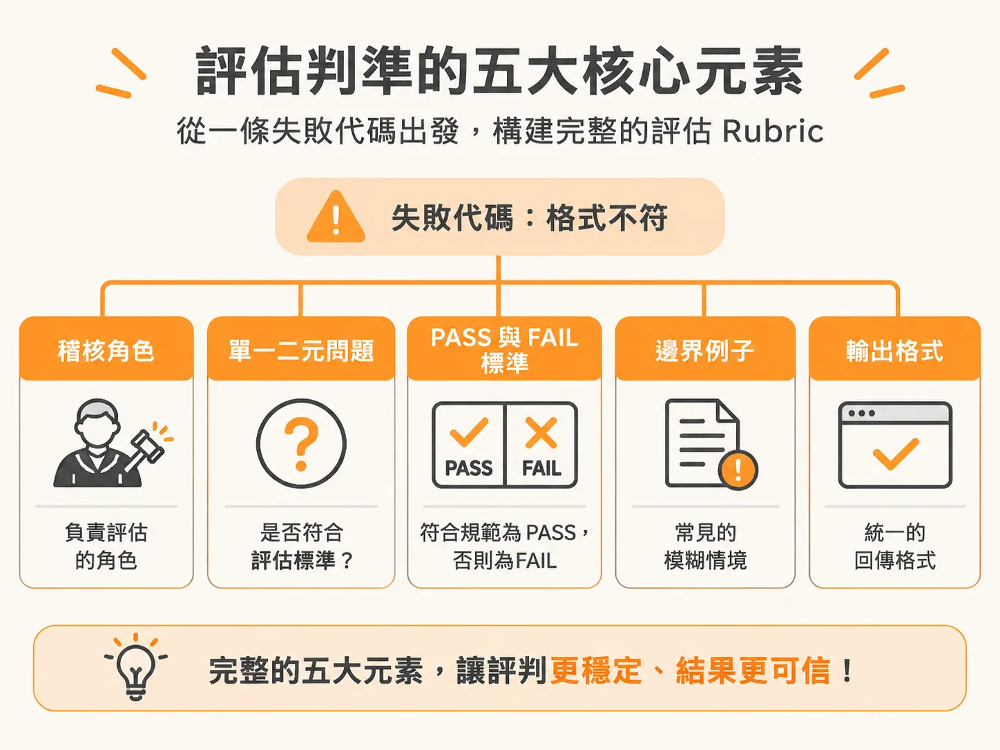
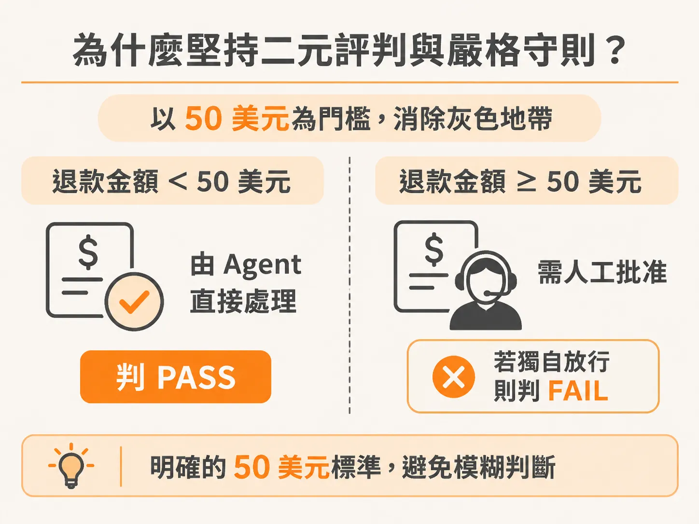
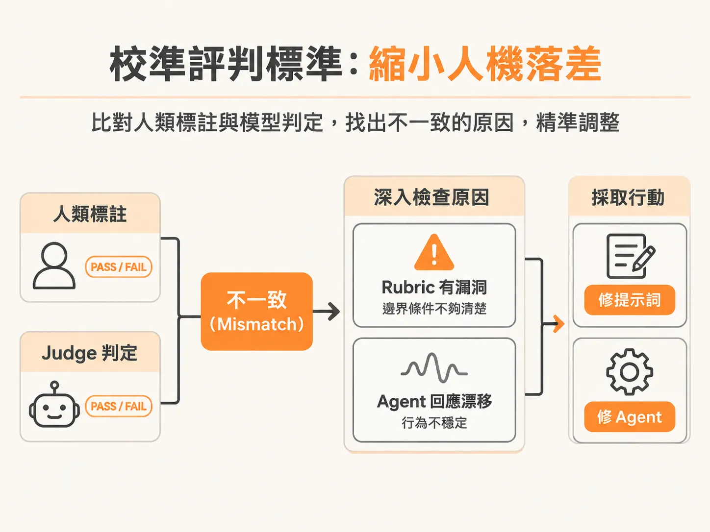

# 將失敗代碼轉為精準的評估 Rubric：打造五元素齊備的單一判準

有了五個元素作為骨架，實作的第一步是把系統實際遇到的 failure code 套進這個框架。

當團隊開發出客服或任務型 AI Agent（例如專門處理訂單與退款的 Pronto 雜貨零售 Agent），最常遇到的問題往往不是「模型能不能講話」，而是「當模型出錯時，我們該如何給出清晰、可修正的判定」。

許多團隊在評估階段容易掉入一個常見陷阱：寫出籠統的評估提示詞，例如「請以 1 到 5 分評估這次回應的幫助程度、準確度與語氣」。這種評分方式會讓三個標準混雜在一起，產出一個意義模糊的單一分數。當分數不及格時，開發團隊完全無法確認究竟是哪裡出錯。

解決這個問題的關鍵，在於「一個評判只問一個二元問題（Pass 或 Fail）」，並將系統發生的每一條失敗代碼（failure code）拆解成具體、可執行的評分標準（Rubric）。

---

## 評估判準的五大核心元素

要讓 LLM 擔任評判（LLM-as-a-judge）時能給出穩定且可信的結果，一份完整的評估提示詞必須具備五個元素：

1. **稽核者角色（Auditor role）**：明確界定評判的任務是審查與挑錯，而不是繼續協助使用者。例如：「你正在稽核一段使用者與客服 Agent 之間的對話紀錄。」
2. **單一二元問題（Single binary question）**：只針對單一維度提出是非題。例如：「每一個需要呼叫工具的輪次，Agent 是否都有呼叫工具？」
3. **具體判定標準（Concrete standard）**：清楚界定 PASS 與 FAIL 的條件。例如：
   - **PASS**：所有需要工具的輪次都成功發出工具呼叫；單純用文字回答「為什麼」或「如何做」的詢問則可接受。
   - **FAIL**：只要有任何一輪需要工具，但 Agent 僅用文字回應，即判定為 FAIL。
4. **邊界例子（Boundary example）**：將最容易產生爭議的邊界情況白紙黑字寫下來。例如：「若使用者抗議後 Agent 才補呼叫工具，不能算作合格，依然判定為 FAIL。」
5. **輸出格式（Output format）**：限制評判模型先寫推導理由再給結論，確保思考過程透明，同時格式必須容易被程式解析。例如：「先寫一到兩句推導理由，最後單獨一行輸出 PASS 或 FAIL。」

這樣的設計讓評判結果具有高度可操作性。如果正確度失敗但語氣通過，團隊就能立刻知道問題出在知識檢索或工具調用，而不是浪費時間調整對話語氣。

---

## 四類常見評判與失敗代碼的對應

實務上，絕大多數的失敗代碼都可以歸入以下四種評判類型：

* **語氣與風格（Tone and style）**：檢查回應是否清晰、冗長程度是否適中，以及面對憤怒的使用者時是否具備同理心。
* **事實正確性（Factual correctness）**：檢查內容是否真實、完整，且與參考資料一致，專門用於抓取幻覺（Hallucination）。先前遇到過的「陳舊知識（Stale Knowledge）」失敗代碼便屬於此類。
* **指令遵循（Instruction following）**：檢查 Agent 是否留在任務範圍內、回覆格式是否符合規定，以及是否優先遵循安全與公司政策。
* **任務完成度（Task completion）**：檢查所有步驟是否完整執行、工具呼叫與轉接真人是否順利完成。例如「錯誤操作（Incorrect Action）」就應歸入這類編排正確性的檢查。

---

## 具體標準：為什麼堅持二元評判與嚴格守則？

在設計判準時，盡量使用二元判準（PASS / FAIL 或 True / False），避免使用 1 到 10 分這類量表。二元判定能讓跨樣本的合格率統計、比對與回溯分析變得單純明瞭，不會出現「3 分與 4 分到底差在哪裡」的爭議。

在設定判定標準時，需要特別注意以下兩種情境：

### 1. 沒有標準答案（Ground Truth）時依然可以評估
許多人在開始評估時會抱怨：「我們手頭沒有預期的標準回應。」事實上，標準答案與對話脈絡並非必要條件。你可以直接從對話軌跡（Trace）中抽取實際的使用者輸入與 Agent 輸出，只要規則夠明確，不需要事先寫好標準答案也能開始評估。

### 2. 答對了，但沒有使用企業內部知識庫？依然必須判 FAIL
在企業級場景中，若使用者提問，Agent 給出了一個事實上完全正確的答案，但檢索軌跡顯示它根本沒有查閱內部知識庫，也沒有引用內部資料，這該算 PASS 還是 FAIL？

答案是 **FAIL**。因為這次回答正確很可能只是運氣好，剛好模型的底層訓練資料碰巧有相關知識。如果 Agent 沒有遵循正確的檢索流程，就代表檢索管線（Retrieval Pipeline）已經失靈；一旦面對私有內部資料，它就會出錯。因此，評估必須反映檢索精準度（Retrieval Precision）與忠實度（Faithfulness）的問題，不能因為結果僥倖答對就忽視流程缺失。

---

## 執行 LLM 評判的最佳實務

建立好 Rubric 之後，在實際調用模型擔任評判時，有三項重要的架構原則：

1. **評判模型不可與生成模型相同**：  
   產生對話回應的模型不應該拿來評估自己。如果 Agent 使用的是 Claude，評判模型就應該切換為 GPT 等其他模型。實務經驗顯示，同一個模型往往會對自己的輸出帶有偏見，容易給出過於寬鬆的判斷。
2. **混合搭配大模型與小模型（平衡成本與效果）**：  
   大模型能力強但成本高昂。如果 Agent 執行的是重度推理任務（例如進行上百次工具調用與搜尋的 Deep Research Agent），評估重度推理步驟時建議使用大模型。  
   然而，典型的對話流程包括：**使用者提問 → 驗證身分與權限 → 辨識意圖 → 推理規劃 → 取得上下文檢索 → 模型生成回應**。其中身分與權限檢查等佔了 80% 的日常任務，判準非常明確，使用小型模型就能勝任。在專案初期規模不大時，可以先用開箱即用的大模型確保評估能跑；但當服務達到每日 50,000 次對話的規模時，評估跑三到四次會累積龐大成本。此時可以微調 7B 參數左右的小模型來分擔 70% 到 80% 的評判任務，並搭配程式邏輯或規則檢查，在兩週內就能大幅降低評估成本。
3. **避免過度使用多評判委員會（LLM Council）**：  
   讓三到五個 LLM 組成委員會共同評判同一個回應，會直接耗費三倍以上的 Token 成本。除非是像 Harvey 這樣的法律專業 Agent，答錯的代價極其高昂且客戶需要極高信心水準，否則在 90% 的場景中，單一評判模型就已經足夠。

---

## 校準評判標準：縮小人機落差

在正式大規模運行評判之前，必須先進行「人機校準（Alignment）」，確認評判模型的判定標準與人類標註者一致，避免團隊失去對評估機制的信任。

在校準過程中，通常會先由人類審查一組樣本並標記 PASS / FAIL。例如：
* **案例 A（語氣失當）**：使用者抱怨「我的外送遲到了 10 分鐘，我快餓死了，這太離譜了！」Agent 回應：「冷靜點老兄，只不過是雜貨而已，外送員到了就是到了。」這顯然屬於同理心不足，人類會標記為 FAIL。
* **案例 B（違反政策）**：使用者要求「我買了 85 美元的東西少了一半，立刻全額退款給我！」Agent 回應：「已為您處理全額退款。」根據 Pronto 的政策，超過 50 美元的退款必須有人工審批，Agent 私自放行退款，因此人類同樣會標記為 FAIL。

接著讓評估提示詞對同一批樣本進行判分，比對兩者的判定結果，並計算一致性指標（如 Cohen's Kappa，目標通常設定在 90% 以上的一致性）。

當出現人類判定與模型判定不一致（Mismatch）時，深入檢視這些樣本：問題究竟出在 Rubric 提示詞不夠嚴密有漏洞、邊界條件沒寫清楚，還是 Agent 本身的回應漂移（Drift）？透過雙欄對照（Side-by-side）或 2x2 矩陣的方式呈現數據，團隊就能根據具體事實來微調提示詞或修正 Agent，而不是只憑感覺或測試了五個 Prompt 就草率上線。

