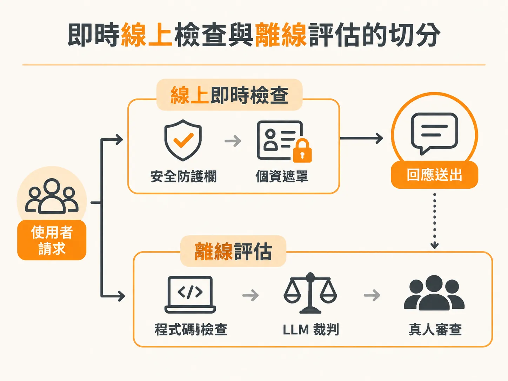
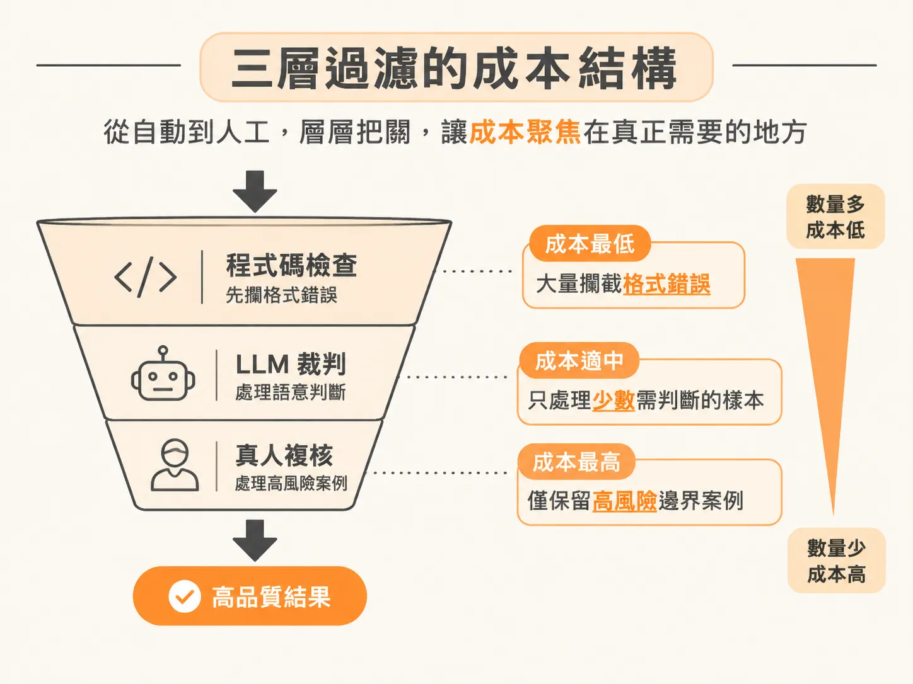

# 組合程式碼檢查、LLM 裁判與真人複核：兼顧成本與即時限制的評估策略

理解指標該放在哪一層之後，接著要面對成本與延遲的現實：不同 evaluator 的價格與執行時間差了好幾個數量級。

打造由大型語言模型（LLM）驅動的代理人（Agent）或生成式 AI 應用時，許多團隊常陷入兩難：完全仰賴真人檢查會拖慢發布速度，但把所有評估都丟給 LLM 裁判（LLM-as-a-judge）又會讓推論成本飆升，甚至面臨模型輸出漂移的風險。要建立可靠的產品，關鍵在於依據執行階段（runtime）限制與成本結構，分層組合程式碼檢查（code-based check）、LLM 裁判、使用者回饋與真人複核。

## 什麼時候該用程式碼檢查？

在評估代理人輸出時，最先要考慮的是規則型或確定性（deterministic）的檢查。

例如合規或法規有嚴格要求，規範代理人的輸出必須是合法的 JSON 格式。這時如果交給另一個 LLM 去判斷「這段文字是不是合格的 JSON」，準確率可能只有 95%，而且模型本身的判斷還會隨時間產生漂移。

相反地，直接在系統中寫一段程式碼（例如嘗試解析 JSON）來檢驗格式：
- 判斷結果完全確定，正確率達到百分之百。
- 運算成本極低，幾乎接近於零。
- 能提供極高的信心水準，不需要消耗任何 LLM API 的 token 額度。

只要是比對特定關鍵字、資料結構欄位是否存在、或是函式傳回值的格式，都應該優先交給單純的程式碼規則來處理。

## 即時線上檢查與離線評估的切分

面對正式環境（production）中大量使用者與模型的互動，系統的評估架構通常切分為兩個維度：

### 1. 線上即時檢查（Online / Runtime）
在使用者發出請求、系統產生回應的當下執行。這類檢查首重低延遲與安全性，常見的項目包括：
- **安全防護欄（Guardrails）**：攔截不當提問或有害回覆。
- **個資遮罩（PII Masking）**：透過可觀測性堆疊（observability stack）即時識別並遮蔽個人敏感資訊。

### 2. 離線評估（Offline Eval）
在背景管線中進行深度檢驗，不必承受使用者等待回應的時間壓力。在離線階段，可以混合運用三種評估工具：
- **程式碼檢查**：快速剔除格式錯誤。
- **LLM 裁判**：針對語意流暢度、回答切題程度進行打分。
- **真人審查（Human Review）**：由專家針對爭議樣本進行詳細審核。

## 善用顯式回饋與隱式訊號

要知道使用者對回應是否滿意，光靠離線指標不夠，還必須結合實際的使用者訊號：

- **顯式回饋（Explicit Signals）**：最常見的就是介面上的「讚」與「倒讚」（thumbs up / thumbs down）。這類訊號直觀，但需要使用者主動點擊。
- **隱式回饋（Implicit Signals）**：從使用者的行為模式中挖掘問題。例如在客服聊天機器人中，使用者連續兩次詢問幾乎相同的問題，甚至主動說「我還是聽不懂，請解釋清楚一點」，這就代表前一次回應的品質不及格。

系統可以透過追蹤紀錄（trace）自動抓出這類隱式失敗模式，回饋給研發團隊，作為模型微調或提示詞優化的評估樣本。

## 大量 AI 生成程式碼下的評估管線

在現代開發環境中，許多人仰賴 Cursor、Claude Code 等工具進行所謂的白合撰碼（white coding），由 AI 代理人自動產生大量程式碼或單頁應用。有人會質疑：既然產出這麼多程式碼，如果要加上層層評估，成本豈不是不減反增？

這需要區分個人實驗與團隊產品的開發模式：

- **個人本機實驗**：開發者在本地環境（例如 Claude Code）快速產出原型，只需在本機寫簡單的評分指令驗證概念。
- **團隊產品交付**：當團隊有 20 位開發者、1 位產品經理（PM），要將功能交付給數百萬甚至數十億使用者時，評估就必須融入持續整合管線（CI/CD pipeline）的「建置—測試—部署」（build-test-deploy loop）中。程式碼簽入 GitHub 儲存庫時，就必須自動觸發離線評估。

如果因為追求產出速度而省略評估，網路上充斥的只會是無人使用的「AI 垃圾」（AI slop）。嚴謹的工程規範才是產品能真正規模化的關鍵。

## 控制成本的核心心法

要在大規模部署下壓低成本，評估策略的落實方式如下：

1. **讓確定性檢查自動化**：用幾乎零成本的程式碼檢查，先過濾函式回傳值、資料規格與語法正確性。
2. **在必要時調用 LLM 裁判**：只有涉及非確定性的語意品質、回答情境匹配時，才交給 LLM 打分。
3. **消除真人複核的瓶頸**：真人審查成本最高、速度最慢。評估管線的目標不是消滅真人，而是讓真人抽離常規檢查，只在真正高風險、需要專家仲裁的少數邊界案例保留複核。

透過程式碼檢查、LLM 裁判與使用者回饋的層層過濾，既能守住系統在即時回應時的安全與效能，也能把評估成本鎖在合理範圍內。
