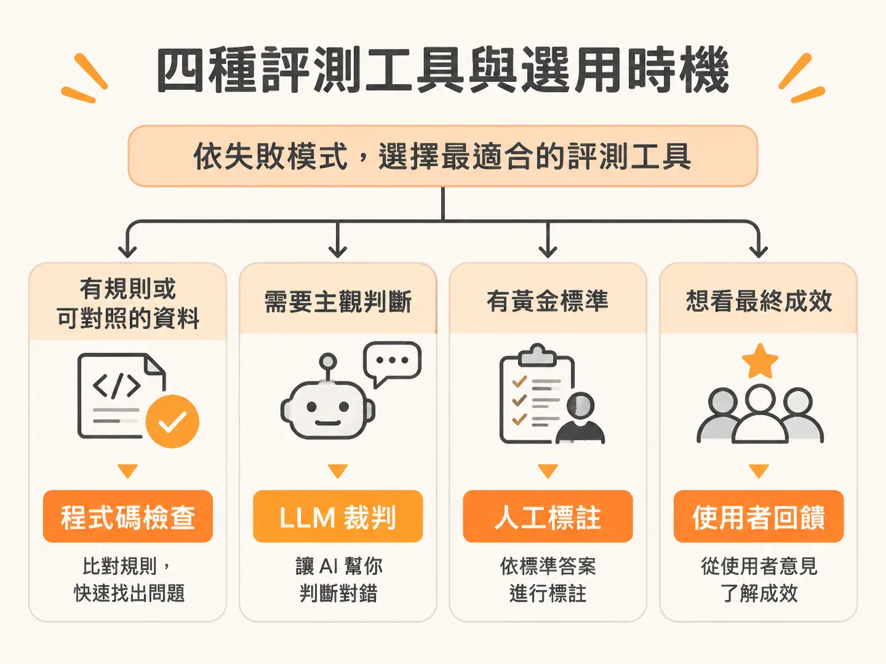
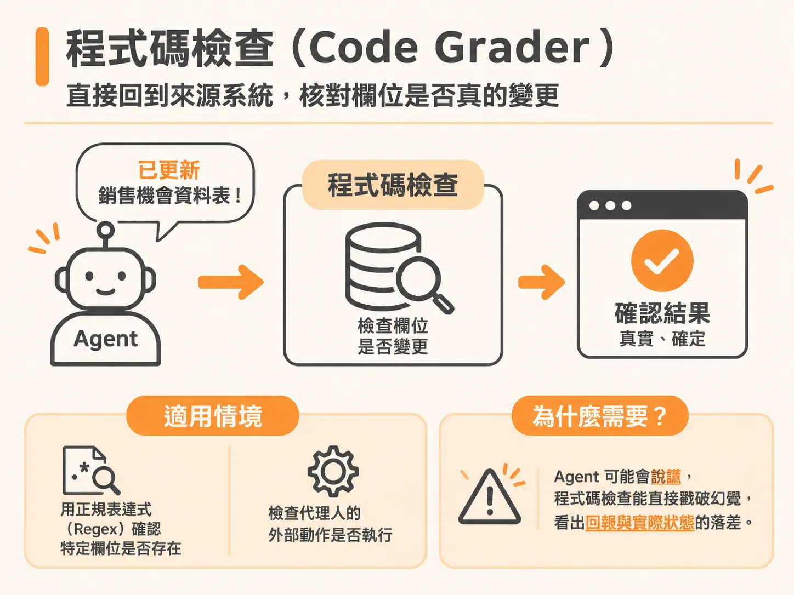
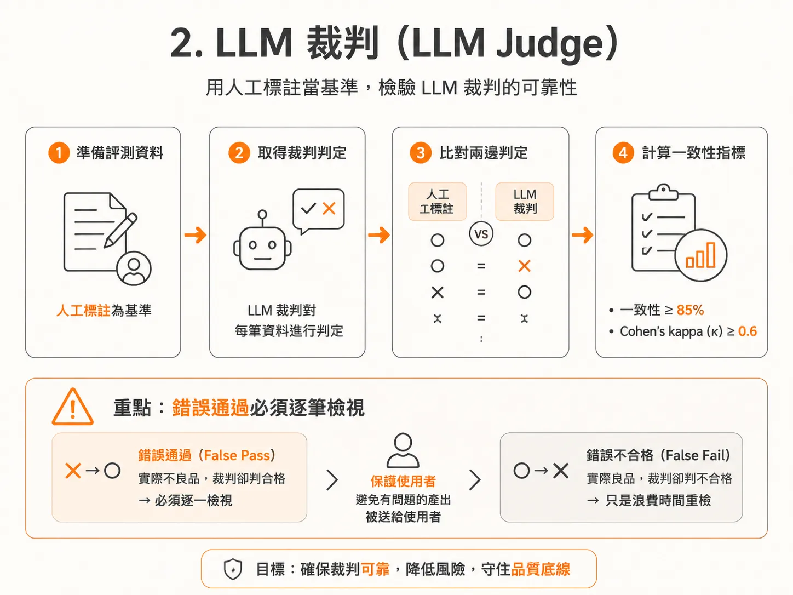
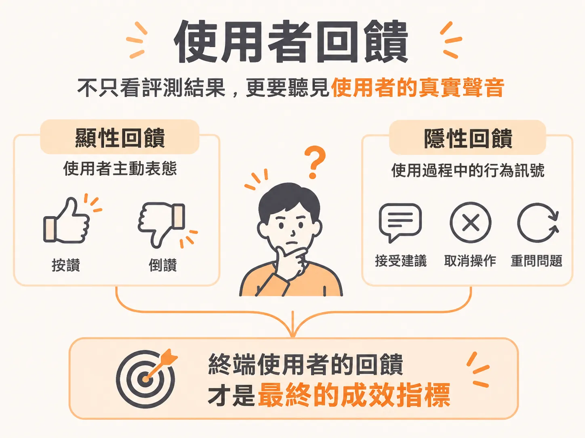

# 依失敗模式挑選評測工具：從程式碼、LLM 裁判到使用者回饋

當你檢視了十筆系統軌跡（traces），發現其中有五筆都因為某些特定問題失敗，接下來該怎麼做？你不可能每次都靠人工逐筆檢查。如果系統一天產生一萬筆軌跡，人工審查在規模與成本上都不可行。

評測（eval）本質上就是把你的品味與標準寫成機器能執行的檢查。每一個檢查項目的存在，都是因為系統曾經在某個地方出過錯。

建立評測機制的通用心法包含五個步驟：
1. **先列出失敗模式（failure modes）**：不要寫抽象的「產出好影片」，而是列出具體的失敗方式，例如「聲音太小」、「尺寸錯誤」、「文字與畫面重疊」、「前 30 秒沒有吸睛點（hook）」或「資訊卡被 YouTube 介面遮擋」。
2. **分成兩大類**：機器可檢查的交給程式碼（code grader）；需要主觀判斷的交給 LLM 評分規準（LLM rubric）。
3. **設定門檻**：明確定義什麼算及格（PASS），什麼情況下絕對禁止發布（ship）。
4. **校準（Calibrate）**：用已知的良品與不良品測試評測工具；如果裁判的判斷跟你的標準不一致，就調整裁判。
5. **設下卡點（Gate it）**：未通過評測，一律不能上線。

要讓這個流程自動化運作，關鍵在於依據失敗模式挑選正確的評測工具（evaluator）。實務上有四種評測類型，各自有適用的情境。

## 四種評測工具與選用時機

選擇評測工具的核心口訣是：**有規則可用程式碼、需要主觀判斷用 LLM 裁判、黃金標準靠人工標註、最終成效看使用者回饋**。

### 1. 程式碼檢查（Code Grader）

如果你的驗證條件有確定性（deterministic）規則，或者可以直接對照系統的真實資料（ground truth），就應該優先使用程式碼。

* **運作特性**：執行速度以秒計算、幾乎零成本，而且結果絕對確定。
* **適用情境**：
  * 用正規表達式（Regex）確認特定欄位是否存在。
  * 檢查代理人（Agent）的外部動作是否確實執行。例如系統回報「已更新 Salesforce 銷售機會資料表」或更新了 Workday 紀錄，你不需要叫 LLM 去判斷「它有沒有更新」，直接用程式去資料庫檢查該欄位有沒有變更即可。Agent 有可能會說謊（回答更新了，但資料庫根本沒動），程式碼檢查能直接戳破這種幻覺。

如果一件事能用規則或比對資料庫說清楚，就不要讓 LLM 介入。在評測規模擴大時，大量呼叫 LLM 評估每筆呼叫可能耗費 3 到 6 美元，評測成本甚至會遠遠超過運行 Agent 本身。近期像 Jev 這種 system 1 分類器模型受到高度關注，正是因為大家都在尋找更便宜、更快速的替代方案來分擔高昂的 LLM 評測成本。

### 2. LLM 裁判（LLM Judge）

當產出包含大量非結構化文字，且需要做出主觀判斷時，程式碼規則就派不上用場，此時必須使用 LLM 裁判。

* **適用情境**：
  * 摘要品質評估：要求模型摘要一篇一百頁的研究論文，摘要是否抓到重點、邏輯是否通順，無法用寫死規則檢查。
  * 語氣與專業度檢查：判斷客服回覆的語氣是否專業得體。
* **運作方式**：設計評分規準（Rubric），通常採用 1 到 5 分的量表（Likert scale），並且針對每個分數錨定明確的文字定義，清楚說明「拿 1 分的長怎樣、拿 5 分的長怎樣」。

使用 LLM 裁判時，永遠不能盲目信任它。你必須用人工標註的資料來驗證裁判。在指標上，裁判與人工標註的一致性通常要求達到 85% 以上，且 Cohen's kappa（$\kappa$）值需大於等於 0.6；更重要的是，每一筆「錯誤通過」（false pass，即實際上是不良品，裁判卻判合格）都必須逐一檢視。因為錯誤不合格（false fail）只是浪費時間重新檢查，但錯誤通過卻會直接把有問題的產出送給使用者。

### 3. 人工標註（Human Labels）

人工標註是所有評測的黃金標準（ground truth）。沒有人工標註過的基準資料，你就無法驗證 LLM 裁判到底準不準。

人工審查不能憑感覺進行，需要有明確的引導手冊（human eval guide）與流程設計：
* **善用跨團隊眾包（Internal Crowdsourcing）**：如果你正在打造一個業務銷售代理人（SDR Agent），而工程團隊本身不熟悉業務流程，不一定要花大錢找外部標註廠商。可以舉辦內部的工作坊（brown bag session），找業務團隊與市場拓展（GTM）團隊一起看真實軌跡，藉助領域專家的專業定義何謂良好產出。
* **明確無歧義的規範**：評審指引必須極度清楚，提供「良好表現」的具體範例。評分方式必須一致，明確規範是要打及格／不及格（pass/fail），還是 1 到 5 分的等級，不要讓標註者有人給 1 到 10 分、有人隨手寫合格。如果人類標註者彼此之間的協議度（$\kappa$）都很低，LLM 裁判就更不可能與人類達成一致。

在面對領導層溝通時，傳統機器學習指標（如精確率 Precision、召回率 Recall、F1 分數或 BLEU）雖然在檢索（Retrieval）等底層模組仍有參考價值，但不該放在最顯眼的儀表板上。評測指標應該分層呈報：
1. **商業成果與風險（Leadership 層級）**：產品是否達成業務目標、風險控制如何。
2. **代理人執行品質（Agent 執行層級）**：工具呼叫（Tool call）是否正確、調取的資料是否準確。
3. **底層模型與檢索表現（工程技術層級）**：F1、檢索命中率等底層指標。

### 4. 使用者回饋（User Feedback）

即使你的評測儀表板全是綠燈，只要產品一上線使用者都在抱怨，評測全數通過也沒有意義。終端使用者的回饋才是最終的成效指標，回饋形式主要分為兩類：

* **顯性回饋（Explicit Feedback）**：使用者刻意且主動留下的評價。最常見的形式就是聊天介面上的按讚（thumbs up）與倒讚（thumbs down）。
* **隱性回饋（Implicit Feedback）**：使用者在正常使用過程中自然產生的行為訊號，背後不需要刻意填寫評分。
  * 以程式碼編輯工具 Cursor 為例，當模型生成程式碼建議時，開發者是選擇「接受程式碼」、「直接取消」，或是「後續是否有送出 Pull Request（PR）」，這些操作行為就是極為強烈的隱性評測訊號。
  * 如果使用者沒有接受建議，背後就隱含著「這次產出不夠好」的資訊。隨著數百萬開發者每天持續操作，即使只有 10% 到 20% 的互動留下行為軌跡，滾雪球累積下來的真實回饋量依然非常龐大。

在產品設計初期，就必須將顯性回饋（按讚、倒讚）與隱性回饋（使用者的接受、捨棄、修改等操作行為）一併納入體驗中，讓真實的使用者訊號持續反饋到評測系統，作為迭代升級的基礎。
