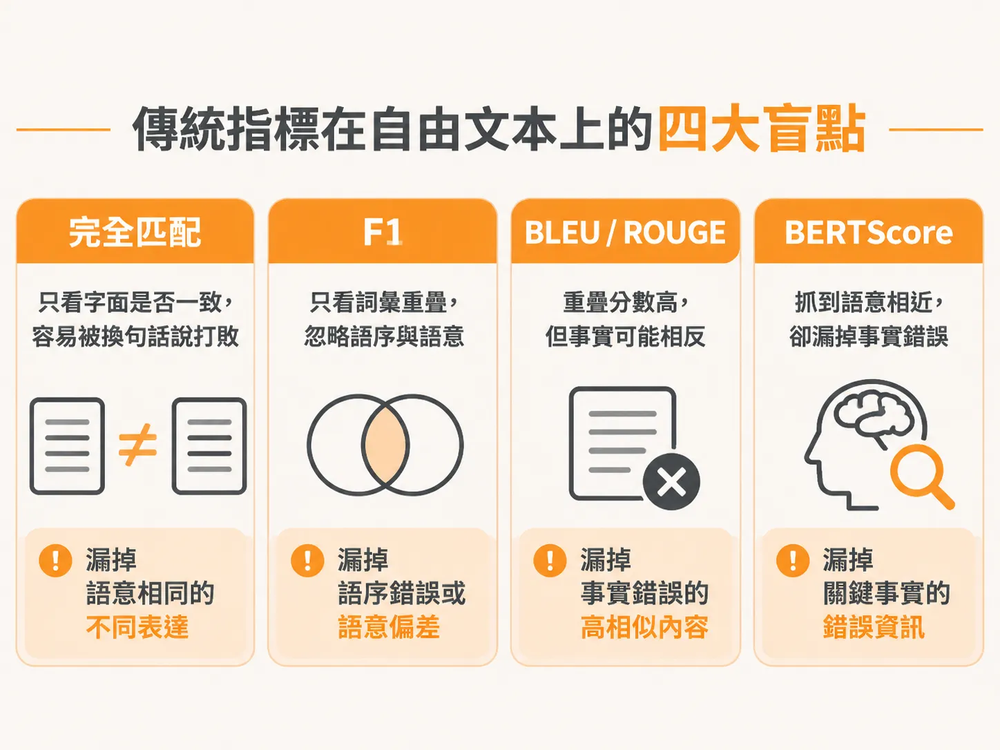
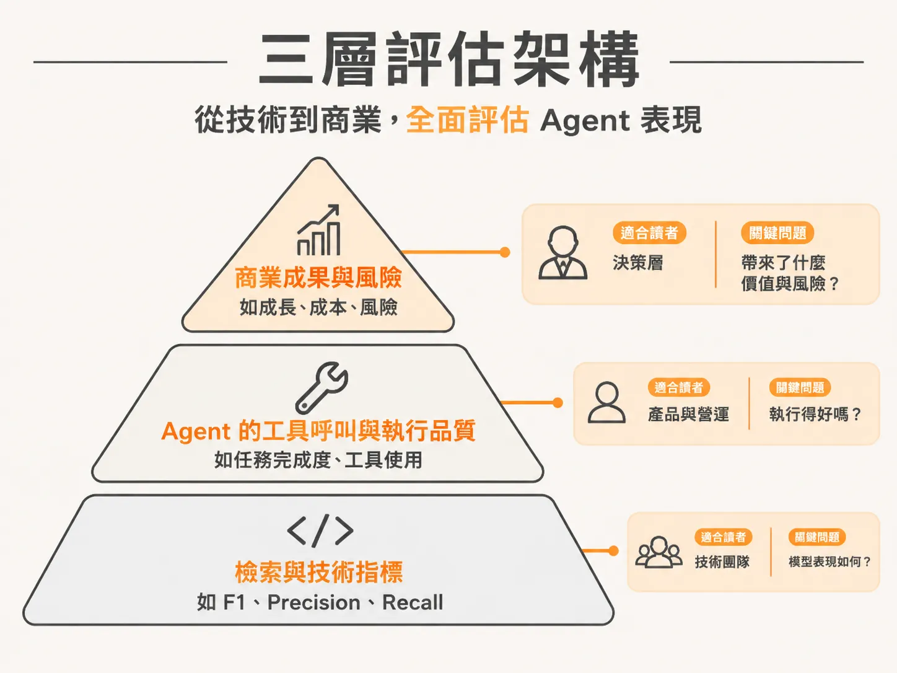

# 傳統指標為何在自由文本失靈？將評估指標放回三層架構

選對 evaluator 之後，下一個問題是：該拿哪些數字向上層報告？

當團隊把大型語言模型（LLM）上線，工程師往往習慣拿出傳統機器學習的指標來向主管報告：「我們的 F1 分數達到 0.92，BLEU 分數也大幅提升。」然而，主管與管理層常會困惑地反問：「這代表業務成果變好了嗎？上線後有什麼風險？」

傳統指標並非完全失去價值，但若拿來評估自由文本生成，往往會漏看關鍵問題。同時，若在會議中把這些底層指標直接擺在儀表板的核心，很容易讓討論失焦。要建立有效的評估系統，必須先理解四種常見傳統指標在自由文本上的限制，再將它們安放到合適的三層指標架構中。

## 傳統指標在自由文本上的四大盲點

在評估自由文字輸出時，常見的傳統指標各有其設計用途，但在面對語言模型多樣的生成內容時，各自都有致命的漏失：

- **Exact Match（完全匹配）**：
  - **衡量內容**：輸出是否與參考答案完全一模一樣。
  - **適用場景**：ID、固定標籤、明確的分類結果。
  - **在自由文本失靈的原因**：自由文本只要出現任何用詞換句話說（phrasing variation），哪怕意思完全正確，也會被判為錯誤。
- **F1 / Precision / Recall（精確率／召回率／F1 分數）**：
  - **衡量內容**：字詞片段（token 或 span）的重疊程度。
  - **適用場景**：實體擷取、關鍵字提取與分類任務。
  - **在自由文本失靈的原因**：只比對詞彙有沒有出現，完全忽略詞彙之間的語序與整體語意。調換前後因果或邏輯關係，只要包含相同關鍵字，分數可能依然很高。
- **BLEU / ROUGE**：
  - **衡量內容**：連續詞組（n-gram）的重疊比例。
  - **適用場景**：機器翻譯、文章摘要。
  - **在自由文本失靈的原因**：分數高不代表內容正確（high score ≠ correct）。模型只要把參考答案的大量詞組重新拼湊，就能拿到漂亮的重疊分數，但產出的事實可能完全顛倒。
- **BERTScore**：
  - **衡量內容**：詞向量之間的語意相似度（embedding similarity）。
  - **適用場景**：評估整體句意是否貼近。
  - **在自由文本失靈的原因**：無法精確捕捉事實錯誤（misses factual errors）。例如模型把「營收成長 15%」寫成「營收衰退 15%」，兩句話在語向量空間中極為相似，BERTScore 會給出極高分，卻完全漏掉了嚴重的事實偏差。

在選擇評估器時，必須回歸你要檢驗的本質：你正在檢查的是一條不可違反的固定規則（a rule）、需要上下文理解的綜合判斷（a judgment），還是有明確標準答案的客觀事實（a ground truth）。

## 把指標放回評估的三層架構

既然傳統指標有這些盲點，是否代表它們不再有用？其實不然。F1、Precision 與 Recall 在評估系統管線（pipeline）中的「檢索（retrieval）」環節時，依然是非常優秀的衡量工具。問題的根源不在指標本身，而是團隊常常把它們擺錯了層級。

在設計評估體系時，建議心中要帶著兩到三種不同的角色與視角，將指標分為三個層級：

1. **第一層：商業成果與風險（Outcome and Risk）**
   這是領導階層與產品負責人最關心的維度。這項 AI 應用是否達成預期的商業成果？產品是否算得上成功？上線後是否有法規、資安或聲譽上的風險？這是儀表板最高層級、必須優先回答的問題。
2. **第二層：Agent 執行與功能品質（Agent Execution and Quality）**
   這是衡量系統功能運作是否健全的中間層。Agent 有沒有做出正確的工具呼叫（tool call）？它在執行過程中是否存取了正確的資料來源？整個執行的工作流程是否符合功能品質要求？
3. **第三層：底層檢索與技術運作指標（Underlying and Retrieval Metrics）**
   傳統機器學習指標就落在這個層級。它們用來監控底層檢索管線的成效，例如檢索階段抓出的文件片段其 Precision、Recall 與 F1 是否達標。

如果直接把第三層的 F1 或 BLEU 當成核心指標端上管理層會議，會議往往難以收斂，甚至演變成無休止的無效爭論。清楚劃分這三個層級後，底層指標便能在它擅長的檢索分析上發揮價值，同時也能讓團隊清楚向決策者證明：系統功能是否正常運作，以及整體產品究竟帶來了多少商業成果與風險控管。
