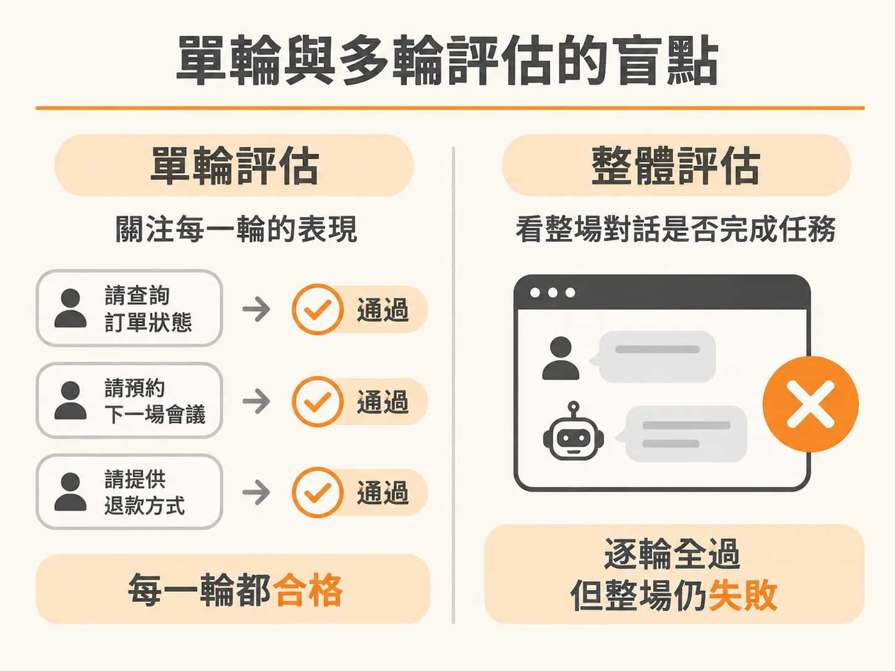
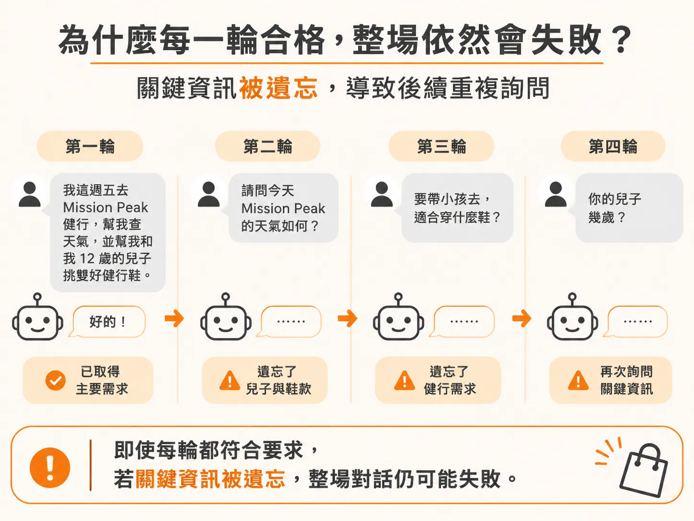
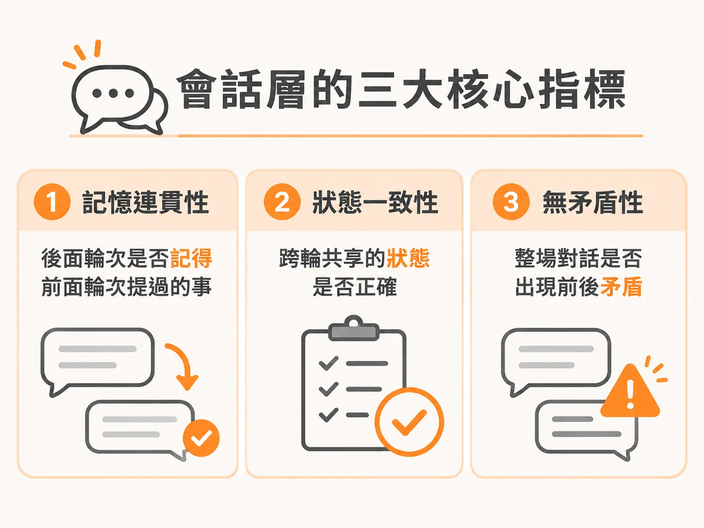

# 從單輪到會話層：用三大指標評估多輪對話

評估 AI 助理或 Agent 時，多數人最直覺的做法是「單輪評估」：給模型一段 prompt，看它給出的回覆對不對、有沒有呼叫正確的工具，然後給予及格或不及格。

但是在真實應用情境中，絕大多數的互動都是多輪對話。以常見的客服情境為例，使用者可能透過電話或文字進線，來回溝通 5 分鐘，平均長度大約是 5 個輪次（turn）。如果只用單輪的標準去檢驗，很常會遇到一個尷尬的狀況：每一輪單獨拿出來評分都合格，整場對話最後卻是徹底失敗的。

## 單輪與多輪評估的盲點

單輪評估關注的是當下的輸入與輸出。只要 Agent 在該輪正確叫出工具、回答精準，該輪就能拿到分數。

多輪評估看的則是整場對話的「最終成果」（outcome）。不論對話進行了 2 分鐘還是 5 分鐘、來回了 10 輪還是 20 輪，關鍵在於：
- 使用者的任務到底有沒有被解決？
- 對話是否導致了糟糕的顧客滿意度？
- 系統是否因為無法解決問題，最後只能轉接給真人客服？

在自主 Agent 的客服場景中，「轉接真人率」（escalation rate）就是一個非常核心的指標。如果 Agent 在每一輪都禮貌且正確地回答，但繞了 10 輪還是無法辦理退貨，最終被迫轉給真人，這場對話在會話層就不能算及格。

## 為什麼每一輪合格，整場依然會失敗？

當對話越來越長，上下文視窗（context window）塞進越來越多內容，Agent 就很容易丟失先前的脈絡。

舉個實際的購物助理情境：使用者對著電商助理說：「我這週五打算去 Mission Peak 健行，幫我查天氣，並幫我和我 12 歲的兒子挑雙好健行鞋。」

這是一個帶有多意圖（multi-intent）且高度個人化的需求。系統辨識了日期、查了天氣，也根據登入身分抓取過往偏好（例如使用者的鞋號是 9 號），每一輪的回覆都非常得體。但如果到了第四輪，Agent 突然反問一句：「請問您兒子的年齡是幾歲？」

在單輪評估看來，詢問小孩年齡以推薦尺寸是合理的工具行為；但在會話層，使用者一開始就已經清楚交代過「12 歲」。Agent 遺忘了前面提過的事實，又或者在前面幾輪明明已經討論過商品價格，後面卻又重複詢問預算，這會立刻讓體驗大打折扣，甚至導致任務失敗。

## 會話層的三大核心指標

要避免這種「單輪皆通，全盤皆輸」的情況，對話層級的評估必須加入以下三個維度：

### 1. 上下文保留（Context Retention）
檢驗第 $N$ 輪的回覆中，Agent 是否依然記得第 1 輪到第 $N-1$ 輪出現過的關鍵資訊。長對話中最容易發生的問題就是遺忘先前的對話紀錄，評估時要特別挑出跨輪次的關鍵約束條件（例如兒子的年齡、出發時間、前幾輪確認過的事情），確認模型沒有遺漏或重複詢問。

### 2. 狀態準確度（State Accuracy）
檢驗系統在整場對話中追蹤的狀態是否正確。例如購物車裡的品項與數量、使用者的尺寸與偏好條件、目前已完成的驗證步驟等。Agent 不只要產出文字，往往還要將 session 的狀態傳遞給後端系統，狀態一旦追蹤錯誤，後續的決策就會全面偏差。

### 3. 連貫性（Coherence）
檢驗整場 session 之中是否存在前後矛盾。模型在第 2 輪給出的說明或承諾，不能在第 5 輪被自己推翻。保持整場對話的一致性，是建立使用者信任的基本條件。

評估多輪對話不能只停留在個別輪次的正確性。把單輪的工具調用與準確率，結合會話層的上下文保留、狀態準確度與連貫性，才能真正衡量 Agent 在真實多輪互動中的任務達成能力。
