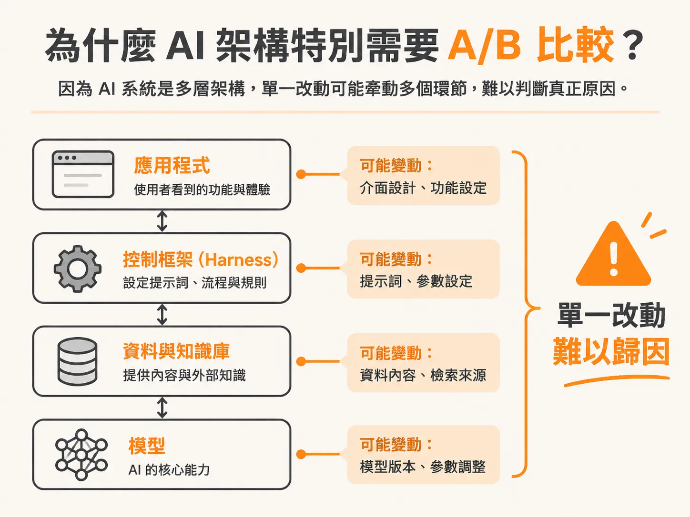
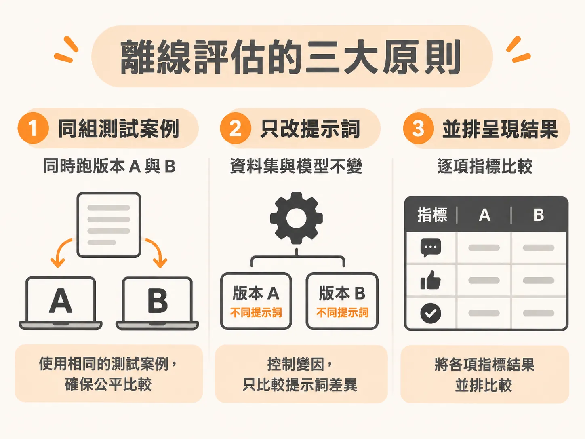
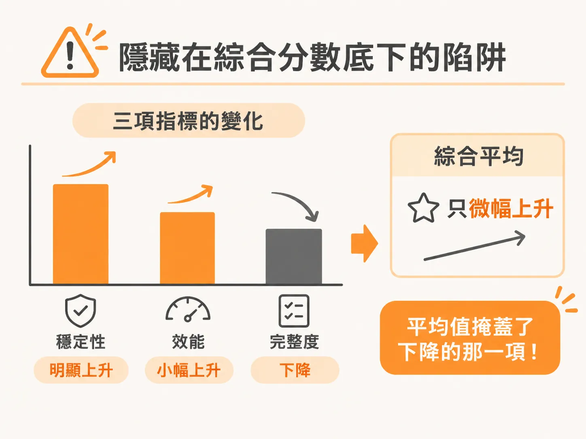
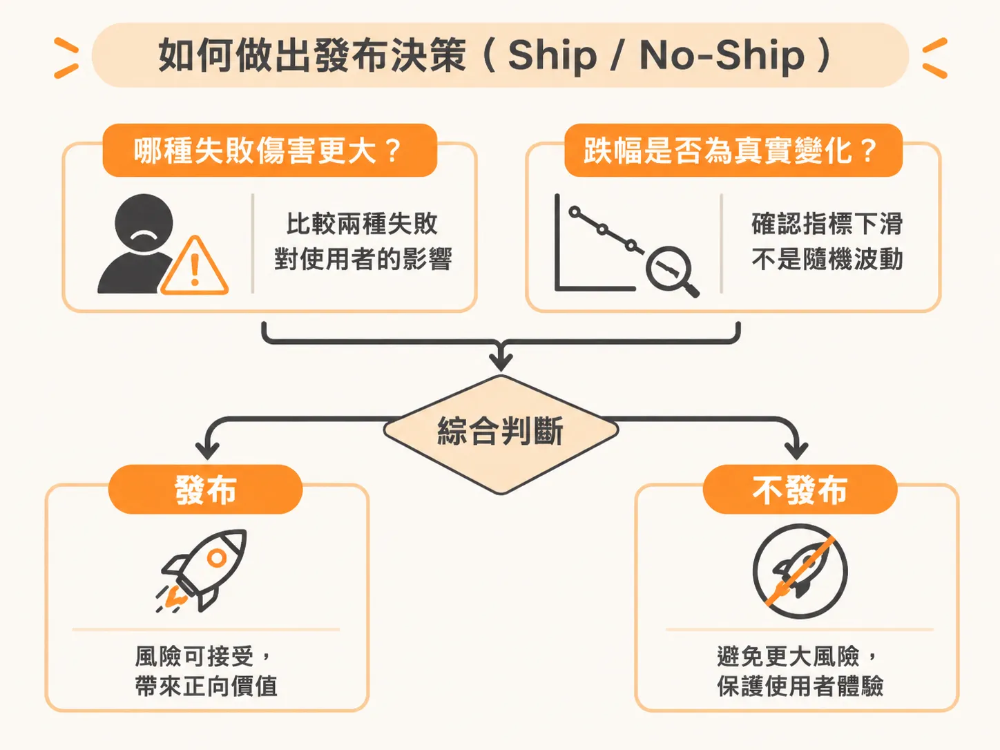

# 用離線 A/B 評估做安全的發布決策

對話與工具都能量了之後，最後一個問題是：這次改動到底有沒有讓整體變好？

當你改寫了系統的提示詞（prompt），第一個冒出來的問題通常是：「這樣真的變好嗎？」

如果只是隨手挑四、五個範例丟進模型測試，看看回覆覺得「感覺不錯」就直接推上線，這類憑感覺（vibe）做的決定幾乎必然會在正式環境踩雷。在軟體開發與消費型產品領域，Google 和 Meta 這類公司數十年來都在大量運用 A/B 測試，甚至同時在線上對數十億使用者運行數十種版本。

但在把 AI 功能推給真實使用者之前，你更需要的是「離線 A/B 評估」（offline A/B）：拿完全同一組測試案例，在預發布環境中對新舊兩個版本做 side-by-side 的並排比對。

## 為什麼 AI 架構特別需要 A/B 比較？

在常見的 AI 架構堆疊（有時被稱為 AI 三明治架構）中，通常包含四層：最底層的模型、資料與檢索內容、外層的控制框架（harness），以及最上層的應用程式。

這個架構最大的挑戰在於：任何一個環節隨時都在變動，而且往往由不同團隊負責。
- 控制框架裡的提示詞會被修改。
- 知識庫更新了一篇新文章，檢索出來的新資料可能突然讓模型感到困惑。
- 即使你什麼都沒動，底層調用的商業大語言模型（例如 GPT 或 Claude 系列）版本也可能在後端默默更新，讓你這週跑出來的結果和上週完全不同。

當系統充滿漂移的變數，任何改動都可能導致輸出品質下滑。因此，每當團隊根據追蹤紀錄（traces）想出優化點子時，絕對不能直接把新版本推上線，而必須建立標準化的 A/B 比對流程。

## 離線評估的三大原則

想要透過離線 A/B 得到可靠的結論，必須遵守三個執行原則：

1. **一次只改一個變數**：在測試工具（例如提示詞遊樂場 playground）中比對新舊版本時，必須固定資料集與模型。如果你同時更換了模型又修改了提示詞，最後即使成績變了，你也完全無法歸因是哪一個改動造成的。
2. **跑完整測試集，不要只看少數範例**：人眼抽查幾筆資料很容易產生倖存者偏差。必須讓新舊版本跑過同一批完整的測試集，才能得出客觀的數據。
3. **逐一指標檢視差距（delta），不能只看綜合分數**：評估指標通常不只一個，改版往往會帶來「進兩步、退一步」的退化現象（regression）。新版本可能在某個維度勝出，卻在另一個維度失分。

## 隱藏在綜合分數底下的陷阱

以實際的改版評估為例，假設線上運行的版本是 A，新提示詞版本是 B，測試後得出各項指標的變化：

| 指標 | A（目前版本） | B（新版提示詞） | 變化（Change） |
| :--- | :--- | :--- | :--- |
| **忠實度（Faithfulness）** | 82% | 91% | +9 |
| **完整度（Completeness）** | 88% | 85% | −3 |
| **語氣（Tone）** | 90% | 92% | +2 |
| **綜合平均（Blended average）** | 86.7% | 89.3% | +2.7 |

如果只看最後的綜合平均分數，新版本提升了 2.7 個百分點，看起來像是一次成功的優化。但這個平均分數完全掩蓋了完整度下降 3 個百分點的事實。

## 如何做出發布決策（Ship / No-Ship）

看到這樣的矩陣結果，到底該不該發布版本 B？決策的核心在於兩件事：

第一，**哪一種失敗對使用者傷害更大？**
如果你的應用是醫療、法律或金融等容錯率極低的領域，忠實度大幅提升 9 個百分點，代表捏造事實與幻覺明顯減少，那麼犧牲 3 個百分點的完整度可能非常值得；但如果你的應用是客服排解指南，漏掉關鍵步驟會直接導致使用者無法解決問題，那麼完整度的下滑就可能是無法接受的阻礙。

第二，**這個數值差距是否真實？**
你需要確認 −3 的跌幅是具有統計意義的實質倒退，還是只是測試樣本抽樣波動下的雜訊。

把這些指標並排整理成表格，帶進跨團隊的決策會議中討論，評估才有辦法制度化。團隊不需要再爭論彼此的主觀感受，而是用具體的指標差距，決定這項改動究竟該上線還是該退回。
