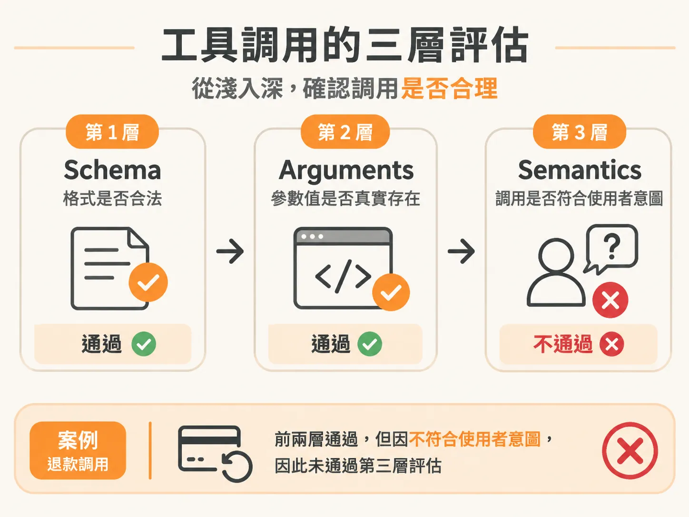
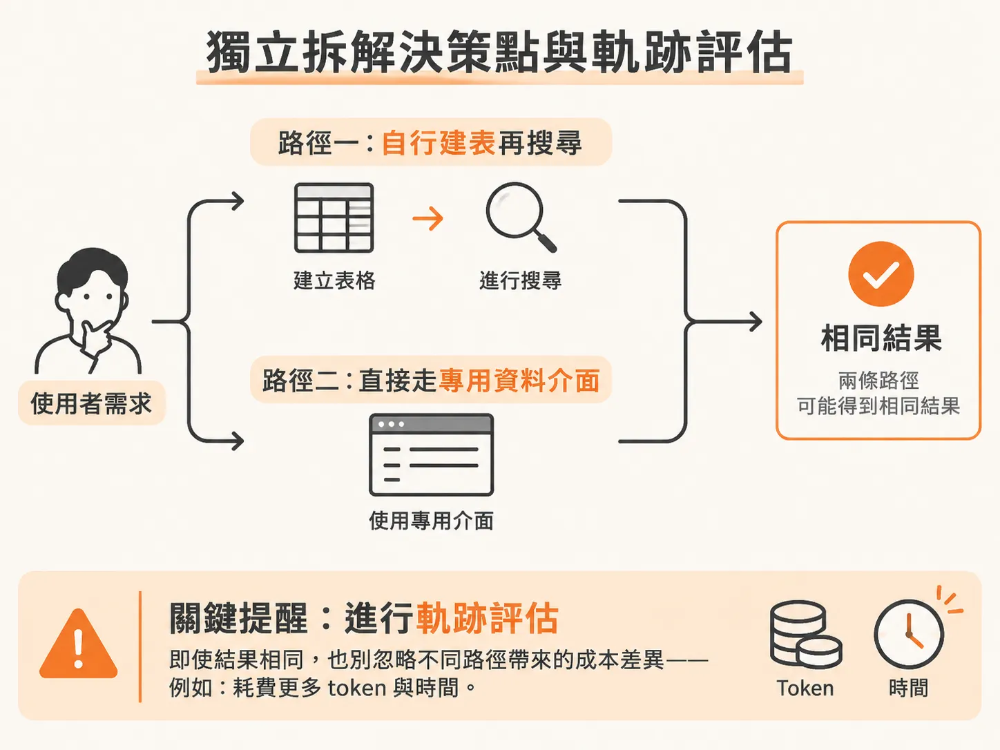

# 評估 Tool Call 的三層結構與路徑選擇

把視角從整場對話拉回單一輪，最常出錯的動作就是工具調用（tool call）。

在開發 AI Agent 時，許多人只檢查工具調用（tool call）有沒有拋出錯誤、輸出的 JSON 能不能順利被程式解析。但程式沒有當掉，不代表模型做了對的事。

評估 Agent 的工具調用時，必須將驗證拆解為三個層次，同時搭配執行軌跡（trajectory）的評估，才能在規模擴大時確保系統兼顧正確性與效率。

## 工具調用的三層評估：Schema、Arguments、Semantics

評估一次工具調用是否合理，需要由淺入深檢視三個層次：

1. **結構層（Schema）**：輸出的格式是否符合規格？例如是否為合法、可解析的 JSON，欄位型態是否正確。
2. **參數層（Arguments）**：填入的參數值是否有效？例如有沒有帶入系統中確實存在的訂單編號（Order ID）。
3. **語意層（Semantics）**：調用該工具是否符合使用者真正的意圖？

單看前兩層很容易產生「一切正常」的假象。舉例來說，使用者傳來的訊息只是在詢問訂單運送進度，模型卻產生了一個格式完全合法（Valid JSON）、訂單編號也完全吻合的退款工具調用。

前兩層的檢查會全部通過，只有在第三層的語意評估中，才會發現使用者根本沒有要申請退款，模型卻誤將一般詢問判定成退款請求。因此，光驗證 JSON 合法遠遠不夠，必須檢驗工具調用與意圖的一致性。

## 獨立拆解決策點與軌跡評估（Trajectory Eval）

在具備路由器（router agent）與多個工具調用模組的複合架構中，最佳實踐是將各個元件拆開獨立評估，而不是只看最後的總體輸出。

從使用者提出問題到 Agent 給出最終行動之間，包含數個關鍵決策點與潛在失敗點（failure points）。其中最重要的兩個環節就是工具調用與檢索（Retrieval）；只要確實掌握這兩處的評估，系統就已經穩固了七成。

當 Agent 面對十種工具時，它是否選擇了正確的工具？如果預期該走工具 A 卻走向工具 B，這就是執行路徑偏差。

即便走向不同路徑最終可能碰巧得出相同結果，也不能忽視軌跡評估。例如：

* **路徑 A**：Agent 自己建立資料表再執行資料搜尋。
* **路徑 B**：直接調用專門的資料 MCP（Model Context Protocol）介面。

雖然兩者回傳的答案可能一樣，但路徑 B 消耗更少 token，反應速度也更快。在單元測試階段，走哪條路看起來差別不大；但當系統流量放大、進入大規模運作時，路徑是否經過最佳化就會對成本與延遲產生決定性影響。

## 工具評估的成本配置

評估工具調用時，不必浪費高成本的大型語言模型。

因為驗證工具是否選對，本質上是一個分類問題（例如在選項 A 與 B 之間做判斷）。評估這類節點時，使用小型模型就能勝任，能有效節省評估流程所消耗的 token。
