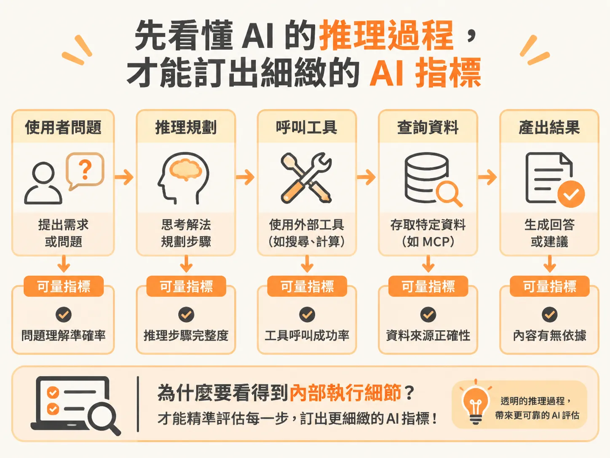
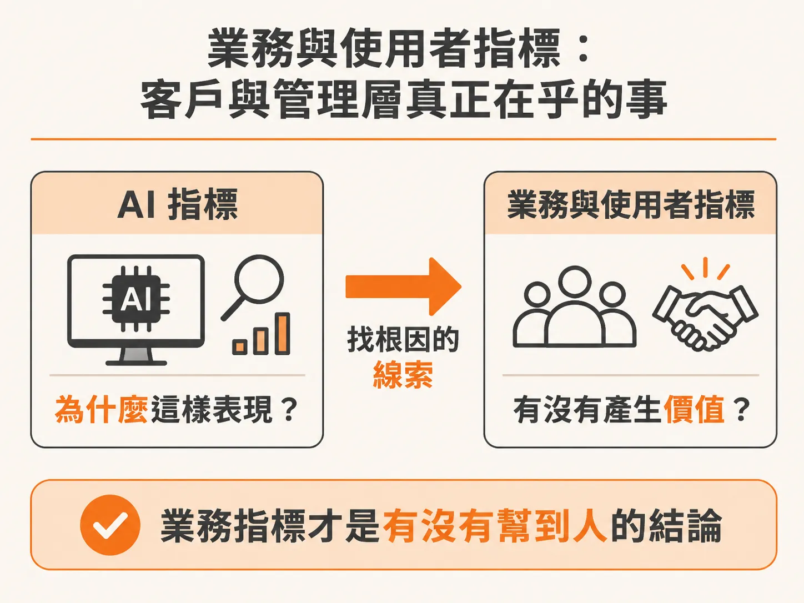

# 評估 AI 產品成效：搞懂 AI 指標與業務指標的差別

品質、安全、可靠度、成本與延遲都量到了，很快會碰到下一個問題：這些數字要給誰看、回答誰的疑問？

當你把一個 AI Agent 推上線時，最常遇到的問題往往不是「程式碼有沒有寫對」，而是「怎麼知道它算不算成功」。

如果你在打造產品初期沒有想清楚成效該怎麼定義、指標該怎麼量測，就急著推到正式環境（Production），這款產品最後無法符合預期、甚至以失敗收場的機率非常高。

在不同的工具中，名詞可能長得不太一樣。例如 Braintrust 或 LangChain 等平台，有的稱作指標（Metric）、分數（Score），有的稱作量測項（Measure）或是 KPI。別被這些名詞分類搞混，它們本質上都是同一件事：關鍵在於你到底要從哪些維度來衡量產品。

最簡單也最實用的思考框架，就是把所有指標分成兩大類：**AI 指標（AI Metrics）** 與 **業務與使用者指標（Business / User Metrics）**。

這兩類指標並不是互相取代，而是分工回答截然不同的問題：**AI 指標回答「為什麼（Why）」**，幫我們看清模型的內部表現；**業務指標回答「這件事到底有沒有價值、有沒有產生實質影響（Whether it mattered）」**。

## 先看懂 AI 的推理過程，才能訂出細緻的 AI 指標

以一個客服 Agent（例如 Pronto）為例，當你把它整合進官方網站、WhatsApp 或 Slack 時，使用者會在這裡進行第一線互動。

在幕後，AI 正在經歷複雜的流程：推理層在想什麼、它呼叫了哪些工具、呼叫了哪個 MCP（Model Context Protocol）、存取了什麼資料，整個往返過程非常繁瑣。過去許多閉源模型像個黑盒子，外部完全看不到推理細節。但自從 DeepSeek 出現並展示內部推理過程後，掀起了業界的期待，現在像是 Anthropic 和 OpenAI 等廠商也愈來愈開放，許多開發工具（例如 Cursor）和評測平台都能完整顯示追蹤紀錄（Traces）。

能看見這些內部執行細節，我們才能訂出更細緻的 **AI 指標**。AI 指標專門用來評估 AI 本身做得好不好、推理與產出是否正確：

- **幻覺率（Hallucination Rate）**：模型有沒有捏造事實？能不能透過引用來源與更新語料來降低幻覺？
- **準確度與脈絡掌握**：例如 Context Precision、召回率（Recall）、Grounding（是否有根據事實發言）、F1 Score 等。
- **錯誤率與工具呼叫**：API 呼叫是否失敗、權限或資料缺漏處理得如何。
- **延遲（Latency）**：AI 產出回答的速度夠不夠快。

對使用者或主管來說，他們其實不在乎 F1 Score 是多少或召回率多高。這些指標是給工程團隊看的代理指標（Proxy Metrics），目的是幫我們抓出問題根因，打造出更可靠、可擴展的系統。

## 業務與使用者指標：客戶與管理層真正在乎的事

業務與使用者指標，衡量的是這項產品有沒有替公司和使用者帶來實質價值。

主管或管理層如果希望你看著儀表板回報成效，通常最關心三個問題：
1. **這東西安全可靠嗎？產出的品質對不對？**
2. **我們花了多少成本？**（例如消耗了多少 Token？這通常是財務主管最在意的：到底花多少、省多少或賺多少。）
3. **我們得到了什麼價值？**

以剛剛提到的外部客服 Agent 為例，常見的業務與使用者指標包括：

- **問題解決率（Resolution Rate / Deflection Rate）**：有多少使用者的問題由 Agent 成功解決，而不需要轉移給真人客服？
- **轉接真人率（Escalation to Human Rate）**：Agent 無法處理、最後不得不轉給真人接手的互動比例有多高？團隊的目標通常是壓低這個數字。
- **使用者滿意度（CSAT）**：使用者與 Agent 互動後的體驗如何？

很多團隊在做概念驗證（POC）時，往往只專注於 AI 的品質與準確度，把成本與業務成效留到以後再說。但在建構企業級的 Agent 方案時，成本、用量與商業價值必須在最一開始就納入規劃。

## 根據情境調整指標

業務指標並非一成不變，它高度取決於 Agent 的應用場景：

- **外部客服 Agent**：衡量重點是使用人數、問題解決率、轉接真人次數與 CSAT。
- **寫程式 Agent（Coding Agent）**：衡量的可能是程式碼採納率、功能開發時間的縮短程度。
- **內部軟體開發生命週期（SDLC）的工作流程 Agent**：重點則是能否幫後勤團隊省下人工處理時間。

在評估評測（Evals）時，不要只看工具預設提供了什麼。現代多數評測平台都支援自訂評分器（Custom Scorers），當預設指標不符合業務定義時，你完全可以根據實際需求打造自己的指標。

在展開 AI 產品的 PRD 或評測驅動開發（Eval-Driven Development）時，隨時拿這兩個問題檢驗自己：這項指標是在衡量 AI 本身為什麼這樣回答，還是在衡量這項回答對真實業務有沒有產生影響？兩者兼備，你才能打造出既技術紮實又具備商業價值的產品。
