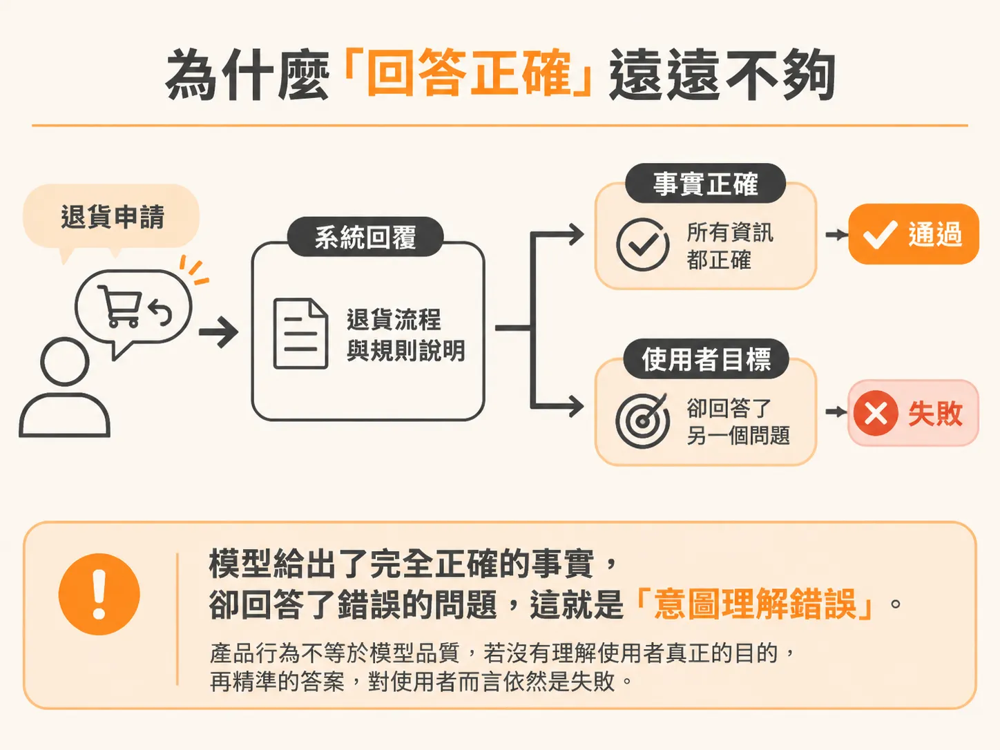
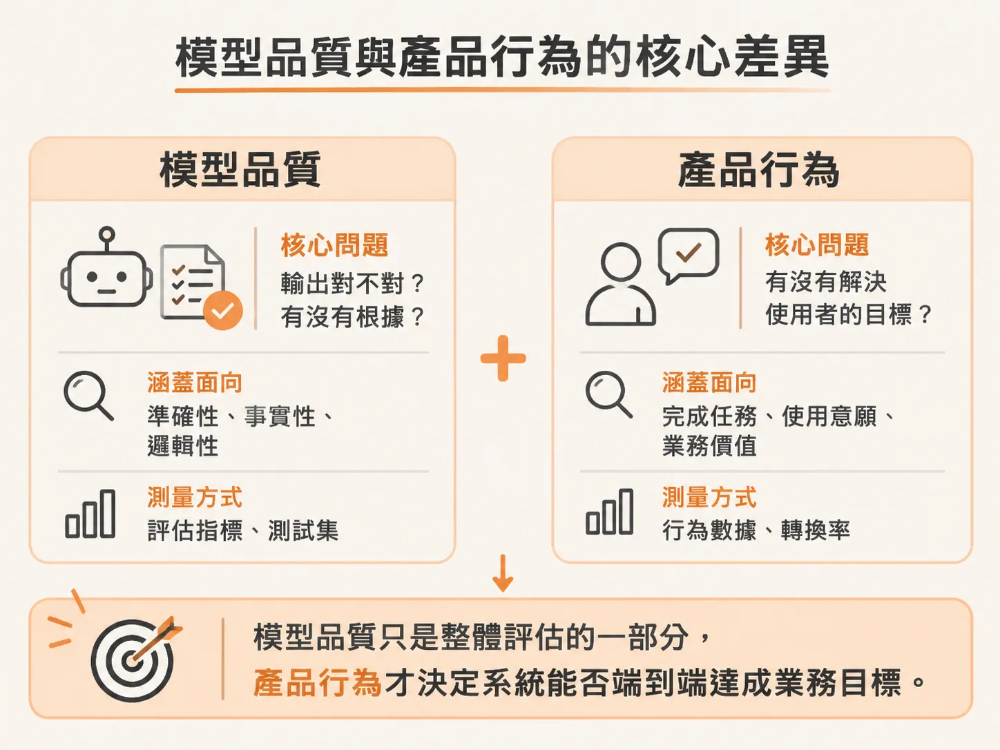

# 答對了卻答錯問題：區分模型品質與產品行為

在評估 AI 系統時，許多團隊常落入一個盲點：只要模型產出的文字內容正確、沒有幻覺，就認定系統運作正常。但在實際產品中，「回答正確」與「解決問題」往往是兩回事。

### 為什麼「回答正確」遠遠不夠

在實際審查執行紀錄（trace）時，常常會遇到一種令人困惑的情況：系統回答的內容通過了每一項事實準確度檢查，資訊完全屬實，但使用者卻依然沒有得到想要的結果。

這就是典型的「意圖理解錯誤」（Wrong Intent）。模型給出了完全正確的事實（right facts），卻回答了錯誤的問題（wrong question）。這類案例清楚說明了一件事：**產品行為（product behavior）並不等於模型品質（model quality）**。如果系統根本沒有理解使用者真正的目的，模型產出的內容再精準，對使用者而言依然是一次失敗的互動。

### 模型品質與產品行為的核心差異

要建立完整的評估機制，必須針對這兩者設計截然不同的評估方法：

#### 1. 模型品質（Model quality）
模型品質關注的是模型本身的生成能力：
* **核心問題**：輸出是否正確且有憑有據（grounded）？
* **涵蓋維度**：忠實度（faithfulness）、事實準確度（factual accuracy）、完整性（completeness）、連貫性（coherence）。
* **測量方式**：透過大語言模型擔任評審（LLM judge）、人工審查（human review）、基準答案比對（reference comparison）。

#### 2. 產品行為（Product behavior）
產品行為關注的是使用者任務的達成狀況：
* **核心問題**：系統是否解決了使用者的實際目標？任務是否確實完成？
* **涵蓋維度**：是否回答了正確的問題（right question answered）、任務是否完成（task completed）、是否使用了正確的工具（right tool used）。
* **測量方式**：任務完成度評估（task-completion evals）、執行軌跡分析（trajectory analysis）。

模型品質只是整體評估的一部分，產品行為才決定了系統能否端到端達成業務目標。

### 從 Trace 審查到評估指標：專案原則

在審查系統失敗案例時，必須仰賴完整的執行軌跡。例如在一次分析中，8 個失敗的對話階段（sessions）裡就有 5 個引用了過時的政策，進而導致溢收費用（overcharge）；這顯示過期知識（Stale Knowledge）是當前系統的最大風險，必須優先為它建立評估器。

要將 trace 中觀察到的問題轉化為有效的評估體系，可以遵循以下六項核心原則：

1. **Trace 勝過平面日誌（Traces beat logs）**：AI Agent 的失敗本質上屬於語意層面（semantic failure）。單看對話紀錄（transcript）看不出決策邏輯，必須檢視包含呼叫關係與工具調用的完整結構樹（tree）。
2. **自動化前先人工閱讀（Read before you automate）**：在交給任何自動化評審器測量之前，必須先由人工建立清楚的錯誤分類法（taxonomy）。
3. **頻率 × 嚴重性決定優先順序（Frequency × severity sets priority）**：優先替那些反覆發生、且對業務造成重大實質損害的失敗模式建立評估器。
4. **二元標籤而非模糊量表（Binary codes, not scales）**：採用定義明確、兩個人來標註都會得出相同結果的是／否（yes/no）失敗模式，而不是主觀的 1 到 5 分量表。
5. **六個維度一次檢視（Six dimensions, one read）**：在同一份 trace 中，同時檢視六大維度——品質（Quality）、行為（Behavior）、安全（Safety）、可靠性（Reliability）、成本（Cost）與延遲（Latency）。
6. **異常就是最好的教材（Anomalies are the curriculum）**：那些暫時無法解釋的奇怪模式，先將 trace ID 保存下來，它們往往會成為後續深入排查與建立新評估機制的關鍵起點。
