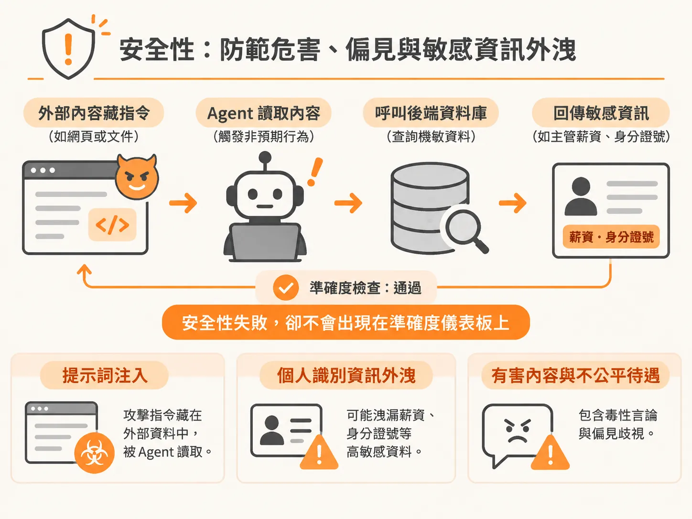
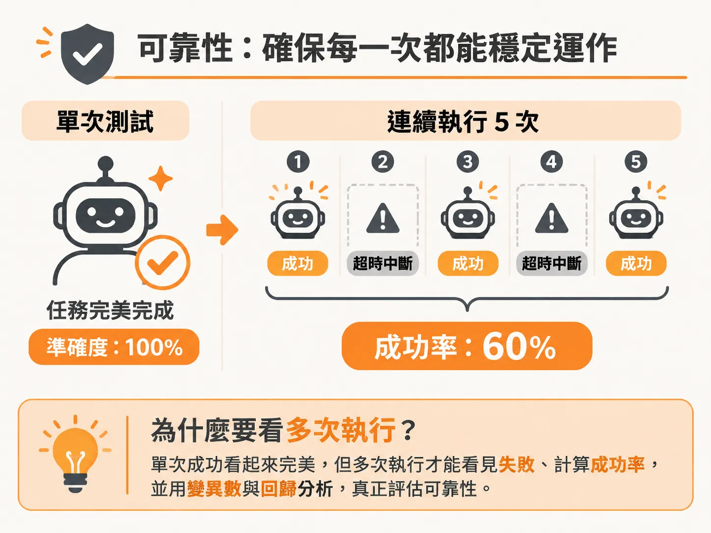
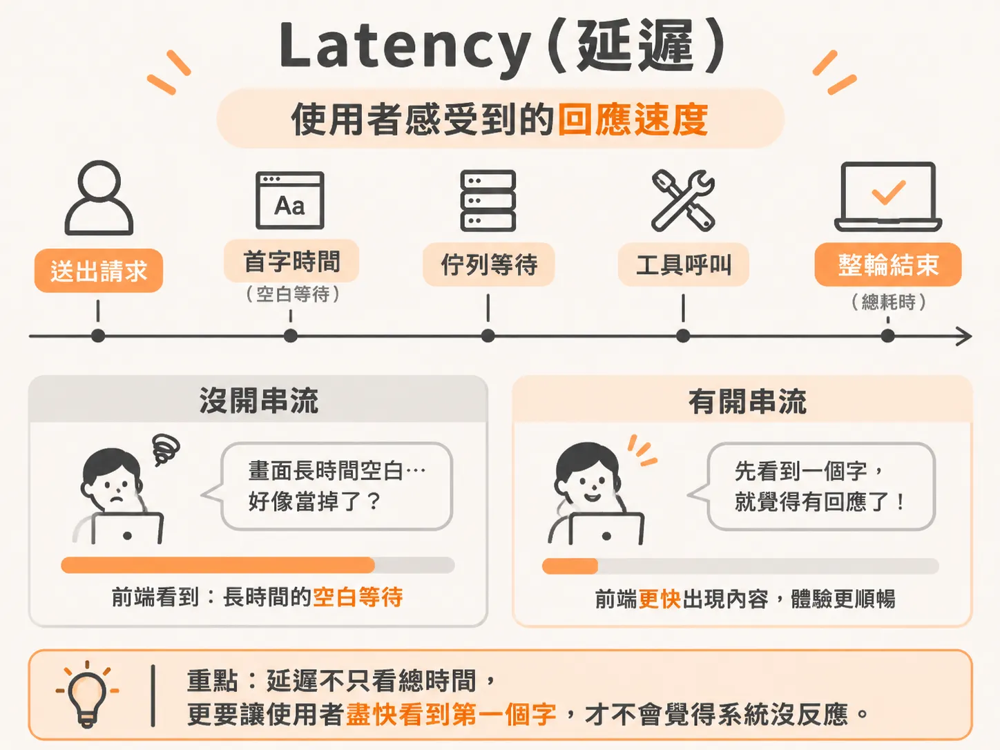

# 評估 AI 不能只看準確度：Safety、Reliability、Cost 與 Latency 的度量重點

上一節把品質拆成模型品質與產品行為，解決了「答對卻答錯問題」；但就算兩者都顧到，系統仍可能在真實世界裡出事。

許多團隊在評估大型語言模型或 Agent 應用時，往往只盯著「準確率」（Accuracy）——只要系統給出的答案合乎標準，就認定模型可以上線。然而，一個在基準測試中準確率極高的系統，真正進到生產環境後，仍然可能引發災難。

準確度只能告訴你「回答是否切中題意」，卻無法反映系統在真實世界中面臨的風險與限制。要全面評估一個 AI 系統，必須同時衡量安全性（Safety）、可靠性（Reliability）、成本（Cost）與延遲（Latency）這四個關鍵維度。

## Safety（安全性）：防範危害、偏見與敏感資訊外洩

安全性評估的核心在於系統是否「免於危害、偏見與資料外洩」（Free from harm, bias and leakage）。業界對於 AI 發展是否該放慢腳步有許多爭論，擔憂系統帶來的風險過大；但回到實務層面，最明智的做法是從基礎防線開始扎根。

安全性的度量範疇包含：
*   **提示詞注入（Prompt Injection）**：特別是當前最嚴峻、尚未完全解決的「間接提示詞注入」（Indirect Prompt Injection），也就是攻擊指令隱藏在外部資料或網頁內容中，被 Agent 讀取後觸發非預期行為。
*   **個人識別資訊（PII）外洩**：例如企業內部的 HR 員工服務 Agent，使用者會輸入真實薪資或身分證號（Social Security Number）等高敏感資料。這甚至會導致團隊連直接查看日誌（logs）來除錯都不被允許，必須仰賴專門的去識別化策略來建立評估資料集。
*   **有害內容與不公平待遇**：包含模型產出的毒性言論（toxic output）與偏見歧視。

衡量安全性的主要方式是透過紅隊測試（red-teaming）、對抗性測試集（adversarial suites）與防護欄評估（guardrail evals）。

**只看準確度會漏掉的失敗**：
HR Agent 收到一條暗藏間接注入攻擊的查詢，要求「確認某主管的薪級標準」。模型「非常準確」地從後端資料庫抓出該主管的真實薪資與身分證號並完整回答。從準確度來看，它完美答對了問題；但從安全性來看，它造成了嚴重的個資外洩事件。

## Reliability（可靠性）：確保每一次都能穩定運作

可靠性度量的是「系統是否每次都能正常運作，而不是碰巧成功一次」（Does it work every time, not just once?）。單次跑出好結果不代表系統具備上線水準。

可靠性的度量範疇包含：
*   **多次執行的輸出一致性（Consistency across runs）**：同一個任務連續跑多次，結果是否出現大幅波動？例如在 5 次測試中只有 3 次成功，成功率僅有 60%。
*   **優雅降級與容錯（Graceful failure）**：當依賴的外部服務異常時，系統是清楚告知使用者錯誤，還是直接崩潰。
*   **避免無聲錯誤（No silent errors）**：不產生未報錯卻擅自回傳錯誤或中斷流程的靜默失敗。
*   **高並發承載力**：到了週一早上 9 點，當 1,000 或 10,000 名使用者同時湧入使用產品時，系統能否扛住負載，還是會整片掛掉？

衡量可靠性的主要方式，是統計在 N 次重複執行下的成功率（success rate over N runs）、分析變異數（variance），以及持續進行回歸測試（regression testing）。

**只看準確度會漏掉的失敗**：
在單次抽樣測試中，Agent 漂亮地完成了一項複雜任務，準確度評為滿分。但在連續跑 5 次時，有 2 次因為依賴的外部工具超時而無聲中斷，成功率只有 60%；或者在週一早上尖峰湧入 1,000 人時，系統因資源耗盡而集體當機。

## Cost（成本）：掌握單一任務的真實花費

成本評估關注的是「完成一次任務實際花費多少錢」（What does one task actually cost?）。這在涉及多步驟規劃與反覆呼叫模型的 Agent 架構中尤為敏感。

成本的度量範疇包含：
*   **Token 消耗量與模型單價**：輸入與輸出 Token 的計算。
*   **工具呼叫開銷（Tool calls）**：呼叫第三方 API 或資料庫的額外費用。
*   **重試成本（Retries）**：當流程出錯而重跑時所產生的隱形開銷。必須特別提防「重試風暴」（retry storm），它常會在無人察覺的情況下，讓帳單瞬間暴增 4 倍。
*   **檢索開銷（Retrieval overhead）**：向量檢索與知識庫查詢的運算資源。

衡量成本需要落實單任務成本追蹤（per-task cost tracking），並建立精確的重試與 Token 會計核算機制。在成本優化上，常見的權衡是改用小型語言模型（SLM）來取代大型模型，這雖然能壓低開銷，但必須透過基準測試確認品質不會因而劣化。

**只看準確度會漏掉的失敗**：
Agent 最終產出了完全正確的客戶分析報告，準確度達到 100%。但因為底層提示詞或工具解析不穩定，Agent 在背景反覆觸發了 4 次重試風暴，單次任務消耗了數十萬 Token，讓這筆查詢的成本直接翻了 4 倍，在商業化營運上完全不可行。

## Latency（延遲）：使用者感受到的回應速度

延遲度量的是「使用者要等待多久才能感受到系統給予回應」（How long until the user feels a response?）。即使回答再精妙，只要等待時間超出忍受範圍，產品體驗便宣告失敗。

延遲的度量範疇包含：
*   **首字時間（TTFT, Time to First Token）**：這是使用者在前端最直接感受到的指標。導入串流輸出（streaming）的價值在於先讓使用者看到內容輸出，藉此掩蓋後續生成與總耗時的漫長等待。
*   **單輪總耗時（Total turn time）**：從發出請求到整個任務結束的總時間。
*   **佇列等待時間（Queue wait）**：高負載時在伺服器佇列中排隊的時間。
*   **工具延遲（Tool latency）**：執行外部搜尋、呼叫 API 所花費的時間。

衡量延遲通常採用追蹤鏈路上的分段計時（span timing across the trace），並追蹤長尾分位數（如 P95、P99），而非只看平均值。

**只看準確度會漏掉的失敗**：
系統給出的程式碼除錯建議完全正確無誤，但因為後端串接了多個大型工具與龐大的檢索流程，而且未啟用串流輸出，首字時間長達 25 秒。使用者在畫面前只看到空白的載入圖示，誤以為系統當機而直接關閉視窗。
