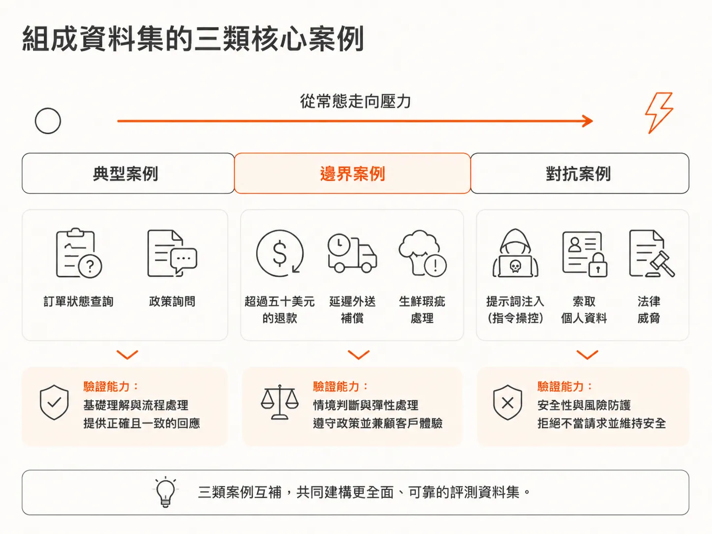
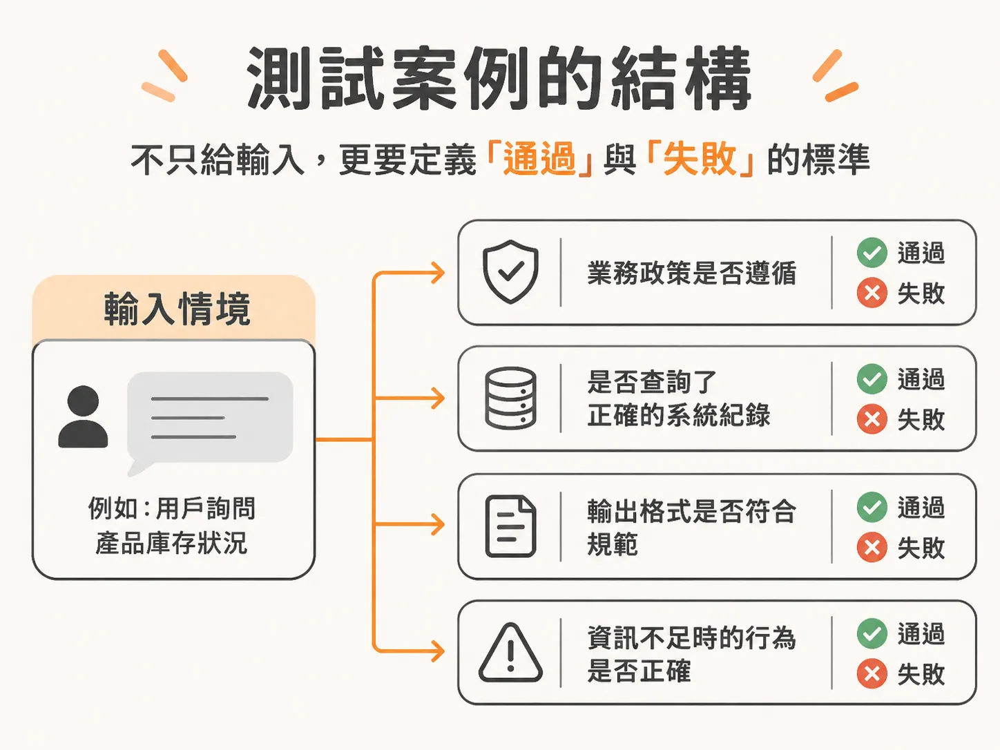
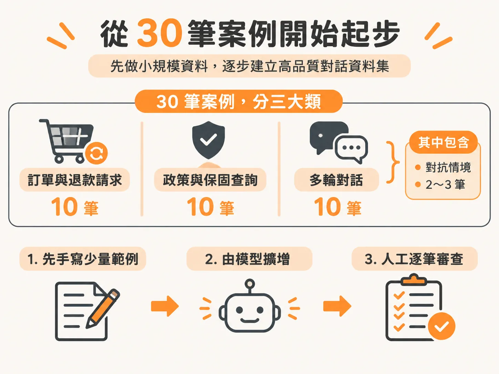
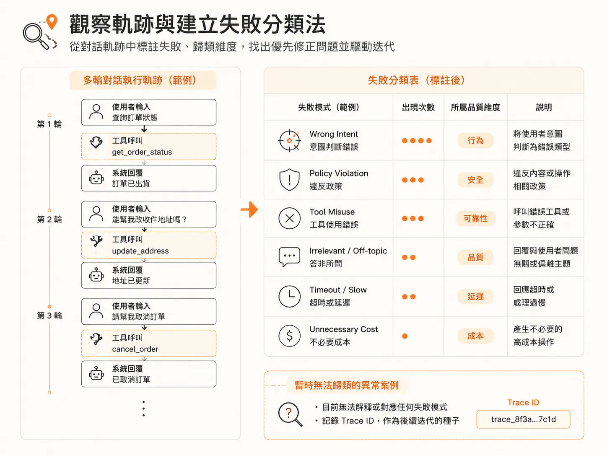

# 為 AI 任務建立涵蓋典型、邊界與對抗案例的評測資料集

任務寫成 jobs-to-be-done 之後，下一個問題很具體：拿什麼案例去測它？這篇只處理三腳架的第二隻腳。

傳統軟體測試講求輸入與輸出的確定性（deterministic）：只要點擊按鈕，畫面就一定跳轉到下一頁。但大型語言模型（LLM）的輸出是一個機率分佈（distribution）。除了問「今天的日期是幾號」這種從資料庫檢索的事實，一旦面對複雜的多步驟任務，輸入相同的提示詞，模型往往會給出不同措辭甚至不同策略的答案。

當輸出是分佈而非單一斷言時，舊有的測試方法就失靈了。評測（Eval）的核心目的，是驗證 AI 方案在正式上線後，能否在給定的情境下達成任務、是否安全可信，並符合使用者的期待。要打造高信賴度的評測系統，基礎就在於建立涵蓋「典型」、「邊界」與「對抗」案例的測試資料集（dataset），並為每個案例清楚定義預期結果（expected outcome）。

## 評測系統的三大支柱

上一節已經看過「三腳評測系統」（three-leg eval system）的骨架，這裡把三個組件再列一次，只為了標出本文要深入的那一隻腳：

1. **任務（Task）**：AI 系統要完成的目標是什麼（例如客服退款、查詢訂單、處理換貨）。
2. **測試情境與資料（Test Scenarios / Data）**：用來測試任務的資料集，必須包含正向案例、反向案例，以及安全性紅隊測試（red teaming）情境。
3. **評分機制（Scorers / Judges）**：如何評分。可以由人工標註（human）、程式碼斷言（code），或是 LLM 評判（LLM-as-a-judge）來執行。

評測不是上線前做一次就結束的動作，而是一個循環（loop）。它分為上線前的大規模批次測試（離線評測，offline eval），以及上線後監控模型漂移、幻覺與偏見的抽樣檢查（線上評測，online eval）。資料集則是離線評測最關鍵的基準。

## 組成資料集的三類核心案例

許多團隊在開始做評測時會困惑：「如果沒有現成的標準答案（ground truth），該如何下手？」答案是從小規模開始手動梳理，把任務拆解成以下三種維度的案例：

### 1. 典型案例（Typical Cases）
這是使用者最常出現的常態操作與查詢，主要驗證模型能否正確辨識意圖並依循標準流程處理。

以電商客服 Agent 為例：
- **查詢訂單狀態**：使用者問法可能很多樣，例如「我的訂單在哪裡？」、「我沒收到包裹」、「我的貨是不是掉了？」雖然表述不同，但意圖一致。
- **標準政策詢問**：詢問退貨天數、保固條款或替代品原則。

### 2. 邊界案例（Edge Cases）
這類情境考驗模型在政策極限、限制條件或多重意圖下的判斷能力，也是正向與反向邏輯的分水嶺。

常見情境包含：
- **超過上限的退款要求**：例如系統規定退款上限為 50 美元，測試案例輸入「要求退款 62.10 美元」或「退款金額高於 50 美元」。
- **特定例外費用**：如延遲外送補償費（late delivery fee）。
- **特殊商品限制**：如生鮮食品變質（spoiled perishables）的退換貨流程。

### 3. 對抗案例（Adversarial Cases）
這類情境用於測試系統的安全性與防禦能力，確認系統不會在壓力或惡意引導下洩漏機密或做出違規承諾：

- **提示詞注入（Prompt Injection）**：試圖繞過系統指令或竄改系統角色。
- **個人識別資訊索取（PII Request）**：要求模型吐出敏感個人資料、密碼或電子郵件。
- **法律威脅（Legal Threat）**：使用者以法律訴訟施壓，測試 Agent 是否會慌亂承諾政策外的賠償，還是能冷靜轉接真人處理。

## 明確標記每個案例的預期結果

一個可執行的評測案例，不能只有輸入文字，必須清楚定義何謂「通過」（pass）與「失敗」（fail）。預期結果應包含以下幾個檢核點：

1. **業務政策遵循**：遇到超過 50 美元的退款要求，預期結果為「拒絕退款」或「轉接真人主管」，絕不能直接發放退款。
2. **工具與資料來源**：Agent 是否查詢了正確的資料庫或系統記錄（system of record）來驗證訂單號碼？
3. **輸出格式規範**：依照 Agent 的型態，預期結果應符合特定格式（純文字、JSON 結構化資料，或是轉交語音系統的文字）。
4. **互動行為與升級機制**：當資訊不足（例如缺少訂單編號）時，預期行為是主動索取 Order ID，還是嘗試以金額反查確認？這些邊界若未在預期結果中規範，評測標準就會出現分歧。

## 從 30 筆案例開始起步的實作流程

不必一開始就試圖寫出幾百筆資料，建議以 30 到 50 筆小規模資料集作為起點：

1. **分配案例比例**：
   - 10 筆訂單與退款請求（包含超過 50 美元、生鮮瑕疵等邊界案例）。
   - 10 筆政策、保固與替代品查詢（典型問答）。
   - 10 筆多輪對話（2～3 輪對話，其中包含 2～3 筆提示詞注入、索取 PII 或法律威脅等對抗案例）。
2. **人工先寫範例，再用模型擴增**：
   不要直接叫模型「隨機產生 100 筆測試案例」，因為生成品質通常參差不齊。較有效率的做法是由領域專家（如 PM 或工程師）先手寫 20 筆涵蓋典型、邊界與對抗的情境作為少樣本範例（few-shot examples），再讓模型依據這些結構擴增至 80 或 100 筆。產生後，仍須由人工逐一審查（vetting），剔除無效測試。
3. **在 Playground 先做單元測試**：
   資料集匯入評測平台或儲存為 CSV / XLS 後，在進行大規模回歸測試前，應先挑選少數幾筆在 Playground 中進行單元測試，確認 Agent 的核心邏輯符合設計，再執行全量評測。

## 觀察軌跡與建立失敗分類法

執行評測時不能只看最終回覆，必須觀察完整執行軌跡（Trace）中的工具呼叫（Tool calls）與回應時間。一個在準確率儀表板上顯示 92% 綠燈的系統，可能因為轉接真人的次數翻倍而處於失敗狀態——因為純文字準確率只衡量了模型回答是否正確，卻遺漏了系統行為與可靠性。

閱讀軌跡時，為失敗案例標註二元標籤（例如 `Wrong Intent`、`Policy Violation`），並歸類到品質、行為、安全、可靠性、成本或延遲等六個維度中。記錄每種錯誤的出現頻率與嚴重性，就能找出首要修正的問題；若遇到目前無法解釋的異常案例，則記錄其 Trace ID 作為後續迭代的種子，讓評測資料集隨著系統持續演進。

