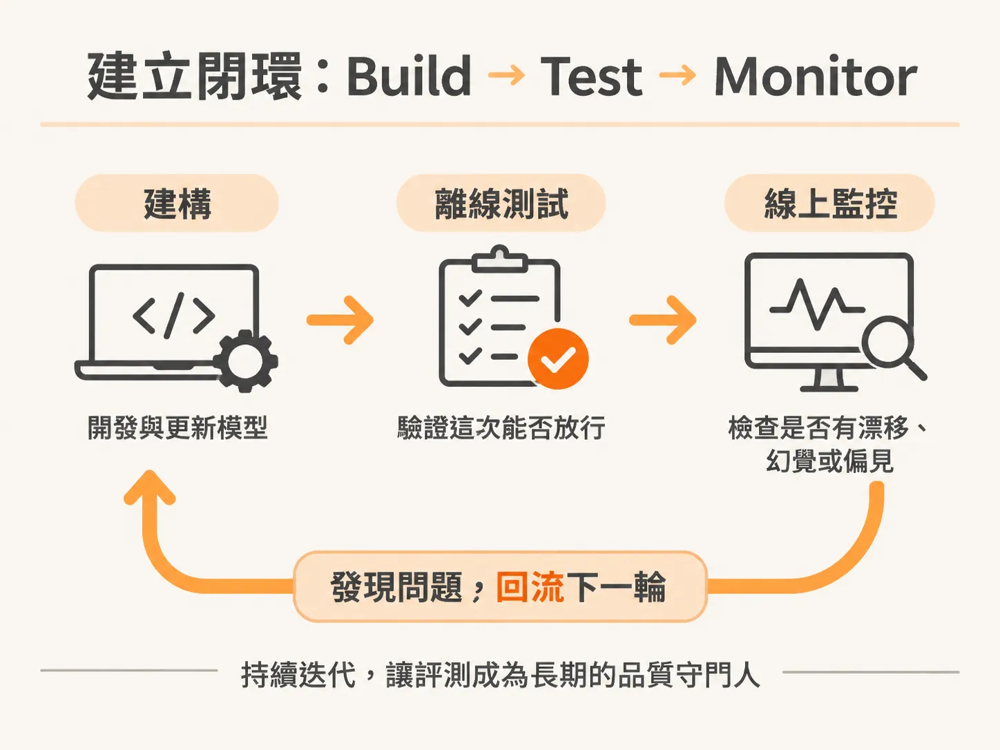
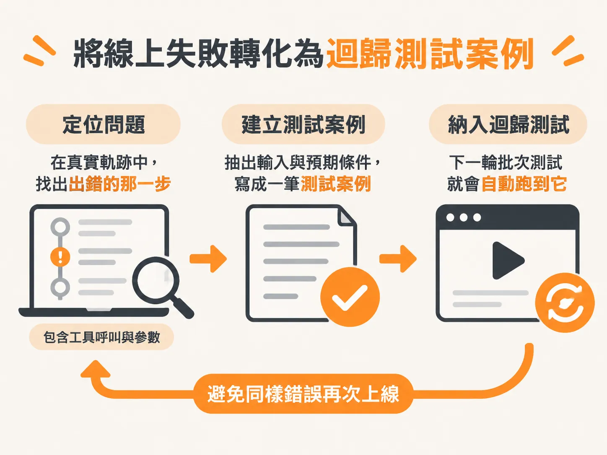
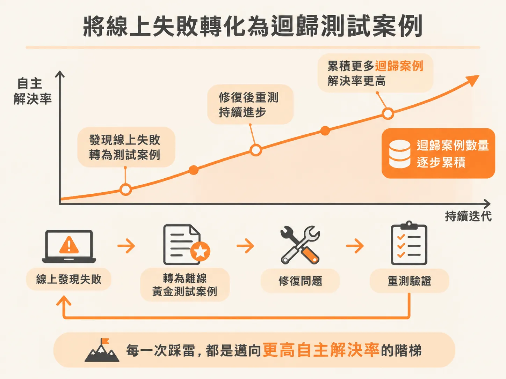

# 把離線評測與線上監控接成完整迴路：從 Build、Test 到 Monitor 的 AI 迭代法

任務、資料集、評分者三塊都到位後，還剩一個容易被忽略的問題：這套東西只跑一次，還是會一直跑下去？

過去二十多年開發軟體時，測試的邏輯非常直覺：給定一個輸入，比對輸出是否完全等於預期值。只要點擊某個按鈕能正確跳轉到下一頁，測試就算通過。這種決定性（deterministic）的特性，讓自動化與手動測試都容易維護。

但在打造 AI 應用與 Agent 時，同樣的邏輯會全面失效。除了詢問「今天是幾號」這類單純提取資料的問題，只要牽涉到多步驟推理與複雜任務，AI 的輸出本質上就是一種機率分佈——給定相同的 Prompt，每次產出的內容可能落在分佈的頂端、底部或中間，帶來些許差異。

面對這種不確定性，評測（Eval）的目的並不是強求消除波動，而是要回答核心問題：你的 AI 方案到底有沒有達到使用者預期？它是否在安全、值得信任的前提下完成任務？若仍沿用舊思維做測試，開發團隊很快就會寸步難行。

---

## 傳統測試思維在 AI 時代的四個轉向

要建立可信賴的評測系統，必須先理解 AI 評測如何取代傳統測試的假設：

| 破裂的傳統假設 | 傳統作法 | 取代的新思維 |
| :--- | :--- | :--- |
| **決定性（Determinism）** | `assert output == expected` | 衡量多次執行下的整體成功率 |
| **單一裁決（One verdict）** | 每個測試只有 Pass / Fail | 針對多個品質維度（如 6 項維度）分別評定 Pass / Fail |
| **靜態測試（Static tests）** | 寫一次就永久運行（Write once, run forever） | 持續演進的活體裁判（Living judges）與動態資料集 |
| **建構後才測（Test after build）** | 開發尾聲才交由 QA 驗證 | 從第一天起就展開錯誤分析（Error analysis） |

非決定性不是該被拔除的 Bug，而是評測時必須圍繞測量的本質特徵。當模型需要發揮創造力時，往往會調高 Temperature，非決定性的範圍也隨之拉大。此時只跑一兩次測試遠遠不夠，必須在多次重複執行中觀察整體表現，甚至結合單一指標與綜合分數（例如達成 60% 的加權門檻）來衡量成效。

此外，隨著模型能力提升，撰寫冗長精巧的提示詞技術生命週期愈來愈短；相對地，系統化評測的能力具備極長的保鮮期。現代模型多半支援不同層級的思考深度（Effort level），簡單的摘要任務若開啟頂級模式，只會平白拉長等待時間並消耗昂貴的 Token。工程師必須能依據任務類型在成本、速度與品質之間取得平衡。

---

## 評測的三大支柱（The Three Building Blocks）

無論系統規模是單純的 Prompt、獨立模型、單一 Agent 還是多 Agent 系統，每次評測都由三個核心元件組成：

1. **任務（Task）**：AI 系統具體要解決的問題。例如「處理顧客的退換貨請求」。在實際情境中，這往往包含多重意圖，例如查詢系統記錄確認商品是否符合退貨條件、驗證處置流程是否安全合規等。
2. **資料集（Dataset）**：用來驗證系統的測試情境。涵蓋正規測試案例、邊緣狀況、紅隊對抗（Red-team）情境以及正式環境流量。許多人常問：「如果手邊沒有標準答案（Ground Truth），該如何開始？」事實上不用因此卡住，團隊大可從小規模資料起步，後續再從真實軌跡（Traces）中逐步豐富並擴展成黃金測試集。
3. **評分器（Scorer / Judge）**：用來給輸出打分的工具。可以由確定性程式碼邏輯檢驗、LLM 作為裁判（LLM-as-a-judge），或是人工審查來執行。

跑完這三者，系統便會產出具體分數，團隊就能據此判斷表現是否達標，進而決定是否需要調整 Prompt 或微調系統。

---

## 建立閉環：Build → Test → Monitor

評測絕不能是一次性的驗收活動，而必須是一個持續循環的生命週期：



<!-- derived -->
```
    ┌──────────┐
    │  Build   │ ◄───────────────────────────┐
    └────┬─────┘                             │
         │                                   │
         ▼                                   │
    ┌──────────┐      Novel / Edge Cases     │
    │   Test   │ (Failure traces as eval set)│
    │ (Offline)│                             │
    └────┬─────┘                             │
         │ (Go / No-go gate)                 │
         ▼                                   │
   ┌───────────┐                             │
   │  Monitor  │ ────────────────────────────┘
   │ (Online)  │
   └───────────┘
```

整個架構主要分為兩大階段：

### 1. 離線批次測試（Offline Eval：Test 階段）
在正式上線或部署前執行。通常以批次方式（Batch testing）跑過大量的測試情境，確認模型沒有產生嚴重的幻覺或邏輯偏誤。這也是軟體交付前最重要的「Go / No-go」門檻判斷點。在工程實踐中，這類耗時的自動化批次實驗非常適合作為 CI/CD Pipeline 的一環，排定在資源閒置的離峰時段（例如深夜）自動觸發，隔天一早即可檢視報告。

### 2. 線上即時監控（Online Eval：Monitor 階段）
當系統正式面對終端使用者時，執行選擇性的檢查。此處需要觀察資料漂移（Drift）、幻覺傾向以及回應是否有偏見。評估時需兼顧兩類指標：
* **AI 指標**：例如幻覺率、指令遵循度。這類指標告訴我們系統「為什麼」出問題。
* **業務指標**：例如顧客滿意度（CSAT）、自主解決率。這類指標告訴我們這個問題「有沒有造成實質影響」。

這兩個階段並非各自獨立。線上環境所記錄下來的使用者互動歷程（Traces）如果只放在記憶體中，幾小時後就會隨快取消失，因此必須予以妥善持久化記錄。這些真實流量中的失敗歷程，正是整個循環中最具價值的資產。

---

## 將線上失敗轉化為迴歸測試案例

一個健全的 Agent 開發循環，核心就在於**將線上遭遇的失敗轉化為未來的防禦案例**。

當線上監控或可觀測性系統捕捉到 Agent 在多步驟工具呼叫中出錯、嘗試越權存取資料，或是給出違規的回應時，處理流程如下：



1. **捕獲失敗軌跡（Trace Analysis）**：檢視包含多次對話與工具呼叫的軌跡。評估時既要看最終目標是否達成（例如機票有沒有訂對），也要逐步驗證中間的軌跡評測（Trajectory eval）——檢查工具呼叫順序、輸入輸出參數，以及是否有權限違規。
2. **清洗並收錄至測試集（Dataset Curation）**：將這些在真實世界中暴露出的新穎情境（Novel scenarios）、邊緣案例（Edge cases）或攻擊手法，提取出輸入與預期條件，直接擴充到離線評測資料集中。
3. **建立防護網並自動化防禦**：下次工程團隊修改系統、Prompt 或切換底層模型時，這批先前在線上踩雷的案例便會在離線批次測試中自動執行。

當失敗案例被持續匯入測試集，系統便具備了遞迴自我改進（Recursive Self-Improvement, RSI）的基礎設施。透過不斷在線上發現漏洞、轉為離線黃金測試案例、修復並重測，AI 系統便能像登山演算法（Hill climbing）一樣，一步步朝著更高的自主解決率穩定邁進。


