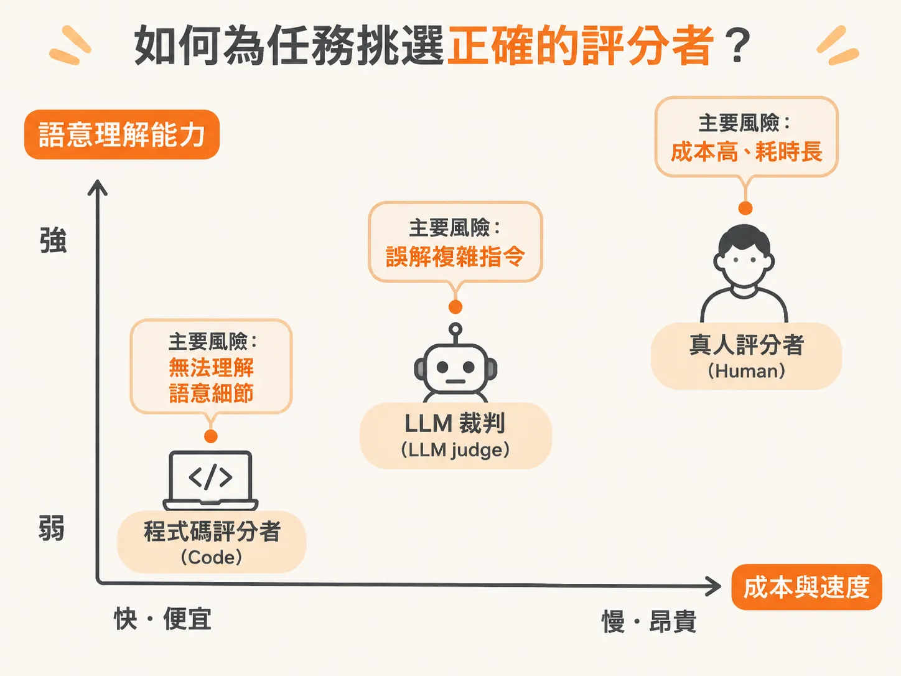
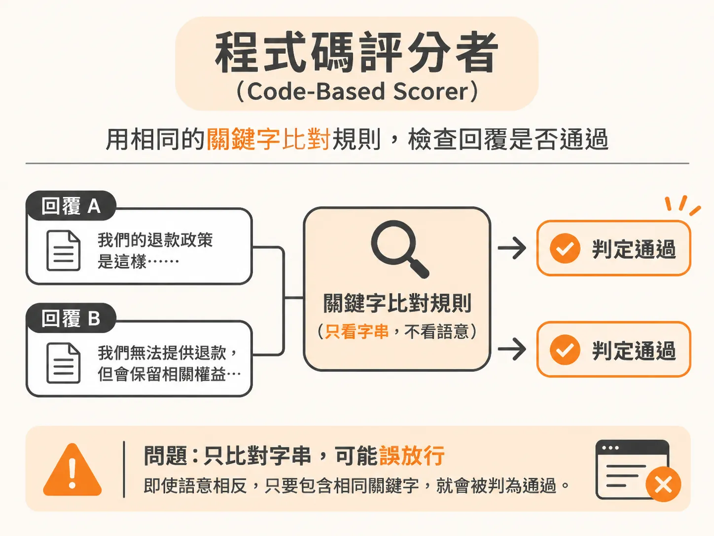
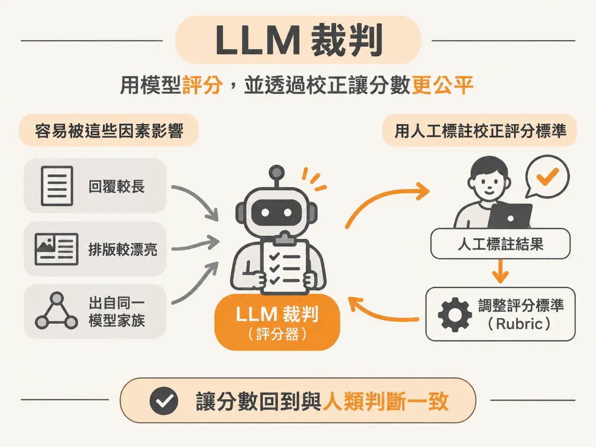
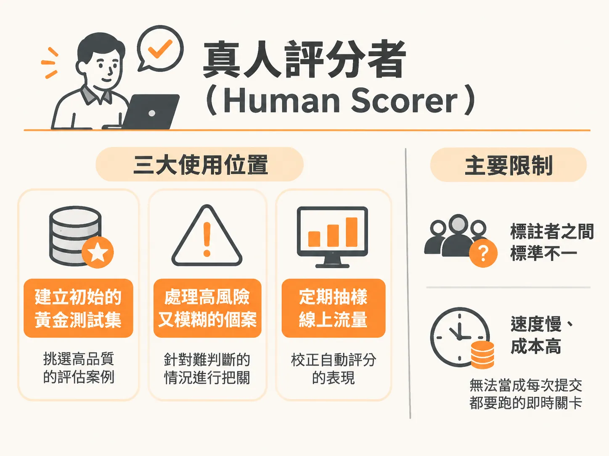
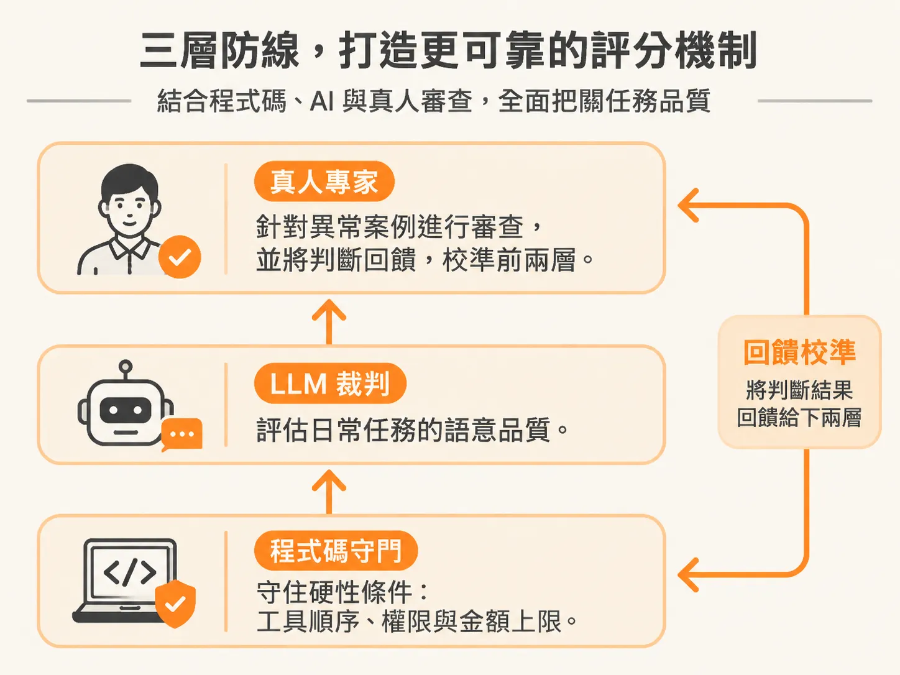

# AI 評估三腳架：如何為任務選對 Code、LLM Judge 與真人評分者

任務定義好了、資料集也湊齊了，三腳架只剩最後一隻腳：誰來判定這一筆到底過不過？

在過去二十幾年的軟體開發中，測試邏輯非常直觀：給定一個輸入，就會得到一個確定的輸出。按鈕按下去，畫面就該跳轉到下一頁；測試工程師只要在測試案例裡寫下斷言，驗證實際輸出是否等於預期輸出即可。這種確定性讓自動化測試和人工 QA 都能照著標準劇本走。

然而，當你開始打造 AI 解決方案或智慧代理人（Agent）時，傳統的測試劇本立刻失效。

同一個問題問兩次，大型語言模型給出的字句往往不盡相同。除了查詢「今天的日期」或「現任總統是誰」這種單純撈取事實的請求之外，只要牽涉到多步驟推理與複雜任務，模型的輸出本質上就是一個機率分布。這個分布有時落在最佳的高點，有時落在邊緣，有時卡在中間。非確定性並不是該被消滅的臭蟲，而是你在做評估（Eval）時必須圍繞著它進行度量的核心特徵。

## 什麼是 Eval？從確認規格到衡量非確定性

許多人問起 Eval 時，第一反應往往陷入細節：「我們是在測準確率嗎？是在抓幻覺嗎？還是在算 Token 成本？」

這些都很重要，但 Eval 的核心本質只有一句話：**你如何確認 AI 解決方案真的達成了使用者的期待，而且是以安全、值得信任的方式完成？**

當系統正式進入生產環境，使用者是否能信任你的 Agent，甚至放心交出自己的電子郵件或密碼，取決於它能不能穩定交付價值。面對模型輸出的機率分布，傳統測試假設必須全面替換：

- **放棄單次斷言**：不再用單一測試去判定絕對的對或錯，而是透過多次重複執行，測量通過率與可靠度。
- **由單一結果轉向多維度判定**：不再只給出一個 pass 或 fail，而是針對六個常見的品質維度分別給予通過或未通過的評價。
- **靜態測試轉為動態演進**：以前測試寫一次就跑一輩子，現在評分標準（Judges）與測試資料集必須隨著時間持續演進。
- **測試前置化**：測試不再是開發完才丟給 QA 的收尾步驟，從第一天起就要透過錯誤分析來指導開發。

這種評估能力是具備長期半衰期的關鍵技能。在今年稍早，懂得寫出複雜又詳盡的提示詞曾是炙手可熱的技能；但隨著最新模型推理能力的提升，只要用清楚直白的語言講明目標，並指定給予的推理投入程度（Effort level），模型就能有很好的表現。

現在許多工具都允許細緻調整努力層級。不同的任務需要不同的思考深度，如果你的公司只按 Token 消耗量來評量工作成效，把投入度調到最大當然最簡單；但一位聰明的工程師會意識到，單純的文字摘要在極輕量模式與極大化模式之間根本沒有輸出差異，盲目調高只會帶來無謂的等待時間與昂貴帳單。

## 評估的三腳架與開發生命週期

完整的評估架構（Eval Harness）雖然涵蓋許多層次——從離線測試到線上監控，從評估單一提示詞、模型到多 Agent 系統——但最核心的基礎仍可簡化為前兩節已經用過的「三腳架系統」，這裡只快速複習，重點放在第三項：

1. **任務（Task）**：AI 系統具體要解決的問題，例如處理客戶的瑕疵品退款請求。
2. **資料集（Dataset）**：包含正向測試案例、負向測試案例與紅隊對抗安全測試案例。
3. **評分者（Scorer / Judge）**：決定由誰來給分數，包含程式碼檢查（Code）、LLM 裁判（LLM judge）與人工審查（Human review）。

只要掌握這三個組件，評估系統就完成了一半。將這三者結合執行後，你會得到一個分數，用來判斷當前系統表現優劣，並決定後續如何微調。

評估不能只做一次，它是一個持續的閉環：**構建（Build）**、**評估測試（Test）** 與 **監控觀測（Monitor）**。

在系統上線前，團隊會執行離線評估（Offline eval），以批次方式跑過大量場景，作為能否正式發布的決策門檻；當系統進入生產環境，則切換為線上評估（Online eval），抽樣檢查模型是否產生特徵漂移（Drift）、出現幻覺或偏見。在矽谷 AI 社群熱烈討論的遞迴式自我改進（RSI, Recursive Self-Improvement）架構中，評估正是支撐每一次自動迭代實驗的基石。

## 在 PRD 裡定義邊界：允許與不允許

要評估一個系統，產品經理（PM）與 AI 工程師必須共同定義產品體驗與最終成果。

以客服退款 Agent 為例，評估時不能只看最終回覆是否客氣，更要檢查 Agent 調用工具的「軌跡」（Trajectory）。Agent 是循著最短、最佳的路徑直接查詢系統完成退款，還是陷入無窮迴圈耗了三十分鐘、吃掉大量 Token 才勉強給出答案？

兩年半前剛打造第一代客服 Agent 的經驗帶來過慘痛教訓：團隊試圖單靠冗長的提示詞和指令來設定護欄，結果帶來了嚴重的非確定性。在退款、傳送外部資料、修改權限這種出錯代價極高的場景中，絕不能單靠模型的自由意志，必須仰賴確定性的邏輯檢查。

在撰寫規格時，最重要的思考工具是劃分兩個桶子：**這個解法被允許做什麼，以及它不被允許做什麼**。

- **成果規範**：只有在訂單經過完整驗證後才能退款（必須向 CRM 或 SAP 等核心紀錄系統查驗）。若訂單金額超過 50 美元，必須轉交真人核准；50 美元以下且符合條件，才能自動放行。
- **軌跡規範**：Agent 是否在發放退款前確實查詢了訂單編號，還是直接憑空幻覺完成退款？工具調用的順序是否正確？

提早定義好這些規範，建立評估資料集時就不會面臨無從下手的窘境。此外，文字對話 Agent 與語音 Agent 的評估複雜度截然不同。文字 Agent 可以向使用者提示「思考中」或「規劃中」，容許一定延遲；但語音 Agent 必須模擬不同口音、吵雜的背景噪音、使用者的插嘴打斷，甚至長達兩三分鐘的停頓空白（Dead air time），並要求極低的即時回應延遲。

## 如何為任務挑選正確的評分者？

在決定好任務與資料後，最關鍵的抉擇在於：這道題目該交給程式碼（Code）、LLM 裁判（LLM judge）還是人工（Human）來打分？選錯評分工具，不僅浪費成本，更會帶來嚴重的誤判風險。

### 1. 程式碼評分者（Code-Based Scorer）

程式碼評分者是最便宜、速度最快且最具確定性的評估方式。常見的形式包含斷言驗證、常規表達式（Regex）字串比對、JSON Schema 格式檢查，以及 API 調用追蹤檢查。

- **最適合的任務**：
  - 驗證 Agent 是否按規定調用了特定的資料庫查詢工具。
  - 檢查退款金額是否小於等於訂單上限、是否有真人核准標記等硬性業務邏輯。
  - 格式驗證（例如輸出是否符合標準 JSON、是否包含特定訂單 ID 格式）。
- **誤判風險**：
  - **缺乏語意彈性（過度嚴苛）**：靜態的正規表達式只能抓死板的關鍵字。如果模型換了一種同義詞或更自然的句法表達，程式碼檢查就會直接判為失敗。
  - **無法理解上下文（盲目放行）**：如果只檢查輸出是否包含特定字串，當模型產生「我很抱歉，我們無法提供 30 天退款」時，單純比對「30 天退款」字樣的規則可能會誤判為符合說明政策。

### 2. LLM 裁判（LLM Judge）

LLM 裁判利用大型語言模型的上下文理解與推理能力，依據你設定的評估標準（Rubric）來為輸出打分，常見於開源或閉源模型。

- **最適合的任務**：
  - 開放式文本的品質評估，例如語氣是否專業友好、回答是否過於冗長。
  - 檢驗回答是否忠實於檢索到的參考文件（如 RAG 系統的忠實度檢查）。
  - 多意圖解析：確認模型回覆是否同時兼顧了退款條款說明、退貨窗口條件與必要的免責聲明。
- **誤判風險**：
  - **評分偏見（Bias）**：模型往往偏好較長、格式漂亮或特定措辭的回覆（長度偏見），甚至對自身家族生成的文字給予偏高分數。
  - **自身推理限制與成本**：以模型評估模型，評估者本身也可能產生幻覺；若評估任務極為龐大，每次測試都要調用高階模型，會帶來顯著的延遲與 API 費用負擔。
  - **與人類偏好脫節**：未經校準的 Prompt 裁判，其給分標準往往與實際業務團隊或使用者的真實感受存在落差，必須持續比對人類標註數據來校正。

### 3. 真人評分者（Human Scorer）

由領域專家、產品經理或標註團隊直接檢視執行軌跡（Traces）與最終輸出，給予最精確的品質回饋。

- **最適合的任務**：
  - 建立初始的黃金測試集（Golden dataset）與標註基準。
  - 處理高風險、高複雜度的模糊案例（例如法律責任判定、醫療診斷邊界）。
  - 定期抽樣線上流量，校準 LLM 裁判的判斷邏輯。
- **誤判風險**：
  - **主觀標準不一**：不同標註員之間的疲勞程度、理解認知存在差異，容易導致評分不一致。
  - **極限吞吐量與高昂成本**：人工評審速度極慢、費用昂貴，完全無法放進 CI/CD 自動化流程中作為每次程式碼推送的即時閘門。

在實務架構中，沒有任何單一評分方式能解決所有問題。實務上多採取混合模式（Hybrid）：由程式碼負責守住底線（工具順序、權限檢查、安全性），由 LLM 裁判評估日常語意品質，再由真人專家針對異常案例進行審查並持續校準前兩者。

評估體系同時需要兩類指標的結合：
- **AI 指標**（如幻覺率、引用準確度）：說明系統在技術上**為什麼失敗**。
- **業務指標**（如客服滿意度 CSAT、問題一次解決率）：驗證這項 AI 表現**是否真正對業務產生影響**。

## 沒有黃金測試集時，如何開始？

許多工程師在著手 Eval 時最常見的困惑是：「我們公司手頭根本沒有黃金資料集（Ground truth），連預期答案都沒有，該怎麼開始？」

大型實驗室會斥資數百萬美元購買付費資料庫或僱用大量人員進行標註，但在一般產品團隊中，缺乏特定領域（如心臟外科手術或特殊製造業）的標準資料是常態。

你不需為此卡關。在起步階段，先回到 PRD 的業務情境，在「允許」與「不允許」的規範下各寫出兩個具體案例。讓內部團隊自己扮演使用者進行測試，蒐集系統運行的 Trace 紀錄；接著利用程式碼工具（如 LangSmith、DeepEval、RAGAS 或 Promptfoo）追蹤這些軌跡，挑出表現良好與失敗的樣本進行標註。

從小規模的測試集出發，結合合成資料技術逐步擴充，測試資料集就會隨著系統迭代越來越豐富。只要釐清任務本質、搭好測試案例，並在成本、速度與品質的權衡下替每一道關卡選對評分者，AI 系統的可靠度就能從難以捉摸的黑盒，轉化為能夠具體量化與持續改進的工程成果。
