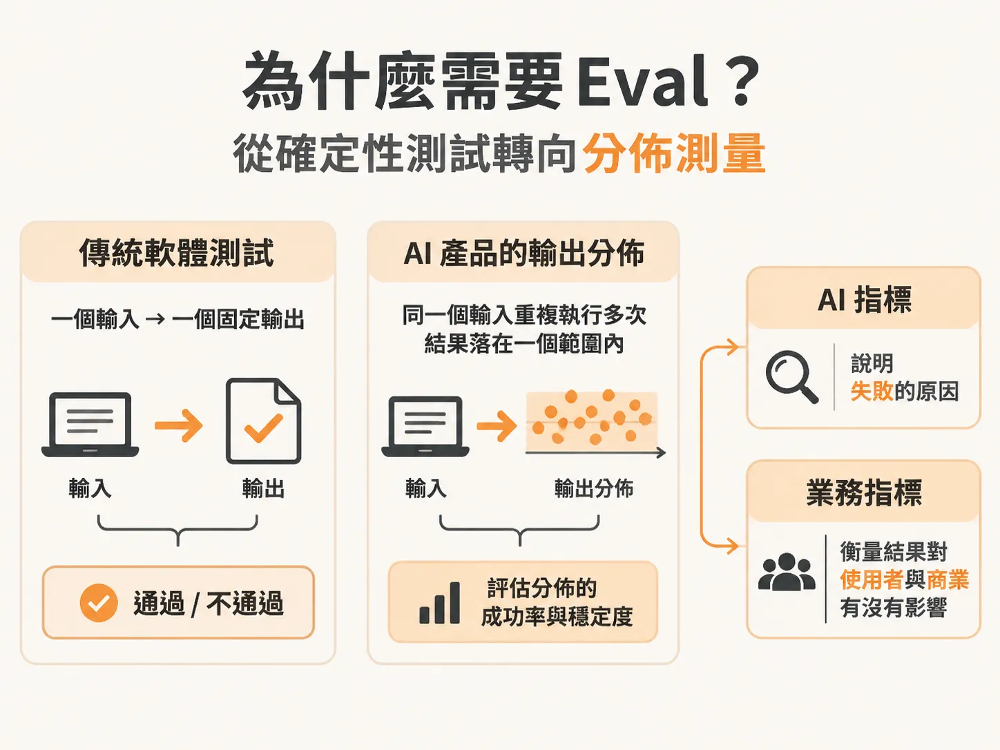
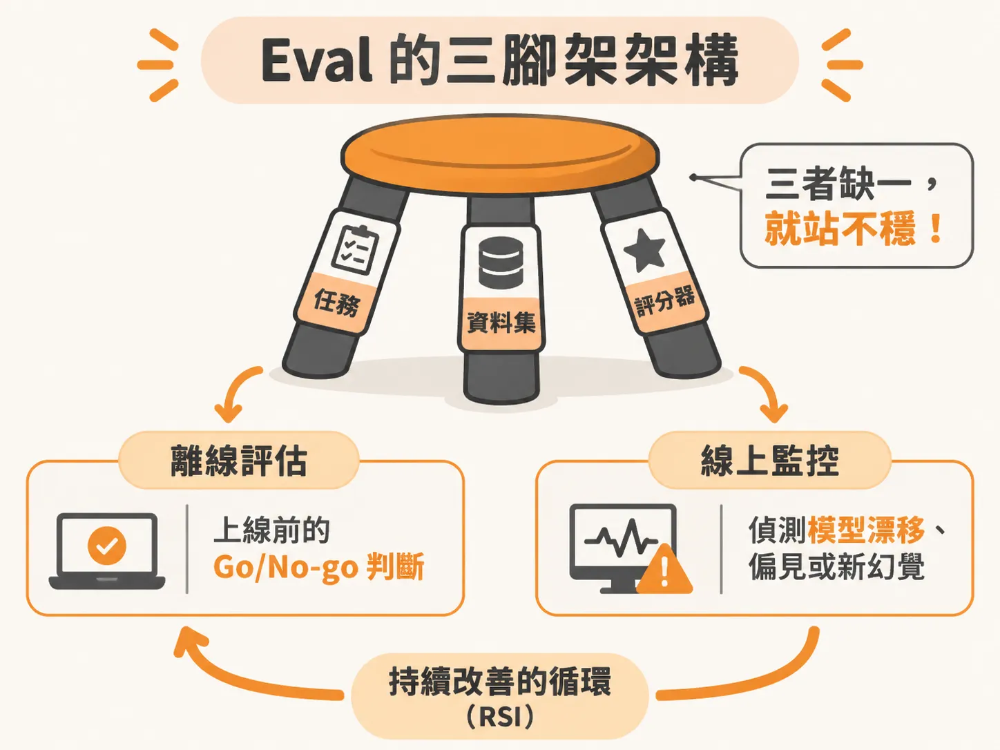
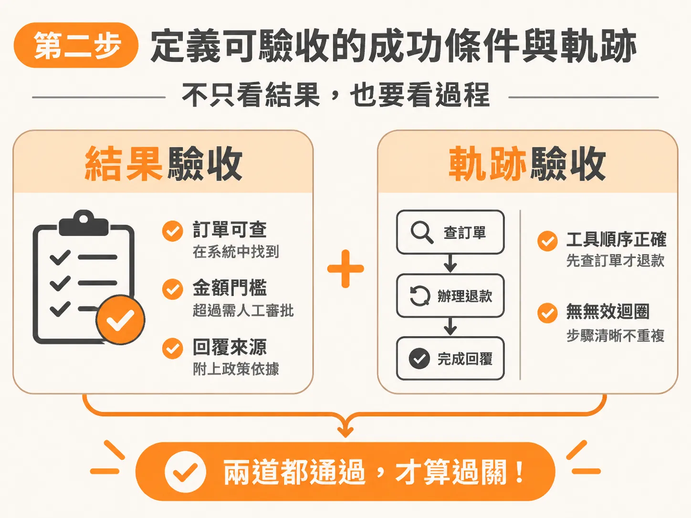
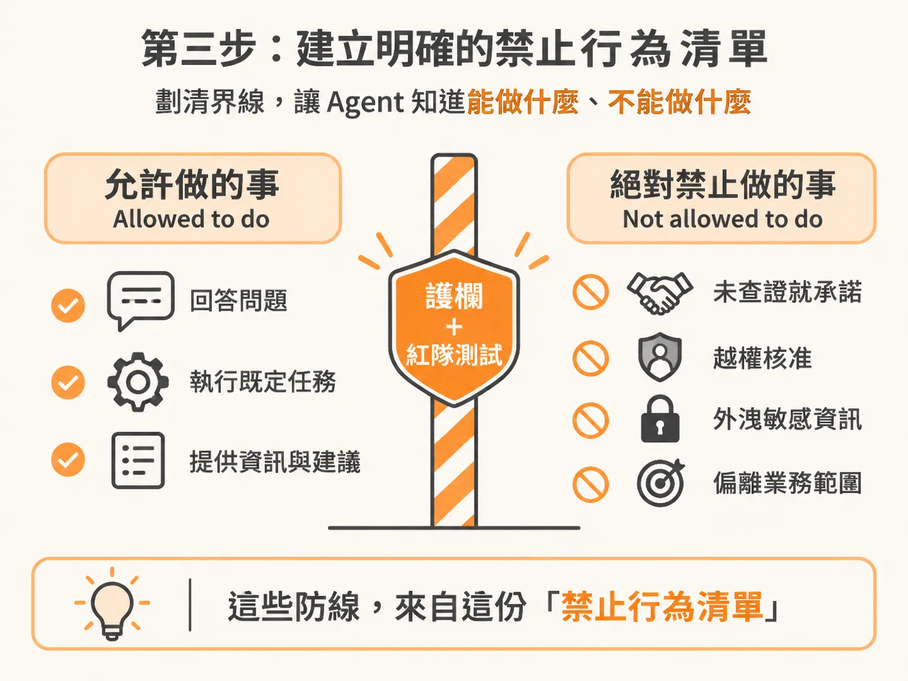

# 定義 AI Eval 的任務：從任務目標、成功條件到禁止行為

在傳統軟體開發中，測試的邏輯非常直覺：給定一個輸入，比對輸出是否完全等於預期值（`assert output == expected`）。按鈕點下去，畫面就該跳轉到下一頁；測試寫好後可以跑上好幾年，最後由 QA 團隊在發布前做一次性的驗收。

但當你著手評估（Eval）AI Agent 或大語言模型應用時，這套行之有效的規則會立刻失靈。大語言模型的輸出不是一個固定值，而是一個機率分佈（distribution）。你問同一個問題三次，可能會得到三種不同措辭的回答。非確定性（non-determinism）並不是一個該被除掉的錯誤，而是生成式模型與生俱來的特性；評估的本質，就是繞著這個分佈去測量它的穩定度。

如果測試不能再靠單一的斷言語句，團隊該如何定義一個 AI 評估任務（Eval Task）？在評估架構中，最核心的第一步是把任務拆解為三大支柱：釐清使用者真正要達成的任務目標（Jobs-to-be-Done）、訂出可明確驗收的成功條件與軌跡，以及畫出絕對不容跨越的禁止邊界。

---

## 為什麼需要 Eval？從確定性測試轉向分佈測量

許多人剛接觸 Eval 時，容易陷在單一技術指標裡：模型的準確率多高？幻覺率是多少？每次推論要花多少 Token？

這些問題固然相關，但 Eval 最核心的提問其實只有一個：**你打造的 AI 解決方案，究竟有沒有在實際情境中滿足使用者的預期？**

使用者在意的預期通常包含兩件事：順利完成任務，以及用值得信任且安全的方式完成。如果一個客服 Agent 能夠順利幫忙處理退款，但過程中把消費者的密碼明文貼在對話框裡，這項任務依然是徹底失敗的。

面對 AI 的機率分佈特性，傳統測試假設必須全面替換：

| 傳統軟體測試假設 | 傳統作法 | AI Eval 的替代作法 |
| :--- | :--- | :--- |
| **確定性（Determinism）** | `assert output == expected` | 透過多次運行測量成功率 |
| **單一結果（One verdict）** | 每個測試只有通過或不通過 | 拆解成多個品質維度分別判定通過與否 |
| **靜態測試（Static tests）** | 寫一次就永久執行 | 持續演進的評審標準（Judges）與資料集 |
| **建構後驗收（Test after build）** | 開發結束後由 QA 驗證 | 從第一天起就展開錯誤分析（Error analysis） |

在 AI 應用中，指標通常分成兩類：AI 指標（例如幻覺率）用來解釋「為什麼失敗」，而業務指標（例如顧客滿意度 CSAT、客訴解決率）則用來衡量「這件事對使用者和商業有沒有實質影響」。

---

## Eval 的三腳架架構

要完整運行一套評估系統，必須具備三個基礎積木（Three-leg eval system）：

1. **任務（Task）**：AI 系統需要處理的核心工作，例如「處理顧客的商品退款請求」。
2. **資料集（Dataset）**：包含正向測試案例、負向測試案例，以及安全性紅隊演練（Red teaming）等對抗性案例。
3. **評分器（Scorer / Judge）**：可以用程式碼直接檢驗、呼叫另一個 LLM 擔任評審（LLM Judge），或由人工介入審查。

當這三者組合在一起，就能在開發階段進行離線評估（Offline eval，做為上線前的 Go/No-go 判斷），並在正式上線後搭配在線監控（Online eval），偵測模型漂移（Drift）、偏見或新出現的幻覺，形成一個持續改善的循環（Recursive Self-Improvement, RSI）。

而這一切的起點，都在於如何在規格制定階段，把「任務（Task）」定義得足夠具體。這需要產品經理（PM）與 AI 工程師共同協作，從 PRD 或規格書開始，寫出具備可驗收性的描述。

---

## 第一步：用 Jobs-to-be-Done 寫出任務本質

傳統撰寫 Prompt 的技巧壽命越來越短，早期那些複雜的 Prompt 結構，在模型能力提升與推論算力（Effort level）可調的趨勢下，邊際效益正在降低。現在更關鍵的技能，是用清楚直白的語言定義：這項任務的終極目標是什麼？

以 Pronto 客服 Agent 為例，使用者的痛點可能是「買到瑕疵品想退款」，但系統要處理的 Job-to-be-Done 不只是「回答退款規範」，而是「在符合公司授權與風控前提下，安全、正確地完成退貨退款流程」。

在定義任務時，也必須考慮不同載體的體驗差異。以文字對話 Agent 來說，系統可以在後台規畫或暫停數秒；但如果是語音客服 Agent（Voice Agent），延遲必須極低，評估時還必須模擬背景雜音、不同口音、使用者說話中斷，甚至是通話中出現兩到三分鐘無聲（Dead air time）的極端情境。

---

## 第二步：定義可驗收的成功條件與軌跡

有了核心目標後，不能只給模型一句抽象的「請禮貌且正確地協助退款」，必須把成功條件落實為具體的輸出標準與執行軌跡（Trajectory）。

### 1. 結果驗收（Outcome）

驗收條件要涵蓋具體規則與業務邊界：
- **身分與訂單核驗**：退款前必須確認該筆訂單在系統紀錄（System of Record，如 CRM 或 SAP）中存在且符合退貨期限。
- **金額分流規則**：若退款金額小於或等於 50 美元，在驗證無誤後可自動核准；若金額大於 50 美元，必須觸發人工審批（Human-in-the-loop）流程。
- **資訊完整性**：回覆中是否提供了明確的政策引用來源？回答是否簡潔扼要，而不是過度冗長（Verbose）？

### 2. 軌跡驗收（Trajectory）

在多步驟或使用外部工具（Tool Calls）的 Agent 架構中，結果正確不代表過程及格。如果一個 Agent 為了查一筆退款資料在迴圈裡跑了 30 分鐘、消耗了上萬個 Token 才產出正確答案，這樣的執行路徑顯然是不合格的。

團隊需要透過追蹤紀錄（Traces）檢查 Agent 的呼叫軌跡：
- Agent 是否先查詢了訂單號碼，才決定核發退款？還是憑空幻覺出一筆金額直接發出？
- 工具呼叫的順序是否正確？有沒有呼叫了不必要的工具？
- 是否選擇了最短且最優化的路徑，而不是在多個工具之間無效迴圈？

在涉及權限變更、退款或對外發送敏感資料的高風險操作中，千萬不能只靠長篇 Prompt 的「防守提示」來約束，因為非確定性的風險代價太高。高風險環節必須強制搭配確定性檢查（Deterministic checks），將 Agent 的每一步呼叫與真實的系統紀錄（顧客姓名、Case ID 等）牢牢綁定。

---

## 第三步：建立明確的禁止行為清單（Not Allowed to Do）

在規劃任何 AI 專案時，最能幫團隊在日後省下大量救火時間的關鍵，就是清楚劃分出兩個清單：**允許做什麼（Allowed to do）**，以及**絕對禁止做什麼（Not allowed to do）**。

未設防的 Agent 往往會在非預期的邊界失控。以退款客服為例，明確的禁止清單應包含：
- **禁止未查證即承諾**：嚴禁在 CRM 系統查無有效訂單紀錄前，對顧客給出任何退款金額或期限的保證。
- **禁止越權核准**：嚴禁在未獲得人工審批的情況下，私自核准超過 50 美元的退款要求。
- **禁止外洩敏感資訊**：嚴禁在對話中吐出顧客的完整信用卡號、密碼，或是內部 API 的錯誤日誌。
- **禁止偏離業務範圍**：嚴禁回應與產品售後、退換貨無關的話題（如寫程式、政治評論或競爭對手評價）。

只要在任務設計初期把這兩份清單列清楚，工程團隊就能在系統中佈署對應的護欄（Guardrails）與紅隊測試（Red-team scans），避免在上線後因為個案失誤陷入無止境的應急危機。

---

## 從兩三個例子起步，打破零起點困境

剛開始建立 Eval 時，很多團隊會焦慮自己手邊沒有完美的黃金資料集（Golden Dataset）。但你不需要一開始就花大錢採購上萬筆標註資料；事實上，即便在先進的研究機構中，垂直領域（如生醫專科、外科手術或實體機器人）的精準測試數據也普遍短缺。

實務上的做法是「從兩到三個具體範例開始」：
1. 針對成功條件，寫下兩筆真實的退款情境（一筆低於 50 美元自動放行，一筆高於 50 美元轉人工）。
2. 針對禁止行為，寫下兩筆惡意嘗試或異常輸入（例如故意提供偽造訂單號碼要求退款）。
3. 讓內部團隊先行測試，把發現的邊界情況與真實 Traces 持續補充進資料集。

在專案一開始就把任務寫成具備 Jobs-to-be-Done、驗收標準與禁止行為的規格，後續建立測試資料集與選擇 Scorer 時就不會面臨無從下手的困境。這份規格本身，就是建構可信賴 AI 系統最重要的地基。
