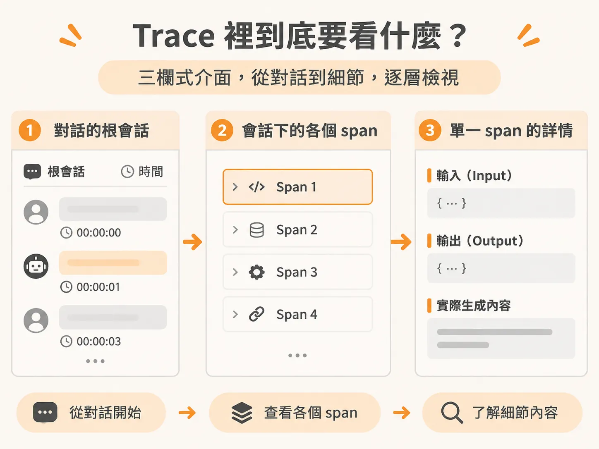
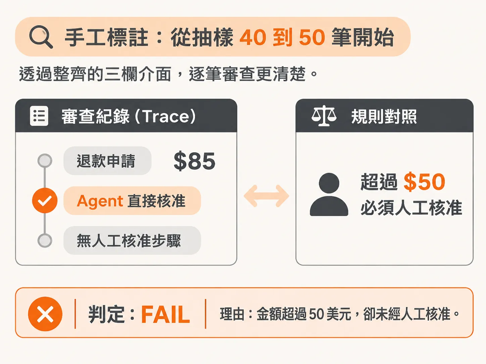
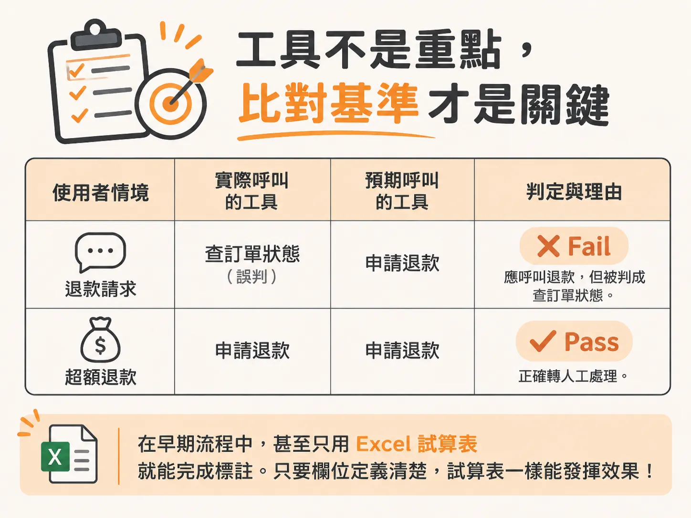
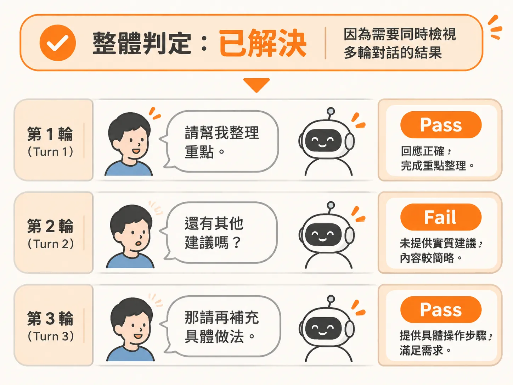

# 讀懂一條 Trace：逐筆標註 Pass/Fail 與具體原因

上一節把每次 run 拆成 Session、Turn、Span；接下來要真的坐下來把它讀完，而不是只確認資料有沒有存進去。

開發 AI Agent 時，最容易落入的陷阱是只看終端機輸出的 log，或是只看模型最後給使用者的回覆。如果回覆看起來客氣通順，大家往往就以為系統運作正常；但實際上，底層可能調用了錯誤的工具、略過了必要的安全規則，甚至在背後默默失敗。

要真正了解 Agent 的表現，必須親自用眼睛看、用手標註（error analysis）。在評估 AI 輸出時，不能只看最終答案，而是要從頭讀完整條 trace，逐筆給出 pass 或 fail，並附上具體的判斷理由。

## Trace 裡到底要看什麼？

多數具備追蹤觀測機制的系統，會把執行過程中的 trace 存入資料庫。以企業實際導入為例，當客戶在平台上啟用評估與可觀測性時，系統會將這些 trace 倒進他們的資料雲（Data Cloud），讓團隊能控管誰有權限查閱，並透過 API 或介面檢視。

常見的 Trace 檢視工具通常採用三欄式介面：

1. **左側：根會話（Root Session）**，能看到整體對話流程與時間戳記（timestamps）。
2. **中間：跨度（Span）**，列出在該會話底下發生的各個具體步驟。
3. **右側：詳細屬性（Details）**，展開特定 span 的詳細資訊。

在簡易範例中，屬性可能只有訂單編號（order ID）、輸入、輸出，以及大語言模型（LLM）實際生成了什麼；但在更複雜的 Agent 裡，右側會帶有大量的中繼資料（metadata）與執行細節。分析的核心就在於：比對「進去了什麼輸入」與「模型生成了什麼輸出」，確認中間每一步有沒有走偏。

## 手工標註：從抽樣 40 到 50 筆開始

面對動輒一萬筆的線上會話，不可能全部用人工肉眼看。這時應該採取抽樣方式。業界的最佳實踐通常建議先挑選 **40 到 50 筆會話** 開始標註。

當資訊被整齊排在三欄介面中時，逐筆審查就不會令人難以招架。例如在檢視介面時，系統可能已經標記出一個「超額退款（over-refund）」的錯誤：

- **細看數據**：系統直接核准了 85 美元的退款，中間完全沒有請求人工核准。
- **對照業務規則（Guardrail）**：原先制定的防護規範明訂「超過 50 美元就不能直接退款，必須送交人工（或主管）簽核」。
- **人工提供標註**：這筆就不能只看「有退款給客人」就給過。人工必須介入標記為 Fail，並寫下理由：「此筆退款不該直接核准；超過 50 美元時依規定需經人工核准。」

修復程式碼往往是最簡單的一步，最難的是「找出到底哪裡出錯」以及「為什麼出錯」。確認了原因，就能回頭去檢查防護政策為何沒有觸發、為何沒能攔截這個直接核准的動作。

## 工具不是重點，比對基準才是關鍵

進行錯誤分析時，不需要一開始就被複雜的工具綁架。工具的本質是為了方便視覺化；例如分析長篇往返電子郵件的業務開發 Agent（SDR agent），與分析語音 Agent 所需要的檢視版面完全不同。

如果現成工具不合用，甚至可以用簡單的提示詞請 LLM 在十分鐘內寫一個簡單的 HTML 頁面，只要能上傳 JSON trace、匯出結果即可。

在早期流程中，甚至只用 Excel 試算表就能完成標註。只要欄位定義清楚，試算表一樣能發揮效果：

| 使用者參照／情境 | 實際 Tool Call | 預期 Tool Call | 判定 | 理由說明 |
| :--- | :--- | :--- | :--- | :--- |
| 使用者回報壞掉的草莓 | 查詢訂單狀態 | 發起退款流程 | FAIL | 應走退款流程，卻誤查訂單狀態，也未索取 24 小時內照片 |
| 使用者要求退款 $85.40 | 送交人工審核 | 送交人工審核 | PASS | 超過 $50 門檻，正確觸發人工升級機制 |

如果呼叫了 GitHub 工具，就要進一步看它在內部呼叫了哪一個 PR 合併動作、呼叫順序是否符合預期。有了明確的預期標準（ground truth），判定 pass 或 fail 就有了依據。

## 多輪對話要「逐輪」與「整體」一起看

在多輪對話的情境中，常見的疑問是：到底該看每一輪的輸出，還是只看最後有沒有解決問題？

答案是兩者都要看：

1. **逐輪判定（Turn level）**：檢視 Agent 當下的反應是否合乎邏輯與業務流程。例如使用者抱怨「同一筆訂單被收了兩次費用，快點處理」，Agent 回覆「請問您的訂單編號是什麼？」。從工作流程來看，系統在採取退款等敏感動作前，本來就應該先確認對象、識別驗證使用者身分，因此要求提供單號屬於合理行為，該輪應記為 Pass。
2. **最終判定（Session level）**：看使用者的終極目標是否確實被解決，或者流程在中途走偏。

標註時不用糾結於評估標準是否百分之百完美。這個階段最核心的目的是鍛鍊手感與判讀能力：親自讀 trace、標註 pass 與 fail、寫下一行具體原因，進而把錯誤分類歸納，決定後續該優先修正哪一項規則。

千萬不要在第一天就想著全靠 LLM 自動將錯誤分群。如果連人都不清楚每一步為什麼對、為什麼錯，直接把評估全丟給 AI，最後做出來的產品只會離真實的使用者情境越來越遠。
