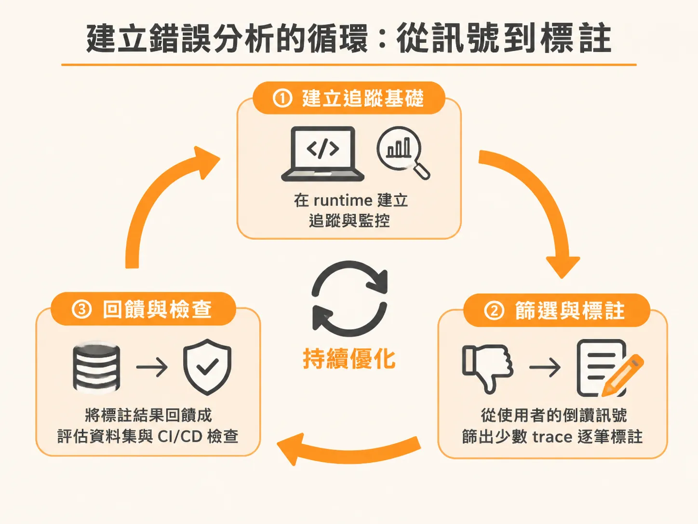
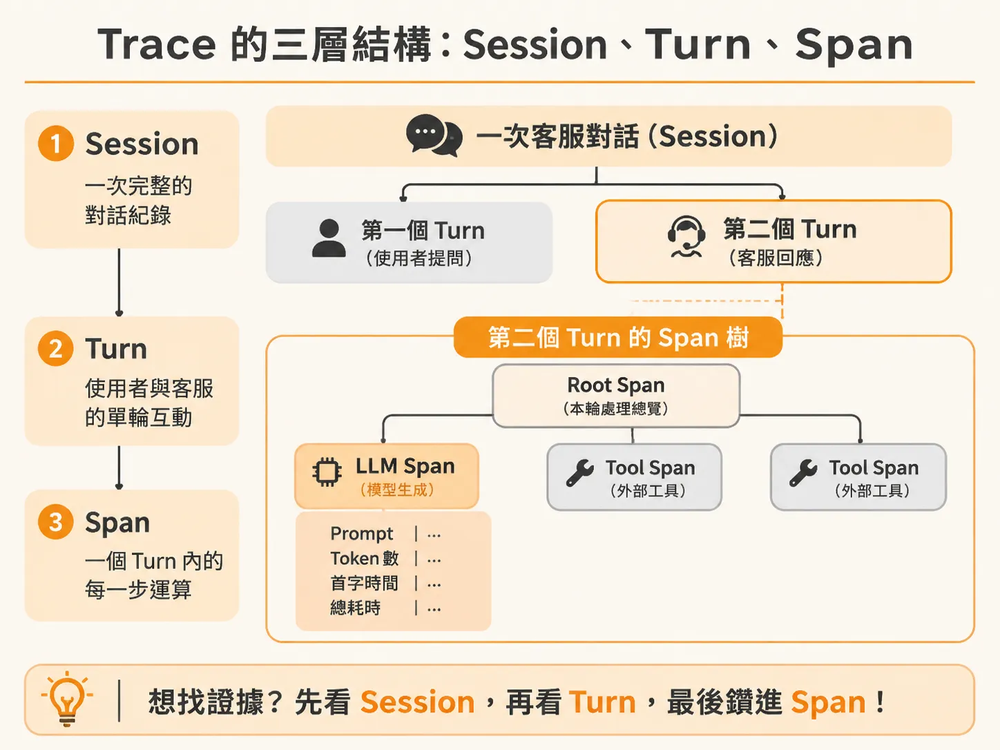
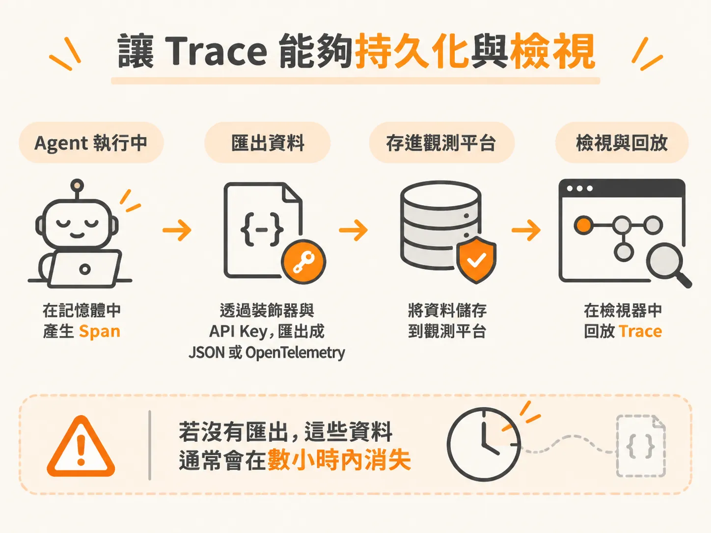

# 為 Agent 每次 Run 建立 Session、Turn 到 Span 的完整 Trace

當客服 AI Agent 做出錯誤決策時，工程團隊最常遇到的困境就是打開日誌卻一無所獲。

以虛構的 30 分鐘生鮮外送平台「Pronto」為例，系統規定生鮮品損毀需在 24 小時內附照才能退款；運費只有在延遲超過 60 分鐘或官方取消時才退；超過 50 美元的退款必須轉交真人審查，Agent 絕對不可自行核准；食安問題（如沙拉盒出現碎玻璃）或法律威脅也必須立即轉真人。

如果這時查看傳統的應用程式日誌（Logs）：

<!-- source: sources/ai-eval/20261108/course/code/ByteByteGo_AI_Evals_Week1_SlideDeck.txt#L602-L622 -->
```text
10:32:52 INFO  received user message
10:32:52 INFO  tool: refund called
10:32:55 WARN  policy version mismatch (soft)
10:32:56 INFO  tool: refund returned
10:33:01 INFO  response sent (9s total)
```

這些紀錄只呈現了時間戳記、函式呼叫順序，以及一個沒有觸發警報的輕微警告。傳統日誌完全遺漏了關鍵的「語意層」（semantic layer）：模型在當下究竟看到了什麼提示詞與上下文？檢索模組拿回了哪一段退款規定？模型為何會引用已廢棄的政策而多收顧客款項？日誌無法重現推論過程，讓除錯變得像在盲飛（flying blind）。

要讓錯誤具備可解釋性，團隊必須為 Agent 的每次執行建立 Trace，並建立日常檢視的習慣。

---

## 建立錯誤分析的循環：從訊號到標註

追蹤分析並不是偶爾為之的除錯手段，而是一個持續循環的工程習慣。這套流程主要分為三個階段：



1. **建立追蹤基礎**：在 Runtime 記錄完整的推論與工具調用過程，並將這些暫存於記憶體中的數據持久化存入觀測平台。
2. **篩選與標註（Annotation）**：從實際運行資料中找出異常個案，進行人工檢視並歸類錯誤原因。
3. **回饋至評估與 CI/CD**：將標註完成的失敗個案轉化為評估資料集，甚至用來校準作為裁判的評估模型（LLM-as-a-judge），防止回歸錯誤。

在實務上，面對龐大的執行次數，無法人工看完每一筆 Trace，最有效的切入點是收集使用者的明確評估（explicit evals），也就是介面上的「按讚（Thumbs up）」與「按倒讚（Thumbs down）」。

真實使用者的回饋資料通常很稀疏，因此收集介面必須極度簡單，切忌使用十題以上的冗長問卷。當使用者點擊倒讚時，提供直覺的分類選項（例如「事實錯誤」或「不安全／具冒犯性」），就能產生具備行動價值的訊號。

舉例來說，若 Agent 處理了 100 場對話，其中有 12 場被標記為倒讚，分析時就可以直接聚焦在這 12 筆 Trace 上，將問題分桶歸類：有多少比例是工具呼叫錯誤（wrong tool calls）？有多少是幻覺（hallucinations）？有多少是檢索遺漏？將失敗分門別類後，改善方向才會具體可行。

---

## Trace 的三層結構：Session、Turn、Span

要完整回放一次 Agent 的執行歷程，Trace 的資料模型必須忠實反映多輪對話與內部推論的階層關係。這個架構由外而內分為三層：

<!-- derived -->
```text
Session (使用者整場互動階段，包含共用上下文與 Session ID)
  └── Turn (單次對話輪次：使用者 Utterance ──> Agent 最終回覆)
        └── Span (執行階段單位)
              ├── Root Span (該輪執行的進入點)
              ├── Tool Span (如 lookup_policy, issue_refund)
              └── LLM Span (Prompt、Reasoning、Token 與耗時)
```

### 1. Session（會話）
Session 代表使用者與 Agent 的完整互動階段，擁有唯一的 `session_id`。例如使用者進入客服中心詢問「如何重設密碼」，從開始對話到問題解決離開，整個過程都隸屬於同一個 Session。

### 2. Turn（對話輪次）
在同一個 Session 中，使用者可能持續追問。例如使用者看完說明後接著說「我還是看不懂」，這便進入了第二個 Turn。每一個 Turn 都代表一次「輸入意圖（utterance/intent）到產生最終回覆」的完整往返。多輪對話的歷史紀錄會在 Turn 之間累積。

### 3. Span（執行單元）
在單一 Turn 內部，系統所經歷的每一步運算都是一個 Span，呈現為具階層性的樹狀結構：



* **Root Span**：最頂層的 Span，記錄整個 Turn 的總耗時與最終狀態。
* **LLM Span**：記錄模型呼叫的細節。這裡不僅記錄傳入的模型名稱（如特定版本模型），更包含送入的完整 Prompt、模型產生的推論邏輯（Reasoning）、產出文字、首字生成時間（TTFT, Time to First Token）、總耗時以及所消耗的輸入與輸出 Token 數。在評估 Agent 延遲與成本時，這些都是不可或缺的指標。
* **Tool Span**：記錄各項工具的執行狀況。例如呼叫 `get_order_status` 時傳入了哪個訂單編號（如 `PRN-84213`）、工具實際回傳了什麼資料；呼叫 `issue_refund` 時退款金額是否違反了 50 美元規則等。

---

## 讓 Trace 能夠持久化與檢視

Agent 執行時產生的 Span 與推論路徑原生存在應用程式記憶體中。若沒有將其寫入外部系統，快取往往在數小時內便會消失，事後將無法追溯。



在實作上，可透過觀測工具（如 LangSmith、Braintrust 或 TraceWeaver 等開源／自建工具）進行檢測（Instrumentation）：

1. **埋設追蹤**：在 Agent 的核心執行函式（如 `run()`）以及所有工具函式（如 `get_order_status`、`issue_refund`、`lookup_policy`、`escalate_to_human`）加上追蹤裝飾器（Decorator），讓每次進入與回傳自動打包成 Span。
2. **匯出資料**：設定平台的 API Key，讓執行階段將包含階層關係的 JSON 或 YAML Trace 資料直接上傳；或透過 OpenTelemetry 格式導出本地檔案，供離線檢視器載入。
3. **回放與審查**：在視覺化介面中展開失敗的 Turn，從 Root Span 一路往下看 Tool Span 的輸入輸出是否正確、LLM Span 內的推論是否偏離系統提示。

唯有將不可見的推論與工具鏈拆解為明確的 Session、Turn 與 Span，失敗的情境才能被完整回放，工程團隊也才能真正看清錯誤發生的核心原因。
