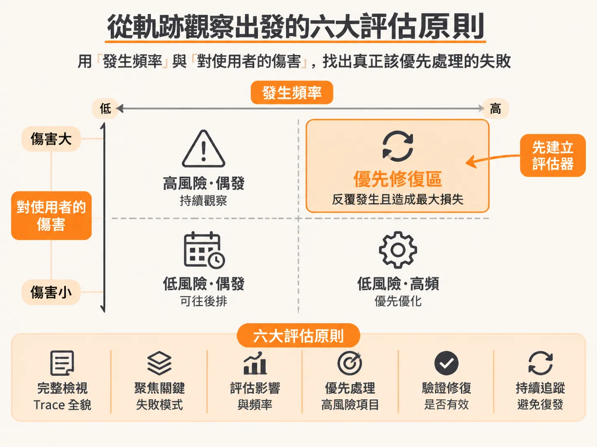
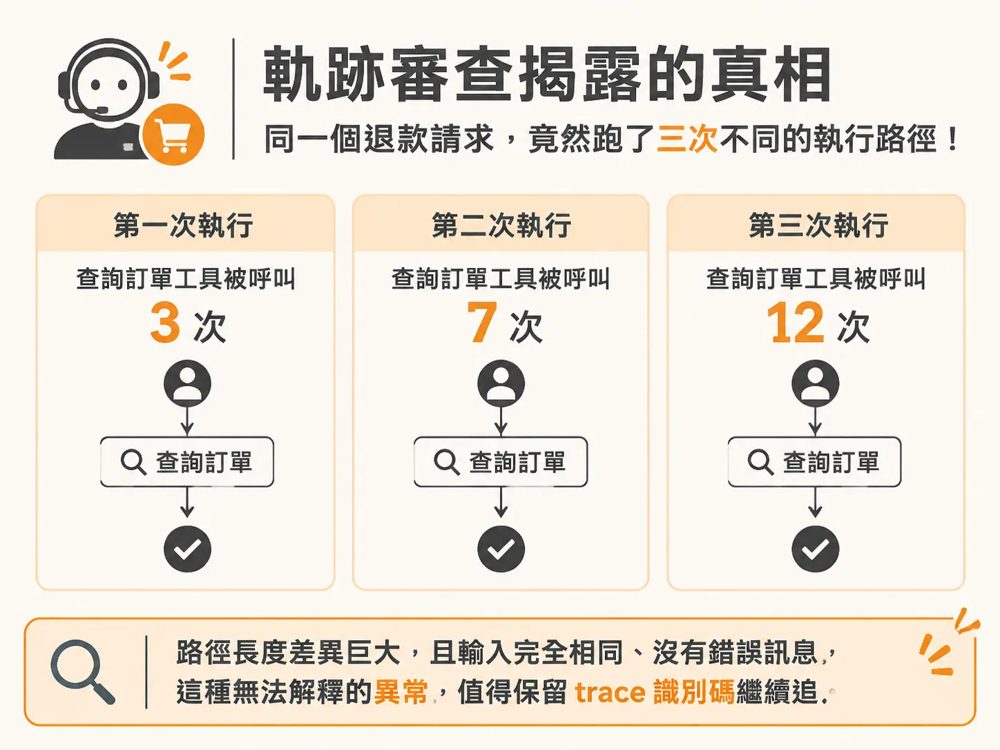
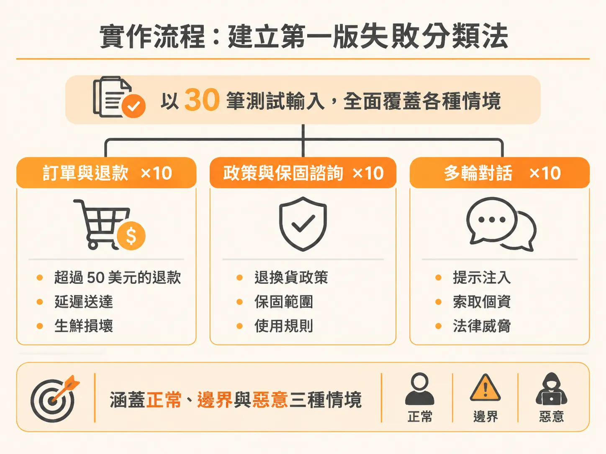
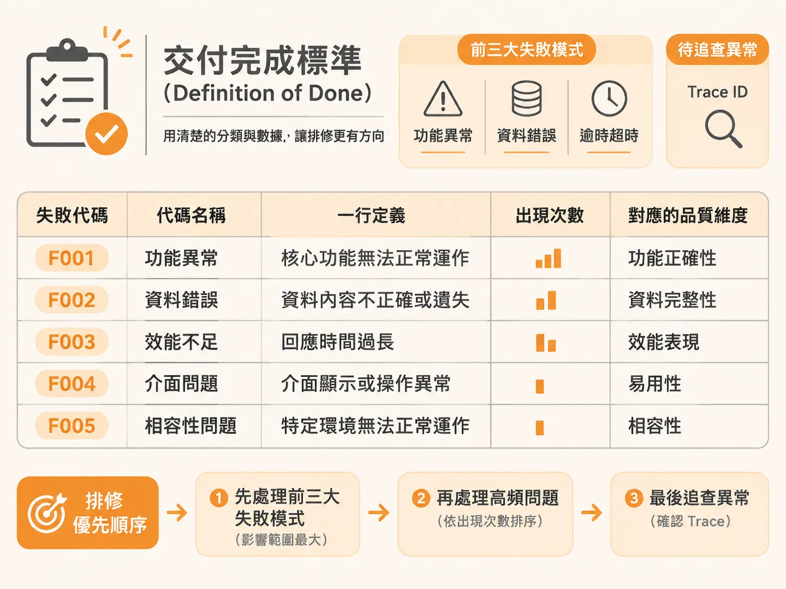

# 用頻率與嚴重度排定修復順序：建立失敗分類法與回歸案例

有了具名的二元代碼和出現次數，最後一步是決定先修哪一個，並把成果交到別人手上。

監控儀表板上顯示模型準確率高達 92%，指標全亮綠燈，客服端卻傳來真人轉接率暴增兩倍的消息，社群平台上更充斥著使用者的抱怨。在 AI 產品開發中，許多團隊都遇過這種「指標很漂亮，使用者卻極度不滿」的窘境。

這類問題的核心在於：團隊往往只盯著模型的「事實準確度」（Accuracy），忽略了產品在行為（Behavior）與可靠度（Reliability）上的表現。模型可能講出百分之百正確的事實，卻完全答非所問（Wrong Intent），導致使用者感到挫敗而要求轉接真人。這種轉接失敗通常發生在整場多輪對話的脈絡中，單看單一對話輪次根本抓不到。要解決這個落差，必須從真實軌跡（Traces）出發，建立一套團隊能共同理解的失敗分類法（Failure Taxonomy），並依據「頻率 × 嚴重度」決定優先修復的項目。

## 從軌跡觀察出發的六大評估原則

AI Agent 的運作失誤多半與語意及流程有關，只看對話記錄（Transcript）不夠，必須檢視工具呼叫、輸入、輸出與時間線組成的完整樹狀結構（Trace）。這六項原則在整週的流程裡反覆出現，這裡把它們收成一張清單，當作後續所有判讀的檢查表：

1. **軌跡優於單純紀錄（Traces beat logs）**：Agent 的錯誤是語意層級的，需要觀察完整的呼叫樹，而不是扁平的對話紀錄。
2. **先人工研讀再自動化（Read before you automate）**：在寫出任何自動化評判器（Judge）之前，必須先有人工歸納出的分類法。
3. **以「頻率 × 嚴重度」排定優先級（Frequency × severity sets priority）**：優先為那些反覆發生且對使用者傷害最大的失敗模式建立評估指標。
4. **採用二元判定標籤，而非量表打分（Binary codes, not scales）**：給予明確具名的「是／否」錯誤代碼，確保兩位不同標註者看到的標準一致。
5. **單次研讀檢驗六大維度（Six dimensions, one read）**：在同一批軌跡中，同時檢視品質（Quality）、行為（Behavior）、安全（Safety）、可靠度（Reliability）、成本（Cost）與延遲（Latency）。
6. **將異常視為未來的教材（Anomalies are the curriculum）**：遇到暫時無法解釋的奇怪軌跡，保留它的軌跡識別碼（Trace ID），作為後續深入研究的起點。

## 實際案例：軌跡審查揭露的真相

以電商客服 Agent 的軌跡分析為例，深入檢視往往會發現儀表板以外的事實：

- **過期知識是最大風險**：在 8 個失敗的對話工作階段中，有 5 個引用了過期的政策，直接導致向顧客超收費用。這是團隊應該建立的第一個評估器。
- **延遲藏在工具呼叫中**：對話卡頓的主因並非大型語言模型推理太慢，而是工具呼叫與佇列等待的時間過長；這點只有從追蹤呼叫樹才能發現。
- **「正確」不等於解決問題**：答非所問的回答通過了所有事實準確度檢查，內容事實無誤，但回答了錯誤的問題。產品層級的行為健全，不等於底層模型的品質。
- **記錄異常模式**：面對同一個退款請求執行三次，查詢訂單的工具呼叫次數分別為 3 次、7 次與 12 次。同樣的輸入卻產生差異極大的執行路徑，系統沒有報錯、沒有觸發警報，這類異常的 Trace ID 必須先妥善保存。

## 實作流程：建立第一版失敗分類法

從零開始建立追蹤系統與失敗分類法，可依循六個步驟執行：

1. **埋入追蹤工具**：透過追蹤 SDK（例如 LangSmith）在程式碼中埋點，或是直接使用免設定的 Trace Viewer 介面。
2. **執行 30 筆測試案例**：
   - 10 筆訂單與退款請求，包含邊界案例（超過 50 美元的退款、延遲送達補償、易腐生鮮損壞）。
   - 10 筆政策、保固與替代品諮詢。
   - 10 筆多輪對話（2 至 3 輪），其中包含 2 到 3 筆對抗性測試（提示注入、索取個資、法律威脅）。
3. **完整標註 30 筆軌跡**：從頭到尾完整讀完每條軌跡，記錄通過或失敗，並寫下自由文字筆記。
4. **歸納分類法**：整理出 5 個以上明確具名、採二元判定的標籤代碼，統計每個代碼出現的頻率，並對應到前述的品質六大維度。
5. **撰寫分析摘要**：列出前三大失敗模式，並說明團隊應優先評估與修復哪一項。
6. **保留一個無法解釋的異常**：記下該案例的 Trace ID。

## 交付完成標準（Definition of Done）

一份可交接的評估計畫與失敗分類法，需符合以下六項標準：

- 每一筆執行都產出可見的軌跡，清楚顯示輸入內容、工具呼叫與時間戳記。
- 30 筆測試案例皆經過完整人工標註，包含通過／失敗判定與詳細筆記，而非僅瀏覽最終產出。
- 分類法包含至少 5 個具名的二元判定標籤代碼，其定義足夠明確，能讓其他團隊成員一致套用。
- 每個代碼都有具體的發生頻率統計，以利排序優先修復項目。
- 成果摘要清楚點出 3 個關鍵發現與 1 個未解異常，並附上具體 Trace ID。
- 每個代碼皆明確歸類至品質、行為、安全、可靠度、成本或延遲等六個維度之一。

## 評估成果是團隊最強的說服工具

精確的評估指標不僅用於修復系統錯誤與防範回歸，更是團隊對外溝通的利器。市場上每家公司都在打造自己的 Agent，許多專案甚至會在行銷與業務推廣資料中宣傳其評估成果。

當業務與行銷團隊面對客戶詢問產品在特定場景下與其他競品的差異時，若工程團隊能提供扎實的競爭力評估數據，業務便能自信地向客戶證明產品價值。這種以評估為導向的產品定義（Eval-driven PRD）與市場拓展策略（Eval-driven GTM），讓工程開發與商業目標直接接軌。以同一批軌跡分析為基礎，產出業務團隊能直接引用的成果，能讓評估發揮超越單純程式碼測試的影響力。
