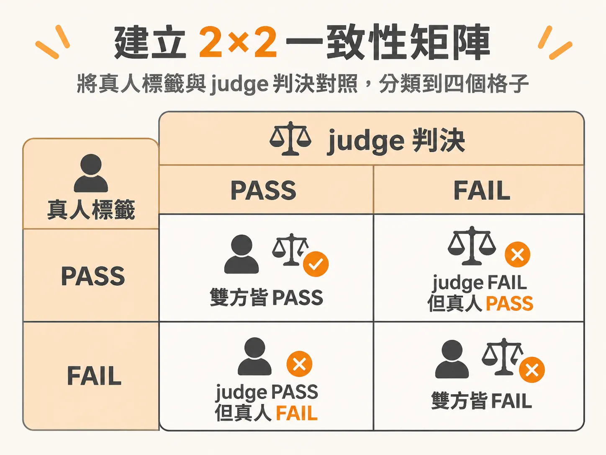
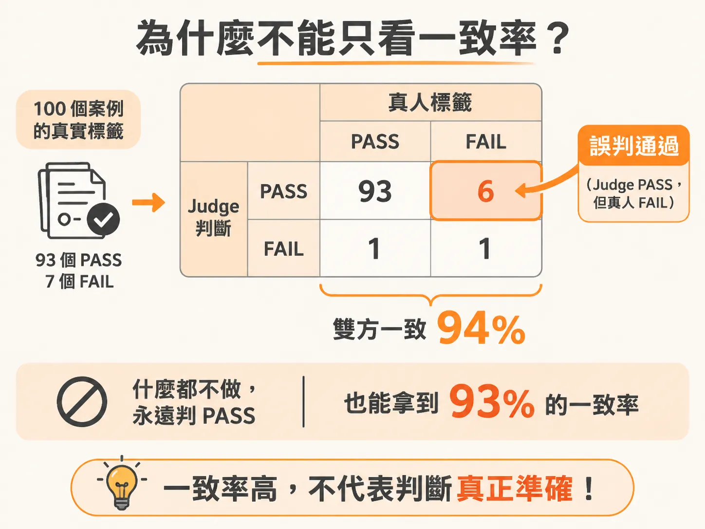
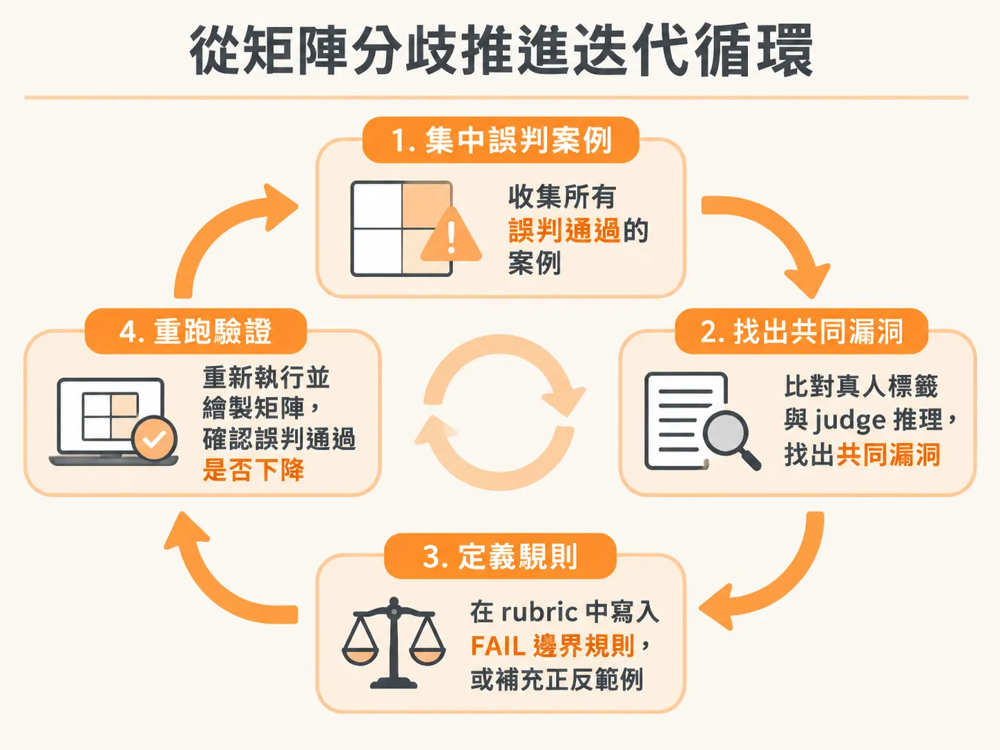

# 用 2×2 一致性矩陣檢驗 LLM Judge：看懂四個象限的判決意義

當團隊著手打造用來評估 AI 輸出的 LLM judge 時，最常遇到的問題是：這個 judge 到底能不能信任？能否拿它的評分來決定產品要不要上線（go / no-go decision）？

要證明 judge 是否可靠，最直接的方法是拿同一批樣本，讓真人專家與 judge 分別給出判決（PASS 或 FAIL），再把兩者的結果排成一張 2×2 的一致性矩陣（agreement matrix）。透過這張矩陣，我們不只能計算整體一致率，還能看清每一次分歧背後的風險結構。

## 建立 2×2 一致性矩陣

驗證時通常需要 30 到 50 個涵蓋多種情境的真人標籤案例（例如標記 40 個模型的輸出）。資料集必須維持多樣性，且不能把調整 prompt 時看過的資料直接拿來驗證；若用同一批資料調優又測試，只會虛增 judge 的表現。

在評估標準上，建議採用單一問題的二元判決（PASS 或 FAIL），並讓 judge 在輸出結果前先寫下推理過程（reasoning），避免使用 Likert 多分級或在單一 prompt 中塞入多項標準。

把每一筆案例的真人標籤與 judge 判決對照後，即可分類填入 2×2 矩陣的四個格子中：



| | Judge：PASS | Judge：FAIL |
| :--- | :--- | :--- |
| **Human：PASS** | 雙方皆 PASS（JP_HP） | 誤判失敗（False Fail / JF_HP） |
| **Human：FAIL** | 誤判通過（False Pass / JP_HF） | 雙方皆 FAIL（JF_HF） |

## 讀懂四個格子的意義

這四個格子分別代表評估系統中的不同狀態：

### 1. 雙方皆通過（Judge Pass, Human Pass）
真人與 judge 都判定合規。代表在正面案例上，judge 能正確識別出符合標準的輸出。

### 2. 雙方皆失敗（Judge Fail, Human Fail）
真人與 judge 都判定違規。代表在有瑕疵的案例上，judge 確實抓到了問題，是有效的防線。

前兩者（矩陣對角線）加總起來，除以總樣本數，就是表面的一致率（observed agreement）。當雙方意見一致時通常不需要額外處理；重點在於非對角線上的兩種分歧。

### 3. 誤判失敗（False Fails：Judge Fail, Human Pass）
真人認為合格，judge 卻打了 FAIL。這種錯誤屬於「過度嚴格」或「誤殺」。在業務上，它會讓合規的輸出被擋下或重算，造成額外成本，但通常不會直接把爛答案送到終端使用者面前。

### 4. 誤判通過（False Passes：Judge Pass, Human Fail）
真人認為不合格、是真實的壞結果，judge 卻放行給了 PASS。**這是整個矩陣中最危險的象限**。它代表有害、幻覺或錯誤的內容直接穿透了評估防線，可能直接引發客訴或資安事故。

## 為什麼不能只看一致率？

許多人驗證 judge 時只看一致率，但高一致率往往會隱瞞嚴重的系統性盲點。

舉一個實際案例：假設有 100 個案例，真人標籤中 93 個 PASS、7 個 FAIL（系統平時表現多半正確）。測試一個新的忠實度（faithfulness）judge，得到的 2×2 矩陣如下：



- Judge Pass / Human Pass：93 件
- Judge Fail / Human Pass：0 件
- Judge Pass / Human Fail：6 件
- Judge Fail / Human Fail：1 件

表面上一致率高達：

<!-- derived -->
```
(93 + 1) / 100 = 94%
```

主管看到 94% 可能覺得可以上線，但仔細看最危險的誤判通過區：真實的 7 個失敗案例中，judge 竟然放過了 6 個，只抓到 1 個。

這個 judge 其實只是盲目地「幾乎全部給 PASS」。在 93% 案例本來就是 PASS 的情況下，一個什麼都不做的 judge 也能拿到 93% 的分數，94% 實際上只比閉著眼睛猜多對了一題。

這就是為什麼必須引入校正隨機猜測的 Cohen’s kappa（κ）：
- 此案例的 Cohen’s κ 僅有 0.24，遠低於標準門檻。
- 偏斜的資料分佈會讓 raw accuracy 失去參考價值，而 κ 能如實反映這種不平衡。

## 判斷 Judge 能否上線的四道關卡

要將 judge 納入自動化上線決策（ship decision），必須通過四個明確門檻：

1. **一致率（Agreement）≥ 85%**：
   在涵蓋足夠多樣性的 30 至 50 個真人標記樣本上測量。如果是在要求更高的代理人（Agent）場景，團隊標準甚至建議拉高到 90%。
2. **Cohen’s κ ≥ 0.60**：
   確認雙方的一致性不是來自特定類別比例過高造成的隨機吻合，達到統計上實質一致（substantial agreement）的程度。
3. **誤判通過（False passes）極少，且每一筆都親自讀過**：
   最危險的象限數量必須壓得夠低，而且你必須確切知道裡頭每一題錯在哪裡、失敗率是多少。
4. **失敗原因可被解釋（Explainable）**：
   能具體說出每次分歧的根因，而不是只回報一個僥倖達標的數字。

以一個實際的忠實度檢驗為例，50 個樣本中，雙方一致的有 31 件（雙 PASS）與 8 件（雙 FAIL），總計 39 件：

| 關卡 | 目標值 | 測試結果 | 判斷依據 | 審核結果 |
| :--- | :--- | :--- | :--- | :--- |
| 1. 一致率 | ≥ 85% | 78% | 39 / 50 符合 | FAIL |
| 2. Cohen’s κ | ≥ 0.60 | 0.44 | 僅屬中度一致，未達實質一致 | FAIL |
| 3. 誤判通過 | 極少且逐筆檢視 | 47% | 15 個真實失敗中有 7 個被放行 | FAIL |
| 4. 根因可解釋 | 找出分歧模式 | 是 | 7 筆誤判通過中，有 5 筆引述了錯誤的文件章節 | PASS |

雖然前三項都沒過關，但第四項指出了明確的修正方向。這類「朝單一方向偏差」的錯誤通常是可以修正的系統性偏誤（例如在 prompt 中補上一條針對引述章節的邊界規則，就能一次修復 7 筆中的 5 筆）；反之，如果分歧點毫無規律、純屬隨機錯誤，通常代表評分準則（rubric）寫得太模糊。

## 從矩陣分歧推進迭代循環

當矩陣顯示 judge 尚未達標時，不必急著全盤改寫 prompt。標準的診斷流程是：

1. 把所有落入「誤判通過」象限的案例集中起來。
2. 逐一比對真人標籤備註與 judge 產出的 reasoning 說明，找出它們共同利用的漏洞（shared loophole）。
3. 在 rubric 中把這個漏洞明確定義為 FAIL 的邊界規則（boundary rule），或是補充正反範例。
4. 重新執行並重新繪製矩陣，檢視誤判通過是否顯著下降。



在實務決策上，若指標卡在 78% 上下，團隊可評估這些誤判的風險等級。如果屬於無法承擔的高風險缺陷，就必須擋下；若風險可控，也能先採取 Alpha 或 Beta 的漸進式發布（staggered launch）。將這些一致性矩陣指標與檢驗門檻提早寫進單頁規格書（one-pager spec）中，能省去跨團隊溝通時反覆開會對齊標準的時間成本。
