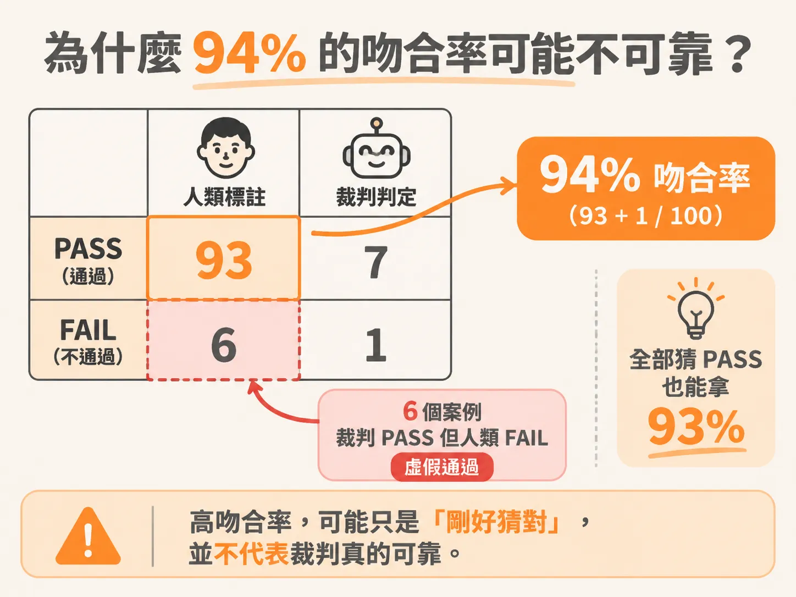
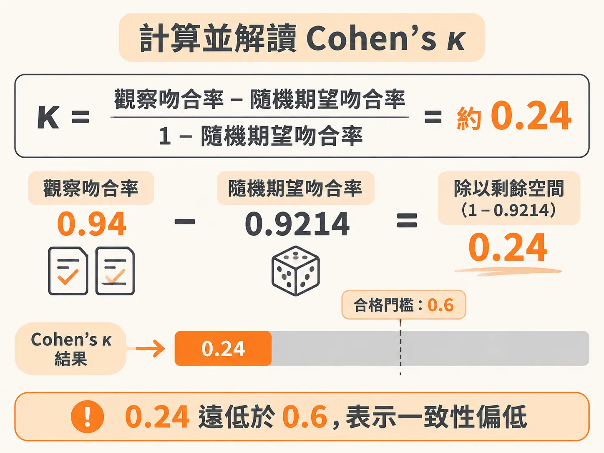
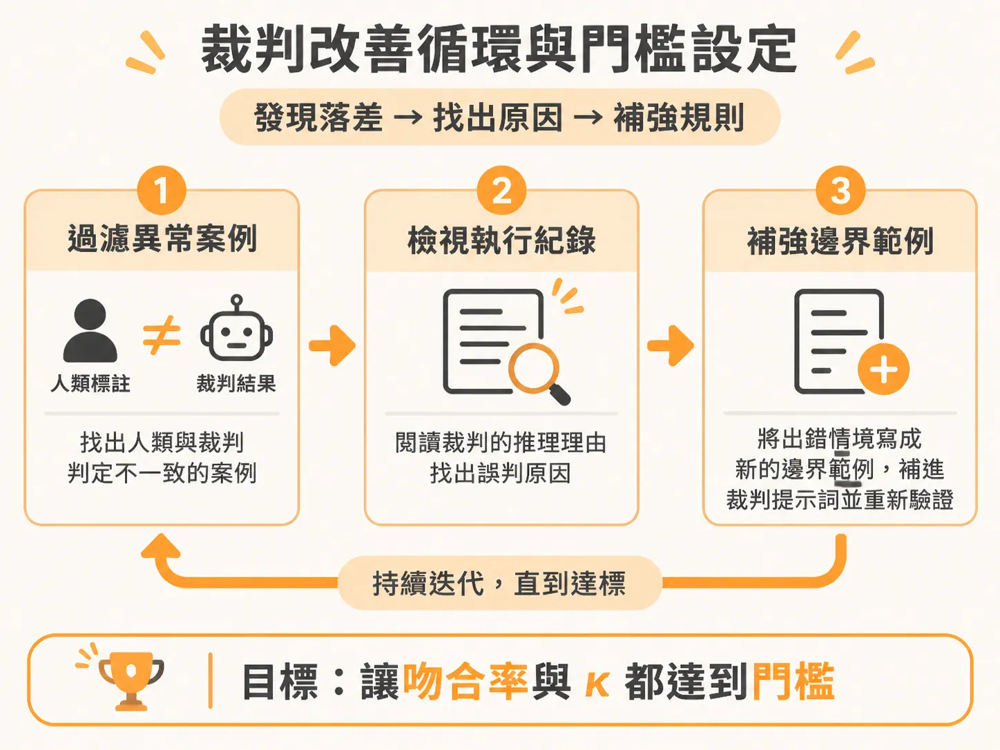

# 評估 LLM 裁判的可靠度：計算並解讀 Cohen's κ

上一節用 2×2 矩陣把 judge 的對錯拆成四個象限，也看到一致率會騙人。接著要把那個直覺變成一個可計算、可比較的數字。

當你為 AI 系統設計好用來評估品質的提示詞（prompt），並把它當成自動化裁判（LLM-as-a-judge）跑完測試集後，很快就會面臨一個核心問題：這個裁判到底可不可信？能不能根據它的判定來做產品上線（go / no-go）的決策？

要證明裁判的可靠度，標準做法是拿人類專家的標註結果與 LLM 裁判的判定進行對照，檢驗兩者之間的吻合程度。但在衡量一致性時，若只看表面上的吻合率（agreement percentage），往往會踩進嚴重的指標陷阱。

## 裁判提示詞的設計核心：單一二元標準

在驗證裁判之前，提示詞本身必須提供足夠具體的判準。一個常見的反模式（anti-pattern）是在同一個提示詞裡混雜多個標準，例如要求模型：「請以 1 到 5 分評估這則回覆的實用性、正確性與語氣。」

這樣做的問題在於三個指標會互相干擾，當分數偏低時，你完全無法得知是哪一項出了問題。正確的做法是拆成三個獨立裁判，每個裁判只回答一個是非題（PASS 或 FAIL）：

1. **角色定義（Auditor role）**：明確告知模型它是在稽核對話紀錄，是在進行評估而非協助使用者。
2. **單一二元問題（Single binary question）**：每次只問一個問題，例如「每個需要呼叫工具的輪次都成功發出工具呼叫了嗎？」。
3. **明確標準（Concrete standard）**：清楚界定 PASS 與 FAIL 的條件。例如只要該呼叫工具卻只用純文字回覆就是 FAIL。
4. **邊界範例（Boundary example）**：把棘手的邊界情境寫明。例如「在使用者抗議後才補呼叫工具，不能算過關」。
5. **輸出格式（Output format）**：要求先輸出一到兩句推理過程（reasoning），最後再印出 PASS 或 FAIL。先寫出理由能強迫模型思考，而二元結果也更容易拿來與人類標註對齊。

業界常見的四種裁判類型涵蓋了大部分失敗代碼：檢查語氣與風格（如對沮喪使用者是否有同理心）、事實正確性（如幻覺檢測）、遵循指令（如遵守安全準則），以及任務完成度（如工具呼叫與轉接是否確實）。

## 為什麼 94% 的吻合率可能不可靠？

假設團隊開發了一個新的「真實性（faithfulness）」裁判，在 100 個測試案例中，人類標註為 93 個通過（PASS）、7 個不通過（FAIL）。這代表底層的 Agent 平常表現多半正常。



當你拿 LLM 裁判去跑這 100 個案例，發現它和人類標註的表面吻合率高達 94%。這是否代表裁判已經可以上線？

來看看詳細的混淆矩陣：

| | 裁判：PASS | 裁判：FAIL | 合計 |
| :--- | :--- | :--- | :--- |
| **人類：PASS** | 93 | 0 | 93 |
| **人類：FAIL** | 6 | 1 | 7 |
| **合計** | 99 | 1 | 100 |

表面吻合率的算法是兩者判定完全相同的案例比例：

<!-- derived -->
```text
吻合率 = (93 + 1) / 100 = 94%
```

看起來非常漂亮。但請注意底層資料的分佈：即使裁判壞掉了，不管看到什麼內容都盲目給出 PASS，它也能平白拿到 93% 的吻合率！現在裁判只不過在 7 個真正的失敗案例中，僥倖猜對了 1 個，其餘 6 個全部放行，吻合率才變成 94%。

這 6 個被裁判判定為合格、但專家明確指出失敗的案例，就是所謂的**虛假通過（false pass）**。在所有真實失敗中，裁判只抓到了七分之一。如果你只看 94% 的吻合率，就會誤以為系統非常穩定，把充滿風險的模型直接推向生產環境。

因此，在檢查矩陣時，務必優先檢視「虛假通過」這個象限，因為最危險的漏洞都藏在這裡。

## 計算並解讀 Cohen's κ

為了解決極端資料分佈下的機率偏差，我們需要使用統計指標 Cohen's kappa（記作 κ）。它衡量的不是單純的表面一致性，而是**扣除隨機猜測後的實際對齊程度**。

其公式定義為：



<!-- derived -->
```text
κ = (P_o - P_e) / (1 - P_e)
```

其中：
- `P_o`（Observed agreement）為實際觀察到的吻合率。
- `P_e`（Expected agreement）為雙方在隨機猜測下預期會吻合的機率。

以上述的 100 個案例為例：
- 觀察吻合率 `P_o = (93 + 1) / 100 = 0.94`。
- 人類判定 PASS 的機率為 `93 / 100 = 0.93`，FAIL 為 `7 / 100 = 0.07`。
- 裁判判定 PASS 的機率為 `99 / 100 = 0.99`，FAIL 為 `1 / 100 = 0.01`。

雙方純粹因隨機分佈而同時判定 PASS 的期望值為 `0.93 * 0.99 = 0.9207`；同時判定 FAIL 的期望值為 `0.07 * 0.01 = 0.0007`。
兩者相加得到隨機吻合機率：

<!-- derived -->
```text
P_e = 0.9207 + 0.0007 = 0.9214
```

將數值代入公式：

<!-- derived -->
```text
κ = (0.94 - 0.9214) / (1 - 0.9214) ≈ 0.0186 / 0.0786 ≈ 0.2366
```

四捨五入後，**κ 僅有 0.24**。

這就像有人在經常下雨的西雅圖天天預測「明天會下雨」，就算猜對率極高，也不代表他的預測模型具有專業能力。κ 透過扣除基準機率，揭露了這座裁判本質上幾乎只會盲目給 PASS 的事實。

請特別注意：κ 是衡量對齊程度的統計量，**κ 值 0.6 並不等於「60% 的準確率」**。當 κ 為 0 時，代表裁判的判定與亂猜毫無區別。在實務上，我們會把 **κ ≥ 0.6** 當作裁判具備基本信度的起跑門檻。

## 裁判改善循環與門檻設定

在建立自動化評估時，目標通常設定為：表面吻合率達 85% 以上（若是複雜的 AI Agent 任務，建議爭取 90% 以上），同時 **Cohen's κ 達到 0.6 以上**。

如果你的裁判測試結果與人類標註有落差（例如人類認為合格率僅 50%，裁判卻判定 80% 通過），改善流程如下：



1. **過濾出分歧案例**：雙方判定一致的案例先不用看，把精力集中在出現分歧的案例（特別是那 6 個虛假通過的真實失敗）。
2. **分析判定推理（Trace & Rationale）**：打開執行紀錄（trace），因為先前提示詞要求模型先輸出理由，你可以直接閱讀它為什麼判定 PASS。是因為裁判缺乏特定情境的常識？還是現有規則存在盲點？
3. **疊代提示詞**：把出錯的情境作為新的範例（few-shot example）補充進裁判提示詞，補強邊界判準後重新驗證。

每個產品團隊面臨的風險承受度都不同。如果評估結果是 78% 吻合率，雖然距離 85% 還有一段距離，但你可以進一步檢視未抓到的錯誤風險有多高。若是可接受的邊緣案例，團隊可以選擇採取漸進式發布（先進行 Alpha / Beta 測試，而非直接全面上線 GA）。

最重要的是：在產品規格書（PRD / spec）的一頁說明中，及早白紙黑字寫下團隊共識的信度門檻（例如吻合率目標與 κ 門檻）。這樣能在後續跨團隊討論中，省下無休止的校準會議時間，讓產品發布的依據清清楚楚。
