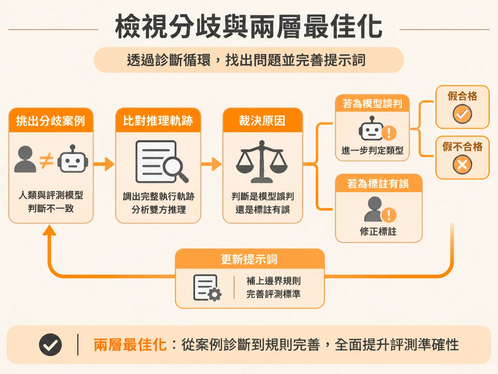
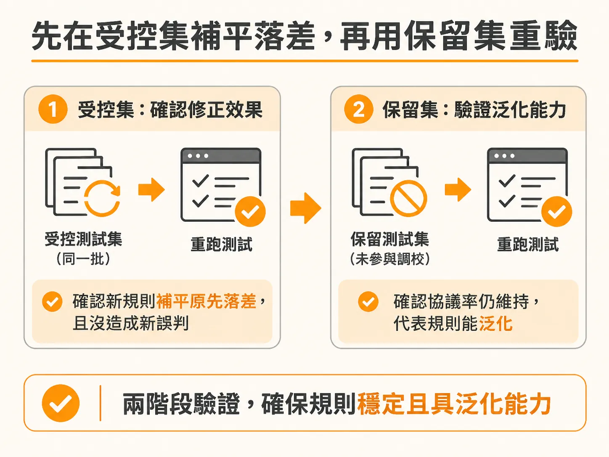
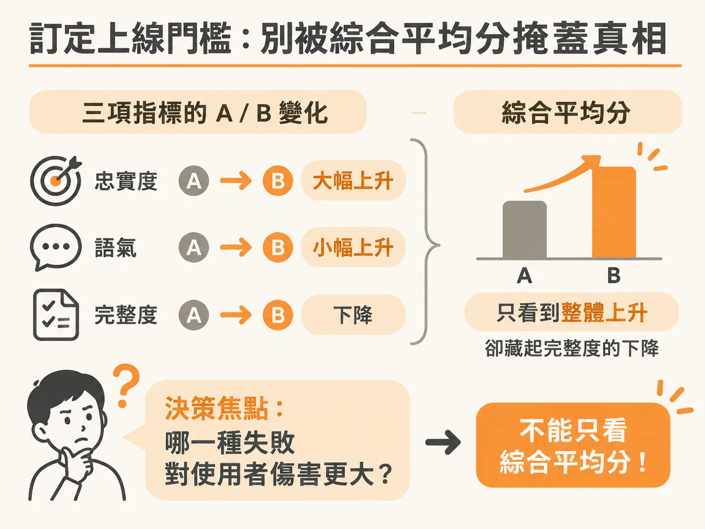

# 裁決評測分歧：從補齊邊界規則到訂定上線門檻

前一節把錯誤定位到 false pass 象限，也找出它們共同的漏洞；現在要把這些漏洞真正修掉，並寫下上線門檻。

當你跑完評測模型（LLM-as-a-judge）與人工標註的比對，看到協議率矩陣（agreement matrix）上出現紅字時，往往會面臨一個具體問題：接下來該怎麼改？是直接把這張統計矩陣丟回給大型語言模型，要它重寫提示詞（prompt），還是有更具系統性的修正迴圈？

要讓評測模型具備可信度，不能只看整體統計數字，而是必須回到兩者判斷不一致的案例（disagreements），逐條裁決並補齊邊界規則。

## 檢視分歧與兩層最佳化

改進評測模型時，主要著眼於兩個層面的最佳化：

1. **評判標準（Prompt）**：你具體要求模型評估什麼？規則是否寫得夠精確？
2. **完整上下文（Context）**：評測模型在打分時，是否拿到了做出公正裁決所需的完整背景資訊？

具體的做法是深入檢視失敗場景（failed scenarios）。把人工標註與評測模型打分不一致的樣本挑出來，調出完整的執行軌跡（trace）。此時可以借助代理迴圈（agent loop）或 Claude Code 這類開發工具輔助診斷，直接比對兩者的推論邏輯，找出模型誤判或規則模糊的地方。

在逐條裁決時，必須記錄下是哪一方誤判。如果是評測模型的盲點，要辨識出它屬於「假合格」（false-pass，該抓沒抓）還是「假不合格」（false-fail，誤殺好人），並找出它鑽了提示詞中的哪條漏洞，進而補上清楚的邊界規則。

## 先在受控集補平落差，再用保留集重驗

修正提示詞時，切忌一邊改規則、一邊隨機加入新的測試樣本。標準的迭代流程包含兩個階段：

第一階段是在**同一個受控測試集（controlled set）**上驗證。既然分歧是出現在這批特定的樣本中，修改完提示詞後，就必須拿這批完全相同的題目重新測試。你必須先確認剛剛補上的邊界規則，確實把原本已知的落差補平，而沒有引發新的誤判。

第二階段才是引入**保留測試集（held-out test scenarios）**。這批測試場景完全沒有參與先前的提示詞調整與除錯。只有當更新後的評測模型在全新的情境下，依然能維持相同水準的協議率，才代表這套規則具備泛化能力，而不是對已知題目過度擬合。

這項對齊工作需要紮實的耐心。在實際的客戶關係管理（CRM）業務場景中——例如客服代理（customer service agent）或銷售開發代理（SDR agent）——通常需要花上整整一個月，歷經六到七輪的人機對齊調整，評測模型的協議率才能從起步階段拉升到 85% 以上。隨著測試資料庫持續擴大、品質逐步精準，對齊水準才能進一步逼近 90%。

目前市面上雖有自動化評測對齊工具（例如 NetLogs），但這類全自動調校在真實環境中多半仍處於展示階段（demo level）。學術論文在概念上證明了自動閉環的可行性，但要讓它在實際生產環境中穩定運作，依舊離不開工程團隊嚴謹的手動裁決與反覆驗證。

## 訂定上線門檻：別被綜合平均分掩蓋真相

當評測模型經過驗證、協議率達標後，就能用來評估業務提示詞的改版。然而，在決定新版本能否正式上線（ship 或 no-ship）時，最常見的陷阱就是只看單一的「綜合平均分」（blended average）。

評估決策必須拆解到各個獨立指標（per-metric A/B results）。以下是一組典型的評測對比：

| 指標 | 現行版本 A | 新提示詞 B | 變化 |
| :--- | :---: | :---: | :---: |
| 忠實度（Faithfulness） | 82% | 91% | +9% |
| 完整度（Completeness） | 88% | 85% | −3% |
| 語氣（Tone） | 90% | 92% | +2% |
| **綜合平均分** | **86.7%** | **89.3%** | **+2.7%** |

如果只看綜合平均分，新版本整體上升了 2.7 個百分點，表面上像是一次成功的優化。但這個平均數字完全掩蓋了完整度下跌 3 個百分點的事實。

這時能不能批准上線？決策的核心在於：**哪一種失敗模式對真實使用者的傷害更大？**

如果你的系統是醫療、法規或金融客服，遗漏關鍵步驟（完整度不足）會導致使用者遭受實質損失，那麼即使忠實度與語氣大幅改善，完整度倒退 3 個百分點就構成了絕對的拒絕上線（no-ship）條件。此外，團隊還必須進一步驗證這 3 個百分點的下滑是否具有統計顯著性，確認它是真實的效能衰退，而非隨機抽樣的雜訊。

明確寫下各指標的不可妥協門檻（guardrails），而不是單純依賴整體的加權分數，才能避免在新版本上線後引發未預期的業務災難。
