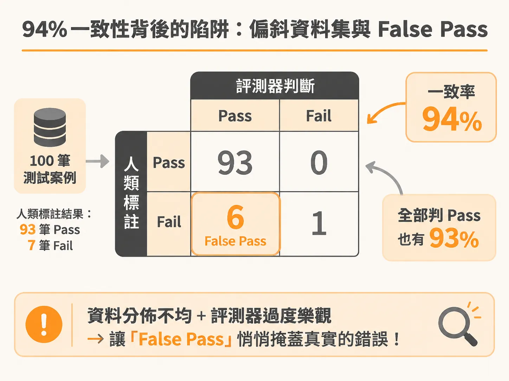
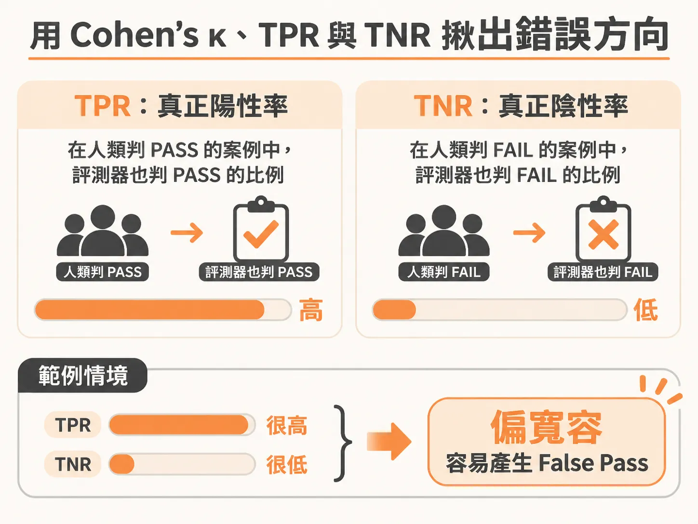
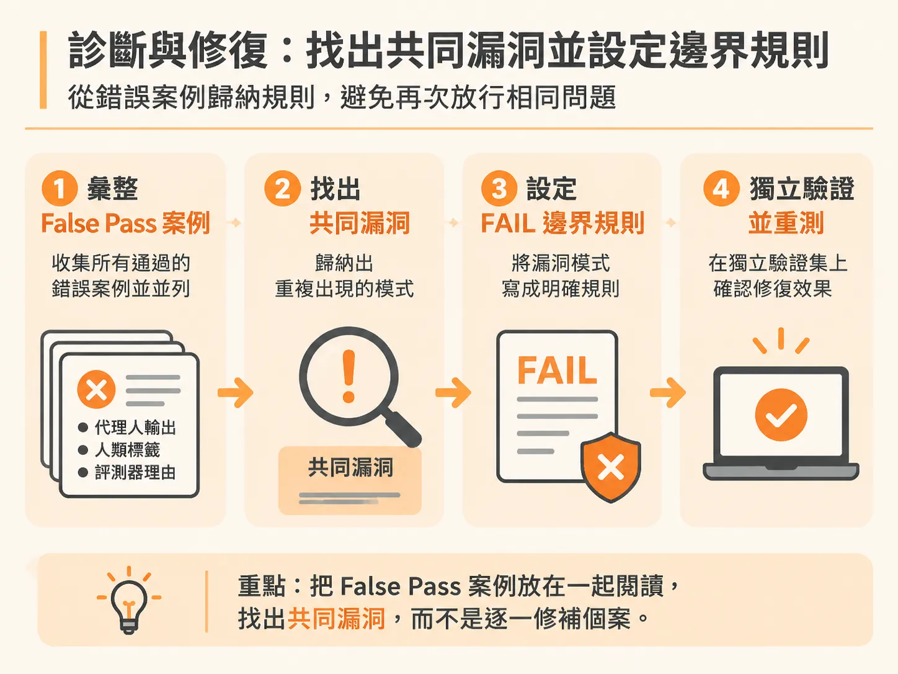

# 如何解讀評測矩陣中的 False Pass，並用 TPR 與 TNR 抓出偏誤方向

κ 給你一個整體分數，但還看不出錯誤偏向哪一邊；那要看錯誤落在哪個象限。

當團隊開始用大型語言模型（LLM）擔任評判者（LLM Judge）來自動評估產品輸出時，最常遇到的陷阱就是「高準確率的假象」。

假設隊友做了一個忠實度（faithfulness）評測器，跑完測試後回報：「它與人類標註的一致性（agreement）高達 94%，可以上線了！」這時如果直接採用，往往會將嚴重的幻覺與錯誤輸出直接放行給終端使用者。

要判斷一個評測器能不能信任，必須看懂它在矩陣中的落點，特別是危險的「假通過」（False Pass）象限，並搭配真實陽性率（TPR）與真實陰性率（TNR）來確認它的錯誤方向。

## 94% 一致性背後的陷阱：偏斜資料集與 False Pass

為什麼一致性高達 94% 的評測器依然不可靠？

假設手上有 100 筆測試案例，人類標註的結果是 93 筆通過（Pass）、7 筆失敗（Fail）。這代表受測的 AI 代理人表現本來就大多正確。此時，如果評測器幾乎對所有案例都判定通過，我們會得到以下的一致性矩陣：

| 人類標註 \ 評測器判定 | 評測器：Pass | 評測器：Fail |
| :--- | :--- | :--- |
| **人類：Pass** | 93 | 0 |
| **人類：Fail** | **6（False Pass）** | 1 |

計算整體一致性：

$$\frac{93 + 1}{100} = 94\%$$

帳面看似漂亮，但事實上，哪怕評測器是個閉著眼睛全給通過的機器人，也能免費拿到 93% 的基準分數；94% 僅僅比全給通過好上一點點。

檢視人類標記為失敗的 7 筆案例中，評測器只抓到了 1 筆，其餘 6 筆全部漏放。這 6 筆落入的象限就是「False Pass」（人類認定失敗，評測器卻判定通過）。

在所有評測錯誤中，False Pass 是最危險的象限。評測器如果把合格的回答誤判為不合格（False Fail），頂多讓開發團隊多花時間檢查；但如果將不合格、甚至帶有錯誤資訊的輸出誤判為合格（False Pass），不良輸出就會直接抵達使用者手中。

## 用 Cohen’s κ、TPR 與 TNR 揪出錯誤方向

單看一致性會被不平衡的樣本欺騙，因此需要其他指標輔助：

### 1. Cohen’s κ（Kappa 係數）
Cohen’s κ 能夠校正「碰巧猜對」的機率。在前述 94% 一致性的例子中，算出的 Cohen’s κ 只有 0.24，遠低於可信任門檻（0.60）。這立刻指出了評測器其實嚴重失真。

### 2. TPR 與 TNR 的搭配判斷
為了清楚了解評測器的判斷偏誤（bias），必須同時觀察真實陽性率（TPR）與真實陰性率（TNR）：

* **TPR（True Positive Rate）**：在人類判定合格（Pass）的樣本中，評測器正確抓出合格的比例。
* **TNR（True Negative Rate）**：在人類判定失敗（Fail）的樣本中，評測器正確抓出失敗的比例（即評測器說 Fail 且人類也說 Fail 的案例，佔所有人為 Fail 的比例）。

如果評測器的錯誤集中在單一方向——例如 TNR 極低、TPR 極高，意味著評測器有嚴重的「寬容偏誤」（偏向給 Pass，導致大量 False Pass）。朝單一方向偏誤通常是可被修正的偏差；但如果錯誤在兩邊隨機發生，往往代表評測標準（Rubric）本身語意模糊。

在調整評測器提示詞以拉高整體分數時，務必同時監控 TPR 與 TNR，避免為了提高整體一致性，反而犧牲了抓出失敗案例的能力。

## 評測器上線前的四道檢驗門檻

在讓 LLM 評測器接管上線決策前，必須以 30 到 50 筆多元的人工標註資料進行驗證，並通過以下四道門檻：

1. **一致性（Agreement）≥ 85%**：評測器與人類標註的重合比例需達標。測試集必須包含多元情境，如果只有簡單案例會虛增分數。
2. **Cohen’s κ ≥ 0.60**：排除偶然一致性，達到實質一致的標準。
3. **極少 False Pass，且逐筆閱讀**：False Pass 象限的案例數量必須極少，且開發者必須親自讀過每一筆漏放的錯誤，清楚掌握危險象限中的內容。
4. **錯誤原因可解釋（Explainable）**：每一個分歧案例都能指出具體原因，找出根本盲點，而非只看表面數字。

### 檢驗案例：未達標的忠實度評測器

以一份 50 筆人工標註的忠實度評測為例：

| 門檻 | 目標值 | 實際結果 | 原因說明 | 判定 |
| :--- | :--- | :--- | :--- | :--- |
| **1. 一致性** | ≥ 85% | 78% | 31 筆 Pass + 8 筆 Fail，共 39/50 吻合 | 未通過（FAIL） |
| **2. Cohen’s κ** | ≥ 0.60 | 0.44 | 僅達中度一致，未達實質一致 | 未通過（FAIL） |
| **3. False Passes** | 極少且逐筆檢視 | 47% | 人類標記失敗的 15 筆中，有 7 筆被漏放 | 未通過（FAIL） |
| **4. 可解釋性** | 找出根本原因 | 是 | 7 筆 False Pass 中，有 5 筆皆引用了錯誤的文件章節 | 通過（PASS） |

雖然這份評測器在前三道門檻皆未達標，但第四項門檻提供了明確的修復線索：那 5 筆 False Pass 具有相同的漏洞。

## 診斷與修復：找出共同漏洞並設定邊界規則

要修復評測器的偏誤，切忌一筆一筆修補個案，而是要將 False Pass 的案例放在一起閱讀，找出它們背後的「共同漏洞」（shared loophole）。

在上述例子中，評測器誤放的 7 筆案例裡，有 5 筆都出在「AI 代理人引用了錯誤的文件章節，但評測器只檢查了文字表面意思，沒有比對章節來源」。當確認了「評測器會在引用錯誤章節時給 Pass」的模式後，只要在評測規準中加入一條明確的判定界線（Boundary Rule）：「若引用章節與事實不符，一律判定為 FAIL」，就能一口氣修復這 5 個 False Pass。

修復流程如下：
1. **並列檢視歧異**：將代理人輸出、人類標註、評測器的判定理由並列比對。如果是人類標錯，則進行裁決（Adjudication）修正並記錄原因；如果是評測器誤判，記下漏洞模式。
2. **歸納漏洞模式**：用一句話定義最主要的失敗模式，例如：「當代理人回應包含『已轉接』但實際上未執行時，評測器會誤給通過。」
3. **增加邊界規則並重新執行**：將漏洞轉換成 FAIL 邊界規範，更新評測規準後再次驗證。

最後要特別避免的陷阱是：**切勿拿用來微調提示詞的案例當作最終驗證結果**。如果一邊改規準、一邊在同一批測試資料上重新計算一致性，只會粉飾評測器的分數。務必保留獨立的驗證集（held-out set），在修正評測器後再以全新資料集驗證，才能確保評測器真正具備上線的可靠度。
