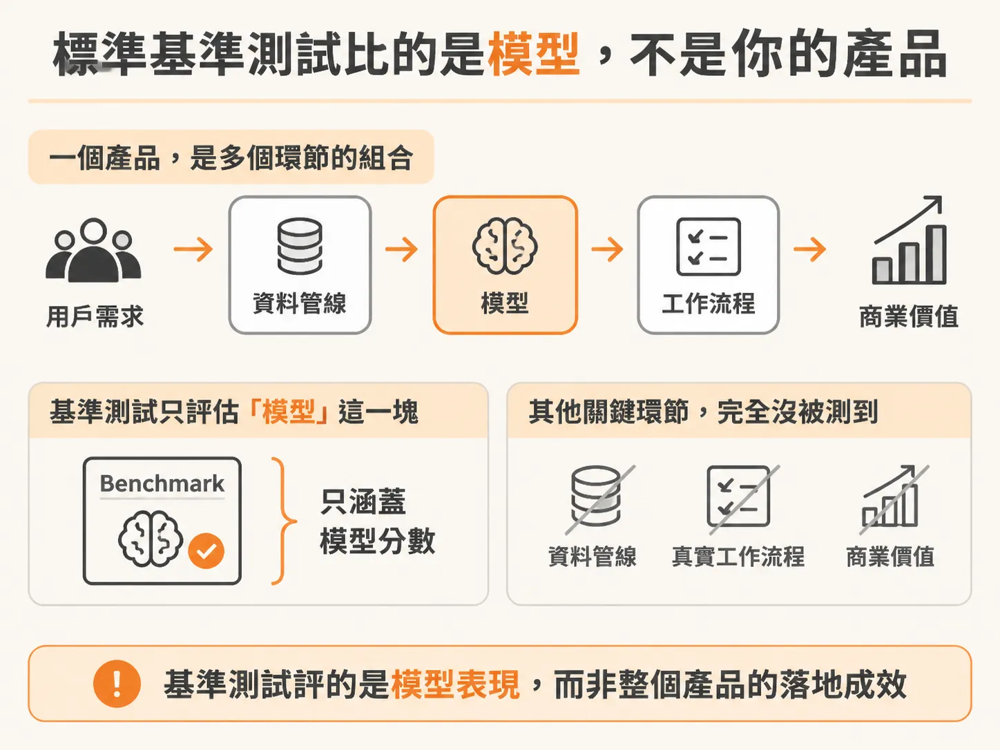
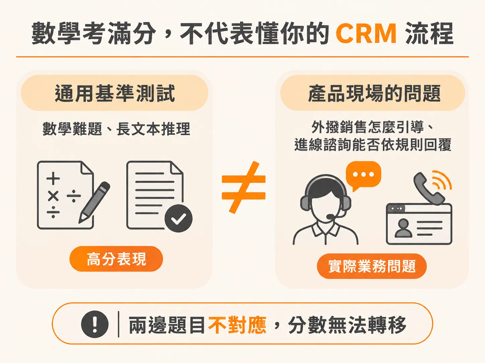
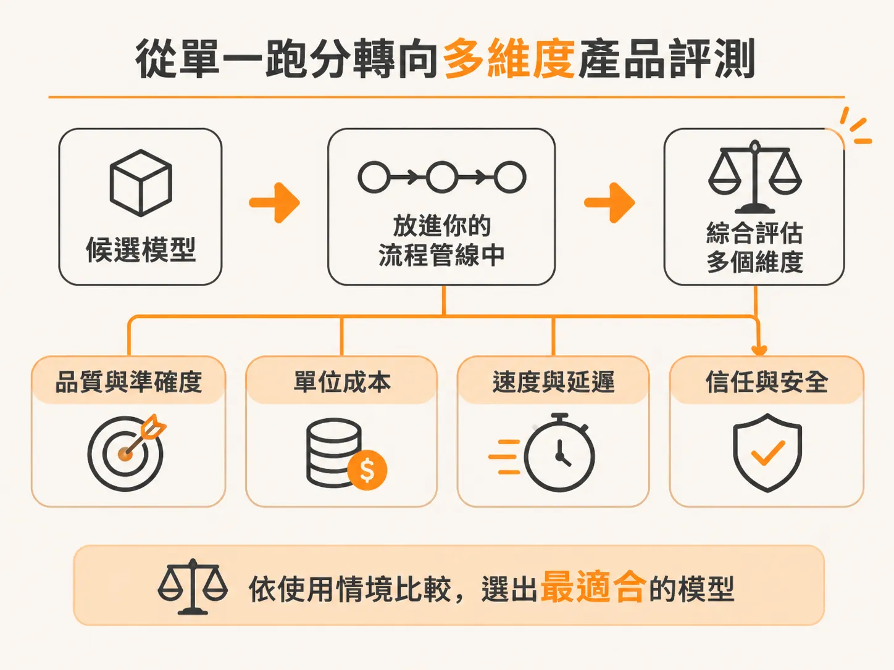

# 為什麼排行榜上的模型高分，無法預測你的真實工作流？

既然品質要靠多次執行的成功率來衡量，下一個問題就是：這個成功率該拿什麼當起點？多數團隊的第一個直覺，是去看排行榜。

每隔幾天，市場上就會有一家人工智慧實驗室發表新模型。週一這家廠商宣布旗艦模型在排行榜拿下第一，隔天另一家又端出新版本搶回榜首。各大模型公司幾乎都把公開基準測試（benchmarks）當成發表產品的主要宣傳工具，分數競賽甚至逐漸演變成一種刷榜遊戲。

當你在評估要採用哪款模型時，排行榜上的高分往往會帶來一種錯覺，以為只要選排名最高的模型，系統上線後就能順利運作。然而，公開模型基準測試與你實際在產品端做的評測（eval），關注的核心完全不同。

## 標準基準測試比的是模型，不是你的產品

公開排行榜與標準基準測試最大的價值，在於讓人在固定題目下橫向比較各家「純模型本身的效能」（model performance）。但這類通用測試對具體的商業關聯性非常低。

在實際的商業場景中，底層模型只是整個系統的其中一個零件。真正決定業務成敗、考驗系統能否落地的，是你端到端的工作流程（end-to-end workflow）、核心要解決的待辦任務（jobs to be done），以及最終帶來的商業價值。公開基準測試既沒有測試你的資料管線，也沒有驗證你的真實工作流程。

## 數學考滿分，不代表懂你的 CRM 流程

以客戶關係管理（CRM）的實際場景為例，模型在排行榜上擊敗各類數學難題、在長文本推理任務拿下高分，確實技術含量很高，也讓人印象深刻。但這個成績完全無法告訴你：

- 當業務代表需要打一通外撥銷售電話（outbound sales call）時，它能否給予正確的引導？
- 面對顧客進線的業務諮詢（inbound sales queries），它能不能精準理解並依據公司業務規則回覆？
- 它能否在第一線妥善承接真實的客戶服務，不給出偏離事實的解答？

通用基準測試測的是泛用能力，而你的產品需要的是在特定場景下完成任務的能力。這正是為什麼在應用人工智慧時，不能直接拿公開排行榜的分數當依據，而是必須從核心待辦任務出發，替自己的應用定義清楚的成功準則（success criteria）。

## 從單一跑分轉向多維度產品評測

要替業務挑選合適的模型，關鍵在於把候選模型放進自己的流程管線（pipeline）中驗證。在真實系統中，評估不能只看單一的準確度，還必須綜合衡量以下幾種維度：

- **品質與準確度**：在你的業務資料與邊界案例中，產出是否合格。
- **單位成本**：如果只看榜單挑選最強、最貴的模型，其推論成本可能高到完全無法規模化，甚至在跑大量評測或實際量產時就把專案預算燒光。
- **速度與延遲**：是否能滿足即時互動或背景任務的時效要求。
- **信任與安全**：在真實客戶互動時，是否具備足夠的防護機制與穩定性。

實務上，可以將業務拆解成具體的使用情境，例如切分為「客服業務代表（customer service agent）」與「行銷場景（marketing use cases）」。接著透過自動化評測管線，持續比對不同模型在各個情境下的準確度、成本、速度與安全性等子指標。

看懂公開基準測試與場景評測的差異，你就不會再被模型發表會上的刷榜數字牽著走，而是能依據真實產品的投資報酬率與工作流程，做出合理的技術決策。
