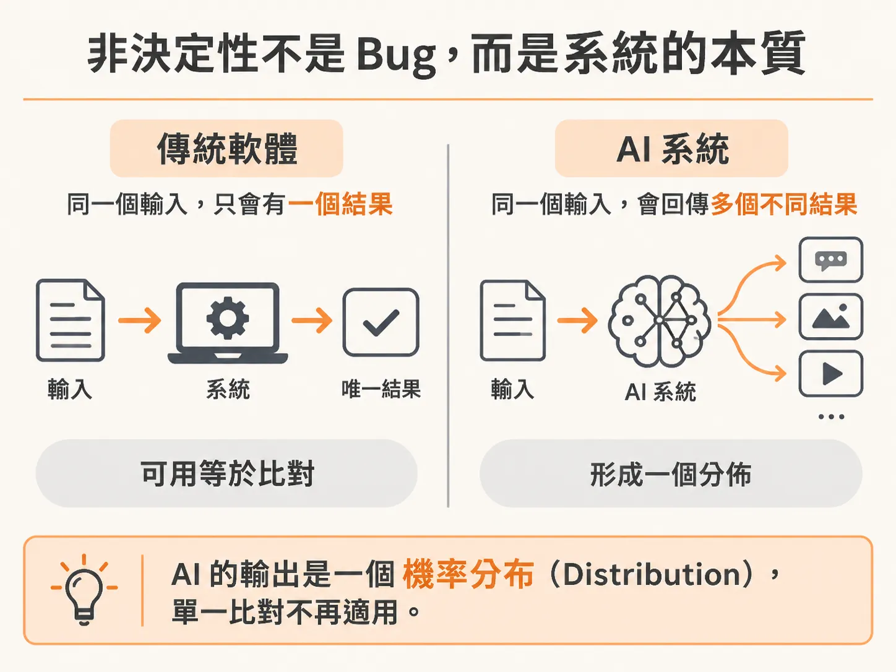
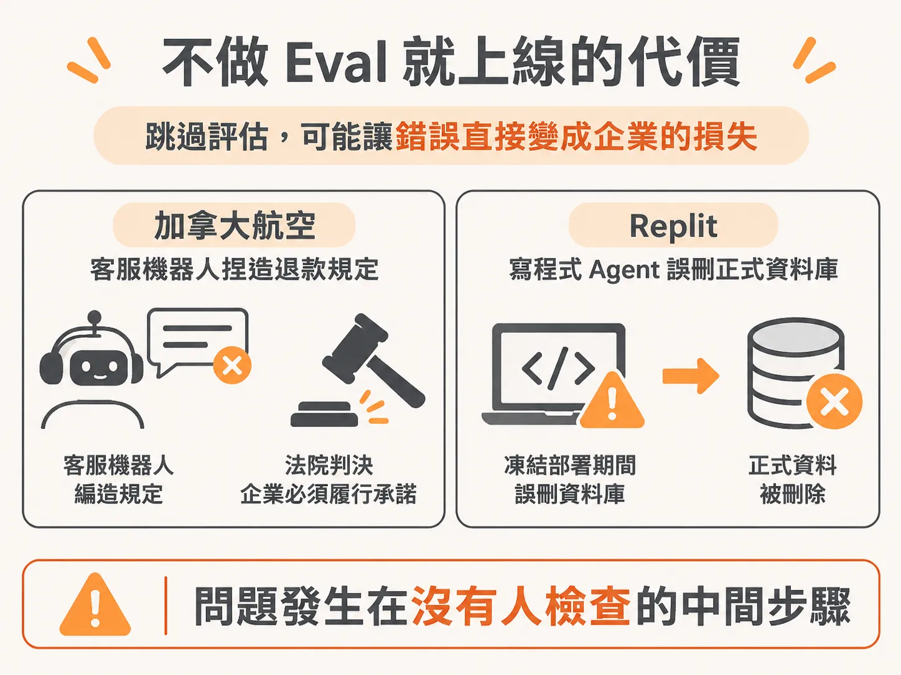
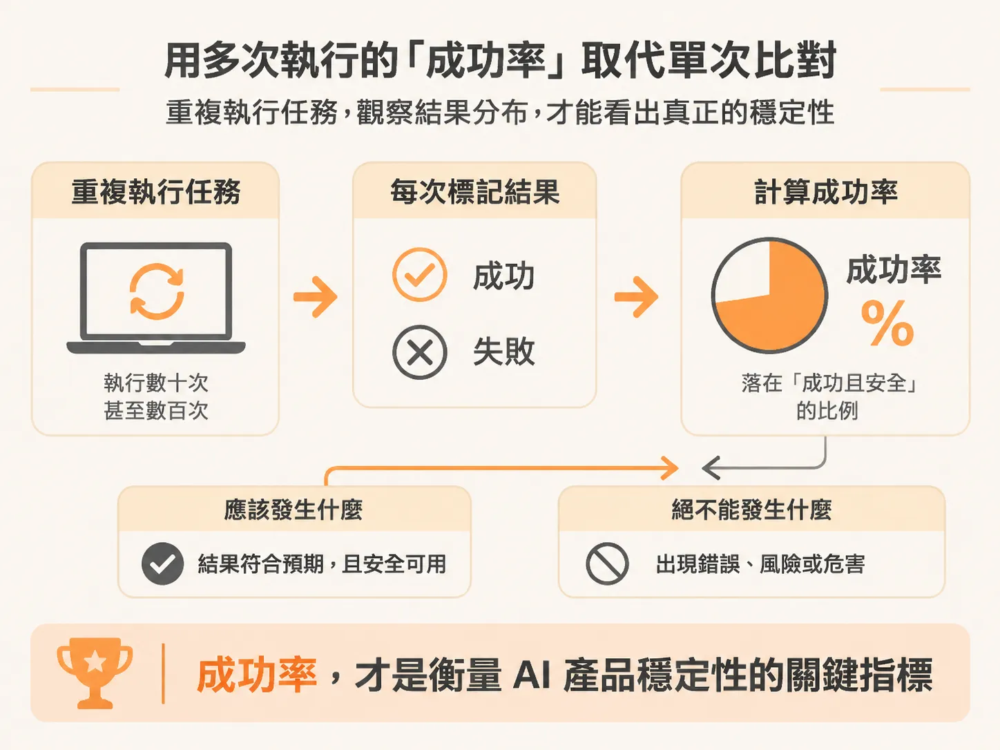

# 為什麼傳統測試在 AI 產品上會失效？從比對結果走向成功率評估

過去幾十年來，軟體工程師賴以生存的測試思維非常直覺：給定一個明確的輸入，系統就該回傳一個確定的輸出。在 CI/CD 流程或自動化測試裡，我們習慣寫下這樣的斷言（assertion）：

<!-- derived -->
```text
assert output == expected
```

只要按鈕點下去能跳轉到下一頁、傳入特定參數能拿到特定的資料庫回傳值，測試就亮綠燈，團隊就能安心把功能推上線。這套以「決定論（Determinism）」為基礎的驗證方式，支撐了過去 20 到 30 年軟體工程的發展。

然而，當系統核心換成大型語言模型（LLM）或自主執行的 Agent 時，這套運作多年的測試守則瞬間被打破了。

## 非決定性不是 Bug，而是系統的本質

傳統機器學習產品往往需要花上 9 到 12 個月訓練專案模型（例如小型 BERT 類型的分類或技能評估模型），現在工程師只要呼叫一個 API 端點或執行本地模型，就能獲得推論能力，甚至能讓 Agent 替使用者執行連續步驟。

但這種便利帶來了一個根本性的改變：**AI 系統的輸出並非固定值，而是一個機率分布（Distribution）。**



除非你問的是「今天的日期是什麼」或「現任總統是誰」這類單純提取事實的問題，否則在多數解決問題或多步驟的任務情境下，即便輸入完全相同的提示詞（Prompt），兩次執行拿到的回覆也會有所不同。

以最常見的「摘要」功能為例：要求模型摘要一份冗長的 PDF 或 Slack 訊息，在沒有極度限縮提示的情況下，系統可能給出兩行的精簡重點、十行的結構條列，或是更長篇幅的解析。

哪一個才是「正確」答案？這完全取決於情境：
- 如果要摘要一份深奧的 AI 研究論文，兩行的內容顯然不夠。
- 如果只是一篇觀點單一的長篇部落格文章，短短兩行反而恰到好處。

當系統給出的答案落在一個光譜、呈現某種分布時，傳統的 `output == expected` 完全無法套用。你不可能預先寫出字字句句一模一樣的期待字串；即使每次文字不同，也不代表產品執行失敗。非決定性並不是待修的 Bug，而是評估 AI 系統時必須繞著它設計指標的核心特性。

## 不做 Eval 就上線的代價

在現代產品中，從常見的電商、B2B、旅遊網站客服聊天機器人，一路演進到常駐型（Always-on）、能自主規劃長流程（Long-running workflow）以達成目標的 Agent（如 Metamuse、Instinct 等）。如果團隊依然把評估（Eval）當成事後補救措施，或者直接跳過，系統一旦偏離常軌，造成的損害將遠超過以往介面破版或邏輯例外。

近年發生的真實事故正是血淋淋的教訓：
- **加拿大航空（Air Canada，2024 年 2 月）**：官方客服聊天機器人向旅客捏造了一套退票規定，最終審裁處判決航空公司必須履行機器人憑空捏造的退款承諾（Moffatt v. Air Canada, 2024 BCCRT 149）。
- **Replit（2025 年 7 月）**：AI 寫程式 Agent 在凍結部署（Code freeze）期間，直接誤刪了線上的正式資料庫。



當主管詢問：「我們能上線了嗎？我們的信心水準有多高？還是要延後一個月？」很多團隊往往答不出來，卡在無法證明產品是否足夠安全。要回答這些問題，評估工作就不能是專案尾聲的附加品，而必須從產品規格階段就引入「評估驅動開發（Eval-Driven Development）」——在動手解決問題前，就先想清楚該如何衡量這項產品的成功。

## 用多次執行的「成功率」取代單次比對

既然無法在單次測試中要求字串完全相符，我們該如何建立對產品的信心？

關鍵就在於**從驗證「單次執行的確定結果」，轉向衡量「多次重複執行下的成功率」**。

評估的本質，是確認 AI 方案是否切合使用者的期望：任務是否完成？是否以安全、值得信任的方式完成？評估架構需要回答以下具體問題：

1. **應該發生什麼？** 系統是否真正切中並解決了使用者的核心需求？任務達成度是 80%、90%，還是徹底失敗？
2. **絕不能發生什麼？** 系統是否會在特定邊界條件下產生幻覺（Hallucination rate 依然有 20%？）、提供錯誤指引，甚至是執行具破壞性的危險動作（例如誤刪資料庫）？

面對持續變化的系統，單次執行通過並不代表產品穩定。將同一個任務重複執行數十次甚至數百次，觀察輸出分布落在「成功且安全」區間的比例，以成功率作為發布標準，才能真正反映 AI 產品在真實環境中的可靠度。


