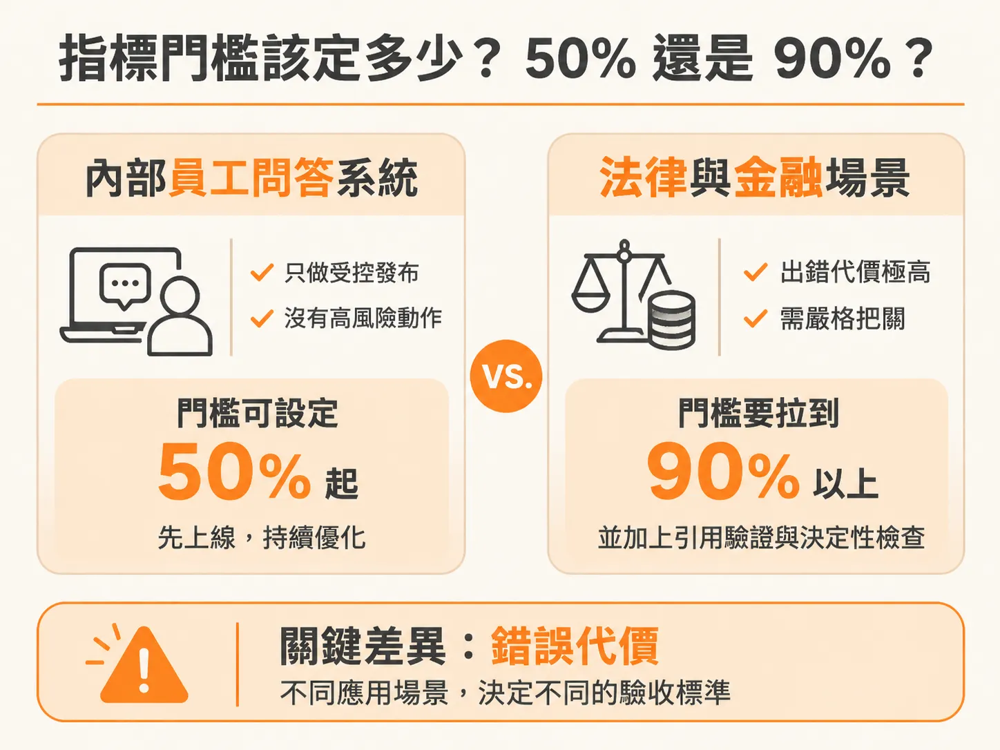
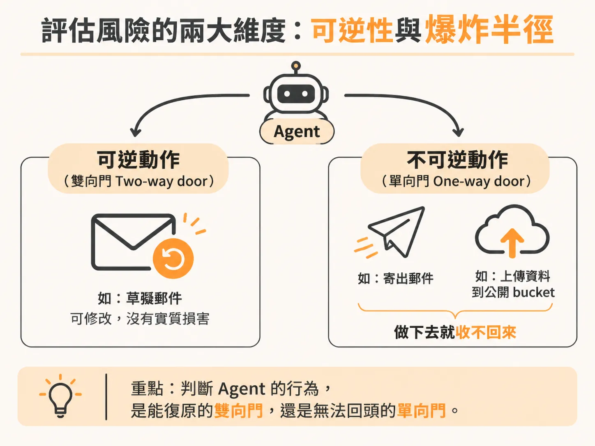
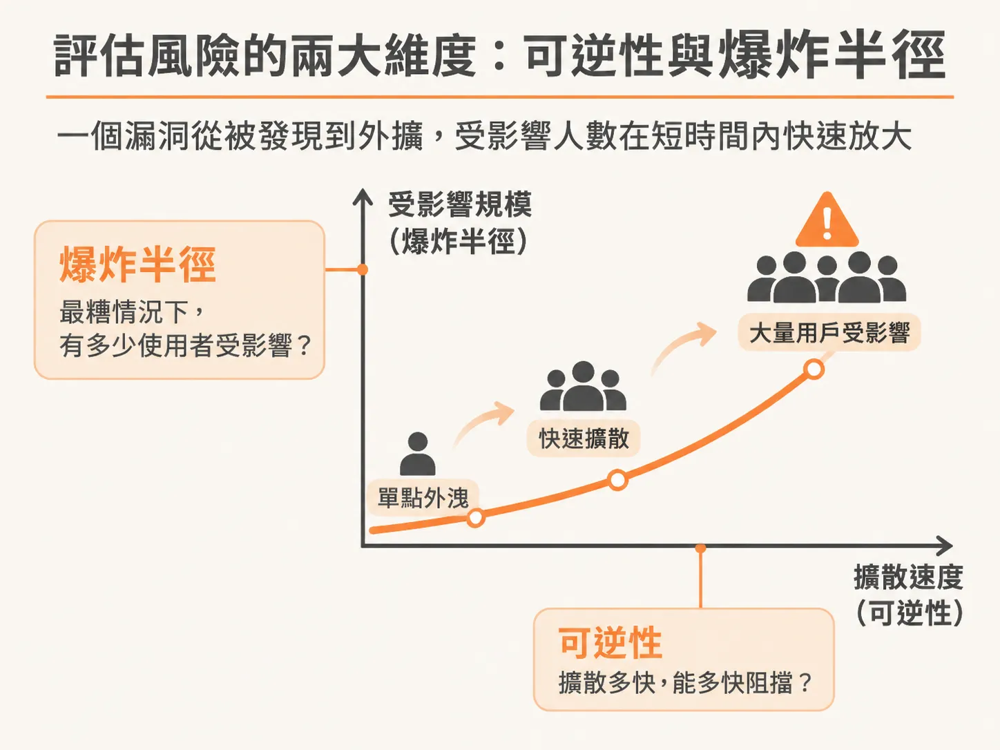
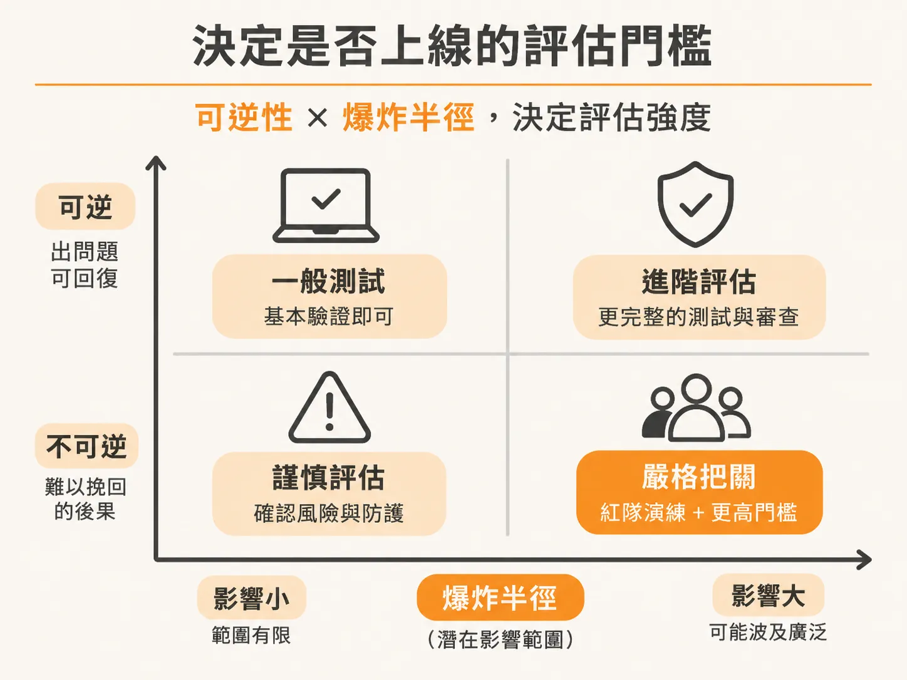

# AI 評估不只看 Benchmark：用五個問題、可逆性與爆炸半徑決定能否上線

規格寫好、成功率也量出來了，最後仍要回到交付會議上的那一句話：現在能不能 ship？

傳統軟體測試有一套行之有效的驗證流程：輸入固定，預期輸出也固定，只要測試案例全數通過，就能放心部署。但在打造基於大型語言模型的 AI 系統時，輸入千奇百怪，輸出更是每次都在變動。這時舊有的 QA 手法便徹底失效，因為你面對的是一個行為不斷變動的系統。

面對這種不確定性，團隊不能只盯著 benchmark 的分數，而是要退一步回答五個核心問題：

1. **應該發生什麼事？**（What should happen?）
2. **絕對不能發生什麼事？**（What must not happen?）
3. **系統真的解決了使用者提出的實際需求嗎？**（Did it address the actual ask?）
4. **系統還殘留哪些風險？**（例如：目前的幻覺率依然高達 20%）
5. **我們現在可以直接上線（ship），還是該延後一個月？**

決定「現在能不能上線」，關鍵在於如何平衡快速交付與風險控管，而不是盲目追求每一個指標都要達到滿分。

## 指標門檻該定多少？50% 還是 90%？

評估指標可以拆成 AI 本身的表現指標（AI metrics）與商業指標（business metrics）。許多團隊常問：驗收門檻應該設在 50%、70% 還是 90%？

答案完全取決於應用場景與錯誤的代價：

- **內部員工專用 Agent**：如果只是給內部員工使用的問答系統，初期品質與正確率分數就算只有 50%，也可以選擇上線。因為使用範圍僅限公司內部，可以做受控發布（controlled launch），而且這類 Agent 起初不具備呼叫外部資料或執行高風險操作的能力，單純回答問題。此時 50% 的門檻就能讓產品先跑起來，避免卡住團隊的開發節奏。
- **法律或金融場景 Agent**：如果將類似架構改用在法律或金融領域，一旦出錯，企業承擔的代價極高。這類系統的門檻就必須拉到 90% 以上，而且不能單靠模型輸出，還必須在最上層加上引用來源驗證（citations）與決定性檢查（deterministic checks）等硬性防護。

因此，好的驗收準則（acceptance criteria）與門檻設定，是在「快速交付」與「合理風險」之間找到站得住腳的論據。

## 評估風險的兩大維度：可逆性與爆炸半徑

在判斷一個 AI Agent 是否值得信任且安全時，有兩個核心概念必須納入評估框架：**可逆性（Reversibility）**與**爆炸半徑（Blast Radius）**。

### 1. 可逆性：單向門與雙向門

評估一個 Agent 的動作，首先要看它是「單向門（One-way door）」還是「雙向門（Two-way door）」，也就是該行為到底能不能復原：

- **雙向門（可逆）**：以 Gmail Agent 為例，如果功能只是「草擬郵件（draft email）」，這是一項可逆動作。草稿寫得不好，不會造成實質損害，使用者寄出前還能閱讀與修改。
- **單向門（不可逆）**：如果賦予 Agent「直接寄出郵件（send email）」的權限，信件一旦發出就無法收回；或是讓它呼叫動作將資料上傳到公開 S3 bucket，這類動作皆屬於不可逆操作。

不可逆的動作越多，系統出錯時造成的傷害就越難挽回。

### 2. 爆炸半徑：受影響的規模與擴散速度

第二個維度是爆炸半徑，也就是當最糟糕的情況發生時，會有多少使用者受到波及？

這在對抗性場景（adversarial scenarios）、紅隊演練（red teaming）、提示詞注入（prompt injections）與資料外洩（data exfiltration）中尤其關鍵。以資安漏洞為例，先前有測試人員發現系統漏洞並取得原始碼，將其放上 GitHub，隨後在 Twitter（現為 X）上迅速擴散，短時間內就達到 200 萬次下載。

這正是爆炸半徑的具體展現：一旦出事，情況會惡化到什麼地步？惡化的速度有多快？如今許多針對 AI 的攻擊都是以機器速度在進行，這代表防禦與偵測機制也必須跟上這個反應速度。

## 決定是否上線的評估門檻

當系統的操作越不可逆，且潛在的爆炸半徑越大時，你的評估關卡（eval gates）就必須設計得越嚴苛。

對於高風險功能，不能只跑跑標準資料集的評分，而必須花費大量心力進行紅隊測試。許多大型企業甚至投入數百萬美元聘請外部駭客針對系統做滲透測試，找出隱藏的漏洞與注入弱點。

回到最初的問題：「現在能不能 ship？」

不要只看著 benchmark 上的單一數字猶豫不決。檢視系統當前執行的動作是否可逆、計算失敗時的爆炸半徑與出錯代價；如果風險處於受控範圍且屬於可逆的雙向門，就算只有 50% 也能先交付；但只要牽涉到不可逆操作與高爆炸半徑，就必須嚴守 90% 以上的防線與決定性檢查，絕不能倉促上線。
