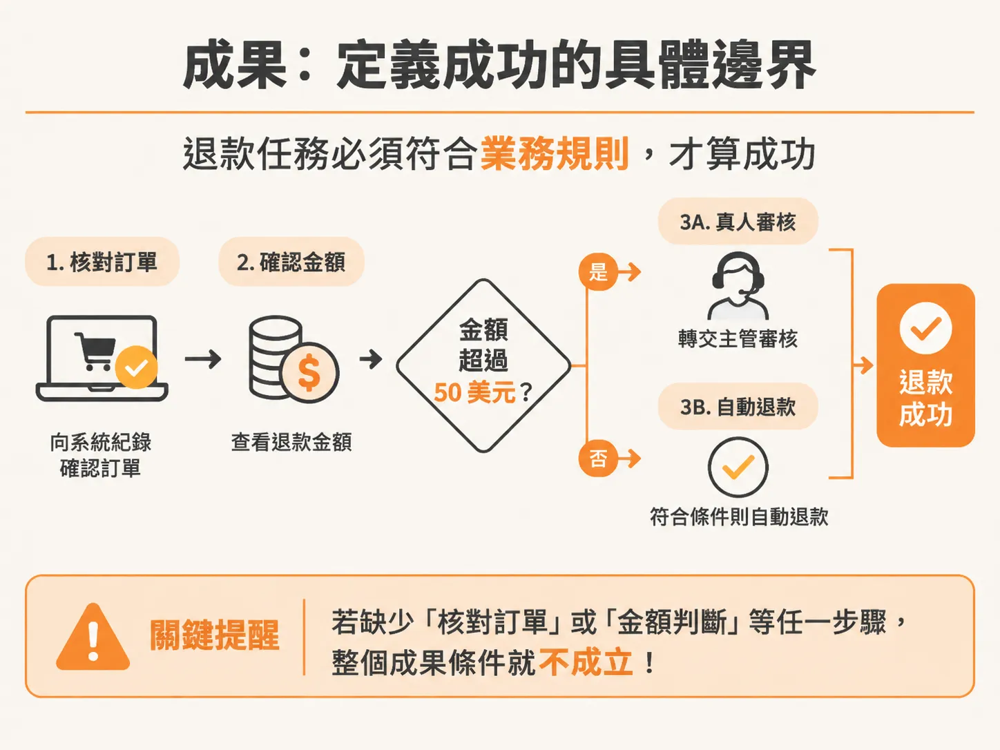
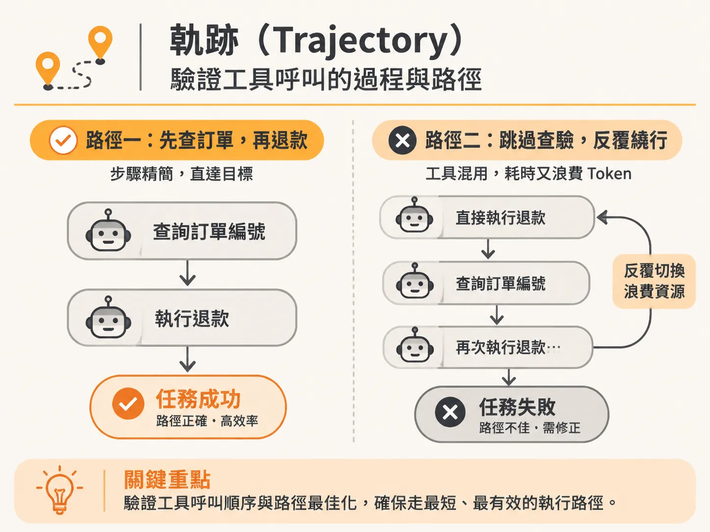
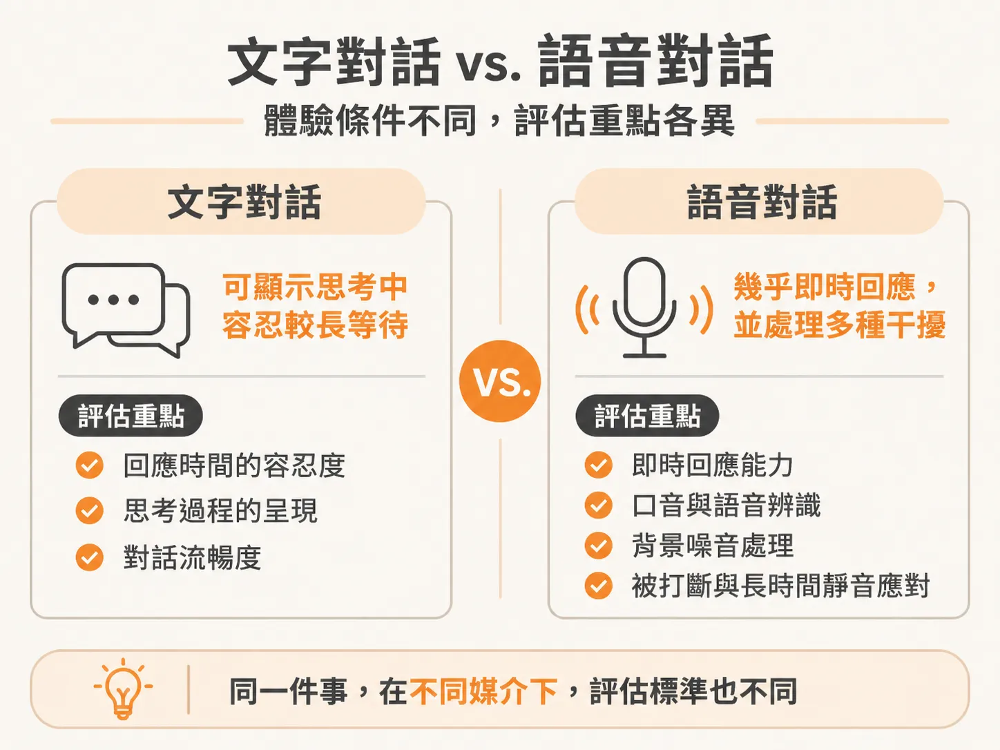
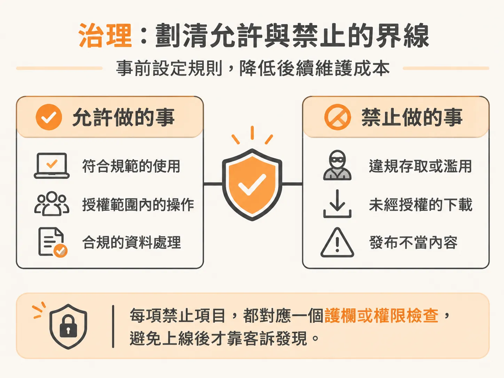

# 用評測規格寫出 AI 產品的 PRD：拆解成果、體驗、軌跡與治理

知道該量哪些維度之後，還得把它們在動工前寫成一份可驗收的規格；否則每個維度都只是會議上的形容詞。

在打造 AI 代理人（agent）或對話系統時，許多團隊常遇到同一個困境：產品經理（PM）寫了一份厚厚的產品需求文件（PRD），工程師開始疊加長提示詞（prompt）與工具，上線後才發現模型行為完全不可控——退款沒對帳就發放、工具呼叫陷入無窮迴圈、或是語音延遲過長讓使用者直接掛斷。最後，團隊只能在客訴與緊急救火中疲於奔命。

近來業界常聽見「評測就是新一代的 PRD」（evals are the new PRD），或是「評測驅動開發」（eval-driven development）。這並不是要用零散的測試取代產品規格，而是把過去模糊的願景，轉化為在動工前就能定義清楚、可驗證的評測評分規準（eval rubric）。

## 評測不是單一角色的事，而是一場團隊合作

如果你的團隊有一個人能全權包辦評測，固然值得高興，但實務上幾乎不可能。評測規格需要跨角色共同完成：

*   **產品經理（PM）**：核心責任是定義成功標準，並主動發展假設——這款產品到底有哪些潛在失敗模式（failure modes）？例如網站上的客服代理人上線後，使用者會嘗試用什麼方式把它玩壞？提早把這些情境歸類並化為指標。
*   **AI 工程師**：協助從真實追蹤紀錄（traces）中撈取資料、清理並去除個人可識別資訊（PII），建立去識別化的評測資料集；同時與 PM 一起決定關鍵指標、量測門檻以及上線評估（go/no-go）的決策標準。
*   **架構師與資料分析師**：一同檢視技術邊界與指標合理性。

過往 PM 寫 PRD、工程師照著規格實作的界線正在模糊。理想的做法是在規格或 PRD 當中，把評測規準納為專門章節，或在長篇 PRD（包含市場策略、上市計畫等）中附上評測規格的專屬連結。如此一來，在專門討論評測與驗收標準的會議上，團隊就能直接聚焦在可執行的驗證條件上。

在動工寫程式碼與提示詞之前，評測規格應該涵蓋四個核心維度：成果（Outcome）、體驗（Experience）、軌跡（Trajectory）與治理（Governance）。

## 1. 成果（Outcome）：定義成功的具體邊界

成果維度關注「系統最終要達成什麼實質業務結果」，需要 PM 與 AI 工程師共同定義。一開始不必追求完美，先挑出兩三個真實情境作為起點。

以 Pronto 客服代理人為例，退款流程的成功條件不能只寫「協助客戶退款」，而必須包含明確的業務規則：
*   只有在訂單經過完整驗證後，才能發起退款。這意味著背後必須有一步是向系統紀錄（如 CRM 或 SAP）核對該筆訂單。
*   如果退款金額高於 50 美元，必須轉交真人主管審核；若是 50 美元以下且符合其他條件，才允許自動處理。

提前把這些邊界、護欄與業務政策寫進評測規格，團隊就不會陷入「模型已經做出來了，現在到底要測什麼」的零起步困境，而是第一天就具備測試案例與良好行為的標準。

## 2. 軌跡（Trajectory）：驗證工具呼叫的過程與路徑

當代理人需要呼叫外部工具完成任務時，只看最終輸出是不夠的。模型可能給出了正確答案，但過程卻在迴圈中卡了 30 分鐘、耗費大量 Token；或者它根本跳過查詢工具，直接憑空捏造（hallucinate）出資訊。

評測規格必須驗證軌跡的好壞與路徑是否最佳化：
*   **工具呼叫順序**：代理人在核發退款前，究竟有沒有先呼叫工具查詢訂單編號？還是跳過查驗直接執行？
*   **路徑最佳化**：這是最短的直線路徑，還是拐彎抹角的無效路徑？如果路徑不良，就需要修正指令，明確告知模型可以直接呼叫特定工具。

在涉及退款、資料外傳、變更權限等高錯誤成本的生產環境中，光靠龐大的提示詞或鬆散的自然語言護欄，會引入過多非確定性（non-determinism）。團隊必須透過系統追蹤紀錄（traces）進行確定性檢驗，比對客戶姓名、案件編號（Case ID）與業務機會紀錄，確認代理人每一步工具呼叫與執行順序是否符合預期，並給出通過或不通過的客觀評定。

## 3. 體驗（Experience）：依互動媒介設定評估指標

體驗維度通常由 PM 主導（若團隊有設計師也可協助參與）。文字對話代理人與語音代理人的體驗評估標準有本質上的不同：

*   **文字對話代理人**：系統在背景思考或規劃時，介面顯示「正在思考中」是可接受的，使用者對延遲的容忍度較高。
*   **語音代理人**：延遲必須極低，互動體驗需要像真人視訊通話一樣即時反饋。評測難度也大幅提升，必須模擬更多真實情境：各國語言與口音、吵雜環境下的背景噪音、使用者打斷代理人說話等。此外，還必須評測「靜音空白時間」（dead air time）——例如使用者提問後沉默了兩三分鐘，系統該如何反應？這在語音評測中都是必須預先定義好壞的具體指標。

## 4. 治理（Governance）：劃清允許與禁止的界線

治理是整個評測規格中最關鍵、也最能節省後續維護成本的維度。在任何新專案開工前，花時間明確劃分這兩個清單：

*   **這套解決方案被允許做什麼（What it is allowed to do）**
*   **這套解決方案絕對不被允許做什麼（What it is not allowed to do）**

清楚定義這兩個區塊，團隊在架構初期就能設置相對應的護欄與權限檢查，避免產品上線後觸發未曾設想的行為，演變成全體團隊疲於奔命的緊急救火與客訴升級處理。

在開發前先把成果、軌跡、體驗與治理這四個維度的評測標準定案，你的 PRD 就具備了可量測的骨架。這不僅能大幅降低模型帶來的隨機性風險，也讓工程實作有了清楚對齊的驗收依據。
