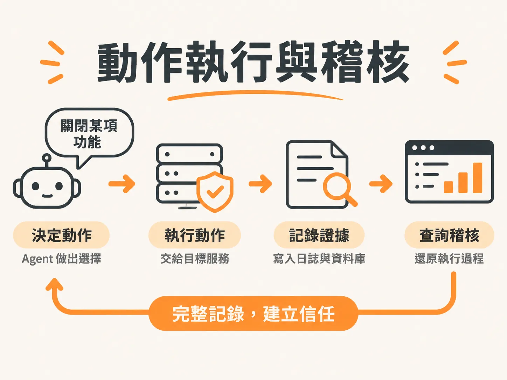

# 動作執行與稽核



## 問題

背景 Agent 自己決定要做事，比如「把某個功能關掉」。但決定只是一句話，真正要緊的是：**哪一套系統負責真的去執行？執行之後又怎麼留下證據？**

如果把所有業務邏輯都塞進 Agent 伺服器，系統會變得臃腫。更麻煩的是信任問題——面對在背景自動跑程式的 Agent，如果拿不出確切的執行證明與追蹤紀錄，其他人對這套系統的信任度基本上是零。

解法是把「執行」交給被保護的目標服務，把「記錄」留給 Agent 這邊。

## 前置條件

- 一個負責執行動作的結帳服務（checkout service），它開有 `/operations` 這個端點。
- Agent 已經決定好要送出的動作，而且特殊動作已先被攔下，這裡只處理被放行的動作。
- 要追蹤的識別碼：環境 ID、執行 ID（runId）、動作 ID。
- 想看執行過程時，可以開 Inngest 本地開發伺服器的儀表板（預設在 `127.0.0.1:8288`），並備妥 events、actions、runs 三張資料表。

## 步驟

1. **產生 `actionId`**：用隨機的 UUID 幫這次動作取一個獨一無二的編號，系統才能精準追蹤每一筆被派送的動作。就像寄包裹前先貼上追蹤單號。

2. **組好請求內容**：以 POST 發送 JSON 到結帳服務的 `/operations`，內容包含：
   - `actionId`：用來追蹤與記錄這一次操作。
   - `name`：Agent 決定執行的動作名稱。
   - `expectedVersion`：當前狀態的預期版本號。這就像管理 API 版本一樣，標記 Agent 做決策時看到的「世界版本」。如果服務升級、狀態結構變動，帶上預期版本就是一層預防。

3. **發出請求前先記錄**：呼叫前先把「act」寫進 activity log，記下要執行什麼動作、帶什麼參數。

4. **送出請求並處理回應**：收到回應後，如果 HTTP 回應不是 OK，直接拋出錯誤中斷。先以標準錯誤處理應對；持久化執行架構下的重試策略是另一個進階主題。

5. **判斷是否過期**：結帳服務設計有過期狀態（stale state）的概念。只要回傳結果不是過期狀態（`result.stale !== true`），就代表操作順利完成，繼續下一步。

6. **寫入資料庫與 activity log**：呼叫記錄函式，把環境 ID、執行 ID、動作 ID、動作名稱、傳入參數（含預期版本）與執行結果，寫入 `actions` 資料表，並在 activity log 補一筆「動作已回傳」。資料表寫入用「衝突就不做事」的方式，避免重複寫入。

<!-- source: sources/background-agent/20261109/supplement/server/agent-workflow.ts#L20-L56 -->

```typescript
export async function recordToolAction(
  environmentId: string,
  runId: string,
  actionId: string,
  name: ActionName,
  input: Record<string, unknown>,
  result: Record<string, unknown>,
) {
  await db
    .insert(actions)
    .values({ id: actionId, environmentId, name, input, result })
    .onConflictDoNothing()
  await logAgentActivity(environmentId, runId, 'act', `${name.replaceAll('_', ' ')} returned`, {
    actionId,
    input,
    result,
  })
}
```

## 例子

假設 Agent 決定要「關閉某項功能」：

1. 系統產生一個 UUID 當作 `actionId`。
2. Agent 發 POST 到 `/operations`，內容是這個 `actionId`、動作名稱，以及若非純讀取動作則附上 `expectedVersion`（取自 `state.world.version`）。
3. 呼叫前，activity log 先記一筆「Calling disable feature」。
4. 結帳服務回傳結果。不是過期狀態，就把整筆結果連同輸入存進 `actions` 表，activity log 再記一筆「disable feature returned」。

之後想查「為什麼 Agent 做了這件事」，可以到 Inngest 儀表板看每個 step 的執行、失敗狀態，可以重跑或手動停止；再到 `events`（記錄喚醒事件與所屬 run_id）、`actions`（記錄動作名稱與參數）、`runs`（記錄目標、目標條件與狀態）三張表比對，就能完整還原執行過程。

## 失敗模式

**改寫型動作執行後，狀態卻沒有改變。** 這是最關鍵的失敗。每一個改寫型動作都必須反映在服務狀態上，因為：

- Agent 讀取到的狀態就是它的「使用者介面」。
- 如果狀態沒更新，Agent 進入下一個循環時就無法得知剛才的操作有沒有生效。這就像在 GitHub 上點了「Merge」，但畫面完全沒變，只能去翻伺服器日誌確認。
- Agent 失去反饋後，會不斷重複提出完全相同的動作——示範中曾連續 8 次給出「應該把這項 feature 關閉」的相同判斷。原因之一就是周遭世界的狀態在每輪結束後完全沒變，另一個原因是決策迴圈沒有傳入歷史紀錄，模型每一輪看到的輸入都一樣。

重複行動又沒觸發終止條件時，系統的安全護欄會接手：迴圈有上限（示範程式為 24 次，`cycle <= 24`），跑滿就強制收手。退出迴圈底端後，程式把該 run 的狀態更新為 `escalated`，並標註「Decision limit reached」。看到這個記號，代表執行不是死當，而是安全地觸碰了防護上限。

## 進階

- **為什麼業務邏輯留在結帳服務？** 模型本身不在乎背後實作細節，它只負責給建議。Agent 伺服器只要告訴 `/operations` 該跑哪個動作，業務邏輯就留在屬於它的服務裡。
- **記錄預期版本看似過度防護。** 有些情境連預期版本都記錄似乎太謹慎，但對需要高度透明度與可追溯性的背景 Agent，完整的日誌與資料庫紀錄正是建立信任的基礎。
- **Run 的設計與稽核範圍。** 一次 run 代表代理被某個事件喚醒後的一輪執行；一場長達數週的調查可能橫跨多個 runs。上游若已把事件分類（如 SEV-0），可掛到既有 run 底下；否則每次喚醒就是一個新 run。當 run 的所有狀態都序列化進資料庫，即使一週後才啟動新流程，讀取同一份快照就等於接續舊進度。哪些狀態該對模型隱藏，也屬於這層設計的一部分。
