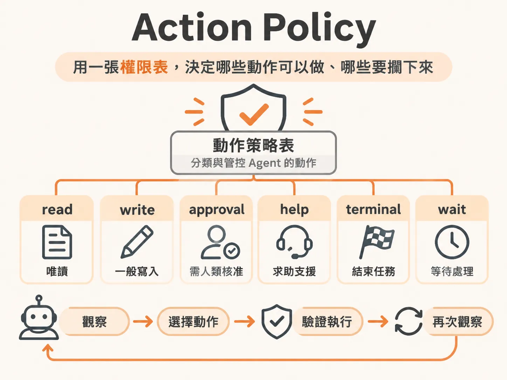

# Action Policy



## 定義

Action Policy 是一張「動作策略表」。它把 Agent 可以做的每個動作，分成幾種等級：`read`（唯讀）、`write`（一般寫入）、`approval`（需要人類核准）、`help`（求助）、`terminal`（結束）、`wait`（等待）。

你可以把它想像成公司裡的權限分級表：小助手可以自由「翻看資料」（read），也可以「更換辦公室白板」（write），但「退貨退款」要先給主管簽名（approval）、「打電話找老闆」要轉給櫃檯（help）、「宣告任務結束」和「說要等一下」也都不能自己決定。

在程式裡，這張表就是一個簡單的對照物件：

<!-- source: sources/background-agent/20261109/supplement/server/tool-policy.ts#L1-L15 -->

```typescript
export const actionPolicy: Record<
  ActionName,
  'read' | 'write' | 'approval' | 'help' | 'terminal' | 'wait'
> = {
  inspect_logs: 'read',
  inspect_changes: 'read',
  disable_feature: 'write',
  rollback_release: 'approval',
  request_help: 'help',
  complete: 'terminal',
  wait: 'wait',
}
```

## 為什麼重要

因為模型回傳的動作只是一份「提議」，不是已經被授權的命令。

如果把所有工具呼叫都交給 AI SDK 內建的自動迴圈，模型就成了唯一決定「何時呼叫、何時成功」的角色。有些動作本質上不是單純的函式運算：

- **暫停等待**：需要排程或休眠等基礎設施操作。
- **對外求助**：需要通知人類工程師，甚至暫停整個 workflow。
- **高風險變更**：例如線上服務回滾，不能讓模型想做就做。

有了 Action Policy，harness（外層的測試骨架，負責驗證並執行模型提議的程式）就知道哪些動作可以直接放行、哪些要在執行前攔下來。沒有這層攔截，Agent 就可能做出無法挽回的操作。

## 如何運作

整個迴圈的節奏固定為：**觀察當前環境 → 選擇一個動作 → 由 harness 驗證並執行 → 再次觀察**。模型每次只告訴 harness「它認為下一步該做什麼」，真正的執行與攔截完全由外部程式碼接管。

harness 在執行前查表，決定怎麼處理每個動作：

- **`read`（如 `inspect_logs`、`inspect_changes`）**：單純讀取，直接執行。
- **`write`（如 `disable_feature`）**：一般寫入，直接執行。
- **`approval`（如 `rollback_release`）**：攔下來，先建立變更提議，等有人核准才執行。
- **`help`（`request_help`）**：攔下來，把 run 標記為升級處理（escalated），銜接外部通報，不要讓迴圈空轉。
- **`wait`**：攔下來，交給排程系統休眠，而不是讓執行緒空轉忙碌等待（busy-waiting）。
- **`terminal`（`complete`）**：攔下來，不只聽信模型單方面宣布成功，而是由外層檢驗環境真實狀態是否已復原，才決定是否結束。

`approval` 和 `help` 的攔截點在程式裡長這樣：查完政策後，這兩種動作會先建立提議（proposal），等不到核准就把 run 設為 escalated 並結束，絕對不執行。

<!-- source: sources/background-agent/20261109/supplement/server/agent-workflow.ts#L141-L185 -->

```typescript
      const policy = actionPolicy[decision.action]
      if (policy === 'approval' || policy === 'help') {
        const input =
          policy === 'help'
            ? { question: decision.detail }
            : { expectedVersion: state.world.version }
        const proposalId = await step.run(`propose-action-${cycle}`, async () => {
...
        if (proposal.status !== 'approved') {
          await step.run(`stop-after-human-${cycle}`, () =>
            setRun(runId, 'escalated', `Human decision: ${proposal.status}`),
          )
          return
        }
        if (policy === 'help') continue
```

只要攔住 `wait`、`request_help`、`complete`、`rollback_release` 這四個關鍵動作，剩下的普通決策就能放心放行。

## 例子

假設結帳服務出事：健康度狀態是「降級（degraded）」，錯誤率高達 42%，某個新功能開著。

1. Agent 觀察（Observe）狀態，LLM 決定呼叫 `inspect_logs`。這在政策表上是 `read`，harness 直接放行，Agent 看到日誌寫著該功能在付款確認階段出錯。
2. 下一輪，LLM 決定呼叫 `disable_feature`。這是 `write`，harness 也直接放行，功能被關掉，錯誤率應該會改善。
3. 但如果 LLM 判斷需要回滾線上版本，呼叫 `rollback_release`——這是 `approval`。即使模型根據日誌與變更都想回滾，harness 也不讓它自動執行，而是攔下來等人核准。審批機制還沒建好時，harness 的安全防線就是直接通報 escalated，絕不讓未經授權的變更打到線上服務。

同一份動作清單，因為查了政策表，安全的動作流暢執行，危險的動作先停下來。

## 邊界與常見誤解

**「read 不會改變狀態」要當回事。** `inspect_logs` 是讀取行動（Read Action），執行完之後，下一輪觀察到的錯誤率、健康度幾乎不會變——這完全合理。不要因為狀態沒動就誤會動作失敗；會改寫狀態的是 Mutative Action（如 `disable_feature`），那才預期看到狀態變化。

**攔截不會自動發生。** Action Policy 只是一張表，需要 harness 的程式碼在每輪執行前主動查表、分支處理。沒有寫攔截邏輯，政策表就只是裝飾。

**complete 不能只聽模型的。** 模型宣布「完成」不代表任務真的結束。在這套設計中，有明確目標條件時，`complete` 會被攔下、由外層檢驗環境真實狀態；迴圈開頭也有一個確定性檢查，先用程式碼判斷目標是否已滿足，而不是只依賴模型判斷。

**安全防線要有備案。** 如果人類審批流程還沒接上，`approval` 和 `help` 的動作不能就一直卡著等——早期的做法是把 run 直接設為 escalated 並中斷，避免迴圈在無人回應時空轉。

## 進階

**動作只是提議，模型不掌握最終授權。** 這是整套設計的核心：模型在每次迭代中提出結構化的動作建議，但「執行與攔截」的決策權完全在外部程式碼手上。模型和授權之間隔了一層 policy 表，這層間隔就是安全性所在。

**政策表和確定性檢查是互補的。** 迴圈開頭的「目標是否已滿足」是由確定性程式碼判斷，不經過模型。但有時開發者寫的檢查邏輯和系統提示詞之間會有認知差距：程式碼說「還沒完成」，LLM 卻選了 `complete`。遇到這種落差時，可以把「檢查目標是否滿足」交給另一次專門的 LLM 呼叫——用範圍更小的提示詞提高準確率，也可以挑更輕量的模型來做這個判斷。
