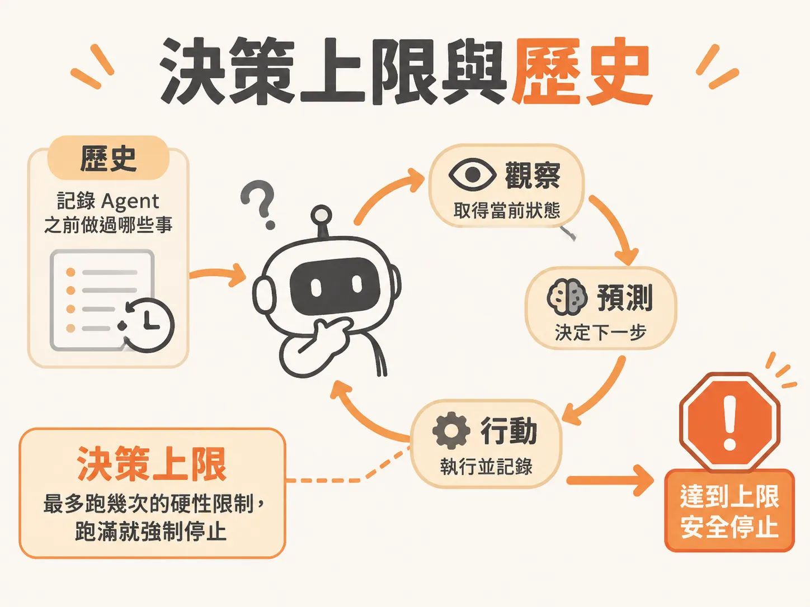

# 決策上限與歷史



## 定義

背景 Agent（在背後自動跑的智能代理人）有一個常見問題：它會一輪又一輪重複提出完全相同的動作，最後被系統的「決策上限」強制停了下來。

這件事有兩個關鍵詞：

- **歷史（History）**：Agent 在之前幾輪已經做過哪些事、說過哪些話的紀錄。
- **決策上限**：迴圈最多跑幾次的硬性限制，跑滿就強制停手。

缺少歷史，Agent 就像金魚一樣失憶；決策上限，則是在失憶造成空轉時踩煞車的安全護欄（safeguard rails）。

## 為什麼重要

如果沒有上限，一個卡住的 Agent 會無窮無盡地跑下去。每一輪都要呼叫大型語言模型（LLM），等於不斷燒錢，卻什麼也沒完成。

有了上限，系統不會死當。它會把這次執行（run）標記為 `escalated`（升級給人類處理），並註明「Decision limit reached（達到決策上限）」。這樣你就能從日誌一眼看出：這趟執行不是壞掉，而是安全地觸碰了防護上限。

而要知道「為什麼會跑到上限」，就必須看懂「缺少歷史」這個根本原因。

## 如何運作

Agent 的核心是一個有上限的迴圈。示範程式把上限設在 24 次（`cycle <= 24`）。每一輪依序做三件事：

1. **Observe（觀察）**：抓取當前狀態。
2. **Predict（預測）**：把目標和狀態交給 LLM，請它挑下一步動作。
3. **Act（行動）**：執行動作並記錄，然後回到迴圈頂端。

問題藏在第 2 步。呼叫 `chooseAction` 這類決策函式時，如果只傳給模型「整體目標（goal）」和「當前觀察到的狀態（current observed state）」，卻沒附上「你之前已經做過哪些事」——那麼模型每一輪看到的輸入就完全一樣。

因為模型看不到先前的行動歷史，它在第 2 次、第 3 次決策時，根本不知道自己剛才已經提出過同一件事。環境沒變、目標沒達成，它自然得出相同結論。

迴圈內部若成功執行中斷或完成的動作，會提早結束。但如果每一輪都沒觸發任何提早退出的分支，迴圈就會完整跑滿上限次數。正常退出迴圈底端後，系統就把 run 更新為 `escalated`：

<!-- source: sources/background-agent/20261109/supplement/server/agent-workflow.ts#L212-L215 -->

```typescript
    await step.run('stop-at-limit', () => setRun(runId, 'escalated', 'Decision limit reached'))
```

## 例子

以結帳服務（checkout service）的告警為例。Agent 的目標是調查事故並恢復服務。它判斷應該「關閉引發錯誤的 Checkout Express 功能」。

但下游客戶端還沒實作這個動作，所以每一輪結束後，環境狀態完全沒變。再加上決策時沒有傳入歷史紀錄，Agent 就連續 8 次給出一模一樣的判斷：「我認為應該把這項 feature 關閉。」

如果當初有給它完整的歷史，它在第二次發現請求沒有效果時，就會轉向請求人類協助，而不是一再重複。

排查時可以用 Inngest 本地儀表板（預設在 `127.0.0.1:8288`）看這趟執行跑滿上限後停滯，再到資料庫確認對應的 run 被標上 `escalated` 與 `Decision limit reached`。相關狀態分別存在三張表：events（喚醒代理的事件）、actions（代理採取的動作）、runs（執行的目標與狀態）。

## 邊界與常見誤解

**誤解一：跑到上限就是系統壞掉。**
不是。`escalated` 代表防護機制正常運作，安全地停了下來。真正要修的是上游的重複行為。

**誤解二：重複行動是模型太笨。**
主因通常有兩個：一是下游客戶端還沒實作對應動作，導致環境狀態每輪都不變；二是決策迴圈沒傳入歷史。兩者都是系統設計問題，不是模型推理能力的問題。

**誤解三：狀態裡有 actions 紀錄，模型就應該知道歷史。**
狀態資料確實會把最近的行動記進 `actions` 表，但關鍵是：有沒有把這些紀錄放進送給模型的決策輸入？記錄和餵給模型是兩件事。只給目標和當前狀態，模型就看不到「自己剛剛做過什麼」。

**誤解四：一次 run 等於一次事故調查。**
一場生產環境的調查可能長達數週，中途代理多次被喚醒，因此一場調查可能橫跨多個 runs。

## 進階

把所有決定 run 的要素序列化進資料庫後，run 就具備可攜性（portability）：即使一週後才啟動全新的工作流程，只要讀取同一份狀態快照，實質上就等於接續舊的執行進度，行為就像一台以資料庫狀態為核心的狀態機。

另一個相關的設計落差：迴圈開頭的確定性檢查程式判斷「目標尚未完成」，但 LLM 根據整體脈絡卻選了「標記完成」。這代表檢查函式與系統提示詞之間存在認知差距。若目標太複雜、無法用簡短規則驗證，可以把「檢查目標是否滿足」交給另一次專門的 LLM 呼叫，用更小的提示詞提升準確率。
