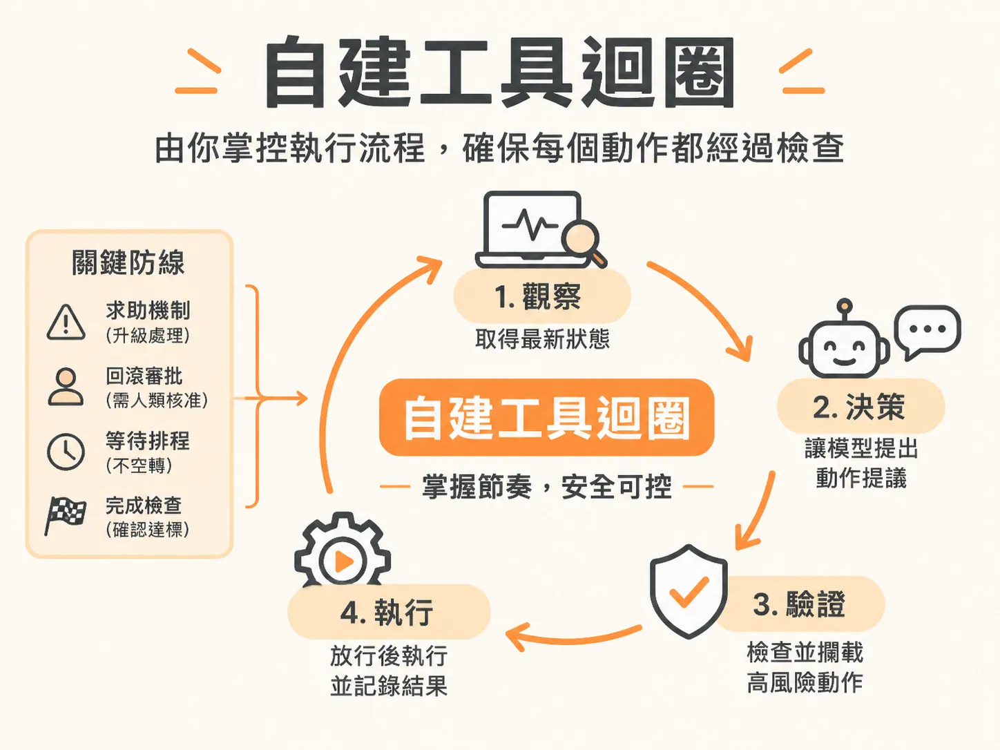

# 自建工具迴圈



## 定義

自建工具迴圈是指：Agent 的外層骨架（harness）自己寫程式掌控整個執行流程，而不是交給 AI SDK 內建的迴圈。

Marc 學到的版本是「observe → choose → validate → execute」四個節奏：先觀察環境狀態，再讓模型挑一個動作，接著由 harness 驗證，最後才執行。

關鍵觀念是：模型回傳的動作只是一份「提議」。模型說「我想關掉這個功能」，不代表它已經獲得授權，更不代表動作已經執行。真正的執行與攔截，完全由 harness 的程式碼接管。

一個比喻：現成 SDK 的內建迴圈像讓司機自己決定路線、自己踩油門；自建迴圈則是司機只能「報告想轉去哪裡」，方向盤握在你手上，你想檢查的地方就先檢查，想擋下的就擋下。

## 為什麼重要

現成的 AI SDK 通常內建工具呼叫迴圈：傳入工具清單、設定 `stopWhen` 條件，模型就會自己跑到底——呼叫工具、看結果、覺得不夠就再呼叫下一個，直到它認為可以回答為止。寫起來很省事。

但一旦放進真實的基礎設施或生產環境，問題就浮現。SDK 雖然有護欄函式和真人介入的鉤子，卻很難在「模型決定呼叫工具」與「工具真正執行」之間硬生生打斷，並把控制權交給外部程式碼。

這在維運中很致命，因為有些「工具呼叫」本質上不是單純的函式運算：

- **暫停等待**：需要排程或休眠等基礎設施操作。
- **對外求助**：要通知人類工程師，甚至暫停整個 workflow。
- **高風險變更**：例如線上服務的回滾，不能讓模型想做就直接做。

如果把這些全交給 SDK 內建迴圈，模型就成了唯一決定「何時呼叫、何時成功」的決策者。所以要把現成迴圈拆開，由 harness 自己掌控。

## 如何運作

整個迴圈跑在一個有上限的重複迴圈裡（例如最多 24 次）。每次迭代嚴格按照固定順序推進：

1. **Observe（觀察）**：抓取被監控對象的最新狀態，例如結帳服務的健康度、錯誤率、發布版本與功能開關。
2. **確定性檢查**：先用純程式碼判斷「目標是否已達成」。如果已達成，直接寫報告結束，不問模型。
3. **Predict（預測）**：如果目標還沒達成，把狀態、目標、系統提示詞打包交給 LLM，請它在允許的動作清單中挑一個，並附上決策原因。這一步就是模型提出「提議」。
4. **驗證與攔截**：harness 依工具策略表決定這個提議能否放行。受限動作在這裡被打斷。
5. **Execute（執行）**：普通動作直接呼叫 API 執行，記錄結果後回到迴圈頂端，再觀察一次。

工具在程式裡被明確分成不同策略等級：

<!-- source: sources/background-agent/20261109/supplement/server/tool-policy.ts#L1-L15 -->

```typescript
import type { ActionName } from '../shared/types'

// The harness reads policy metadata; it does not branch on checkout fault flags.
export const actionPolicy: Record<
  ActionName,
  'read' | 'write' | 'approval' | 'help' | 'terminal' | 'wait'
> = {
  inspect_logs: 'read',
  inspect_changes: 'read',
  disable_feature: 'write',
  rollback_release: 'approval',
  request_help: 'help',
  complete: 'terminal',
  wait: 'wait',
}
```

四個特殊動作各自在固定位置被攔下：

- **request_help（求助，等級 `help`）**：模型發現資訊不足時提出。這不是模型內部能消化的，harness 攔下後把 run 狀態設為 escalated（升級處理），銜接外部通報或暫停機制，避免迴圈在無人回應時空轉。
- **rollback_release（回滾版本，等級 `approval`）**：就算模型依日誌判斷該回滾，harness 也不允許它自動執行。必須先建立變更提議、等人類核准；審批機制還沒建好時，安全防線就是直接通報 escalated，絕不讓未授權的變更打到線上。
- **wait（等待，等級 `wait`）**：模型提議等環境生效時，由排程系統接手休眠，而不是開著執行緒空轉。
- **complete（完成，等級 `terminal`）**：模型單方面宣布成功不算數，harness 會由外層檢驗環境真實狀態是否已復原，才決定是否結束。

攔下這四個之後，剩下的普通決策（讀取、一般寫入）就能放心放行。

## 例子

以結帳服務的事故處理為例，目標是「調查結帳事故，在允許範圍內恢復服務，必要時尋求人類協助」。

**第一輪**：Observe 顯示服務狀態是「降級」、錯誤率高達 42%，且 Checkout Express 功能是開啟的。模型比對可用動作後提議「檢查日誌」，理由是告警雖指向該功能，但改動狀態前要先確認真正的失敗來源。檢查日誌只是讀取動作，harness 直接放行，取回日誌：「Checkout Express feature raised an error during payment confirmation.」

注意：第二輪 Observe 時，錯誤率幾乎沒變。這完全合理——看日誌是**讀取動作**，不是**改寫狀態的動作**，沒有人會預期「看日誌」能讓伺服器恢復。

**第二輪**：日誌已確認該功能在付款確認階段崩潰，模型提議「關閉該功能」。這是會改寫狀態的動作，執行後下一次 Observe 應該看到該功能已關閉、錯誤率改善。如果狀態卻完全沒動，Agent 就會「認知失調」：無從確認動作有沒有生效，最後放棄或直接求助。確保改寫動作反映在狀態資料上，是底層系統的責任，與模型推理能力無關。

## 邊界與常見誤解

- **模型提議 ≠ 已獲授權**：最大的誤解是把模型回傳的結構化動作直接當成「已經做完的事」。自建迴圈的全部意義，就在於執行前還有驗證這一關。
- **「API 回傳成功就是做好了」是錯的**：控制迴圈依賴下一次 Observe 的狀態反饋。如果狀態不同步，迴圈就失去意義。
- **確定性檢查與模型判斷會出現落差**：有時開發者寫的檢查條件認為「目標尚未完成」，LLM 卻在迴圈下方選了 complete。這通常代表檢查函式的邏輯與系統提示詞、目標描述之間有認知差距，要靠調整程式碼與提示詞來縫合。
- **read 與 mutative 要分清楚**：讀取不會改變狀態，不能用「錯誤率沒下降」來判斷檢查日誌有沒有做成功。
- **自建迴圈不是為了限制模型的能力**，而是為了讓高風險與生命週期動作（wait、request_help、complete、rollback_release）有人類或基礎設施這道防線。

## 進階

- **確定性檢查可以外包給另一個 LLM**：如果業務目標太複雜、無法用簡短程式規則驗證，可以把「檢查目標是否滿足」交給一次專門的 LLM 呼叫。它的系統提示詞獨立且範圍更小，準確率更高，還能依任務選用更輕量或專門的判斷模型。
- **審批機制的兩種實作階段**：具備審批機制時，approval 類動作會建立變更提議並等待人類核准；尚未建好時，安全防線是直接設為 escalated 並結束，兩者都保證未授權動作不會落地上線。
- **迴圈要有上限**：整個執行放在有上限的迴圈（例如最多 24 次）中，並在每輪開頭檢查 run 狀態，遇到 completed、failed、cancelled、escalated、superseded 就提前退出，避免失控的內部迴圈做出無法挽回的操作。
