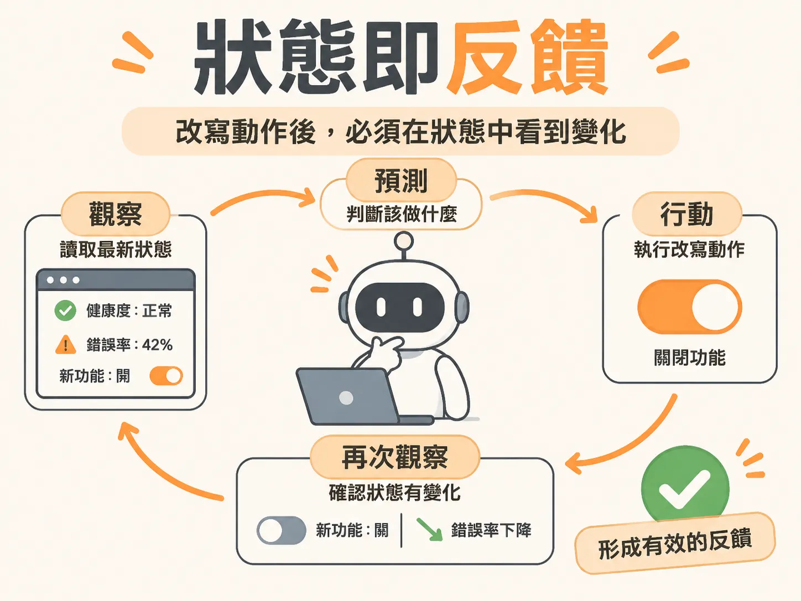

# 狀態即反饋

## 主張

背景 Agent 改變世界的每一個動作，都必須讓系統看得見。也就是說：**改寫型動作執行後，一定要反映在可觀察的狀態上**。

「可觀察的狀態」是什麼？想像結帳服務會定期公布一張體檢表：目前的健康度、錯誤率、發布版本、每個功能開關是開還是關。Agent 每一輪做工時，第一件事就是讀這張表。對 Agent 來說，這張「狀態」就是它的螢幕和儀表板——它無法翻伺服器日誌，也無法打電話問人，它唯一能「看到」的世界就是這份狀態資料。

所以主張很簡單：如果一個動作照理說要改變世界（例如關閉某個功能），而狀態資料卻沒有任何變化，那 Agent 就像點了「Merge」按鈕後畫面完全凍結的使用者——它不知道自己的操作到底有沒有生效。

## 為什麼成立

背景 Agent 的核心是一個不斷重複的迴圈：**觀察（Observe）→ 預測（Predict）→ 行動（Act）**，跑一輪再回頭觀察一次。這個迴圈能不能運作，完全取決於第三步做完之後，第一步能不能「看到」改變。

用課程裡的結帳事故當例子：

1. 第一輪觀察：狀態顯示服務「降級（degraded）」、錯誤率 42%、某個新功能開著。Agent 決定先「檢查日誌」。
2. 第二輪觀察：錯誤率幾乎沒變。這完全合理——看日誌是**讀取動作（Read Action）**，本來就不該改變狀態。
3. 接著 Agent 根據日誌確認禍源，決定**關閉該功能**。這是**改寫動作（Mutative Action）**。
4. 第三輪觀察：狀態應該顯示功能已關閉、錯誤率下降。

因為第四步的觀察要靠狀態變化來確認第三步的成效，所以「改寫動作必須反映在狀態上」不是加分項，而是整個迴圈能成立的前提。

反過來想：如果改寫動作執行後狀態紋風不動，Agent 會陷入「認知失調」——它以為自己做好了一件事，看到的 世界卻說沒有。放任 Agent 假定「API 回傳成功就等於做好了」，這套控制迴圈就失去意義，它通常會卡住、放棄，或直接向人類求助。

要注意的是：這是**底層系統的責任**，跟模型聰不聰明無關。再強的 LLM 也沒辦法從「完全不變的狀態」推論出「我剛才的操作成功了沒」。

## 適用範圍

這個原則區分兩種動作：

- **讀取動作**：例如檢查日誌。它**不應該、也不會**改變狀態，所以不需要狀態反饋來驗證。
- **改寫動作**：例如關閉功能、執行復原（rollback）。這一類**必須**反映在狀態上。

怎麼判斷一個動作屬於哪一種？問自己：如果我（人類）做了這件事，會預期儀表板上的哪個數字或開關跟著變？檢查日誌不會讓錯誤率下降；關閉功能會讓開關變成 off、錯誤率改善。如果說不出來，就要懷疑這個動作寫壞了。

「每個改寫動作都留下可觀察的痕跡」還有一個附帶的好處：可追溯。課程的實作中，每次派送動作都會產生 `actionId`（隨機 UUID），並帶上 `expectedVersion` 標記 Agent 做決策時看到的「世界版本」。執行成功後，環境 ID、執行 ID、動作名稱、傳入參數與結果都會寫進資料庫。對在背景自動跑的系統來說，這些紀錄是建立信任的基礎——拿不出執行證明，信任度基本上是零。

## 反例

課程示範了一個最典型的失敗情境：Agent 連續 8 次給出完全一樣的判斷——「我認為應該把這項 feature 關閉」——最後跑到 24 次決策上限，run 被標成 `escalated`，附註「Decision limit reached」。

拆開來看有兩個原因：

1. **狀態沒有反映動作**：系統還沒把「disable_feature」接進真實環境，所以每一輪迴圈結束後，觀察到的狀態完全沒變。
2. **模型看不到歷史**：呼叫決策函式時只傳了目標和當前狀態，沒附上「你之前已經做過哪些事」。模型每一輪看到的輸入一模一樣，自然得出同一個結論。

這裡有兩個層次要分清楚：缺歷史是決策設計的問題（補上歷史紀錄，Agent 在第二次發現請求沒效時就會轉向求助）；而**缺狀態反饋是執行層的問題**——就算有歷史，如果改寫動作根本沒有落實到狀態上，Agent 還是無從驗證成效。狀態即反饋這條原則指的是後者：不管決策做得多好，下游系統若不把改變寫回狀態，迴圈就會空轉。

好消息是這個失敗模式並不難發現：Inngest Dev Server 的儀表板（本地預設在 `127.0.0.1:8288`）能看到每次 run 的執行軌跡，加上資料庫裡的 events、actions、runs 三張表，就能還原 Agent 到底重複了什麼、卡在哪一步。

## 進階

- **把整個 run 想成以資料庫為核心的狀態機。** 課程的實作把目標、事件、動作、決策全部序列化進資料庫，這讓 run 具備可攜性：即使一週後才啟動新的工作流程，讀同一份狀態快照就等於接續舊進度。狀態越完整、越即時，這種「斷點續跑」就越可靠。

- **狀態也有一致的驗證口徑問題。** 迴圈開頭會先用一段確定性的程式碼檢查目標是否滿足，有時這段程式碼判斷「還沒完成」，但 LLM 看完整體脈絡卻選了「標記完成」。這種落差代表檢查邏輯和餵給 Agent 的目標描述、系統提示詞之間有認知差距。太複雜、寫不成簡短規則的目標條件，可以改交給一次專門的 LLM 呼叫來判定，用獨立且範圍更小的提示詞提高準確率。

- **狀態的可見度也是設計的一環。** 並不是所有資料庫裡的欄位都該餵給模型；哪些狀態要對 Agent 隱藏，屬於狀態設計的決策。反過來說，被隱藏的部分政府就要靠日誌與資料庫紀錄來對人類交代。
