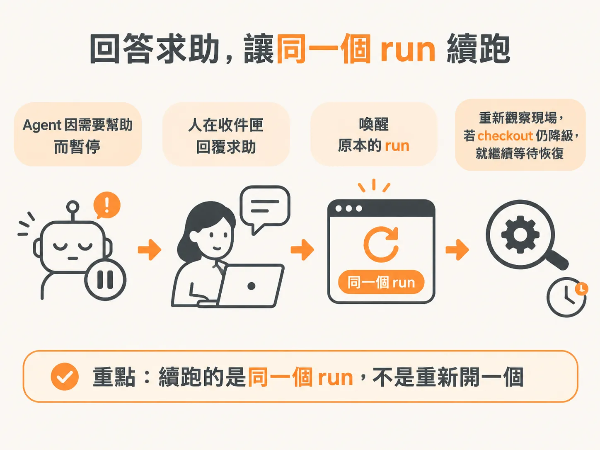
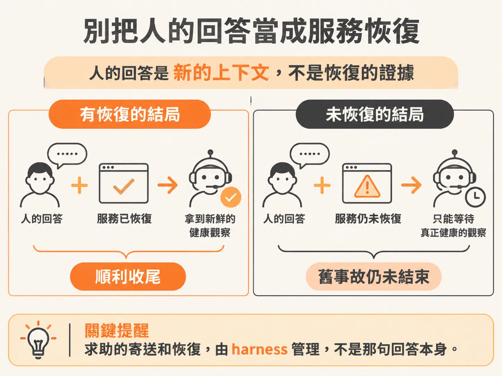

# 當 agent 開口求助：跑完一場事故演練

policy、proposal、等待與重新觀察都接好了，可以跑一次完整演練了。背景 agent 碰到自己修不了的故障時，能不能暫停下來、開口向真人求助？以下完整跑一遍：注入故障、看 agent 選擇求助、到 inbox 回答它，再觀察同一個 run 怎麼醒過來收尾。過程中有一個很容易誤會的地方——人的回答，到底是什麼身分？

## 先選對故障

之前演練過類似狀況，但當時沒把「哪一種故障會觸發求助」記進筆記。翻了一下才想起來：是 dependency。

選 dependency 不是隨便挑的。上游支付閘道掛掉時，agent 手上的本地工具根本修不了 upstream 的問題，它不知道該怎麼辦，也等不到自己恢復——這正是它應該開口說「我需要幫忙」的情境。啟動演練的指令是：

<!-- derived -->

```
start checkout with --fault dependency --recover-after-ms 30000
```

意思是注入一個依賴故障，並在 30 秒後讓服務自行恢復。但真正的目標是加上 inbox 這條路：讓 agent 選到 `request_help` 時，能把求助寄到真人手上，而且事件本身不要把事故結束掉。

## 跑下去，它真的暫停求助了

回去一看，run 已經暫停、顯示需要幫忙——成了。

Activity feed 上可以看到完整節奏：收到事件、觀察狀態、進入迴圈、選了 request for help，接著執行 need help。畫面上就是那個熟悉的 pause and need help。

然後它問了一個問題，大意是：「Hey，你可以去查一下支付閘道嗎，健康的時候 let us know。」

那個「us」很好笑——us 是誰？順帶一提，它還送出了一則 recovery 訊息到 inbox。本來以為已經把這個行為關掉了，不過反正訊息確實進到 inbox，「hey，can you investigate the payment gateway and let us know」這則就躺在那裡。

## 回答它，讓同一個 run 續跑

到 inbox 回答這則求助。重點是：續跑的是同一個 run，不是重新開一個。



Activity feed 會依序出現問題、回答、暫停、喚醒、回報。checkout 如果還是 degraded，它就等服務的 recovery event；要完成，一定得靠一次新鮮的健康觀察。

## 完成了——但是因為什麼完成的？

它跑完了。但一開始不太確定：是因為它看到回答而完成，還是因為它先看到那個 event 進來？

重看一遍才弄清楚：它確實看到了回答——速度很快，快到差點以為是 event 的功勞。真相是它把線連起來了：它讀到回答的內容，再加上那則不小心送出去的 recovery event 正好把狀態改成 healthy，於是它驗證狀態、通過、完成，然後是一句輕鬆的「everything's good」。

說實話，這有點超出預期——沒想到它會這樣把人的回答和事件串起來推理，還蠻讓人佩服的。

## 但別被這次的結果騙了

這次能順利收尾，是因為那則 recovery event 送了出去、狀態真的變 healthy。換個設定——照樣回答求助，但把 `--recover-after-ms` 設成 0，讓服務不會自己恢復——那麼人的回答不應該讓 checkout 被標成健康。

正確的做法是讓服務以健康的狀態重新啟動，這時舊事故是被取代（superseded）而不是完成（completed），因為只有一次新鮮的健康觀察才算數。

這就是整場演練最容易犯的錯：**人的回答是新的上下文，不是恢復的證據**。agent 可以開口求助，但求助的寄送和恢復（resumption）都是 harness 在管，不是那句回答本身把事故治好了。



## harness 裡是怎麼把它管住的

這套節奏在 workflow 裡有對應的機制：人的決定送回來之後，harness 不是照單全收，而是回到迴圈裡、重新查一次最新狀態，版本對不上就把過期的提案作廢，等下一次觀察再說：

<!-- source: sources/background-agent/20261109/supplement/server/agent-workflow.ts#L171-L185 -->

```typescript
        if (proposal.status !== 'approved') {
          await step.run(`stop-after-human-${cycle}`, () =>
            setRun(runId, 'escalated', `Human decision: ${proposal.status}`),
          )
          return
        }
        if (policy === 'help') continue
        const fresh = await step.run(`recheck-approved-state-${cycle}`, () =>
          agentState(environmentId, runId),
        )
        if (fresh.world.version !== input.expectedVersion) {
          await step.run(`invalidate-approval-${cycle}`, () => staleProposal(proposalId))
          continue
        }
      }
```

核可後先 recheck 狀態、不符就 invalidate，正是為了防止任何「舊的訊息」被當成新的證據。接下來要加的 inbox 路徑，也就是繞著這條原則蓋上去的：代理人可以問人，但收尾的判準仍然握在系統手上。
