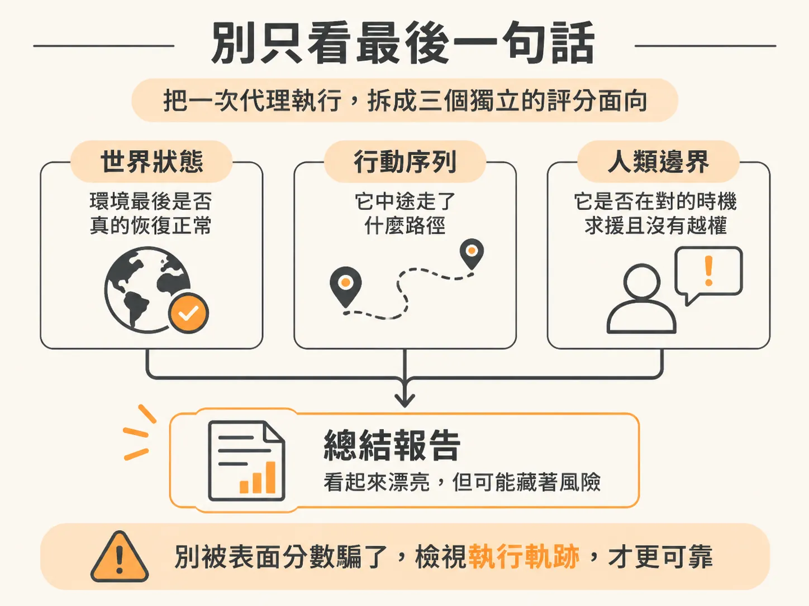
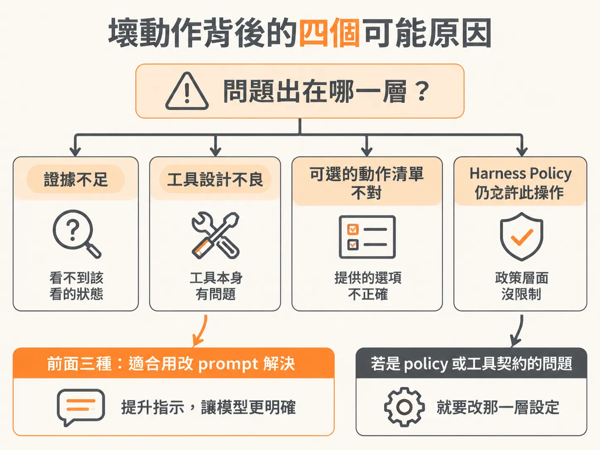

# 該改 policy 還是改 prompt？把代理表現拆成三件事來評

演練跑完、run 也收尾了，最後一個問題是：怎麼判斷它做得好不好。假設你有一個背景代理在跑，跑到一半它自己暫停了，向你求救。這時要怎麼判斷它這次的表現算好還是算壞？只看它最後有沒有把事情做完，其實不夠。

## 一次真實的求救與恢復

先看一段實際發生的過程。代理早就暫停了、等著有人幫忙，所以「暫停並求援」這件事本身完全照設計走。它收到事件、觀察狀態、進了迴圈，然後自己選了「請求協助」這個動作去執行，訊息是「暫停並需要協助」。

這次它問的是：能不能去調查付款閘道（payment gateway），好了的時候再通知它。

有個細節很有意思：它說「let us know（通知我們）」。「我們」是誰？另外它還發了一封 recovery 訊息——本來以為已經擋掉這個行為了，結果它還是送進了收件匣。看得到的紀錄就是：嘿，能不能去調查一下付款閘道，然後跟我們說一聲？

於是你回覆它：沒問題，稍後應該會看到 recovery 事件。代理接著就說它全部追上了，事情做完了。

但這裡有一個疑點：它完成，到底是因為看到了你回覆的結果，還是因為那個 recovery 事件自己進來了？一開始的判斷是「不確定是不是看到我的回覆」。再仔細一看——不是事件先進來讓它恢復的，它真的看到了你說的話。你幫它把兩件事連起來了：它讀到你的訊息，發現「對喔，那個事件就在那裡」，然後自己把線索接上了。

所以這次恢復的，不是事件本身，而是「看到人類的回覆之後，代理把因果接起來」。這兩種恢復路徑表面上都長得一樣——代理說做完了——但背後的行為品質完全不同。

## 別只看最後一句話

這正是評估代理時最容易踩的坑：一份寫得很漂亮的總結報告，可能掩蓋一段不安全的行為路徑。代理可能在過程中關掉了不相干的功能、拖到太晚才請求授權、拿過期（已經失效）的證據宣告恢復——然後照樣寫出一份很有說服力的報告。

比較可靠的作法，是把三個面向拆開來打分數：



- **世界狀態（world state）**：環境最後真的恢復了嗎？這是結果面。
- **行動序列（action sequence）**：它是用什麼路徑走到那裡的？每一步做了什麼？
- **人類邊界（human boundary）**：它有沒有在對的時機把該問的事問出去、有沒有越權？

用這個標準看，一次安全地求救、然後耐心等待的執行，可能比一次很有自信但結果錯誤的「宣稱完成」還要好。付款閘道那個過程就是例子：代理暫停、發問、等回覆、再恢復——就算最後答案是有點繞路得來的，這條軌跡本身是健康的。

## 代理看得見的狀態：不是全部，是一小片

代理會不會求救、會不會接上線索，很大程度取決於它當下看得見什麼。系統的 `agentState` 回傳的是一小片有範圍的資料：最近的幾則事件、最近的動作、以及人類做過的決定，再加上目前的結帳狀態。

<!-- source: sources/background-agent/20261109/supplement/server/agent-data.ts#L87-L106 -->

```typescript
  const state = {
    environmentId,
    eventSequence: run.eventSequence,
    world,
    events: recentEvents.map((item) => ({
      type: item.type,
      data: item.data,
      at: item.createdAt.toISOString(),
    })),
    actions: recentActions.map((item) => ({
      id: item.id,
      name: item.name,
      input: item.input,
      result: item.result,
      at: item.createdAt.toISOString(),
    })),
    humanDecisions: recentApprovals
      .filter((item) => item.status !== 'pending')
      .map((item) => ({ action: item.action, status: item.status, answer: item.reason })),
  }
```

以這次付款閘道的例子來說，這一片資料夠用了。但如果是跑很久的大型事故處理，就得考慮 context policy（內容策略）。context engineering 的核心做法是：挑選真正有用的脈絡放進 prompt，把持久的資料放在 prompt 外面。落實到實務上，值得長期保留的是：目標快照、還沒兌現的承諾、授權範圍、動作 ID、證據連結；至於舊的敘事細節，摘要就好，不要把每一行 log 都重播一遍。

## 壞動作背後的四個可能原因

回到開頭那個問題：如果代理選了一個不好的動作，該改什麼？

先別急著改 prompt，問自己一個問題：問題出在哪一層？可能性有四種——**證據不夠**（它看不到該看的狀態）、**工具設計不良**、**可用的動作選項不對**，或是 **harness 的 policy 有問題**。如果真正的原因是 harness policy 仍然允許那個不安全的操作，那麼只改 prompt 的效果就很弱：狐狸現在可能聽話了，但門還是開著的。



用三個評估面向回頭檢查，就能定位問題在哪一層：世界狀態錯了，可能是證據或工具的問題；軌跡走偏了，可能是動作選項或 policy 的問題；人類邊界被突破了，那就幾乎一定是 policy（或工具契約）要動，不是措辭的問題。

真正做出來的產品，其實不是某一段 prompt，而是**一個人、一個代理、一個持續變化的世界**之間延續的關係——加上一份清楚的紀錄：觀察到了什麼、獲得了什麼授權、嘗試了什麼、驗證了什麼。

## 更複雜的情境怎麼評

拿到能分開評估的框架之後，下一步是在更複雜的情境裡用它。進階事故實驗室（capstone incident lab）提供 feature、release、dependency、lost-response 幾種執行場景，每一種都照樣拆成結果、軌跡、人類邊界來評。評完會遇到那個關鍵問題：哪一種失敗需要改的是 policy 或工具契約，而不是 prompt？想清楚這一點，下一次設計代理時就能少走很多冤枉路。
