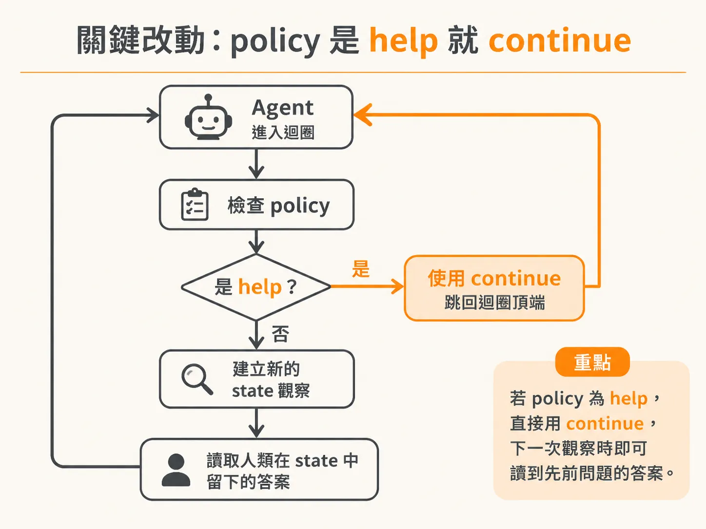
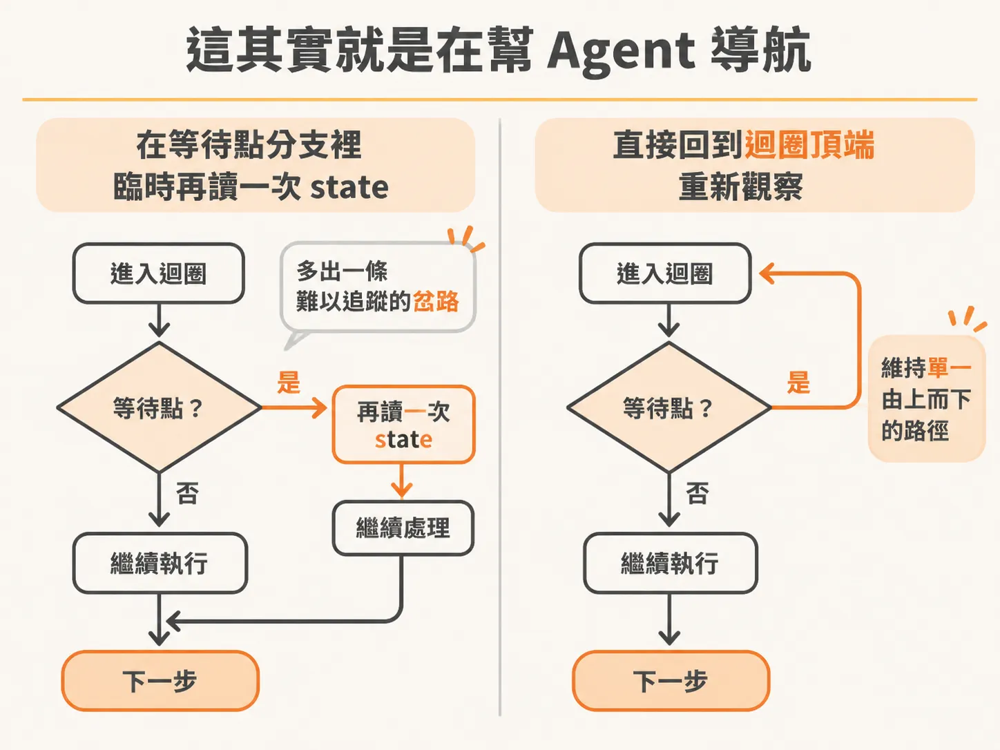
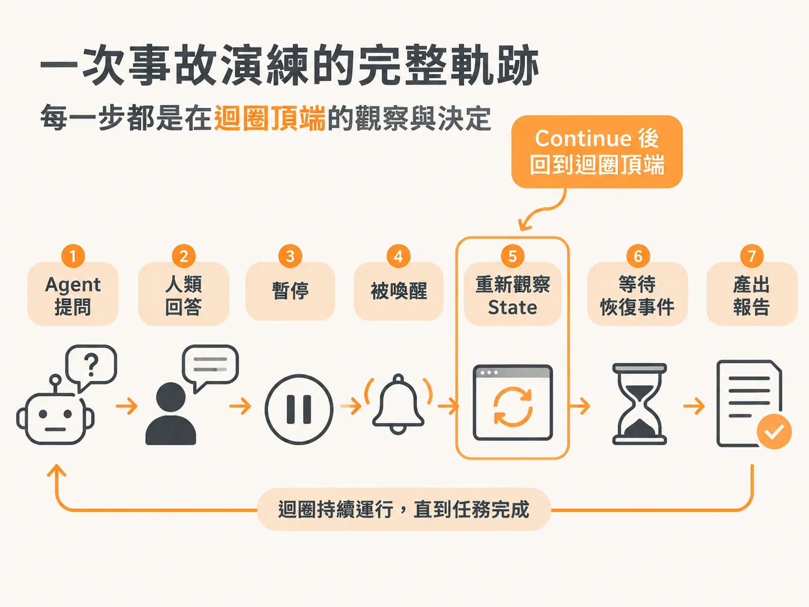

# 用 continue 回到迴圈頂端，讓 agent 重新看一次 state

兩條路併進同一個分支了，還有一個地方沒收乾淨：答案回來之後，agent 要怎麼「看到」它。背景 agent 走到「需要人類幫忙」這一步時，會把問題丟進收件匣，然後暫停等人回答。真正的麻煩在答案回來之後：agent 要怎麼「看到」這個答案？

直覺的做法是，在等待的地方補一段程式，直接再讀一次 state。但這樣做會讓流程開始分岔。更簡單的做法是什麼都不用補，只要一行 `continue`，讓程式回到迴圈最上方，重新做一次完整的觀察。

## 先複習一下現有的結構

整個 agent 的邏輯是 top-down 的：從迴圈頂端開始，讀取 state、觀察環境、決定下一步。讀取 state 的函式在設計時就已經把所有該看的東西包進去了——包括最近的事件、最近的動作，還有「你曾經問過的問題以及它們的答案」。這部分已經被抽象好：資料庫裡有 proposals、你問過的問題，當人類從收件匣回答之後，資料會在 agent 之外被更新進去。

也就是說，只要 agent 重新讀一次 state，它自然會看到：「喔，我之前發過一個問題，現在有人回答了。」我們要做的，只是逼它現在就去做這件事。

## 關鍵改動：policy 是 help 就 continue

在原本的流程裡，等待人類回應用的 resume event 是共用的。不管是「請求批准」還是「請求協助」，用的都是同一個事件，不用為 help 另外做一個新事件。這帶來一個好處：help 這種情況不會產生 proposal（提案），所以原本處理 proposal 的那段邏輯不用擔心，直接照舊運作即可。

唯一的改動是：在建立 fresh state observation（全新的狀態觀察）之前，先檢查 policy 是不是 `help`。如果是，就 `continue`。



<!-- source: sources/background-agent/20261109/supplement/server/agent-workflow.ts#L158-L185 -->

```typescript
        let proposal = await step.run(`read-human-${cycle}`, () => getProposal(proposalId))
        let check = 0
        while (proposal.status === 'pending') {
          check++
          await step.waitForEvent(`wait-for-human-${cycle}-${check}`, {
            event: 'agent/approval.decided',
            if: `async.data.proposalId == "${proposalId}"`,
            timeout: '10s',
          })
          proposal = await step.run(`reconcile-human-${cycle}-${check}`, () =>
            getProposal(proposalId),
          )
        }
        if (proposal.status !== 'approved') {
          await step.run(`stop-after-human-${cycle}`, () =>
            setRun(runId, 'escalated', `Human decision: ${proposal.status}`),
          )
          return
        }
        if (policy === 'help') continue
...
      }
```

看到最後那一行 `if (policy === 'help') continue` 了嗎？它跳過後面所有事，直接回到迴圈最頂端重新開始。對 agent 來說，這就是「再想一次」。但這一次再想，它會在 state 裡看到它需要的答案——因為讀 state 的函式本來就會連同問題的答案一起拿到。我們不需要它去看別的什麼，只要它看到答案就好。

所以每次寫 `continue`，都可以這樣理解：我在強迫 agent 從頭開始、重新思考，因為我改變了某些東西，我要它去看那個改變。在這個情境裡，改變的東西就是：當它去讀 state 時，會看到它之前問的問題已經有了答案。

## 這其實就是在「導航」agent

<!-- source: sources/background-agent/20261109/supplement/server/agent-data.ts#L63-L110 -->

```typescript
export async function agentState(environmentId: string, runId: string) {
  const [world, run, recentEvents, recentActions, recentApprovals] = await Promise.all([
...
  const state = {
    environmentId,
    eventSequence: run.eventSequence,
    world,
    events: recentEvents.map((item) => ({
      type: item.type,
      data: item.data,
      at: item.createdAt.toISOString(),
    })),
    actions: recentActions.map((item) => ({
      id: item.id,
      name: item.name,
      input: item.input,
      result: item.result,
      at: item.createdAt.toISOString(),
    })),
    humanDecisions: recentApprovals
      .filter((item) => item.status !== 'pending')
      .map((item) => ({ action: item.action, status: item.status, answer: item.reason })),
  }
```

從上面的程式可以看到，讀取 state 的時候會把 `humanDecisions`（人類的決定與答案）一併整理進來。所以我們不是在分支裡偷偷塞答案給 agent，而是讓它透過正常管道——重新觀察——自己看到答案。這基本上就是在 steering（導航）agent。

有人可能會問：為什麼不乾脆在這個位置直接再讀一次 state？



這就像在寫 React 時，你不強制 re-render，反而想透過一個 conditional 分支去處理某個特定狀態。實際上直接強制 re-render 讓整個 UI 更新，比針對某一小塊強制更新簡單太多。反正這個函式本來就近乎 stateless——一旦重新 render，它就會看到新的東西、自己更新。這樣做更簡單、也更純粹。

一旦開始分岔——「不如我們在下面這裡也做一次 observe 吧，在這裡讀一下 state」——複雜度就會失控。那樣做之後一定會難以追蹤。所有邏輯都是基於從頂端往下走的單一路徑，別破壞它。

## 實際演練會長什麼樣子

在一次事故演練中，這個流程完整的樣子是：

人類從收件匣裡回答問題，同一個 run 續跑。`continue` 把流程帶回頂端，agent 做一次全新的觀察。如果 checkout 服務還是處於降級狀態，agent 會繼續等服務的恢復事件；只有在新的一次觀察裡看到服務恢復健康，它才會完成後續動作。

在 Activity feed 上，你應該能看到完整的軌跡：問題、答案、暫停、喚醒、最後的報告。每一個環節都是 agent 在迴圈頂端做出的一次觀察與決定，而不是在某個分支裡臨時補出來的判斷。



## 這個原則

遇到「agent 等了外部輸入，現在輸入來了」的情況，不要在等待點下面插入一次額外的 state 讀取。改動造成的新資訊（問題的答案、服務的恢復事件），本來就會在下次讀 state 時被看到。你要做的只有一件事：`continue`，讓它回到迴圈頂端，重新想一次。
